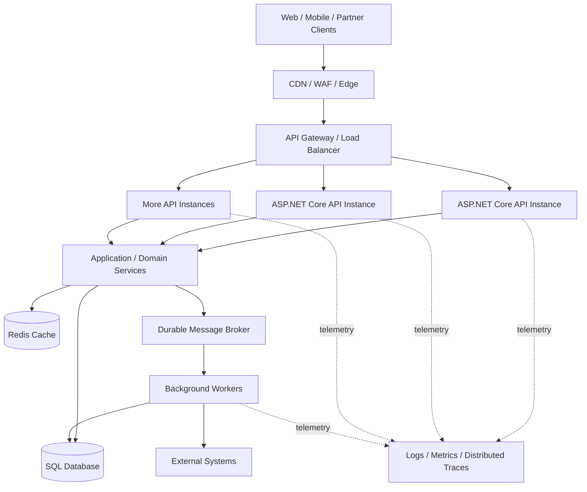

# High-Traffic .NET API — Architectural Blueprint

> A practical reference architecture for senior .NET developers and architects. This document focuses on decisions, trade-offs, capacity planning, and operational safeguards—not on adding infrastructure without a measured need.

## 1. Goals and assumptions

Define targets before selecting technologies:

- **Traffic:** average and peak requests per second (RPS), burst duration, and concurrent connections.
- **Latency:** p50, p95, and p99 targets per endpoint.
- **Availability:** service-level objective (SLO), recovery time objective (RTO), and recovery point objective (RPO).
- **Workload:** read/write ratio, payload sizes, CPU-heavy operations, database calls, and external dependencies.
- **Consistency:** which operations require immediate consistency and which can be eventually consistent.
- **Security and compliance:** identity, authorization, audit, data residency, and retention requirements.

Do not promise a fixed request capacity based on the framework alone. Capacity must be established by load testing the complete system with realistic data and dependencies.

## 2. Reference architecture

**Request path:** client → edge protection → gateway/load balancer → Kestrel-hosted ASP.NET Core instance → middleware and endpoint → application/domain logic → cache, database, or message broker → response.

Not every deployment needs every box. For a moderate system, a managed ingress or load balancer plus a few API instances and SQL may be sufficient. Add a gateway, Redis, workers, or multi-region deployment when requirements justify the operational cost.

## 3. Hosting and request lifecycle

### IIS and Kestrel

- **Kestrel** is ASP.NET Core's cross-platform HTTP server.
- **IIS** can act as a reverse proxy and process manager for ASP.NET Core on Windows. In the common out-of-process hosting model, IIS/HTTP.sys receives the external request and ASP.NET Core Module forwards it to the app running on Kestrel.
- **Containers and Linux** commonly expose Kestrel behind an ingress, load balancer, or reverse proxy. A separate NGINX layer is optional, not automatically required.
- Each proxy hop can add buffering, TLS work, queueing, connection limits, and another place to configure timeouts and request-size limits.

Keep the request pipeline short and predictable. Apply routing, authentication, authorization, validation, rate limits, and telemetry deliberately. Order middleware according to its documented requirements.

### Async I/O and the ThreadPool

`async`/`await` allows a request to release its worker thread while awaiting asynchronous I/O. It does **not** make CPU-bound work faster and does not eliminate limits imposed by SQL, remote services, memory, or sockets.

Avoid `.Result`, `.Wait()`, synchronous database/network calls, unbounded parallel work, and fire-and-forget tasks inside request handlers. Use bounded background queues or a durable broker for work that must outlive the request.

## 4. Application design

### Suggested layering

- **API layer:** HTTP contracts, authentication/authorization, validation, status codes, and API versioning.
- **Application layer:** use-case orchestration, transactions, and coordination of dependencies.
- **Domain layer:** business rules and invariants.
- **Infrastructure layer:** EF Core/Dapper, external clients, cache, messaging, and storage.

Keep controllers/endpoints thin, but avoid creating abstractions that add no value. Use dependency injection lifetimes correctly: `DbContext` is normally scoped; singleton services must be thread-safe and must not capture scoped dependencies.

### Data access

- Use **EF Core** for maintainable transactional application code; use projections and `AsNoTracking()` for read-only queries where appropriate.
- Consider **Dapper or SQL** for measured hot paths where it offers a meaningful benefit.
- Inspect generated SQL and execution plans. Fix N+1 queries, missing/ineffective indexes, excessive round trips, large result sets, and unnecessary materialization.
- Paginate large collections. Prefer keyset pagination for deep, frequently accessed pages when the ordering supports it.
- Use optimistic concurrency or appropriate database locking for conflicting updates.
- Do not run multiple parallel operations on one EF Core `DbContext`; it is not thread-safe.
- Keep transactions short. Do not hold a database transaction open while waiting on a remote API.

## 5. Database connection and concurrency planning

ADO.NET connection pooling reuses physical connections, but each application process/connection-string pool has a finite maximum. The default maximum for `Microsoft.Data.SqlClient` is commonly 100 connections per pool; verify the actual provider, connection string, and configuration.

A key scaling trap: **pool limits multiply across application instances**. For example, 10 instances each configured for a maximum pool size of 100 could collectively request up to 1,000 pooled connections for that pool. That does not mean the database can efficiently serve 1,000 simultaneous queries.

Plan from the database's measured capacity:

1. Measure query latency, CPU, I/O, locks, waits, and queries per second.
2. Set sensible per-instance concurrency limits for database-bound work.
3. Size app replicas and connection pools together with the DB connection budget.
4. Optimize queries and reduce unnecessary DB calls before increasing pool limits.
5. Use replicas for suitable read workloads only when replication lag and consistency requirements allow it.
6. Consider partitioning/sharding only when simpler approaches no longer meet the requirements.

## 6. Caching strategy

Use caching for data that is read often and can tolerate a defined staleness window.

- **CDN/edge cache:** public, cacheable responses and static assets.
- **In-process cache:** very hot, instance-local data; each replica has its own copy.
- **Redis/distributed cache:** shared cache across replicas, distributed counters, or other explicitly designed shared state.

Choose cache keys, TTLs, invalidation rules, and ownership carefully. Protect against cache stampedes with request coalescing, jittered TTLs, or controlled refresh. Do not cache authorization-sensitive data under keys that omit tenant/user context. A cache is not the source of truth unless the design explicitly makes it so.

## 7. Background work and messaging

Move slow, retryable, or non-interactive work—report generation, email, document processing, bulk imports, and integrations—out of the synchronous HTTP path when the client does not need the result immediately.

- Return `202 Accepted` plus a status/resource URL when work is accepted for later processing.
- Use a durable broker such as Azure Service Bus, RabbitMQ, or Kafka according to delivery, ordering, replay, and throughput needs.
- Make consumers idempotent; retries can deliver a message more than once.
- Use an outbox pattern when a database update and event publication must not silently diverge.
- Apply bounded concurrency, retry limits, dead-letter handling, and queue-age alerts.
- Use an in-memory `Channel<T>` only when losing queued work on process failure is acceptable or durability is handled elsewhere.

## 8. Resilience and overload protection

- **Timeouts:** define a total request budget and shorter downstream budgets; avoid requests waiting indefinitely.
- **Retries:** retry only transient failures and safe/idempotent operations. Use bounded exponential backoff with jitter; retries can amplify an outage.
- **Circuit breakers:** stop repeatedly calling an unhealthy dependency.
- **Bulkheads:** cap concurrent work per downstream dependency so one slow system cannot consume all capacity.
- **Rate limiting:** apply per-client/tenant/user limits where appropriate, with explicit `429` behavior.
- **Backpressure:** reject or defer work when queues, DB capacity, or worker capacity are saturated.
- **Cancellation:** propagate `HttpContext.RequestAborted` where appropriate and ensure downstream work respects cancellation.
- **Idempotency keys:** support safe retries for operations such as payments or order creation where duplicate submissions are harmful.

Use a resilience library such as Polly or the .NET resilience APIs available in your target framework, and verify the exact APIs for that framework version.

## 9. Security

- Use OAuth 2.0 / OpenID Connect with validated tokens; enforce authorization at the endpoint/resource level, not only at the gateway.
- Apply least privilege to database identities, managed identities, secrets, and service-to-service access.
- Store secrets in a managed secret store; rotate them and avoid logging them.
- Validate inputs and payload sizes; use parameterized queries.
- Configure CORS narrowly; CORS is not an authorization mechanism.
- Use TLS externally and consider mTLS or workload identity for sensitive service-to-service paths.
- Apply WAF rules, request-rate controls, audit logging, dependency scanning, and secure deployment practices.
- For multi-tenant systems, enforce tenant isolation in authorization and data access; never rely on a client-supplied tenant ID alone.

## 10. Observability and SLOs

Collect three complementary signals:

- **Metrics:** request rate, error rate, p50/p95/p99 latency, CPU, memory, GC pauses, ThreadPool queueing, active requests, connection-pool waits, DB waits, cache hit ratio, and queue age/depth.
- **Traces:** distributed traces across gateway, API, SQL, cache, broker, and downstream calls, with propagated trace context.
- **Logs:** structured logs with correlation/trace IDs and useful business context, while excluding credentials, tokens, and sensitive data.

Use OpenTelemetry where practical and export to a platform such as Azure Application Insights or another compatible backend. Alert on user-visible SLOs and saturation indicators, not just CPU. Sample traces carefully at high volume while retaining errors and slow requests.

## 11. Capacity planning

### Little's Law

A useful approximation is:

\[
\text{In-flight requests} \approx \text{throughput (requests/s)} \times \text{average latency (seconds)}
\]

Example: 2,000 requests/s at 0.15 seconds average latency implies about 300 in-flight requests. This estimates in-flight work; it does **not** mean 300 worker threads are required.

### Estimate instance count

1. Load-test one instance with realistic traffic and data.
2. Find the throughput at which latency or errors begin to violate the SLO.
3. Choose a sustainable operating point below saturation, with headroom for bursts and failures.
4. Estimate replicas from peak demand and sustainable per-instance throughput, then add redundancy and autoscaling limits.
5. Repeat tests with the database and dependencies under realistic load; an API-only benchmark is insufficient.

Test steady load, bursts, soak duration, cold start, failover, and dependency degradation. Track p95/p99, not just average latency.

## 12. Deployment and scaling

- Run stateless API replicas behind a health-checking load balancer.
- Use readiness checks to keep unready instances out of rotation and liveness checks only for conditions that truly require restart.
- Configure autoscaling using relevant signals such as CPU, request concurrency, and queue depth; scale-out cannot instantly solve a saturated database.
- Use blue/green or canary releases, feature flags, rollback plans, and backward-compatible database migrations.
- Use infrastructure as code (Bicep/Terraform) and immutable, scanned container images.
- For multi-region designs, explicitly define routing, data replication, write ownership, failover, RTO/RPO, and how split-brain or regional recovery is handled. Multi-region active-active writes are not a default requirement.

## 13. Common symptoms and diagnostic order

| Symptom | Likely causes | First checks |
|---|---|---|
| High latency, normal CPU | Slow SQL, remote calls, lock waits, connection-pool wait | Distributed traces, SQL waits, dependency timings |
| High CPU | Expensive serialization, algorithms, excessive allocations, compression, logging | CPU profile, hot paths, allocation profile |
| Growing request latency under load | ThreadPool starvation, queueing, dependency saturation | ThreadPool counters, blocking calls, active requests, downstream saturation |
| SQL timeouts | Slow queries, blocking, exhausted pool, DB capacity | Query plans, waits, pool metrics, DB CPU/I/O |
| Memory climbs over time | Retained references, unbounded cache/queues, large objects | Heap dump, GC counters, cache and queue bounds |
| Retry storm | Aggressive retries and cascading failure | Retry counts, timeout budgets, circuit breakers |
| Queue age grows | Consumers too slow, downstream bottleneck, insufficient bounded capacity | Consumer throughput, oldest-message age, dead-letter rate |

Diagnose with telemetry and profiling before changing thread counts, queue lengths, pool sizes, or server limits. Raising a limit can move the queue downstream and make the outage worse.

## 14. Practical reference stack on Azure

A common Azure implementation could use:

- **Azure Front Door + WAF** for global edge entry and protection, where global routing/caching is needed.
- **Azure API Management** when centralized API policies, product subscriptions, quotas, or developer portal features are required.
- **Azure Container Apps or AKS** for ASP.NET Core API and separate worker deployments, chosen according to orchestration and operational needs.
- **Azure SQL Database** for transactional relational data; use appropriate tiering and replicas based on measured workload.
- **Azure Cache for Redis** where shared low-latency caching is justified.
- **Azure Service Bus** for command/task queues and reliable business messaging; **Event Hubs** or Kafka-compatible infrastructure for high-throughput event streams.
- **Managed Identity + Key Vault** for identity-based access and secret management.
- **Application Insights + OpenTelemetry** for application telemetry.

These are options, not mandatory components. Start with the simplest topology that meets the SLO and expand only when measurements show the need.

## 15. Interview-ready explanation

> “I start by defining traffic, latency, availability, consistency, and recovery targets. I keep ASP.NET Core APIs stateless behind a load balancer, use Kestrel, and keep the synchronous request path short. I measure end-to-end latency with distributed tracing and profile before tuning. For database-bound endpoints, I optimize query shape and indexes, control concurrency, and budget connection pools across all replicas. I use caching for suitable read-heavy data and a durable queue for work that does not need to finish before the HTTP response. Timeouts, bounded retries, circuit breakers, rate limits, and idempotency prevent one dependency from cascading across the system. Finally, I load-test realistic workloads and scale based on SLOs and measured bottlenecks rather than claiming a fixed number of concurrent requests.”

## 16. Implementation checklist

- [ ] Define per-endpoint latency and error-rate SLOs.
- [ ] Add structured logs, metrics, and distributed tracing.
- [ ] Review middleware, blocking calls, and cancellation propagation.
- [ ] Profile the slowest endpoints and database queries.
- [ ] Set timeouts and bounded concurrency for every dependency.
- [ ] Calculate aggregate SQL connection budgets across all replicas.
- [ ] Add caching only with explicit TTL and invalidation behavior.
- [ ] Move suitable long-running work to durable background processing.
- [ ] Add rate limits, idempotency, and overload behavior.
- [ ] Load-test steady, burst, soak, and failure scenarios.
- [ ] Validate health probes, deployment rollback, backup, and restore procedures.
- [ ] Revisit architecture after production telemetry identifies the next bottleneck.
