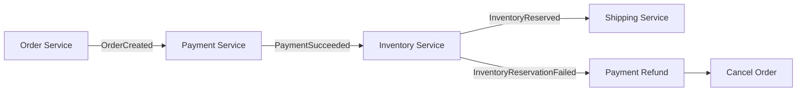
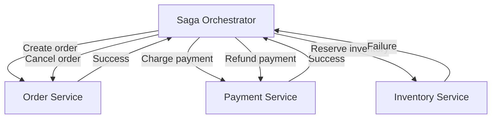

# Saga Pattern in .NET: Choreography vs. Orchestration

## 1. What is the Saga Pattern?

The **Saga Pattern** coordinates a business transaction that spans multiple services, each with its own local transaction and usually its own database.

A traditional database transaction can provide ACID guarantees within one database. Across independently deployed services, a single ACID transaction is usually impractical. A saga instead runs a sequence of local transactions and uses **compensating actions** to address failures.

For example, an order workflow might:

1. Create an order.
2. Charge the customer.
3. Reserve inventory.
4. Arrange shipping.

If inventory cannot be reserved after payment succeeds, the workflow may refund the payment and cancel the order.

> Compensation is a new business action, not a literal rollback. For example, a refund does not erase the original payment record.

## 2. The two coordination styles

### Choreography: services react to events

There is no central workflow coordinator. Each service publishes an event after completing its local work, and other services react to that event.

**Typical flow**

1. The Order Service creates an order and publishes `OrderCreated`.
2. The Payment Service consumes the event, charges the customer, and publishes `PaymentSucceeded`.
3. The Inventory Service consumes that event and reserves stock.
4. If stock cannot be reserved, the workflow publishes a failure event; the relevant services perform compensating actions.

**Advantages**
- No dedicated central coordinator.
- Services can react independently to domain events.
- Can suit event-driven workflows with a small number of steps.

**Trade-offs**
- The overall workflow is spread across services, making it harder to understand and debug as steps grow.
- Event dependencies and failure paths can become difficult to track.
- Requires reliable messaging, idempotent handlers, and good tracing.

### Orchestration: a coordinator directs the workflow

A dedicated **saga orchestrator** tracks the workflow and tells each service which action to perform. Services execute their local transactions and return results; the orchestrator decides the next step.

**Typical flow**

1. The orchestrator requests order creation.
2. After success, it requests payment.
3. It then requests inventory reservation.
4. If reservation fails, it initiates a refund and cancels the order.

**Advantages**
- The workflow and compensation rules are visible in one place.
- Easier to inspect workflow status and reason about the next action.
- Often a good fit for long-running workflows with several conditional steps.

**Trade-offs**
- The orchestrator is another component to build, operate, and monitor.
- It can become overly complex if it contains business logic that belongs in services.
- It must be resilient: persist workflow state and support recovery after restarts. A properly designed orchestrator is not inherently a single point of failure.

## 3. Comparison

| Concern | Choreography | Orchestration |
|---|---|---|
| Workflow control | Distributed across event handlers | Central coordinator |
| Communication style | Primarily events | Commands and results; events may also be used |
| Visibility | Requires tracing events across services | Workflow state is easier to inspect centrally |
| Complexity as steps grow | Event relationships can become difficult to follow | Coordinator workflow can grow in complexity |
| Best fit | Short, event-driven workflows with limited branching | Multi-step workflows with explicit sequencing and compensation |

Neither approach automatically guarantees consistency, scalability, or fault tolerance. Those depend on implementation and operational design.

## 4. Essential reliability practices

Whichever style you choose:

- **Persist progress:** store saga state so a process restart does not lose the workflow.
- **Make handlers idempotent:** processing the same command or event twice should not duplicate a charge, reservation, or other business effect.
- **Use reliable message publishing:** consider the **Transactional Outbox** pattern to avoid committing database changes while losing the corresponding event.
- **Handle retries and timeouts:** retry transient failures with limits and backoff; distinguish transient failures from business failures.
- **Define compensations:** document what happens after each step fails and what to do if compensation itself fails.
- **Expect at-least-once delivery:** duplicates and delayed messages are normal possibilities in distributed messaging.
- **Observe the workflow:** include a correlation/saga ID in logs and traces, and expose statuses such as `Pending`, `Completed`, `Compensating`, and `Failed`.
- **Design for eventual consistency:** other services may temporarily observe intermediate states while the saga is running.

## 5. Implementing sagas in .NET

For a .NET microservices solution, a practical stack might include:

- **ASP.NET Core** for service APIs.
- **RabbitMQ, Azure Service Bus, or Kafka** for messaging, chosen according to the required delivery and routing semantics.
- A durable saga/workflow implementation that persists state and can resume after failure.
- **OpenTelemetry** for distributed tracing and observability.

Libraries such as **MassTransit** support saga state machines and message-driven workflows. Check the current documentation and version-specific features before choosing a library.

### Important distinction: MediatR is not a distributed saga engine

MediatR can dispatch commands and notifications **inside an application process**. Calling several handlers sequentially through MediatR does not, by itself, provide durable workflow state, cross-service messaging, recovery after process failure, or distributed compensation. It may help structure application code, but additional infrastructure is required for a production distributed saga.

## 6. How to choose

Prefer **choreography** when the workflow is relatively simple and services can react naturally to domain events without a complicated global decision tree.

Prefer **orchestration** when the business process has many steps, conditional paths, deadlines, compensation rules, or a need to query workflow status centrally.

For a typical order/payment/inventory workflow in an enterprise .NET system, orchestration is often easier to operate and explain. This is a starting point, not a universal rule: choose based on the workflow, team expertise, operational needs, and failure model.

## 7. Architecture review checklist

Before releasing a saga, confirm:

- [ ] Every step has a defined success and failure outcome.
- [ ] Each side effect is idempotent or protected against duplicate execution.
- [ ] Saga state and message publication are durable.
- [ ] Timeouts, retries, and poison messages have defined handling.
- [ ] Compensation actions and compensation failures are handled.
- [ ] Operators can find a saga by its correlation ID and inspect its current state.
- [ ] Tests cover duplicate messages, delayed messages, service outages, and process restarts.

## Further reading

- [Microsoft: Cloud design patterns](https://learn.microsoft.com/en-us/azure/architecture/patterns/)
- [MassTransit documentation](https://masstransit.io/documentation/)
- [OpenTelemetry for .NET](https://opentelemetry.io/docs/languages/dotnet/)
