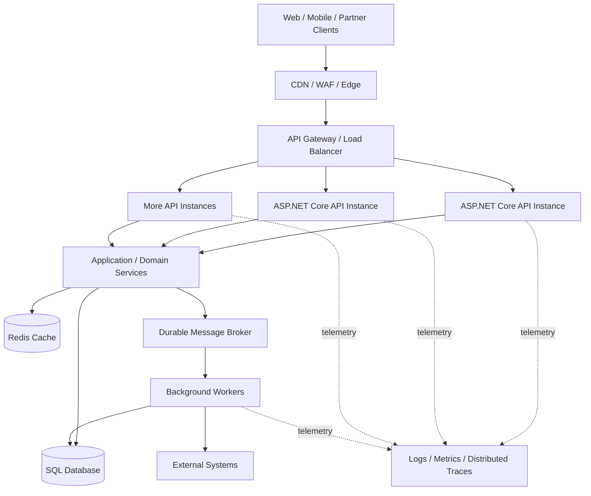
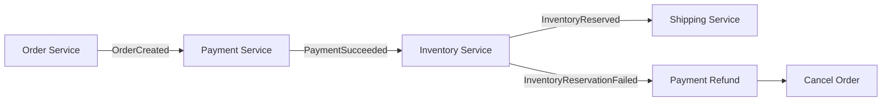
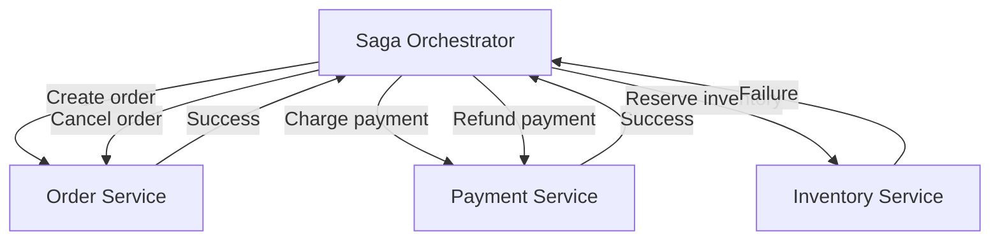

# System Design and Distributed Systems

This guide combines the distinct source materials below. Original explanations, examples, and interview questions are retained; exact duplicate source files are excluded and documented in the library index.

## Included source materials

- [high-traffic-dotnet-api-blueprint.md](#high-traffic-dotnet-api-blueprint-md)
- [saga-pattern-dotnet.md](#saga-pattern-dotnet-md)
- [async-messaging-dotnet-viva-guide.md](#async-messaging-dotnet-viva-guide-md)
- [senior_dotnet_async_locking_distributed_guide.md](#senior-dotnet-async-locking-distributed-guide-md)
---

<a id="high-traffic-dotnet-api-blueprint-md"></a>

## Source: High-Traffic .NET API — Architectural Blueprint

*Imported from `high-traffic-dotnet-api-blueprint.md`.*

### High-Traffic .NET API — Architectural Blueprint

> A practical reference architecture for senior .NET developers and architects. This document focuses on decisions, trade-offs, capacity planning, and operational safeguards—not on adding infrastructure without a measured need.

#### 1. Goals and assumptions

Define targets before selecting technologies:

- **Traffic:** average and peak requests per second (RPS), burst duration, and concurrent connections.
- **Latency:** p50, p95, and p99 targets per endpoint.
- **Availability:** service-level objective (SLO), recovery time objective (RTO), and recovery point objective (RPO).
- **Workload:** read/write ratio, payload sizes, CPU-heavy operations, database calls, and external dependencies.
- **Consistency:** which operations require immediate consistency and which can be eventually consistent.
- **Security and compliance:** identity, authorization, audit, data residency, and retention requirements.

Do not promise a fixed request capacity based on the framework alone. Capacity must be established by load testing the complete system with realistic data and dependencies.

#### 2. Reference architecture



**Request path:** client → edge protection → gateway/load balancer → Kestrel-hosted ASP.NET Core instance → middleware and endpoint → application/domain logic → cache, database, or message broker → response.

Not every deployment needs every box. For a moderate system, a managed ingress or load balancer plus a few API instances and SQL may be sufficient. Add a gateway, Redis, workers, or multi-region deployment when requirements justify the operational cost.

#### 3. Hosting and request lifecycle

##### IIS and Kestrel

- **Kestrel** is ASP.NET Core's cross-platform HTTP server.
- **IIS** can act as a reverse proxy and process manager for ASP.NET Core on Windows. In the common out-of-process hosting model, IIS/HTTP.sys receives the external request and ASP.NET Core Module forwards it to the app running on Kestrel.
- **Containers and Linux** commonly expose Kestrel behind an ingress, load balancer, or reverse proxy. A separate NGINX layer is optional, not automatically required.
- Each proxy hop can add buffering, TLS work, queueing, connection limits, and another place to configure timeouts and request-size limits.

Keep the request pipeline short and predictable. Apply routing, authentication, authorization, validation, rate limits, and telemetry deliberately. Order middleware according to its documented requirements.

##### Async I/O and the ThreadPool

`async`/`await` allows a request to release its worker thread while awaiting asynchronous I/O. It does **not** make CPU-bound work faster and does not eliminate limits imposed by SQL, remote services, memory, or sockets.

Avoid `.Result`, `.Wait()`, synchronous database/network calls, unbounded parallel work, and fire-and-forget tasks inside request handlers. Use bounded background queues or a durable broker for work that must outlive the request.

#### 4. Application design

##### Suggested layering

- **API layer:** HTTP contracts, authentication/authorization, validation, status codes, and API versioning.
- **Application layer:** use-case orchestration, transactions, and coordination of dependencies.
- **Domain layer:** business rules and invariants.
- **Infrastructure layer:** EF Core/Dapper, external clients, cache, messaging, and storage.

Keep controllers/endpoints thin, but avoid creating abstractions that add no value. Use dependency injection lifetimes correctly: `DbContext` is normally scoped; singleton services must be thread-safe and must not capture scoped dependencies.

##### Data access

- Use **EF Core** for maintainable transactional application code; use projections and `AsNoTracking()` for read-only queries where appropriate.
- Consider **Dapper or SQL** for measured hot paths where it offers a meaningful benefit.
- Inspect generated SQL and execution plans. Fix N+1 queries, missing/ineffective indexes, excessive round trips, large result sets, and unnecessary materialization.
- Paginate large collections. Prefer keyset pagination for deep, frequently accessed pages when the ordering supports it.
- Use optimistic concurrency or appropriate database locking for conflicting updates.
- Do not run multiple parallel operations on one EF Core `DbContext`; it is not thread-safe.
- Keep transactions short. Do not hold a database transaction open while waiting on a remote API.

#### 5. Database connection and concurrency planning

ADO.NET connection pooling reuses physical connections, but each application process/connection-string pool has a finite maximum. The default maximum for `Microsoft.Data.SqlClient` is commonly 100 connections per pool; verify the actual provider, connection string, and configuration.

A key scaling trap: **pool limits multiply across application instances**. For example, 10 instances each configured for a maximum pool size of 100 could collectively request up to 1,000 pooled connections for that pool. That does not mean the database can efficiently serve 1,000 simultaneous queries.

Plan from the database's measured capacity:

1. Measure query latency, CPU, I/O, locks, waits, and queries per second.
2. Set sensible per-instance concurrency limits for database-bound work.
3. Size app replicas and connection pools together with the DB connection budget.
4. Optimize queries and reduce unnecessary DB calls before increasing pool limits.
5. Use replicas for suitable read workloads only when replication lag and consistency requirements allow it.
6. Consider partitioning/sharding only when simpler approaches no longer meet the requirements.

#### 6. Caching strategy

Use caching for data that is read often and can tolerate a defined staleness window.

- **CDN/edge cache:** public, cacheable responses and static assets.
- **In-process cache:** very hot, instance-local data; each replica has its own copy.
- **Redis/distributed cache:** shared cache across replicas, distributed counters, or other explicitly designed shared state.

Choose cache keys, TTLs, invalidation rules, and ownership carefully. Protect against cache stampedes with request coalescing, jittered TTLs, or controlled refresh. Do not cache authorization-sensitive data under keys that omit tenant/user context. A cache is not the source of truth unless the design explicitly makes it so.

#### 7. Background work and messaging

Move slow, retryable, or non-interactive work—report generation, email, document processing, bulk imports, and integrations—out of the synchronous HTTP path when the client does not need the result immediately.

- Return `202 Accepted` plus a status/resource URL when work is accepted for later processing.
- Use a durable broker such as Azure Service Bus, RabbitMQ, or Kafka according to delivery, ordering, replay, and throughput needs.
- Make consumers idempotent; retries can deliver a message more than once.
- Use an outbox pattern when a database update and event publication must not silently diverge.
- Apply bounded concurrency, retry limits, dead-letter handling, and queue-age alerts.
- Use an in-memory `Channel<T>` only when losing queued work on process failure is acceptable or durability is handled elsewhere.

#### 8. Resilience and overload protection

- **Timeouts:** define a total request budget and shorter downstream budgets; avoid requests waiting indefinitely.
- **Retries:** retry only transient failures and safe/idempotent operations. Use bounded exponential backoff with jitter; retries can amplify an outage.
- **Circuit breakers:** stop repeatedly calling an unhealthy dependency.
- **Bulkheads:** cap concurrent work per downstream dependency so one slow system cannot consume all capacity.
- **Rate limiting:** apply per-client/tenant/user limits where appropriate, with explicit `429` behavior.
- **Backpressure:** reject or defer work when queues, DB capacity, or worker capacity are saturated.
- **Cancellation:** propagate `HttpContext.RequestAborted` where appropriate and ensure downstream work respects cancellation.
- **Idempotency keys:** support safe retries for operations such as payments or order creation where duplicate submissions are harmful.

Use a resilience library such as Polly or the .NET resilience APIs available in your target framework, and verify the exact APIs for that framework version.

#### 9. Security

- Use OAuth 2.0 / OpenID Connect with validated tokens; enforce authorization at the endpoint/resource level, not only at the gateway.
- Apply least privilege to database identities, managed identities, secrets, and service-to-service access.
- Store secrets in a managed secret store; rotate them and avoid logging them.
- Validate inputs and payload sizes; use parameterized queries.
- Configure CORS narrowly; CORS is not an authorization mechanism.
- Use TLS externally and consider mTLS or workload identity for sensitive service-to-service paths.
- Apply WAF rules, request-rate controls, audit logging, dependency scanning, and secure deployment practices.
- For multi-tenant systems, enforce tenant isolation in authorization and data access; never rely on a client-supplied tenant ID alone.

#### 10. Observability and SLOs

Collect three complementary signals:

- **Metrics:** request rate, error rate, p50/p95/p99 latency, CPU, memory, GC pauses, ThreadPool queueing, active requests, connection-pool waits, DB waits, cache hit ratio, and queue age/depth.
- **Traces:** distributed traces across gateway, API, SQL, cache, broker, and downstream calls, with propagated trace context.
- **Logs:** structured logs with correlation/trace IDs and useful business context, while excluding credentials, tokens, and sensitive data.

Use OpenTelemetry where practical and export to a platform such as Azure Application Insights or another compatible backend. Alert on user-visible SLOs and saturation indicators, not just CPU. Sample traces carefully at high volume while retaining errors and slow requests.

#### 11. Capacity planning

##### Little's Law

A useful approximation is:

\[
\text{In-flight requests} \approx \text{throughput (requests/s)} \times \text{average latency (seconds)}
\]

Example: 2,000 requests/s at 0.15 seconds average latency implies about 300 in-flight requests. This estimates in-flight work; it does **not** mean 300 worker threads are required.

##### Estimate instance count

1. Load-test one instance with realistic traffic and data.
2. Find the throughput at which latency or errors begin to violate the SLO.
3. Choose a sustainable operating point below saturation, with headroom for bursts and failures.
4. Estimate replicas from peak demand and sustainable per-instance throughput, then add redundancy and autoscaling limits.
5. Repeat tests with the database and dependencies under realistic load; an API-only benchmark is insufficient.

Test steady load, bursts, soak duration, cold start, failover, and dependency degradation. Track p95/p99, not just average latency.

#### 12. Deployment and scaling

- Run stateless API replicas behind a health-checking load balancer.
- Use readiness checks to keep unready instances out of rotation and liveness checks only for conditions that truly require restart.
- Configure autoscaling using relevant signals such as CPU, request concurrency, and queue depth; scale-out cannot instantly solve a saturated database.
- Use blue/green or canary releases, feature flags, rollback plans, and backward-compatible database migrations.
- Use infrastructure as code (Bicep/Terraform) and immutable, scanned container images.
- For multi-region designs, explicitly define routing, data replication, write ownership, failover, RTO/RPO, and how split-brain or regional recovery is handled. Multi-region active-active writes are not a default requirement.

#### 13. Common symptoms and diagnostic order

| Symptom | Likely causes | First checks |
|---|---|---|
| High latency, normal CPU | Slow SQL, remote calls, lock waits, connection-pool wait | Distributed traces, SQL waits, dependency timings |
| High CPU | Expensive serialization, algorithms, excessive allocations, compression, logging | CPU profile, hot paths, allocation profile |
| Growing request latency under load | ThreadPool starvation, queueing, dependency saturation | ThreadPool counters, blocking calls, active requests, downstream saturation |
| SQL timeouts | Slow queries, blocking, exhausted pool, DB capacity | Query plans, waits, pool metrics, DB CPU/I/O |
| Memory climbs over time | Retained references, unbounded cache/queues, large objects | Heap dump, GC counters, cache and queue bounds |
| Retry storm | Aggressive retries and cascading failure | Retry counts, timeout budgets, circuit breakers |
| Queue age grows | Consumers too slow, downstream bottleneck, insufficient bounded capacity | Consumer throughput, oldest-message age, dead-letter rate |

Diagnose with telemetry and profiling before changing thread counts, queue lengths, pool sizes, or server limits. Raising a limit can move the queue downstream and make the outage worse.

#### 14. Practical reference stack on Azure

A common Azure implementation could use:

- **Azure Front Door + WAF** for global edge entry and protection, where global routing/caching is needed.
- **Azure API Management** when centralized API policies, product subscriptions, quotas, or developer portal features are required.
- **Azure Container Apps or AKS** for ASP.NET Core API and separate worker deployments, chosen according to orchestration and operational needs.
- **Azure SQL Database** for transactional relational data; use appropriate tiering and replicas based on measured workload.
- **Azure Cache for Redis** where shared low-latency caching is justified.
- **Azure Service Bus** for command/task queues and reliable business messaging; **Event Hubs** or Kafka-compatible infrastructure for high-throughput event streams.
- **Managed Identity + Key Vault** for identity-based access and secret management.
- **Application Insights + OpenTelemetry** for application telemetry.

These are options, not mandatory components. Start with the simplest topology that meets the SLO and expand only when measurements show the need.

#### 15. Interview-ready explanation

> “I start by defining traffic, latency, availability, consistency, and recovery targets. I keep ASP.NET Core APIs stateless behind a load balancer, use Kestrel, and keep the synchronous request path short. I measure end-to-end latency with distributed tracing and profile before tuning. For database-bound endpoints, I optimize query shape and indexes, control concurrency, and budget connection pools across all replicas. I use caching for suitable read-heavy data and a durable queue for work that does not need to finish before the HTTP response. Timeouts, bounded retries, circuit breakers, rate limits, and idempotency prevent one dependency from cascading across the system. Finally, I load-test realistic workloads and scale based on SLOs and measured bottlenecks rather than claiming a fixed number of concurrent requests.”

#### 16. Implementation checklist

- [ ] Define per-endpoint latency and error-rate SLOs.
- [ ] Add structured logs, metrics, and distributed tracing.
- [ ] Review middleware, blocking calls, and cancellation propagation.
- [ ] Profile the slowest endpoints and database queries.
- [ ] Set timeouts and bounded concurrency for every dependency.
- [ ] Calculate aggregate SQL connection budgets across all replicas.
- [ ] Add caching only with explicit TTL and invalidation behavior.
- [ ] Move suitable long-running work to durable background processing.
- [ ] Add rate limits, idempotency, and overload behavior.
- [ ] Load-test steady, burst, soak, and failure scenarios.
- [ ] Validate health probes, deployment rollback, backup, and restore procedures.
- [ ] Revisit architecture after production telemetry identifies the next bottleneck.

---

<a id="saga-pattern-dotnet-md"></a>

## Source: Saga Pattern in .NET: Choreography vs. Orchestration

*Imported from `saga-pattern-dotnet.md`.*

### Saga Pattern in .NET: Choreography vs. Orchestration

#### 1. What is the Saga Pattern?

The **Saga Pattern** coordinates a business transaction that spans multiple services, each with its own local transaction and usually its own database.

A traditional database transaction can provide ACID guarantees within one database. Across independently deployed services, a single ACID transaction is usually impractical. A saga instead runs a sequence of local transactions and uses **compensating actions** to address failures.

For example, an order workflow might:

1. Create an order.
2. Charge the customer.
3. Reserve inventory.
4. Arrange shipping.

If inventory cannot be reserved after payment succeeds, the workflow may refund the payment and cancel the order.

> Compensation is a new business action, not a literal rollback. For example, a refund does not erase the original payment record.

#### 2. The two coordination styles

##### Choreography: services react to events

There is no central workflow coordinator. Each service publishes an event after completing its local work, and other services react to that event.



**Typical flow**

1. The Order Service creates an order and publishes `OrderCreated`.
2. The Payment Service consumes the event, charges the customer, and publishes `PaymentSucceeded`.
3. The Inventory Service consumes that event and reserves stock.
4. If stock cannot be reserved, the workflow publishes a failure event; the relevant services perform compensating actions.

**Advantages**
- No dedicated central coordinator.
- Services can react independently to domain events.
- Can suit event-driven workflows with a small number of steps.

**Trade-offs**
- The overall workflow is spread across services, making it harder to understand and debug as steps grow.
- Event dependencies and failure paths can become difficult to track.
- Requires reliable messaging, idempotent handlers, and good tracing.

##### Orchestration: a coordinator directs the workflow

A dedicated **saga orchestrator** tracks the workflow and tells each service which action to perform. Services execute their local transactions and return results; the orchestrator decides the next step.



**Typical flow**

1. The orchestrator requests order creation.
2. After success, it requests payment.
3. It then requests inventory reservation.
4. If reservation fails, it initiates a refund and cancels the order.

**Advantages**
- The workflow and compensation rules are visible in one place.
- Easier to inspect workflow status and reason about the next action.
- Often a good fit for long-running workflows with several conditional steps.

**Trade-offs**
- The orchestrator is another component to build, operate, and monitor.
- It can become overly complex if it contains business logic that belongs in services.
- It must be resilient: persist workflow state and support recovery after restarts. A properly designed orchestrator is not inherently a single point of failure.

#### 3. Comparison

| Concern | Choreography | Orchestration |
|---|---|---|
| Workflow control | Distributed across event handlers | Central coordinator |
| Communication style | Primarily events | Commands and results; events may also be used |
| Visibility | Requires tracing events across services | Workflow state is easier to inspect centrally |
| Complexity as steps grow | Event relationships can become difficult to follow | Coordinator workflow can grow in complexity |
| Best fit | Short, event-driven workflows with limited branching | Multi-step workflows with explicit sequencing and compensation |

Neither approach automatically guarantees consistency, scalability, or fault tolerance. Those depend on implementation and operational design.

#### 4. Essential reliability practices

Whichever style you choose:

- **Persist progress:** store saga state so a process restart does not lose the workflow.
- **Make handlers idempotent:** processing the same command or event twice should not duplicate a charge, reservation, or other business effect.
- **Use reliable message publishing:** consider the **Transactional Outbox** pattern to avoid committing database changes while losing the corresponding event.
- **Handle retries and timeouts:** retry transient failures with limits and backoff; distinguish transient failures from business failures.
- **Define compensations:** document what happens after each step fails and what to do if compensation itself fails.
- **Expect at-least-once delivery:** duplicates and delayed messages are normal possibilities in distributed messaging.
- **Observe the workflow:** include a correlation/saga ID in logs and traces, and expose statuses such as `Pending`, `Completed`, `Compensating`, and `Failed`.
- **Design for eventual consistency:** other services may temporarily observe intermediate states while the saga is running.

#### 5. Implementing sagas in .NET

For a .NET microservices solution, a practical stack might include:

- **ASP.NET Core** for service APIs.
- **RabbitMQ, Azure Service Bus, or Kafka** for messaging, chosen according to the required delivery and routing semantics.
- A durable saga/workflow implementation that persists state and can resume after failure.
- **OpenTelemetry** for distributed tracing and observability.

Libraries such as **MassTransit** support saga state machines and message-driven workflows. Check the current documentation and version-specific features before choosing a library.

##### Important distinction: MediatR is not a distributed saga engine

MediatR can dispatch commands and notifications **inside an application process**. Calling several handlers sequentially through MediatR does not, by itself, provide durable workflow state, cross-service messaging, recovery after process failure, or distributed compensation. It may help structure application code, but additional infrastructure is required for a production distributed saga.

#### 6. How to choose

Prefer **choreography** when the workflow is relatively simple and services can react naturally to domain events without a complicated global decision tree.

Prefer **orchestration** when the business process has many steps, conditional paths, deadlines, compensation rules, or a need to query workflow status centrally.

For a typical order/payment/inventory workflow in an enterprise .NET system, orchestration is often easier to operate and explain. This is a starting point, not a universal rule: choose based on the workflow, team expertise, operational needs, and failure model.

#### 7. Architecture review checklist

Before releasing a saga, confirm:

- [ ] Every step has a defined success and failure outcome.
- [ ] Each side effect is idempotent or protected against duplicate execution.
- [ ] Saga state and message publication are durable.
- [ ] Timeouts, retries, and poison messages have defined handling.
- [ ] Compensation actions and compensation failures are handled.
- [ ] Operators can find a saga by its correlation ID and inspect its current state.
- [ ] Tests cover duplicate messages, delayed messages, service outages, and process restarts.

#### Further reading

- [Microsoft: Cloud design patterns](https://learn.microsoft.com/en-us/azure/architecture/patterns/)
- [MassTransit documentation](https://masstransit.io/documentation/)
- [OpenTelemetry for .NET](https://opentelemetry.io/docs/languages/dotnet/)

---

<a id="async-messaging-dotnet-viva-guide-md"></a>

## Source: Asynchronous Messaging in .NET — Senior Developer & Architect Viva Guide

*Imported from `async-messaging-dotnet-viva-guide.md`.*

### Asynchronous Messaging in .NET — Senior Developer & Architect Viva Guide

This guide brings together **MediatR, MassTransit, RabbitMQ, Kafka, and publish–subscribe (pub/sub)**. It focuses on what each tool does, how messages flow, when to choose each approach, and the reliability concerns expected in a senior-level design discussion.

#### 1. The key distinction

| Technology | Main role | Scope | Typical use |
|---|---|---|---|
| **MediatR** | In-process mediator | One application process | Route a command/query to a handler; notify local handlers |
| **MassTransit** | .NET messaging framework | Application ↔ broker | Define consumers, publish/send messages, retries, and sagas using a consistent API |
| **RabbitMQ** | Message broker | Across processes/services | Route messages to queues; distribute commands and events |
| **Apache Kafka** | Distributed event-streaming platform | Across processes/services | Store and distribute partitioned event streams; support replay and high-throughput processing |

**Remember:** MediatR does not itself provide durable, cross-service messaging. MassTransit is not a broker; it is a framework that works with transports such as RabbitMQ and, through its Kafka rider, Kafka. RabbitMQ and Kafka have different delivery and storage models, so they are not interchangeable in every design.

#### 2. Commands, events, and notifications

- A **command** asks a specific handler/service to perform an action, such as `CreateOrder` or `ChargePayment`.
- An **event** states that something has already happened, such as `OrderCreated` or `PaymentAuthorized`. It can have multiple subscribers.
- A **notification** is a broad term for information sent to interested parties. In MediatR, `INotification` means an in-process notification; in distributed messaging, an event may be published through a broker.

Naming an event in the past tense (`OrderCreated`) makes its meaning clearer: it describes a fact, rather than instructing another service what to do.

#### 3. MediatR: in-process request/notification handling

MediatR helps decouple code **inside one .NET process**. It routes requests to a handler and can dispatch notifications to multiple local handlers. It does not automatically persist messages or deliver them to another service.

##### Request/command example

```csharp
using MediatR;

public sealed record CreateOrderCommand(Guid CustomerId, decimal Total)
    : IRequest<Guid>;

public sealed class CreateOrderHandler
    : IRequestHandler<CreateOrderCommand, Guid>
{
    public async Task<Guid> Handle(
        CreateOrderCommand request,
        CancellationToken cancellationToken)
    {
        // Validate and save the order using the application's domain/repository layer.
        await Task.CompletedTask;
        return Guid.NewGuid();
    }
}
```

A controller or endpoint can inject `ISender` and call `Send`:

```csharp
var orderId = await sender.Send(
    new CreateOrderCommand(customerId, total), cancellationToken);
```

##### Local notification example

```csharp
public sealed record OrderCreatedLocalNotification(Guid OrderId) : INotification;

public sealed class WriteAuditEntryHandler
    : INotificationHandler<OrderCreatedLocalNotification>
{
    public Task Handle(
        OrderCreatedLocalNotification notification,
        CancellationToken cancellationToken)
    {
        // Write an in-process audit entry or trigger local application behavior.
        return Task.CompletedTask;
    }
}
```

Dispatch it with `IPublisher`:

```csharp
await publisher.Publish(
    new OrderCreatedLocalNotification(orderId), cancellationToken);
```

Register handlers from the relevant assembly, using the registration API supported by your installed MediatR version:

```csharp
builder.Services.AddMediatR(cfg =>
    cfg.RegisterServicesFromAssemblyContaining<CreateOrderHandler>());
```

##### When MediatR is appropriate

Use it for application-layer CQRS handlers, local orchestration, and separation between controllers and use cases. Do **not** use `IPublisher.Publish` as a replacement for a durable broker event: the call is in-process and is not a cross-service delivery guarantee.

#### 4. Publish–subscribe in RabbitMQ

RabbitMQ pub/sub is built around **exchanges, bindings, queues, and consumers**:

1. A producer publishes a message to an exchange.
2. The exchange routes it according to its type and binding rules.
3. Each matching queue receives a copy of the message.
4. Consumers attached to the same queue compete to process messages from that queue.

##### Main exchange types

| Exchange type | Routing behavior | Typical use |
|---|---|---|
| **Fanout** | Routes to every bound queue; routing key is ignored | Broadcast to all interested services |
| **Direct** | Routes when the routing key exactly matches the binding key | Route to a specific category/severity |
| **Topic** | Routes using patterns: `*` matches one word; `#` matches zero or more words | Subscribe to selected event categories, such as `order.*` |
| **Headers** | Routes using message headers instead of the routing key | Specialized header-based routing |

##### Example topology

Suppose `OrderService` publishes `OrderCreated`. Three services need their own copy:

```text
                         ┌─> inventory.queue ─> Inventory Service
OrderService ─> exchange ├─> billing.queue   ─> Billing Service
                         └─> email.queue     ─> Notification Service
```

Each service has a **separate queue**. If Inventory Service has three replicas consuming `inventory.queue`, those replicas are competing consumers: a given delivery goes to one replica, rather than being broadcast to all three. Broadcasting happens across the independently bound queues.

##### Reliability points

- Use durable topology and persistent messages where survival across broker restarts is required.
- Consumer acknowledgements allow RabbitMQ to know when a delivery has been processed; unacknowledged messages can be redelivered after a failure.
- Publisher confirms help the producer determine whether RabbitMQ accepted a publish. They are different from consumer acknowledgements.
- Redelivery can create duplicates. Design consumers to be **idempotent**.
- Configure bounded retries and a dead-letter strategy for messages that repeatedly fail. Avoid infinite requeue loops.
- If no queue is bound when a message is published, ordinary exchange routing does not create a historical copy for a future subscriber. Plan the queue topology before relying on delivery.

#### 5. Publish–subscribe in Apache Kafka

Kafka pub/sub is built around **topics, partitions, consumer groups, offsets, and retention**:

1. A producer appends a record to a topic.
2. The topic is split into partitions, each an ordered log.
3. Consumers read records and track their positions using offsets.
4. Each consumer group tracks its own progress, so different groups can independently process the same topic.

##### Example topology

```text
                         ┌─ group: inventory-service ─> Inventory Service
OrderService ─> topic ───┼─ group: billing-service   ─> Billing Service
  order-created          └─ group: analytics-service ─> Analytics Service
```

Each group can read the same records independently. Within a consumer group, partitions are assigned among its consumers, so adding consumers increases parallelism only up to the available partition count (under the standard consumer-group model). Ordering is guaranteed within a partition, not across the entire topic. Choosing a key such as `OrderId` can keep related records in the same partition.

##### Reliability and replay points

- Kafka normally retains records for a configured time or size policy, regardless of whether a consumer has read them.
- An offset records a consumer group's position. A consumer can often reset an offset and reprocess retained records.
- Offset commit timing matters: committing before business processing finishes can lose work; committing afterwards can result in a record being processed again after a crash.
- Duplicates are possible, so idempotent processing is still important.
- Kafka supports strong processing guarantees for certain Kafka-to-Kafka workflows, but a database update or external API call is not automatically part of a Kafka transaction.

#### 6. RabbitMQ vs Kafka for pub/sub

| Concern | RabbitMQ | Kafka |
|---|---|---|
| Core model | Broker routes messages to queues | Consumers read a retained, partitioned log |
| Pub/sub unit | One queue per independent subscriber; exchange bindings decide routing | One topic; each consumer group has independent progress |
| Scaling consumers | Multiple consumers compete on a queue | Consumers in a group split topic partitions |
| Message lifetime | Common queue workflows remove a message after acknowledgement | Records remain until retention/compaction removes them |
| Replay | Not the default queue model; design a separate archive/stream if needed | Natural use case through offsets while records are retained |
| Routing | Rich exchange and binding rules | Topic/partition/key based; routing is usually designed by the producer and topic structure |
| Common fit | Commands, work distribution, service integration, flexible routing | High-volume event streams, analytics, replay, multiple independent consumers |

Neither is universally better. Choose based on delivery semantics, replay needs, throughput, ordering, operational maturity, and team experience—not only a benchmark.

#### 7. MassTransit with RabbitMQ: end-to-end example

MassTransit provides a .NET abstraction for publishing, sending, consuming, retry behavior, and orchestration. The following is an illustrative RabbitMQ setup; use secure credentials from configuration or a secret store in real environments.

##### Message contract

```csharp
public sealed record OrderCreated(
    Guid OrderId,
    Guid CustomerId,
    decimal Total,
    DateTime CreatedAtUtc);
```

In a multi-service solution, put public message contracts in a small shared contracts assembly/package, or use a deliberate schema/versioning strategy. Avoid publishing database entities directly.

##### Consumer

```csharp
using MassTransit;

public sealed class OrderCreatedConsumer : IConsumer<OrderCreated>
{
    public async Task Consume(ConsumeContext<OrderCreated> context)
    {
        var message = context.Message;

        // Call the service's application layer. Make the operation idempotent.
        Console.WriteLine($"Order created: {message.OrderId}");
        await Task.CompletedTask;
    }
}
```

##### Dependency injection and RabbitMQ configuration

```csharp
using MassTransit;

builder.Services.AddMassTransit(x =>
{
    x.AddConsumer<OrderCreatedConsumer>();

    x.UsingRabbitMq((context, cfg) =>
    {
        cfg.Host("localhost", "/", host =>
        {
            host.Username("guest");
            host.Password("guest");
        });

        // Creates receive endpoints for the registered consumers.
        cfg.ConfigureEndpoints(context);
    });
});
```

The `guest` credentials are for a local development example, not a production configuration. MassTransit starts and manages the bus through its hosting integration; older examples may show a separate `AddMassTransitHostedService` registration that is not needed in current versions.

##### Publisher

```csharp
using MassTransit;

public sealed class OrderApplicationService(IPublishEndpoint publishEndpoint)
{
    public Task PublishOrderCreatedAsync(
        Guid orderId,
        Guid customerId,
        decimal total,
        CancellationToken cancellationToken)
    {
        return publishEndpoint.Publish(
            new OrderCreated(
                orderId,
                customerId,
                total,
                DateTime.UtcNow),
            cancellationToken);
    }
}
```

`Publish` expresses an event: interested consumers can receive it through their broker topology. `Send` is typically used when directing a message to a known endpoint/queue, such as a command. Exact topology and naming conventions depend on transport configuration.

#### 8. Where Kafka and MassTransit fit

MassTransit supports Kafka through a **Kafka rider** and the Confluent .NET client. However, Kafka remains topic/partition/log based; it does not acquire RabbitMQ's exchange-and-queue routing model simply because MassTransit is used. Check the current MassTransit documentation and compatibility notes before choosing its Kafka integration for a production system.

For a direct Kafka implementation in .NET, the commonly used client is Confluent.Kafka. Choose the client approach based on required Kafka features, operational standards, and whether your team benefits from the MassTransit abstraction.

#### 9. Reliability patterns an architect should mention

##### The dual-write problem and the Outbox pattern

Imagine saving an order to SQL Server and then publishing `OrderCreated`:

```text
Save order to database  ── success
Publish event to broker ── failure
```

The order exists, but downstream services never receive the event. Reversing the order creates the opposite failure risk. The **Transactional Outbox** pattern addresses this by writing the business change and an outbox record in the same database transaction. A background publisher sends the outbox event to the broker and marks it as dispatched. Consumers still need idempotency because publishing can be retried.

##### Other essential controls

- **Idempotent consumer:** Processing the same event twice must not create a second payment, duplicate record, or repeated side effect. Use a stable event/message ID and a durable deduplication mechanism where necessary.
- **Retry policy:** Retry transient failures with bounded attempts and backoff; do not retry permanent validation failures forever.
- **Dead-letter handling:** Preserve failed messages, record the error, alert, and define a safe replay procedure.
- **Eventual consistency:** Different services update at different times. The UI and business workflow must tolerate intermediate states.
- **Saga/process manager:** Coordinate a multi-service business process with local transactions and compensating actions instead of expecting one distributed database transaction.
- **Observability:** Include correlation/trace IDs, structured logs, queue depth or consumer lag, retry counts, dead-letter counts, and message processing latency.
- **Contract evolution:** Version event schemas compatibly; treat published events as long-lived public contracts.

#### 10. Common senior-level viva questions

**Q: Is MediatR asynchronous messaging?**  
It supports asynchronous method calls within a process, but it is not a distributed message broker and does not by itself provide durable delivery or cross-process communication.

**Q: What is the difference between `Send` and `Publish`?**  
In MediatR, `Send` dispatches a request to one request handler, while `Publish` dispatches an in-process notification to its notification handlers. In MassTransit, `Send` generally targets a known endpoint and `Publish` distributes an event to interested subscribers through the transport topology.

**Q: In RabbitMQ, how do I make three services each receive an event?**  
Publish to an exchange and bind a separate queue for each service. Three consumers on the same queue are competing consumers, not three independent subscribers.

**Q: In Kafka, how do three services each receive an event?**  
Give each service a distinct consumer group. If all three share one group, they divide the work instead of each receiving an independent copy.

**Q: Does a message broker guarantee exactly-once business processing?**  
Do not assume so. Delivery may be repeated, and external side effects complicate exactly-once claims. Design for idempotency and use transactional patterns such as an Outbox where required.

**Q: When would you choose Kafka over RabbitMQ?**  
Prefer Kafka when retained event history, replay, high-throughput streams, and multiple independent downstream consumers are central requirements. Prefer RabbitMQ when broker routing, task distribution, acknowledgements, and queue-oriented workflows are the natural fit. Validate the decision against actual requirements and operations.

**Q: How do you keep SQL writes and event publishing consistent?**  
Use a Transactional Outbox, then make consumers idempotent. A database commit and broker publish are not one atomic transaction by default.

**Q: How do you handle a poison message?**  
Apply bounded retries, route it to a dead-letter/error workflow, capture diagnostic context, alert operators, and replay only after fixing the cause.

#### 11. Quick decision guide

- **Controller → application use case inside one API:** MediatR or direct dependency injection, depending on whether mediator indirection adds value.
- **One service needs to command a known downstream endpoint:** broker send/command pattern, commonly through MassTransit.
- **Several services react independently to a business fact:** publish an event through RabbitMQ or Kafka.
- **Need rich queue routing and task distribution:** evaluate RabbitMQ first.
- **Need retained event history, replay, and streaming analytics:** evaluate Kafka first.
- **Need local database changes and reliable event publication:** use an Outbox regardless of which broker is selected.

#### Further reading

- [RabbitMQ — Exchanges and routing](https://www.rabbitmq.com/tutorials/amqp-concepts)
- [RabbitMQ — Consumer acknowledgements and publisher confirms](https://www.rabbitmq.com/docs/confirms)
- [Apache Kafka — Introduction](https://kafka.apache.org/intro)
- [Apache Kafka — Consumer offset tracking](https://kafka.apache.org/43/implementation/distribution/)
- [MassTransit — Bus configuration](https://masstransit.io/documentation/configuration)
- [MassTransit — RabbitMQ transport](https://masstransit.io/documentation/configuration/transports/rabbitmq)
- [MassTransit — Kafka rider](https://masstransit.io/documentation/configuration/transports/kafka)
- [MediatR — Repository and registration examples](https://github.com/LuckyPennySoftware/MediatR)

---

**Viva takeaway:** MediatR decouples handlers inside a process; MassTransit simplifies .NET messaging; RabbitMQ routes messages into queues; Kafka stores records in partitioned topics that consumer groups read independently. In a reliable architecture, also explain idempotency, retries, dead-letter handling, event versioning, observability, and the Outbox pattern.

---

<a id="senior-dotnet-async-locking-distributed-guide-md"></a>

## Source: Senior .NET Interview Guide: Async, Threading, Locking, and Distributed Systems

*Imported from `senior_dotnet_async_locking_distributed_guide.md`.*

### Senior .NET Interview Guide: Async, Threading, Locking, and Distributed Systems

> A consolidated reference for senior .NET developer and solution architect interviews. Repeated explanations have been removed; related topics are grouped together.

#### 1. Core mental models

- **`async`/`await` is not automatically multithreading.** It is a way to compose asynchronous operations without blocking a thread while an operation is incomplete.
- **I/O-bound work:** use genuinely asynchronous APIs, such as `HttpClient.GetAsync`, EF Core async methods, and `File.ReadAllTextAsync`.
- **CPU-bound work:** consumes CPU while it runs. `async` does not make the calculation faster or remove its CPU cost.
- **`Task` represents an operation**, not necessarily a dedicated thread.
- ASP.NET Core does not normally have a custom request `SynchronizationContext`. Blocking async work is still harmful because it occupies ThreadPool threads and can cause starvation.
- Prefer async end-to-end for I/O. Do not add `Task.Run` merely to make synchronous I/O look asynchronous.

#### 2. `Task`, `async`/`await`, `Task.Run`, and `Task.FromResult`

##### `async`/`await`: compose asynchronous work

```csharp
[HttpGet]
public async Task<IActionResult> Get(CancellationToken cancellationToken)
{
    var data = await _repository.GetAsync(cancellationToken);
    return Ok(data);
}
```

When the awaited task is incomplete, the method suspends and its current thread can do other work. When the operation completes, the method's continuation runs later, possibly on another ThreadPool thread.

##### `Task.Run`: queue CPU work to the ThreadPool

```csharp
[HttpGet("calculation")]
public async Task<IActionResult> GetCalculation()
{
    var result = await Task.Run(() => HeavyCpuCalculation());
    return Ok(result);
}
```

This can be reasonable for a **short, bounded CPU calculation** when the result is needed in the same request and measurements justify moving the calculation off the current request-execution thread. It is not a default ASP.NET Core performance technique: `Task.Run` still consumes ThreadPool capacity and CPU. Under high concurrency, it can worsen contention and latency.

For heavy, lengthy, or high-volume calculations, prefer a bounded worker pool, durable queue, or separately scalable compute service. Return `202 Accepted` with a job ID when the result will be available later.

Do not use `Task.Run` for ordinary asynchronous I/O, and do not fire-and-forget it from a controller:

```csharp
Task.Run(() => DoWork()); // unsafe fire-and-forget in a web request
```

The work may be lost on process shutdown, exceptions may go unobserved, and the application has no durable retry or coordination guarantee.

##### `Task.FromResult`: return an already-known value as a completed task

```csharp
public Task<bool> IsFeatureEnabledAsync()
{
    return Task.FromResult(true);
}
```

Use it when an API contract requires `Task<T>` but the result is already available synchronously, such as a cache hit, simple in-memory result, or test mock. It **does not** run work asynchronously.

Incorrect:

```csharp
return Task.FromResult(DoBlockingWork()); // DoBlockingWork runs before Task.FromResult
```

Use a genuinely asynchronous API for I/O instead.

##### `Task.Run` vs `Task.FromResult`

| Need | Appropriate choice |
|---|---|
| Await database/network/file I/O | Async API + `await` |
| Return a value already available synchronously from a `Task<T>` method | `Task.FromResult(value)` |
| Run CPU work on a ThreadPool thread | `Task.Run`, only when justified |
| Durable, long-running background job | Queue + worker/job system |
| Make blocking I/O “async” | Neither |

#### 3. Synchronization primitives: `lock`, `Monitor`, `Mutex`, `Semaphore`, `SemaphoreSlim`

| Primitive | Scope | Concurrent entrants | Async waiting | Main purpose |
|---|---|---:|---|---|
| `lock` | One process | 1 | No `await` inside the lock | Protect a short in-memory critical section |
| `Monitor` | One process | 1 per monitor at a time | No async wait API | Mutual exclusion plus condition signaling |
| `Mutex` | Can coordinate processes when named appropriately | 1 owner | `WaitOne` blocks a thread | Cross-process mutual exclusion |
| `Semaphore` | Can be named for cross-process use on supported platforms | Up to configured count | `WaitOne` blocks a thread | Limit concurrent access to N slots |
| `SemaphoreSlim` | One process | Up to configured count | `WaitAsync` | Async-compatible concurrency limiting or mutual exclusion when count is 1 |

##### `lock`: one thread at a time in a critical section

```csharp
private readonly object _gate = new();
private int _counter;

public void Increment()
{
    lock (_gate)
    {
        _counter++;
    }
}
```

- If the gate is free, the thread enters.
- If another thread owns it, the contender blocks until it can enter.
- The lock is released automatically when control exits the block, including when an exception is thrown.
- Use a private dedicated object; do not lock on `this`, a string, or a public object.
- Keep the critical section short.
- `lock` is reentrant for the owning thread.
- Do not use `await` inside a `lock` block.

##### `Monitor`: `lock` plus explicit coordination

`lock (gate)` is conceptually implemented using `Monitor.Enter` and `Monitor.Exit` in a `try/finally`. Use `Monitor` directly when you specifically need `TryEnter`, `Wait`, `Pulse`, or `PulseAll`.

```csharp
private readonly object _gate = new();
private bool _dataAvailable;

public void WaitForData()
{
    lock (_gate)
    {
        while (!_dataAvailable)
        {
            Monitor.Wait(_gate); // releases gate and waits
        }

        // The condition is true and this thread owns gate again.
        ConsumeData();
    }
}

public void PublishData()
{
    lock (_gate)
    {
        ProduceData();
        _dataAvailable = true;
        Monitor.Pulse(_gate); // wake one waiter
    }
}
```

Important details:

- `Monitor.Wait(gate)` requires the current thread to own the monitor. It releases the monitor and waits.
- `Pulse(gate)` moves one waiting thread toward being eligible to reacquire the monitor; it does **not** immediately transfer ownership.
- `PulseAll(gate)` makes all waiting threads eligible to compete to reacquire the monitor.
- A pulsed thread cannot continue past `Wait` until it reacquires the monitor.
- Always check the condition in a `while`, not an `if`: the condition may no longer be true when the thread reacquires the monitor.
- Signal after updating the shared state, while holding the same monitor.

##### `Mutex`: one owner across processes

```csharp
using var mutex = new Mutex(false, @"Global\MyApplicationJob");

bool ownsMutex = false;
try
{
    try
    {
        ownsMutex = mutex.WaitOne(TimeSpan.FromSeconds(5));
    }
    catch (AbandonedMutexException)
    {
        // The previous owner died. The caller now owns the mutex,
        // but must validate/recover the protected resource.
        ownsMutex = true;
    }

    if (!ownsMutex)
        throw new TimeoutException("Could not acquire the mutex.");

    DoProtectedWork();
}
finally
{
    if (ownsMutex)
        mutex.ReleaseMutex();
}
```

A named mutex can coordinate processes on supported operating systems. `WaitOne` blocks a thread, and ownership is thread-affine: the owning thread must release it. An abandoned mutex indicates that the previous owner terminated without releasing it; protected data may be inconsistent and needs recovery. For web applications, do not use a mutex as a substitute for durable distributed job coordination.

##### `SemaphoreSlim`: allow up to N concurrent entrants

```csharp
private readonly SemaphoreSlim _slots = new(initialCount: 3, maxCount: 3);

public async Task ProcessAsync(CancellationToken cancellationToken)
{
    await _slots.WaitAsync(cancellationToken);
    try
    {
        await CallDownstreamServiceAsync(cancellationToken);
    }
    finally
    {
        _slots.Release();
    }
}
```

- At most three operations can hold a slot concurrently.
- When the count reaches zero, additional callers wait asynchronously.
- `Release` returns a slot and allows a waiter to proceed.
- Always release in `finally`.
- The count limits concurrency only within this `SemaphoreSlim` instance/process. It does not impose a cluster-wide limit.
- `SemaphoreSlim(1, 1)` can serialize async operations, but it is not owner-thread-affine in the way `Mutex` is.

##### How do you allow more than one thread into a protected region?

Use a semaphore with a count greater than one, such as `SemaphoreSlim(5, 5)`, to permit up to five concurrent entrants. This is a **concurrency limit**, not exclusive mutual exclusion. Ensure the shared resource is safe for concurrent access; a semaphore does not make arbitrary shared state thread-safe.

##### Quick selection guide

| Requirement | Choose |
|---|---|
| Protect a short in-memory update | `lock` |
| Wait for a condition and signal waiters | `Monitor.Wait` / `Pulse` / `PulseAll` |
| Coordinate a named mutex across processes on one machine | `Mutex` |
| Limit async operations in one process to N | `SemaphoreSlim(N, N)` |
| Coordinate ownership across multiple servers | Database/queue/distributed coordination pattern |
| Make a long-running job durable | Durable queue or job store, not a lock |

#### 4. Deadlocks and ThreadPool starvation

##### Lock-order deadlock

Thread A acquires lock A and waits for B; thread B acquires B and waits for A. Prevent this by acquiring multiple locks in a consistent global order, keeping lock scopes short, and avoiding unnecessary nested locks.

##### Sync-over-async

```csharp
var result = GetDataAsync().Result; // blocks a ThreadPool thread
```

This may deadlock in environments with a synchronization context and can cause ThreadPool starvation in ASP.NET Core under load. Prefer `await GetDataAsync()` end-to-end. `ConfigureAwait(false)` is useful in many library contexts to avoid capturing a context, but it does not make blocking safe.

##### ThreadPool starvation

Common causes include `.Result`, `.Wait()`, `GetAwaiter().GetResult()`, `Thread.Sleep`, synchronous blocking I/O, and excessive work queued through `Task.Run`.

Typical symptoms: high request latency, growing queues, low-to-moderate CPU despite requests hanging, and slow recovery. Investigate traces, thread-pool counters, blocked stacks, dependency latency, and load tests. Fix the blocking path rather than simply increasing thread counts.

#### 5. Async in the ASP.NET Core request pipeline

Typical flow:

1. Kestrel accepts and parses the HTTP request.
2. Middleware executes in order.
3. Routing, authentication/authorization, model binding, filters, and the endpoint execute as applicable.
4. Async I/O is awaited without holding a ThreadPool thread for the entire wait.
5. The response is written to the client.

Example middleware:

```csharp
app.Use(async (context, next) =>
{
    // Before downstream middleware
    await next(context);
    // After downstream middleware
});
```

Best practices:

- Use async I/O APIs end-to-end.
- Pass `CancellationToken` (often `HttpContext.RequestAborted`) to cancellable operations.
- Avoid `.Result`, `.Wait()`, synchronous I/O, and unnecessary `Task.Run`.
- Do not start untracked fire-and-forget work in a controller.
- Use `BackgroundService` for in-process hosted work, but remember that in-process work alone is not durable across restarts and is not a cluster-wide singleton.
- Move durable or lengthy work to a queue and worker.

#### 6. Distributed async system design

##### Durable background processing

Recommended flow:

```text
HTTP request
   |
   v
Validate + persist/enqueue job
   |
   v
Return 202 Accepted + job ID
   |
   v
Durable queue (e.g., Azure Service Bus or RabbitMQ)
   |
   v
Worker(s) -> idempotent processing -> database/result store
   |
   v
Client polls job status or receives a notification
```

Design for at-least-once delivery: messages may be redelivered. Use idempotency keys, database unique constraints, bounded retries with exponential backoff and jitter, dead-letter queues, timeouts, and observability. Do not claim exactly-once execution unless the full end-to-end guarantees genuinely support it.

##### Distributed locks and alternatives

`lock`, `Monitor`, and `SemaphoreSlim` coordinate only within a process. A named `Mutex` can coordinate processes on a supported single-machine scope, but it is not a general multi-server lock.

For cross-server coordination, consider:

- **Database claim/lease:** atomically claim a job row using a conditional update or transactional locking; use lease expiry and recovery.
- **Message queue:** competing consumers, acknowledgments, retries, and dead-lettering often avoid the need for a separate lock.
- **Distributed lease/lock:** use a well-understood implementation with expiry, ownership-checked release, and fencing tokens where stale owners could corrupt data.

A lock alone does not make a job durable or guarantee exactly-once effects. Use idempotency and transactional boundaries.

##### Resilience patterns

- **Timeout:** bound how long a dependency call can take.
- **Retry:** retry only transient failures, with a limit and backoff.
- **Circuit breaker:** stop repeatedly calling a dependency that is failing.
- **Bulkhead/concurrency limit:** isolate resources and cap concurrent work.
- **Backpressure:** reject, defer, or slow new work when capacity is exhausted.
- **Saga:** coordinate multi-service business workflows with compensating actions when necessary.
- **Observability:** propagate correlation/trace IDs and capture structured logs, metrics, traces, queue depth, retries, and processing duration.

#### 7. MCQ and scenario exam

##### Multiple-choice questions

**Q1. What does `async` do by itself?**

A. Creates a new thread  
B. Enables asynchronous method composition and `await`  
C. Makes CPU work parallel  
D. Guarantees better performance  

**Answer: B.** It does not automatically create a thread or parallelize CPU work.

**Q2. What does `await` do when the task is incomplete?**

A. Always blocks the current thread  
B. Suspends the async method and arranges a continuation  
C. Always creates a new thread  
D. Cancels the operation  

**Answer: B.** The current thread can return to other work.

**Q3. What does `Task.FromResult(5)` do?**

A. Runs calculation 5 on another thread  
B. Returns an already-completed `Task<int>` containing 5  
C. Waits five seconds  
D. Starts a background job  

**Answer: B.**

**Q4. Which primitive can asynchronously wait for a concurrency slot?**

A. `lock`  
B. `Monitor.Wait`  
C. `SemaphoreSlim.WaitAsync`  
D. `Mutex.WaitOne`  

**Answer: C.**

**Q5. What does `Monitor.Pulse` guarantee?**

A. The waiter immediately owns the monitor  
B. One waiting thread becomes eligible to compete to reacquire the monitor  
C. All waiting threads enter the critical section  
D. The monitor is released permanently  

**Answer: B.**

**Q6. How can up to five operations enter a region concurrently within one process?**

A. `lock`  
B. `SemaphoreSlim(1, 1)`  
C. `SemaphoreSlim(5, 5)`  
D. `Monitor.PulseAll`  

**Answer: C**, provided the protected resource supports concurrent access.

**Q7. Why is `.Result` dangerous in a web request?**

A. It always causes a deadlock  
B. It blocks a thread and can cause starvation; deadlock is also possible in some contexts  
C. It always starts another process  
D. It cancels the task  

**Answer: B.**

**Q8. Which option is suitable for durable background work across several application instances?**

A. `Task.Run` in a controller  
B. A static boolean  
C. A durable queue with worker consumers  
D. A process-local `lock`  

**Answer: C.**

**Q9. What is the main reason for idempotent message processing?**

A. To make every message execute faster  
B. To safely handle retries and duplicate delivery  
C. To avoid using a database  
D. To guarantee messages are never redelivered  

**Answer: B.**

**Q10. Is `Task.Run(() => HeavyCpuCalculation())` always wrong in a controller?**

A. Yes, in every possible case  
B. No; it can be a measured, bounded compromise, but it consumes ThreadPool/CPU capacity and can hurt under load  
C. It makes the work durable  
D. It makes the work run on another server  

**Answer: B.**

##### Scenario questions

**Scenario 1: An API becomes slow under load, with many `.Result` calls and relatively low CPU.**

Expected answer: suspect sync-over-async and ThreadPool starvation. Trace blocking stacks and dependency latency; use async APIs end-to-end and remove blocking calls.

**Scenario 2: Five downstream requests may run concurrently, but no more than five.**

Expected answer: use a shared `SemaphoreSlim(5, 5)` in that process, `WaitAsync` with cancellation, and `Release` in `finally`. Use a distributed limiter or gateway if the limit must apply across all instances.

**Scenario 3: Consumers wait until a producer publishes data.**

Expected answer: use a condition protected by the same monitor, check it in a `while` loop, call `Monitor.Wait` while false, and update the condition before `Pulse`/`PulseAll`.

**Scenario 4: A scheduled job runs on two application replicas.**

Expected answer: prefer queue-based competing consumers or atomic database job claiming. Add idempotency, lease recovery, and retries. A local `lock` cannot coordinate replicas.

**Scenario 5: A controller performs a CPU-intensive report calculation that takes several seconds.**

Expected answer: use a durable queue and worker or separately scalable compute service, return `202 Accepted` with a job ID, and expose status/results. Use `Task.Run` only for bounded, measured cases where immediate response is necessary.

#### 8. Code review checklist

##### Async correctness
- [ ] No `.Result`, `.Wait()`, or `GetAwaiter().GetResult()` in request paths without a compelling, reviewed reason.
- [ ] No `async void` except event handlers.
- [ ] I/O uses true asynchronous APIs.
- [ ] No unnecessary `Task.Run` around I/O or trivial synchronous code.
- [ ] CPU-heavy work is measured and bounded or offloaded.
- [ ] Cancellation tokens are propagated where supported.
- [ ] Exceptions from background work are observed and handled.

##### Locking correctness
- [ ] Lock object is private and dedicated.
- [ ] Critical section is short; no `await` inside `lock`.
- [ ] Nested locks follow a consistent acquisition order.
- [ ] Shared state is actually protected by the same synchronization strategy.
- [ ] `Monitor.Wait` checks its condition in a `while` loop.
- [ ] `Pulse` versus `PulseAll` is chosen intentionally.
- [ ] `SemaphoreSlim.Release()` is in `finally`; configured capacity is correct.
- [ ] Mutex ownership, timeout, abandoned-mutex recovery, and release are handled correctly.

##### Distributed reliability
- [ ] Background jobs are durable if they must survive restarts.
- [ ] Duplicate delivery/retries are safe through idempotency.
- [ ] Retry policy is bounded and distinguishes transient from permanent failures.
- [ ] Queue depth, failures, latency, and dead-letter messages are observable.
- [ ] Any cluster-wide limit/lock is implemented with a distributed-aware mechanism.
- [ ] Long-running jobs have status, cancellation/timeout strategy, and recovery behavior.

#### 9. Interview summary

> “I use async/await to avoid blocking during I/O, not to disguise CPU work. I use `lock` for short in-process critical sections, `Monitor` for condition signaling, `Mutex` for suitable cross-process single-machine coordination, and `SemaphoreSlim` for async concurrency limits. For durable multi-instance background processing, I use queues or job stores, idempotent handlers, bounded retries, and observability.”

---

## Additional Questpond question sets

### Questpond source: 10-scenario-based-interview-questions.md

---


---

#### Scenario Based

###### 1. How will you increase performance in an Angular application? (PDF p. 14)
**Answer:** Measure first with browser profiling and bundle/network diagnostics. Reduce initial bundle size with lazy routes and tree-shakable imports, use `OnPush`/signals and stable tracking for lists, avoid expensive template work, debounce/cancel duplicate requests, and optimize images/caching; validate real-user metrics after each change.

###### 2. For bulk upload of photos/videos, what would your approach be? (PDF p. 14)
**Answer:** Upload directly to object storage using short-lived, scoped upload URLs, with size/type validation and resumable or chunked transfer for large files. Queue post-upload scanning/transcoding asynchronously, enforce quotas and access controls, and show progress/retry status rather than proxying huge files through the app server.

###### 3. If you find slowness in an Angular application, how will you optimize it? (PDF p. 14)
**Answer:** Reproduce and profile the slow interaction, separating network, JavaScript, rendering, and change-detection time. Inspect bundle and API payloads, use lazy loading and efficient list tracking, avoid repeated subscriptions/template computations, and optimize the measured bottleneck without weakening correctness.

###### 4. If an abstract `Employee` class has abstract method `GetManager()` and concrete method `GetSalary()`, and `Developer` and `QA` inherit it, a client now requires a `CEO` class with no manager but with a salary, how should you implement the scenario? Should you extend the existing design or change it, and which is optimal? (PDF pp. 14–15)
**Answer:** A CEO is not a valid subtype if the `Employee` contract requires every employee to have a manager. Refactor the abstraction to model the actual invariant: keep salary/payroll behavior on `Employee`, but represent manager assignment as optional or split a narrower `IHasManager` capability for roles that have one. This avoids a fake manager or an override that throws, while preserving valid existing behaviors.

###### 5. There are two different interfaces, `A` and `B`, and both have a method with the same name. Can class `C` implement both? If yes, how can it use the method from interface `A`? (PDF p. 15)
**Answer:** Yes. If signatures/semantics align, one public method can implement both. If they need different implementations, implement them explicitly (`void A.Run()` and `void B.Run()`) and invoke the desired one through an `A` or `B` reference/cast.

###### 6. There is a sealed class and I want to add new methods to it without changing its existing logic (PDF p. 15)
**Answer:** You cannot inherit from the sealed class. Add an extension method in a static class for helper behavior that needs only its public API, or wrap it with composition when stateful behavior/abstraction is needed; neither changes the sealed type itself.

###### 7. Can a class have multiple constructors with different access modifiers and also a static constructor? If yes, in what order do they execute? (PDF p. 15)
**Answer:** Yes: instance constructors can be overloaded and have different accessibility; there can be at most one static constructor. The static constructor runs at most once before the type is first used (subject to type-initialization rules); then the selected instance constructor runs, with base initialization before the derived constructor body. Private constructors restrict callers but do not change this ordering.

###### 8. If you need to fetch data but the parameter/query string is complex, will you use GET or POST, and why? (PDF p. 15)
**Answer:** Use GET when the criteria fit safely in a URI and the operation is retrieval, preserving safe/cacheable HTTP semantics. For large or complex search criteria that should not be encoded in a URL, use a documented POST search endpoint with a request body; do not put a body on GET expecting interoperable behavior.

###### 9. How do you increase performance in .NET Core? (PDF p. 15)
**Answer:** Profile representative workloads first, then address the measured bottleneck: reduce allocations and serialization overhead, use async I/O, optimize database calls and payloads, cache with correct invalidation, and scale appropriately. Load-test and monitor p95/p99 latency, error rate, and resource usage after changes.

###### 10. How do you do bulk insert/update in .NET Core? (PDF p. 15)
**Answer:** Use provider-native bulk APIs or a bulk library, TVPs/set-based SQL, or batched operations rather than one round trip per entity. Validate in bounded batches, use transactions suited to recovery needs, and verify provider behavior and constraints.

###### 11. How do you limit API hits in .NET Core? (PDF p. 15)
**Answer:** Configure ASP.NET Core rate-limiting middleware with a policy (for example, token bucket or fixed/sliding window) keyed by authenticated user/tenant or client identity, plus global safeguards. Return `429` and retry information; for multiple instances, use a gateway or distributed coordination when a global limit is required.

###### 12. How do you handle huge payloads that expire in 30 seconds? (PDF p. 15)
**Answer:** The prompt does not clarify whether “expire” refers to an HTTP timeout, a token/upload URL, or a deadline. In general, avoid sending huge payloads synchronously under a 30-second limit: stream/chunk data to object storage, use a short-lived scoped upload URL if that is what expires, and enqueue asynchronous processing with a status endpoint. Set realistic server/proxy timeouts and define retry/resume behavior.

###### 13. For complex logic, will you use LINQ in .NET Core or SQL in the database? (PDF p. 15)
**Answer:** Put set-oriented filtering, joins, aggregation, and paging close to the data source, using translatable LINQ or well-designed SQL; keep domain/business rules in the application/domain layer when they need testability and reuse. Inspect generated SQL and choose based on maintainability and measured execution behavior, not a blanket preference.

###### 14. How do you optimize a stored procedure? (PDF p. 15)
**Answer:** Capture the actual execution plan and runtime metrics, then address scans, poor cardinality estimates, missing/incorrect indexes, excessive reads, implicit conversions, and parameter-sensitive plans. Keep transactions efficient, avoid unnecessary result columns/rows, and retest representative parameter distributions.

###### 15. If asked to create a new project, would you choose code-first or database-first, and why? (PDF p. 15)
**Answer:** Choose code-first when the application team owns the schema and wants versioned model migrations; choose database-first when an existing/shared database is authoritative or governed separately. Review generated migrations/SQL and agree on schema ownership before choosing.

###### 16. How do you do bulk insert/update in EF Core? (PDF p. 15)
**Answer:** EF Core's ordinary `AddRange` plus `SaveChanges` can batch commands, but is not always a true bulk-load mechanism. For large datasets use provider-native bulk copy or a vetted bulk extension; for set-based updates use `ExecuteUpdate`/`ExecuteDelete` where supported, or parameterized SQL. Batch, validate, and transaction-bound operations carefully.
