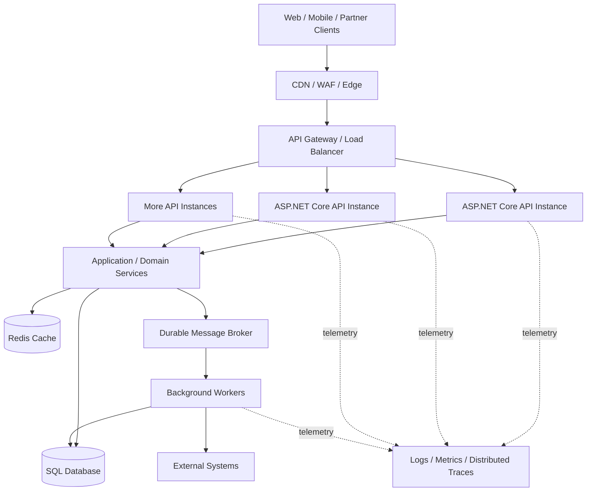
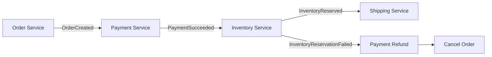
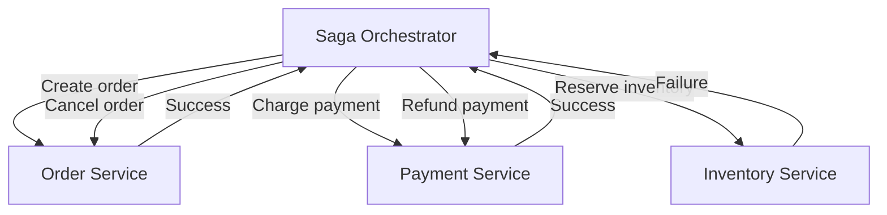

# System Design and Distributed Systems

Each concept is explained once. Where several notes covered the same topic, they have been merged into a single section, and related topics in other guides are linked instead of repeated.

## Contents

- [High-Traffic .NET API — Architectural Blueprint](#high-traffic-dotnet-api-blueprint-md)
- [Saga Pattern in .NET: Choreography vs. Orchestration](#saga-pattern-dotnet-md)
- [Asynchronous Messaging in .NET — Senior Developer & Architect Viva Guide](#async-messaging-dotnet-viva-guide-md)
- [Distributed Async Processing, Locks, and Resilience](#distributed-async-processing)
- [Partitioning, Sharding, and Distributed Data](#partitioning-sharding-distributed-data)
- [Integration events, Outbox, and idempotency](01.1-csharp-delegates-events-domain-and-integration-events.md) *(separate guide)*
- [Additional Questpond question sets](#additional-questpond-question-sets)

---

<a id="high-traffic-dotnet-api-blueprint-md"></a>

## High-Traffic .NET API — Architectural Blueprint

> A practical reference architecture for senior .NET developers and architects. This document focuses on decisions, trade-offs, capacity planning, and operational safeguards—not on adding infrastructure without a measured need.

#### 1. Goals and assumptions

Define targets before selecting technologies:

- **Traffic:** average and peak requests per second (RPS), burst duration, and concurrent connections.
- **Latency:** p50, p95, and p99 targets per endpoint (the time under which 50%, 95%, and 99% of requests finish; p99 = 200 ms means 1 request in 100 is slower than 200 ms).
- **Availability:** service-level objective (SLO, the target, e.g. "99.9% of requests succeed per month"), recovery time objective (RTO, how long an outage may last), and recovery point objective (RPO, how much recent data you may lose, e.g. "at most 5 minutes").
- **Workload:** read/write ratio, payload sizes, CPU-heavy operations, database calls, and external dependencies.
- **Consistency:** which operations require immediate consistency and which can be eventually consistent.
- **Security and compliance:** identity, authorization, audit, data residency, and retention requirements.

Do not promise a fixed request capacity based on the framework alone. Capacity must be established by load testing the complete system with realistic data and dependencies.

#### 2. Reference architecture



**Request path:** client → edge protection → gateway/load balancer → Kestrel-hosted ASP.NET Core instance → middleware and endpoint → application/domain logic → cache, database, or message broker → response.

Not every deployment needs every box. For a moderate system, a managed ingress or load balancer plus a few API instances and SQL may be sufficient. Add a gateway, Redis, workers, or multi-region deployment when requirements justify the operational cost.

#### 3. Hosting and request lifecycle

##### IIS and Kestrel

- **Kestrel** is ASP.NET Core's cross-platform HTTP server.
- **IIS** can act as a reverse proxy and process manager for ASP.NET Core on Windows. In the common out-of-process hosting model, IIS/HTTP.sys receives the external request and ASP.NET Core Module forwards it to the app running on Kestrel.
- **Containers and Linux** commonly expose Kestrel behind an ingress, load balancer, or reverse proxy. A separate NGINX layer is optional, not automatically required.
- Each proxy hop can add buffering, TLS work, queueing, connection limits, and another place to configure timeouts and request-size limits.

Keep the request pipeline short and predictable. Apply routing, authentication, authorization, validation, rate limits, and telemetry deliberately. Order middleware according to its documented requirements.

##### Async I/O and the ThreadPool

`async`/`await` allows a request to release its worker thread while awaiting asynchronous I/O. It does **not** make CPU-bound work faster and does not eliminate limits imposed by SQL, remote services, memory, or sockets.

Avoid `.Result`, `.Wait()`, synchronous database/network calls, unbounded parallel work, and fire-and-forget tasks inside request handlers. Use bounded background queues or a durable broker for work that must outlive the request.

**Why blocking hurts (ThreadPool starvation):** the ThreadPool is a limited set of worker threads shared by all requests. A thread blocked on `.Result` sits idle while holding its slot, so under load every thread ends up waiting and new requests queue even though CPU is near 0%.

```csharp
// Bad: the thread is parked for the whole 200 ms DB call. 100 concurrent requests = 100 blocked threads.
var user = _repo.GetUserAsync(id).Result;

// Good: the thread is released at 'await' and reused by other requests while the DB works.
var user = await _repo.GetUserAsync(id);
```

Fire-and-forget (`_ = DoWorkAsync();`) is dangerous because the work is not tied to the request: exceptions go unobserved and the work is silently lost if the process restarts. Queue it instead.

#### 4. Application design

##### Suggested layering

- **API layer:** HTTP contracts, authentication/authorization, validation, status codes, and API versioning.
- **Application layer:** use-case orchestration, transactions, and coordination of dependencies.
- **Domain layer:** business rules and invariants.
- **Infrastructure layer:** EF Core/Dapper, external clients, cache, messaging, and storage.

Keep controllers/endpoints thin, but avoid creating abstractions that add no value. Use dependency injection lifetimes correctly: `DbContext` is normally scoped; singleton services must be thread-safe and must not capture scoped dependencies.

##### Data access

- Use **EF Core** for maintainable transactional application code; use projections and `AsNoTracking()` for read-only queries where appropriate.
- Consider **Dapper or SQL** for measured hot paths where it offers a meaningful benefit.
- Inspect generated SQL and execution plans. Fix N+1 queries (1 query for 100 orders, then 100 more queries, one per order, to load each customer; use `Include` or a join to make it 1-2 queries), missing/ineffective indexes (the database scans every row instead of seeking), excessive round trips, large result sets, and unnecessary materialization (loading rows into memory with `ToList()` before filtering).
- Paginate large collections. Prefer keyset pagination for deep, frequently accessed pages when the ordering supports it.
- Use optimistic concurrency or appropriate database locking for conflicting updates.
- Do not run multiple parallel operations on one EF Core `DbContext`; it is not thread-safe.
- Keep transactions short. Do not hold a database transaction open while waiting on a remote API.

#### 5. Database connection and concurrency planning

ADO.NET connection pooling reuses physical connections, but each application process/connection-string pool has a finite maximum. The default maximum for `Microsoft.Data.SqlClient` is commonly 100 connections per pool; verify the actual provider, connection string, and configuration.

A key scaling trap: **pool limits multiply across application instances**. For example, 10 instances each configured for a maximum pool size of 100 could collectively request up to 1,000 pooled connections for that pool. That does not mean the database can efficiently serve 1,000 simultaneous queries.

Plan from the database's measured capacity:

1. Measure query latency, CPU, I/O, locks, waits, and queries per second.
2. Set sensible per-instance concurrency limits for database-bound work.
3. Size app replicas and connection pools together with the DB connection budget.
4. Optimize queries and reduce unnecessary DB calls before increasing pool limits.
5. Use replicas for suitable read workloads only when replication lag and consistency requirements allow it.
6. Consider partitioning/sharding only when simpler approaches no longer meet the requirements.

#### 6. Caching strategy

Use caching for data that is read often and can tolerate a defined staleness window.

- **CDN/edge cache:** public, cacheable responses and static assets.
- **In-process cache:** very hot, instance-local data; each replica has its own copy.
- **Redis/distributed cache:** shared cache across replicas, distributed counters, or other explicitly designed shared state.

Choose cache keys, TTLs (time-to-live: how long an entry is kept), invalidation rules, and ownership carefully. A cache is not the source of truth unless the design explicitly makes it so.

**Cache stampede:** a popular entry expires and many requests miss at the same instant, so all of them hit the database to rebuild the same value. Example: a key read 1,000 times/s expires; for the 200 ms rebuild, about 200 requests run the same expensive query at once and can overload the DB. Fixes:

- **Request coalescing:** only the first miss rebuilds; the others wait for that one result.
- **Jittered TTLs:** add a random offset (e.g. 10 min plus or minus 1 min) so thousands of keys written together do not all expire together.
- **Controlled refresh:** refresh the entry shortly before expiry, or serve the stale value while one background task refreshes it.

**Key scoping:** a key must include everything that changes the answer. Bad: `cache["orders"]` returns user A's orders to user B. Good: `cache["tenant:7:user:42:orders"]`. Never cache authorization-sensitive data under keys that omit tenant/user context.

#### 7. Background work and messaging

Move slow, retryable, or non-interactive work—report generation, email, document processing, bulk imports, and integrations—out of the synchronous HTTP path when the client does not need the result immediately.

- Return `202 Accepted` plus a status/resource URL when work is accepted for later processing.
- Use a durable broker such as Azure Service Bus, RabbitMQ, or Kafka according to delivery, ordering, replay, and throughput needs.
- Make consumers idempotent; retries can deliver a message more than once.
- Use an outbox pattern when a database update and event publication must not silently diverge.
- Apply bounded concurrency, retry limits, dead-letter handling, and queue-age alerts.
- Use an in-memory `Channel<T>` only when losing queued work on process failure is acceptable or durability is handled elsewhere.

#### 8. Resilience and overload protection

- **Timeouts:** define a total request budget and shorter downstream budgets; avoid requests waiting indefinitely.
- **Retries:** retry only transient failures (timeouts, 503) and safe/idempotent operations (retrying "charge card" without an idempotency key can charge twice). Use bounded exponential backoff with jitter (waits of about 1 s, 2 s, 4 s, each plus a random offset); retries can amplify an outage: if 1,000 clients each retry 3 times against an already struggling service, it receives up to 4,000 requests instead of 1,000.
- **Circuit breakers:** after N consecutive failures the breaker "opens" and calls fail immediately for a cool-down period instead of waiting on timeouts; it then lets a trial call through to see if the dependency recovered. This protects both the caller's threads and the sick dependency.
- **Bulkheads:** cap concurrent work per downstream dependency so one slow system cannot consume all capacity. Example: allow at most 20 concurrent calls to the slow reporting service, so the other 80 threads still serve checkout.
- **Rate limiting:** apply per-client/tenant/user limits where appropriate, with explicit `429 Too Many Requests` behavior (plus a `Retry-After` header) so one noisy client cannot starve the rest.
- **Backpressure:** reject or defer work when queues, DB capacity, or worker capacity are saturated. Bad: accept everything into an unbounded queue, so latency grows until memory runs out. Good: when the queue holds more than N items, return `503`/`429` quickly so callers slow down.
- **Cancellation:** propagate `HttpContext.RequestAborted` where appropriate and ensure downstream work respects cancellation.
- **Idempotency keys:** support safe retries for operations such as payments or order creation where duplicate submissions are harmful.

Use a resilience library such as Polly or the .NET resilience APIs available in your target framework, and verify the exact APIs for that framework version.

#### 9. Security

- Use OAuth 2.0 / OpenID Connect with validated tokens; enforce authorization at the endpoint/resource level, not only at the gateway.
- Apply least privilege to database identities, managed identities, secrets, and service-to-service access.
- Store secrets in a managed secret store; rotate them and avoid logging them.
- Validate inputs and payload sizes; use parameterized queries.
- Configure CORS narrowly; CORS is not an authorization mechanism.
- Use TLS externally and consider mTLS or workload identity for sensitive service-to-service paths.
- Apply WAF rules, request-rate controls, audit logging, dependency scanning, and secure deployment practices.
- For multi-tenant systems, enforce tenant isolation in authorization and data access; never rely on a client-supplied tenant ID alone.

#### 10. Observability and SLOs

Collect three complementary signals:

- **Metrics:** request rate, error rate, p50/p95/p99 latency, CPU, memory, GC pauses, ThreadPool queueing, active requests, connection-pool waits, DB waits, cache hit ratio, and queue age/depth.
- **Traces:** distributed traces across gateway, API, SQL, cache, broker, and downstream calls, with propagated trace context.
- **Logs:** structured logs with correlation/trace IDs and useful business context, while excluding credentials, tokens, and sensitive data.

Use OpenTelemetry where practical and export to a platform such as Azure Application Insights or another compatible backend. Alert on user-visible SLOs and saturation indicators, not just CPU. Sample traces carefully at high volume while retaining errors and slow requests.

#### 11. Capacity planning

##### Little's Law

A useful approximation is:

\[
\text{In-flight requests} \approx \text{throughput (requests/s)} \times \text{average latency (seconds)}
\]

Example: 2,000 requests/s at 0.15 seconds average latency implies about 300 in-flight requests. This estimates in-flight work; it does **not** mean 300 worker threads are required.

##### Estimate instance count

1. Load-test one instance with realistic traffic and data.
2. Find the throughput at which latency or errors begin to violate the SLO.
3. Choose a sustainable operating point below saturation, with headroom for bursts and failures.
4. Estimate replicas from peak demand and sustainable per-instance throughput, then add redundancy and autoscaling limits.
5. Repeat tests with the database and dependencies under realistic load; an API-only benchmark is insufficient.

Test steady load, bursts, soak duration, cold start, failover, and dependency degradation. Track p95/p99, not just average latency.

#### 12. Deployment and scaling

- Run stateless API replicas behind a health-checking load balancer.
- Use readiness checks to keep unready instances out of rotation and liveness checks only for conditions that truly require restart.
- Configure autoscaling using relevant signals such as CPU, request concurrency, and queue depth; scale-out cannot instantly solve a saturated database.
- Use blue/green or canary releases, feature flags, rollback plans, and backward-compatible database migrations.
- Use infrastructure as code (Bicep/Terraform) and immutable, scanned container images.
- For multi-region designs, explicitly define routing, data replication, write ownership, failover, RTO/RPO, and how split-brain (a network partition leaves two regions each believing they are the primary and both accepting writes, so the data diverges and is hard to merge) or regional recovery is handled. Multi-region active-active writes are not a default requirement.

#### 13. Common symptoms and diagnostic order

| Symptom | Likely causes | First checks |
|---|---|---|
| High latency, normal CPU | Slow SQL, remote calls, lock waits, connection-pool wait | Distributed traces, SQL waits, dependency timings |
| High CPU | Expensive serialization, algorithms, excessive allocations, compression, logging | CPU profile, hot paths, allocation profile |
| Growing request latency under load | ThreadPool starvation, queueing, dependency saturation | ThreadPool counters, blocking calls, active requests, downstream saturation |
| SQL timeouts | Slow queries, blocking, exhausted pool, DB capacity | Query plans, waits, pool metrics, DB CPU/I/O |
| Memory climbs over time | Retained references, unbounded cache/queues, large objects | Heap dump, GC counters, cache and queue bounds |
| Retry storm (failing calls are retried so often that the retries themselves keep the dependency down) | Aggressive retries and cascading failure | Retry counts, timeout budgets, circuit breakers |
| Queue age grows | Consumers too slow, downstream bottleneck, insufficient bounded capacity | Consumer throughput, oldest-message age, dead-letter rate |

Diagnose with telemetry and profiling before changing thread counts, queue lengths, pool sizes, or server limits. Raising a limit can move the queue downstream and make the outage worse. Example: doubling API threads from 100 to 200 when the DB only handles 50 queries at once just puts 200 requests in the DB's queue, and every request gets slower.

#### 14. Practical reference stack on Azure

A common Azure implementation could use:

- **Azure Front Door + WAF** for global edge entry and protection, where global routing/caching is needed.
- **Azure API Management** when centralized API policies, product subscriptions, quotas, or developer portal features are required.
- **Azure Container Apps or AKS** for ASP.NET Core API and separate worker deployments, chosen according to orchestration and operational needs.
- **Azure SQL Database** for transactional relational data; use appropriate tiering and replicas based on measured workload.
- **Azure Cache for Redis** where shared low-latency caching is justified.
- **Azure Service Bus** for command/task queues and reliable business messaging; **Event Hubs** or Kafka-compatible infrastructure for high-throughput event streams.
- **Managed Identity + Key Vault** for identity-based access and secret management.
- **Application Insights + OpenTelemetry** for application telemetry.

These are options, not mandatory components. Start with the simplest topology that meets the SLO and expand only when measurements show the need.

#### 15. Interview-ready explanation

> “I start by defining traffic, latency, availability, consistency, and recovery targets. I keep ASP.NET Core APIs stateless behind a load balancer, use Kestrel, and keep the synchronous request path short. I measure end-to-end latency with distributed tracing and profile before tuning. For database-bound endpoints, I optimize query shape and indexes, control concurrency, and budget connection pools across all replicas. I use caching for suitable read-heavy data and a durable queue for work that does not need to finish before the HTTP response. Timeouts, bounded retries, circuit breakers, rate limits, and idempotency prevent one dependency from cascading across the system. Finally, I load-test realistic workloads and scale based on SLOs and measured bottlenecks rather than claiming a fixed number of concurrent requests.”

#### 16. Implementation checklist

- [ ] Define per-endpoint latency and error-rate SLOs.
- [ ] Add structured logs, metrics, and distributed tracing.
- [ ] Review middleware, blocking calls, and cancellation propagation.
- [ ] Profile the slowest endpoints and database queries.
- [ ] Set timeouts and bounded concurrency for every dependency.
- [ ] Calculate aggregate SQL connection budgets across all replicas.
- [ ] Add caching only with explicit TTL and invalidation behavior.
- [ ] Move suitable long-running work to durable background processing.
- [ ] Add rate limits, idempotency, and overload behavior.
- [ ] Load-test steady, burst, soak, and failure scenarios.
- [ ] Validate health probes, deployment rollback, backup, and restore procedures.
- [ ] Revisit architecture after production telemetry identifies the next bottleneck.

---

<a id="saga-pattern-dotnet-md"></a>

## Saga Pattern in .NET: Choreography vs. Orchestration

#### 1. What is the Saga Pattern?

The **Saga Pattern** coordinates a business transaction that spans multiple services, each with its own local transaction and usually its own database.

A traditional database transaction can provide ACID guarantees within one database. Across independently deployed services, a single ACID transaction is usually impractical. A saga instead runs a sequence of local transactions and uses **compensating actions** to address failures.

For example, an order workflow might:

1. Create an order.
2. Charge the customer.
3. Reserve inventory.
4. Arrange shipping.

If inventory cannot be reserved after payment succeeds, the workflow may refund the payment and cancel the order.

> Compensation is a new business action, not a literal rollback. For example, a refund does not erase the original payment record.

#### 2. The two coordination styles

##### Choreography: services react to events

There is no central workflow coordinator. Each service publishes an event after completing its local work, and other services react to that event.



**Typical flow**

1. The Order Service creates an order and publishes `OrderCreated`.
2. The Payment Service consumes the event, charges the customer, and publishes `PaymentSucceeded`.
3. The Inventory Service consumes that event and reserves stock.
4. If stock cannot be reserved, the workflow publishes a failure event; the relevant services perform compensating actions.

**Advantages**
- No dedicated central coordinator.
- Services can react independently to domain events.
- Can suit event-driven workflows with a small number of steps.

**Trade-offs**
- The overall workflow is spread across services, making it harder to understand and debug as steps grow.
- Event dependencies and failure paths can become difficult to track.
- Requires reliable messaging, idempotent handlers, and good tracing.

Why "harder to follow" matters: to answer "why is order 42 stuck?", you must inspect the logs of Order, Payment, Inventory and Shipping to find which event was not published or consumed; no single place shows the whole flow. Adding a step (say, a fraud check between payment and inventory) means changing what event Inventory listens to, so several services change for one workflow change.

##### Orchestration: a coordinator directs the workflow

A dedicated **saga orchestrator** tracks the workflow and tells each service which action to perform. Services execute their local transactions and return results; the orchestrator decides the next step.



**Typical flow**

1. The orchestrator requests order creation.
2. After success, it requests payment.
3. It then requests inventory reservation.
4. If reservation fails, it initiates a refund and cancels the order.

**Advantages**
- The workflow and compensation rules are visible in one place.
- Easier to inspect workflow status and reason about the next action.
- Often a good fit for long-running workflows with several conditional steps.

**Trade-offs**
- The orchestrator is another component to build, operate, and monitor.
- It can become overly complex if it contains business logic that belongs in services.
- It must be resilient: persist workflow state and support recovery after restarts. A properly designed orchestrator is not inherently a single point of failure.

#### 3. Comparison

| Concern | Choreography | Orchestration |
|---|---|---|
| Workflow control | Distributed across event handlers | Central coordinator |
| Communication style | Primarily events | Commands and results; events may also be used |
| Visibility | Requires tracing events across services | Workflow state is easier to inspect centrally |
| Complexity as steps grow | Event relationships can become difficult to follow | Coordinator workflow can grow in complexity |
| Best fit | Short, event-driven workflows with limited branching | Multi-step workflows with explicit sequencing and compensation |

Neither approach automatically guarantees consistency, scalability, or fault tolerance. Those depend on implementation and operational design.

#### 4. Essential reliability practices

Whichever style you choose:

- **Persist progress:** store saga state so a process restart does not lose the workflow.
- **Make handlers idempotent:** processing the same command or event twice should not duplicate a charge, reservation, or other business effect. Bad: `ChargeCustomer(orderId)` charges again on each redelivery. Good: record the processed message/order ID first (or use a unique constraint); if it is already recorded, skip the charge and just re-send the success reply.
- **Use reliable message publishing:** consider the **Transactional Outbox** pattern to avoid committing database changes while losing the corresponding event. The problem: saving the order to the DB and publishing `OrderCreated` to the broker are two separate systems, so a crash between them leaves an order that nobody hears about (or an event for an order that was rolled back). The fix: write the event into an `Outbox` table in the same DB transaction as the order, and let a separate publisher read that table and send to the broker (retrying until it succeeds).
- **Handle retries and timeouts:** retry transient failures with limits and backoff; distinguish transient failures from business failures.
- **Define compensations:** document what happens after each step fails and what to do if compensation itself fails (for example, a refund call times out: retry with backoff, then raise an alert or manual-review task rather than silently leaving the customer charged).
- **Expect at-least-once delivery:** duplicates and delayed messages are normal possibilities in distributed messaging.
- **Observe the workflow:** include a correlation/saga ID in logs and traces, and expose statuses such as `Pending`, `Completed`, `Compensating`, and `Failed`.
- **Design for eventual consistency:** other services may temporarily observe intermediate states while the saga is running (for example, an order shows as "Pending" with payment taken but stock not yet reserved). Show such states explicitly instead of pretending the order is complete.

#### 5. Implementing sagas in .NET

For a .NET microservices solution, a practical stack might include:

- **ASP.NET Core** for service APIs.
- **RabbitMQ, Azure Service Bus, or Kafka** for messaging, chosen according to the required delivery and routing semantics.
- A durable saga/workflow implementation that persists state and can resume after failure.
- **OpenTelemetry** for distributed tracing and observability.

Libraries such as **MassTransit** support saga state machines and message-driven workflows. Check the current documentation and version-specific features before choosing a library.

##### Important distinction: MediatR is not a distributed saga engine

MediatR can dispatch commands and notifications **inside an application process**. Calling several handlers sequentially through MediatR does not, by itself, provide durable workflow state, cross-service messaging, recovery after process failure, or distributed compensation. It may help structure application code, but additional infrastructure is required for a production distributed saga.

#### 6. How to choose

Prefer **choreography** when the workflow is relatively simple and services can react naturally to domain events without a complicated global decision tree.

Prefer **orchestration** when the business process has many steps, conditional paths, deadlines, compensation rules, or a need to query workflow status centrally.

For a typical order/payment/inventory workflow in an enterprise .NET system, orchestration is often easier to operate and explain. This is a starting point, not a universal rule: choose based on the workflow, team expertise, operational needs, and failure model.

#### 7. Architecture review checklist

Before releasing a saga, confirm:

- [ ] Every step has a defined success and failure outcome.
- [ ] Each side effect is idempotent or protected against duplicate execution.
- [ ] Saga state and message publication are durable.
- [ ] Timeouts, retries, and poison messages have defined handling.
- [ ] Compensation actions and compensation failures are handled.
- [ ] Operators can find a saga by its correlation ID and inspect its current state.
- [ ] Tests cover duplicate messages, delayed messages, service outages, and process restarts.

#### Further reading

- [Microsoft: Cloud design patterns](https://learn.microsoft.com/en-us/azure/architecture/patterns/)
- [MassTransit documentation](https://masstransit.io/documentation/)
- [OpenTelemetry for .NET](https://opentelemetry.io/docs/languages/dotnet/)

---

<a id="async-messaging-dotnet-viva-guide-md"></a>

## Asynchronous Messaging in .NET — Senior Developer & Architect Viva Guide

This guide brings together **MediatR, MassTransit, RabbitMQ, Kafka, and publish–subscribe (pub/sub)**. It focuses on what each tool does, how messages flow, when to choose each approach, and the reliability concerns expected in a senior-level design discussion.

#### 1. The key distinction

| Technology | Main role | Scope | Typical use |
|---|---|---|---|
| **MediatR** | In-process mediator | One application process | Route a command/query to a handler; notify local handlers |
| **MassTransit** | .NET messaging framework | Application ↔ broker | Define consumers, publish/send messages, retries, and sagas using a consistent API |
| **RabbitMQ** | Message broker | Across processes/services | Route messages to queues; distribute commands and events |
| **Apache Kafka** | Distributed event-streaming platform | Across processes/services | Store and distribute partitioned event streams; support replay and high-throughput processing |

**Remember:** MediatR does not itself provide durable, cross-service messaging. MassTransit is not a broker; it is a framework that works with transports such as RabbitMQ and, through its Kafka rider, Kafka. RabbitMQ and Kafka have different delivery and storage models, so they are not interchangeable in every design.

#### 2. Commands, events, and notifications

- A **command** asks a specific handler/service to perform an action, such as `CreateOrder` or `ChargePayment`.
- An **event** states that something has already happened, such as `OrderCreated` or `PaymentAuthorized`. It can have multiple subscribers.
- A **notification** is a broad term for information sent to interested parties. In MediatR, `INotification` means an in-process notification; in distributed messaging, an event may be published through a broker.

Naming an event in the past tense (`OrderCreated`) makes its meaning clearer: it describes a fact, rather than instructing another service what to do.

#### 3. MediatR: in-process request/notification handling

MediatR helps decouple code **inside one .NET process**. It routes requests to a handler and can dispatch notifications to multiple local handlers. It does not automatically persist messages or deliver them to another service.

##### Request/command example

```csharp
using MediatR;

public sealed record CreateOrderCommand(Guid CustomerId, decimal Total)
    : IRequest<Guid>;

public sealed class CreateOrderHandler
    : IRequestHandler<CreateOrderCommand, Guid>
{
    public async Task<Guid> Handle(
        CreateOrderCommand request,
        CancellationToken cancellationToken)
    {
        // Validate and save the order using the application's domain/repository layer.
        await Task.CompletedTask;
        return Guid.NewGuid();
    }
}
```

A controller or endpoint can inject `ISender` and call `Send`:

```csharp
var orderId = await sender.Send(
    new CreateOrderCommand(customerId, total), cancellationToken);
```

##### Local notification example

```csharp
public sealed record OrderCreatedLocalNotification(Guid OrderId) : INotification;

public sealed class WriteAuditEntryHandler
    : INotificationHandler<OrderCreatedLocalNotification>
{
    public Task Handle(
        OrderCreatedLocalNotification notification,
        CancellationToken cancellationToken)
    {
        // Write an in-process audit entry or trigger local application behavior.
        return Task.CompletedTask;
    }
}
```

Dispatch it with `IPublisher`:

```csharp
await publisher.Publish(
    new OrderCreatedLocalNotification(orderId), cancellationToken);
```

Register handlers from the relevant assembly, using the registration API supported by your installed MediatR version:

```csharp
builder.Services.AddMediatR(cfg =>
    cfg.RegisterServicesFromAssemblyContaining<CreateOrderHandler>());
```

##### When MediatR is appropriate

Use it for application-layer CQRS handlers, local orchestration, and separation between controllers and use cases. Do **not** use `IPublisher.Publish` as a replacement for a durable broker event: the call is in-process and is not a cross-service delivery guarantee.

#### 4. Publish–subscribe in RabbitMQ

RabbitMQ pub/sub is built around **exchanges, bindings, queues, and consumers**:

1. A producer publishes a message to an exchange.
2. The exchange routes it according to its type and binding rules.
3. Each matching queue receives a copy of the message.
4. Consumers attached to the same queue compete to process messages from that queue.

##### Main exchange types

| Exchange type | Routing behavior | Typical use |
|---|---|---|
| **Fanout** | Routes to every bound queue; routing key is ignored | Broadcast to all interested services |
| **Direct** | Routes when the routing key exactly matches the binding key | Route to a specific category/severity |
| **Topic** | Routes using patterns: `*` matches one word; `#` matches zero or more words | Subscribe to selected event categories, such as `order.*` |
| **Headers** | Routes using message headers instead of the routing key | Specialized header-based routing |

##### Example topology

Suppose `OrderService` publishes `OrderCreated`. Three services need their own copy:

```text
                         ┌─> inventory.queue ─> Inventory Service
OrderService ─> exchange ├─> billing.queue   ─> Billing Service
                         └─> email.queue     ─> Notification Service
```

Each service has a **separate queue**. If Inventory Service has three replicas consuming `inventory.queue`, those replicas are competing consumers: a given delivery goes to one replica, rather than being broadcast to all three. Broadcasting happens across the independently bound queues.

##### Reliability points

- Use durable topology and persistent messages where survival across broker restarts is required.
- Consumer acknowledgements allow RabbitMQ to know when a delivery has been processed; unacknowledged messages can be redelivered after a failure.
- Publisher confirms help the producer determine whether RabbitMQ accepted a publish. They are different from consumer acknowledgements.
- Redelivery can create duplicates. Design consumers to be **idempotent**.
- Configure bounded retries and a dead-letter strategy (a dead-letter queue is a side queue where messages that keep failing are parked for inspection) for messages that repeatedly fail. Avoid infinite requeue loops: a malformed "poison" message that always throws, if requeued immediately each time, is redelivered forever and blocks or starves the queue.
- If no queue is bound when a message is published, ordinary exchange routing does not create a historical copy for a future subscriber. Plan the queue topology before relying on delivery.

#### 5. Publish–subscribe in Apache Kafka

Kafka pub/sub is built around **topics, partitions, consumer groups, offsets, and retention**:

1. A producer appends a record to a topic.
2. The topic is split into partitions, each an ordered log.
3. Consumers read records and track their positions using offsets.
4. Each consumer group tracks its own progress, so different groups can independently process the same topic.

##### Example topology

```text
                         ┌─ group: inventory-service ─> Inventory Service
OrderService ─> topic ───┼─ group: billing-service   ─> Billing Service
  order-created          └─ group: analytics-service ─> Analytics Service
```

Each group can read the same records independently. Within a consumer group, partitions are assigned among its consumers, so adding consumers increases parallelism only up to the available partition count (under the standard consumer-group model). Ordering is guaranteed within a partition, not across the entire topic. Choosing a key such as `OrderId` can keep related records in the same partition.

##### Reliability and replay points

- Kafka normally retains records for a configured time or size policy, regardless of whether a consumer has read them.
- An offset records a consumer group's position. A consumer can often reset an offset and reprocess retained records.
- Offset commit timing matters (the committed offset is what the group resumes from after a restart). Commit before processing: if the consumer crashes mid-way, the record is already marked done and is **lost** (at-most-once). Commit after processing: if it crashes after the work but before the commit, the record is read **again** (at-least-once, duplicates), which is why idempotent handlers are the usual choice.
- Duplicates are possible, so idempotent processing is still important.
- Kafka supports strong processing guarantees for certain Kafka-to-Kafka workflows, but a database update or external API call is not automatically part of a Kafka transaction.

#### 6. RabbitMQ vs Kafka for pub/sub

| Concern | RabbitMQ | Kafka |
|---|---|---|
| Core model | Broker routes messages to queues | Consumers read a retained, partitioned log |
| Pub/sub unit | One queue per independent subscriber; exchange bindings decide routing | One topic; each consumer group has independent progress |
| Scaling consumers | Multiple consumers compete on a queue | Consumers in a group split topic partitions |
| Message lifetime | Common queue workflows remove a message after acknowledgement | Records remain until retention/compaction removes them |
| Replay | Not the default queue model; design a separate archive/stream if needed | Natural use case through offsets while records are retained |
| Routing | Rich exchange and binding rules | Topic/partition/key based; routing is usually designed by the producer and topic structure |
| Common fit | Commands, work distribution, service integration, flexible routing | High-volume event streams, analytics, replay, multiple independent consumers |

Neither is universally better. Choose based on delivery semantics, replay needs, throughput, ordering, operational maturity, and team experience—not only a benchmark.

#### 7. MassTransit with RabbitMQ: end-to-end example

MassTransit provides a .NET abstraction for publishing, sending, consuming, retry behavior, and orchestration. The following is an illustrative RabbitMQ setup; use secure credentials from configuration or a secret store in real environments.

##### Message contract

```csharp
public sealed record OrderCreated(
    Guid OrderId,
    Guid CustomerId,
    decimal Total,
    DateTime CreatedAtUtc);
```

In a multi-service solution, put public message contracts in a small shared contracts assembly/package, or use a deliberate schema/versioning strategy. Avoid publishing database entities directly.

##### Consumer

```csharp
using MassTransit;

public sealed class OrderCreatedConsumer : IConsumer<OrderCreated>
{
    public async Task Consume(ConsumeContext<OrderCreated> context)
    {
        var message = context.Message;

        // Call the service's application layer. Make the operation idempotent.
        Console.WriteLine($"Order created: {message.OrderId}");
        await Task.CompletedTask;
    }
}
```

##### Dependency injection and RabbitMQ configuration

```csharp
using MassTransit;

builder.Services.AddMassTransit(x =>
{
    x.AddConsumer<OrderCreatedConsumer>();

    x.UsingRabbitMq((context, cfg) =>
    {
        cfg.Host("localhost", "/", host =>
        {
            host.Username("guest");
            host.Password("guest");
        });

        // Creates receive endpoints for the registered consumers.
        cfg.ConfigureEndpoints(context);
    });
});
```

The `guest` credentials are for a local development example, not a production configuration. MassTransit starts and manages the bus through its hosting integration; older examples may show a separate `AddMassTransitHostedService` registration that is not needed in current versions.

##### Publisher

```csharp
using MassTransit;

public sealed class OrderApplicationService(IPublishEndpoint publishEndpoint)
{
    public Task PublishOrderCreatedAsync(
        Guid orderId,
        Guid customerId,
        decimal total,
        CancellationToken cancellationToken)
    {
        return publishEndpoint.Publish(
            new OrderCreated(
                orderId,
                customerId,
                total,
                DateTime.UtcNow),
            cancellationToken);
    }
}
```

`Publish` expresses an event: interested consumers can receive it through their broker topology. `Send` is typically used when directing a message to a known endpoint/queue, such as a command. Exact topology and naming conventions depend on transport configuration.

#### 8. Where Kafka and MassTransit fit

MassTransit supports Kafka through a **Kafka rider** and the Confluent .NET client. However, Kafka remains topic/partition/log based; it does not acquire RabbitMQ's exchange-and-queue routing model simply because MassTransit is used. Check the current MassTransit documentation and compatibility notes before choosing its Kafka integration for a production system.

For a direct Kafka implementation in .NET, the commonly used client is Confluent.Kafka. Choose the client approach based on required Kafka features, operational standards, and whether your team benefits from the MassTransit abstraction.

#### 9. Reliability patterns an architect should mention

##### The dual-write problem and the Outbox pattern

Imagine saving an order to SQL Server and then publishing `OrderCreated`:

```text
Save order to database  ── success
Publish event to broker ── failure
```

The order exists, but downstream services never receive the event. Reversing the order creates the opposite failure risk. The **Transactional Outbox** pattern addresses this by writing the business change and an outbox record in the same database transaction. A background publisher sends the outbox event to the broker and marks it as dispatched. Consumers still need idempotency because publishing can be retried.

##### Other essential controls

- **Idempotent consumer:** Processing the same event twice must not create a second payment, duplicate record, or repeated side effect. Use a stable event/message ID and a durable deduplication mechanism where necessary.
- **Retry policy:** Retry transient failures with bounded attempts and backoff; do not retry permanent validation failures forever.
- **Dead-letter handling:** Preserve failed messages, record the error, alert, and define a safe replay procedure.
- **Eventual consistency:** Different services update at different times. The UI and business workflow must tolerate intermediate states.
- **Saga/process manager:** Coordinate a multi-service business process with local transactions and compensating actions instead of expecting one distributed database transaction.
- **Observability:** Include correlation/trace IDs, structured logs, queue depth or consumer lag, retry counts, dead-letter counts, and message processing latency.
- **Contract evolution:** Version event schemas compatibly; treat published events as long-lived public contracts.

#### 10. Common senior-level viva questions

**Q: Is MediatR asynchronous messaging?**  
It supports asynchronous method calls within a process, but it is not a distributed message broker and does not by itself provide durable delivery or cross-process communication.

**Q: What is the difference between `Send` and `Publish`?**  
In MediatR, `Send` dispatches a request to one request handler, while `Publish` dispatches an in-process notification to its notification handlers. In MassTransit, `Send` generally targets a known endpoint and `Publish` distributes an event to interested subscribers through the transport topology.

**Q: In RabbitMQ, how do I make three services each receive an event?**  
Publish to an exchange and bind a separate queue for each service. Three consumers on the same queue are competing consumers, not three independent subscribers.

**Q: In Kafka, how do three services each receive an event?**  
Give each service a distinct consumer group. If all three share one group, they divide the work instead of each receiving an independent copy.

**Q: Does a message broker guarantee exactly-once business processing?**  
Do not assume so. Delivery may be repeated, and external side effects complicate exactly-once claims. Design for idempotency and use transactional patterns such as an Outbox where required.

**Q: When would you choose Kafka over RabbitMQ?**  
Prefer Kafka when retained event history, replay, high-throughput streams, and multiple independent downstream consumers are central requirements. Prefer RabbitMQ when broker routing, task distribution, acknowledgements, and queue-oriented workflows are the natural fit. Validate the decision against actual requirements and operations.

**Q: How do you keep SQL writes and event publishing consistent?**  
Use a Transactional Outbox, then make consumers idempotent. A database commit and broker publish are not one atomic transaction by default.

**Q: How do you handle a poison message?**  
Apply bounded retries, route it to a dead-letter/error workflow, capture diagnostic context, alert operators, and replay only after fixing the cause.

#### 11. Quick decision guide

- **Controller → application use case inside one API:** MediatR or direct dependency injection, depending on whether mediator indirection adds value.
- **One service needs to command a known downstream endpoint:** broker send/command pattern, commonly through MassTransit.
- **Several services react independently to a business fact:** publish an event through RabbitMQ or Kafka.
- **Need rich queue routing and task distribution:** evaluate RabbitMQ first.
- **Need retained event history, replay, and streaming analytics:** evaluate Kafka first.
- **Need local database changes and reliable event publication:** use an Outbox regardless of which broker is selected.

#### Further reading

- [RabbitMQ — Exchanges and routing](https://www.rabbitmq.com/tutorials/amqp-concepts)
- [RabbitMQ — Consumer acknowledgements and publisher confirms](https://www.rabbitmq.com/docs/confirms)
- [Apache Kafka — Introduction](https://kafka.apache.org/intro)
- [Apache Kafka — Consumer offset tracking](https://kafka.apache.org/43/implementation/distribution/)
- [MassTransit — Bus configuration](https://masstransit.io/documentation/configuration)
- [MassTransit — RabbitMQ transport](https://masstransit.io/documentation/configuration/transports/rabbitmq)
- [MassTransit — Kafka rider](https://masstransit.io/documentation/configuration/transports/kafka)
- [MediatR — Repository and registration examples](https://github.com/LuckyPennySoftware/MediatR)

---

**Viva takeaway:** MediatR decouples handlers inside a process; MassTransit simplifies .NET messaging; RabbitMQ routes messages into queues; Kafka stores records in partitioned topics that consumer groups read independently. In a reliable architecture, also explain idempotency, retries, dead-letter handling, event versioning, observability, and the Outbox pattern.

---

<a id="distributed-async-processing"></a>

## Distributed Async Processing, Locks, and Resilience

In-process async, `lock`, `Monitor`, and `SemaphoreSlim` are covered in [Concurrency, Threading, and Async](07-concurrency-threading-and-async.md#senior-dotnet-async-locking-distributed-guide-md). This section covers what changes once work spans **multiple processes or servers**.

### Durable background processing

Recommended flow:

```text
HTTP request
   |
   v
Validate + persist/enqueue job
   |
   v
Return 202 Accepted + job ID
   |
   v
Durable queue (e.g., Azure Service Bus or RabbitMQ)
   |
   v
Worker(s) -> idempotent processing -> database/result store
   |
   v
Client polls job status or receives a notification
```

Design for at-least-once delivery (the broker guarantees a message is delivered one or more times, never zero, so duplicates are possible: if a worker finishes the job but crashes before acknowledging, the broker redelivers it). Use idempotency keys, database unique constraints, bounded retries with exponential backoff and jitter, dead-letter queues, timeouts, and observability. Do not claim exactly-once execution unless the full end-to-end guarantees genuinely support it.

### Distributed locks and alternatives

`lock`, `Monitor`, and `SemaphoreSlim` coordinate only within a process. A named `Mutex` can coordinate processes on a supported single-machine scope, but it is not a general multi-server lock.

For cross-server coordination, consider:

- **Database claim/lease:** atomically claim a job row using a conditional update or transactional locking; use lease expiry and recovery. Example (T-SQL): `UPDATE Jobs SET LockedBy=@worker, LockedUntil=DATEADD(minute,5,SYSUTCDATETIME()) WHERE Id=@id AND (LockedUntil IS NULL OR LockedUntil < SYSUTCDATETIME())`; if 1 row was affected, this worker owns the job, otherwise another worker does. If the worker dies, the lease expires after 5 minutes and someone else can reclaim it.
- **Message queue:** competing consumers, acknowledgments, retries, and dead-lettering often avoid the need for a separate lock.
- **Distributed lease/lock:** use a well-understood implementation with expiry, ownership-checked release (only the owner may release, so worker A cannot free a lock that has since passed to worker B), and fencing tokens where stale owners could corrupt data. A fencing token is a number that increases each time the lock is granted; the storage rejects writes carrying an older token. Scenario: A pauses (long GC) and its lock expires; B gets token 34 and writes; A wakes up and writes with token 33, and the store rejects it.

A lock alone does not make a job durable or guarantee exactly-once effects. Use idempotency and transactional boundaries.

### Resilience patterns

Timeouts, retries with backoff, circuit breakers, bulkheads, backpressure, and idempotency keys are explained in the blueprint above (**8. Resilience and overload protection**); outbox, idempotent consumers, and dead-lettering are in **Reliability patterns an architect should mention**.

---

<a id="partitioning-sharding-distributed-data"></a>

## Partitioning, Sharding, and Distributed Data

*Source: "Indexing, Partitioning, Sharding & Transaction Isolation — A Database-Agnostic System Design Guide" (Parts 2, 3, and 5). Indexing and transaction isolation are in [05 — Database Indexing and Transaction Isolation](05-efcore-linq-and-sql.md#database-indexing-and-isolation). Saga orchestration vs choreography is in [Saga Pattern in .NET](#saga-pattern-dotnet-md) and the Outbox pattern in [Asynchronous Messaging](#the-dual-write-problem-and-the-outbox-pattern); they are linked here rather than repeated.*

### Partitioning

Partitioning splits **one logical dataset** into physical segments, usually inside one cluster, behind one logical name. It is **not primarily about capacity** — partitions share the same CPU, RAM, and disk. It makes a huge dataset manageable:

1. **Query pruning** — a query scoped to the partition key never touches other partitions.
2. **Maintenance parallelism** — vacuum/compaction, statistics, and index rebuilds run per partition.
3. **Cheap lifecycle** — dropping or archiving a time partition is a metadata operation, not millions of deletes.
4. **Smaller, cache-friendlier indexes** per partition.

**Horizontal vs vertical.** Horizontal splits rows by a key. Vertical splits columns into a hot piece and a cold/oversized piece (engines do this automatically for large values — PostgreSQL TOAST, off-page BLOB/TEXT — or you do it in the schema).

| Strategy | Best for | Watch out for |
|---|---|---|
| **Range** (`created_at` ranges) | Time series; archive-the-old lifecycle | Must pre-create future partitions; skew if data is uneven |
| **List** (`region IN (...)`) | Discrete known categories | Uneven category sizes |
| **Hash** (`hash(customer_id) % N`) | Even load with no natural range/list key | Range scans touch every partition; pruning only helps exact-match on the hashed key |

SQL Server implements this with partition functions and schemes; PostgreSQL with declarative partitioning (`pg_partman` automates creation and retention); BigQuery/Snowflake with partitioned or clustered tables.

**Cross-engine gotchas**

Assumes an `Orders` table partitioned by month of `created_at`.

1. A unique constraint generally **must include the partition key**, because each partition can only check uniqueness inside itself. `UNIQUE(order_no)` is rejected; `UNIQUE(order_no, created_at)` works but then does not stop the same `order_no` appearing in two months. Global uniqueness needs a lookup table or collision-free IDs (GUID/ULID/snowflake).
2. There is usually no true global index — each partition has local indexes (one index per partition), so a lookup by `order_no` alone probes the index of every partition.
3. A query that does not filter on the partition key **cannot prune** and may be worse than no partitioning. `WHERE created_at >= '2025-03-01' AND created_at < '2025-04-01'` reads 1 partition; `WHERE customer_id = 7` reads all 36 partitions (3 years).
4. Changing a row's partition key is physically a delete + insert (the row must move to another partition), so updating `created_at` across a month boundary is far more expensive than a normal update.
5. Too many partitions add planning/metadata overhead (the planner must consider each one); tens to low hundreds is the sweet spot, thousands is a warning sign.

**Migrating a live giant table into partitions** — expand → dual-write → backfill → cutover → contract:

```text
1. Create the new partitioned structure (empty).
2. Dual-write new records to old and new.
3. Backfill history in small batches, respecting lock/timeout limits.
4. Verify counts/checksums.
5. Cut reads over.
6. Stop writes to the old structure; remove it when confident.
```

**When partitioning does not help:** small datasets (below tens of millions of rows), queries not aligned with the partition key, and over-partitioning.

### Sharding

Sharding distributes data across **independent nodes** so no single machine holds or serves all of it. It adds capacity; partitioning does not.

| | Partitioning | Sharding |
|---|---|---|
| Deployment | Usually one cluster | Many independent nodes / failure domains |
| Resources | Shared pool | Each node has its own CPU/RAM/disk |
| Solves | Maintenance and planning cost of one huge dataset | The capacity ceiling of one node |
| Cross-unit operations | Still local to one node | Become distributed operations (hard) |
| Adding one | Metadata operation | Infrastructure + data rebalancing |

They compose: a well-designed shard is often a partitioned dataset internally (for example, hash-shard by tenant, range-partition by month inside each shard).

**Sharding strategies**

| Strategy | How | Pros | Cons |
|---|---|---|---|
| **Range** | Key ranges per shard | Simple; range scans stay in a shard | Hotspots (with an increasing key such as `OrderId` or timestamp, all new writes land on the newest shard while older shards sit idle) |
| **Hash** | `hash(key) mod N` | Even distribution | Range scans fan out; changing `N` moves almost all data |
| **Consistent hashing** | Hash ring with virtual nodes | Adding/removing a node moves ~1/N of data | More complex to operate |
| **Directory / lookup** | Explicit `key → shard` map | Flexible; can move specific hot keys | The directory becomes a critical, highly available dependency |

Naive `mod N`: going from 4 to 5 shards remaps almost every key (≈ 4/5 of the data moves). Consistent hashing moves only the ring segment adjacent to the new node (≈ 1/5).

**Choosing a shard key — the most important decision.** Good keys have high cardinality, match the dominant access pattern, **co-locate related data** (one tenant/user on one shard so joins and transactions stay local), and distribute evenly. Bad keys: a raw increasing timestamp with hash sharding (scatters time ranges), a low-cardinality or lopsided field (a "country" key where one country has 80% of users), or a key unrelated to how data is queried. If you need both time-range queries and horizontal scale, hash-shard on something else and partition by time inside each shard.

**Canonical multi-tenant SaaS answer:** shard by `tenant_id`. Per-tenant reads, writes, joins, and transactions stay on one shard; only cross-tenant analytics fans out.

**Cross-shard queries (scatter-gather).** A query that cannot route by its key is broadcast to all shards and merged by a coordinator. Latency is bounded by the *slowest* shard, so tail latency worsens as shard count grows (if each shard is slow 1% of the time, a query touching 100 shards is slow about 63% of the time: 1 - 0.99^100), and cross-shard joins require co-location or shipping data — which is why small reference data is often duplicated on every shard.

**Hot shard / celebrity problem.** If one key or tenant carries most of the traffic, adding shards does not help under pure key routing. Example: with 10 shards and one tenant producing 60% of traffic, that tenant's shard is saturated while the other 9 are mostly idle, and an 11th shard still cannot split one tenant's key. Mitigations: write-shard the hot key across several physical partitions with a synthetic suffix (write to `tenant42#0` ... `tenant42#7` chosen at random, and read by querying all 8 and merging), cache that key aggressively, move it to dedicated capacity (directory-based maps only), or rate-limit/isolate the noisy key.

### Distributed transactions: coordination patterns

A transaction spanning two shards — or two microservices that each own a private database — cannot be a single ACID transaction. Something else must provide atomicity or a defined recovery path. Roughly in order of "decoupling gained vs atomicity given up":

**Two-phase commit (2PC).** Phase 1: the coordinator sends `PREPARE`; each participant does all work needed to guarantee it *can* commit (log, locks) and votes. Phase 2: if all voted yes, `COMMIT`; otherwise `ABORT`. Why it is rarely the answer across microservices:

- **Blocking:** participants hold locks from `PREPARE` until they hear back; if the coordinator dies they are *in-doubt* (they voted yes, so they may not unilaterally commit or abort, and the locked rows stay unavailable to everyone else until the coordinator recovers).
- The coordinator is a single point of failure and a throughput bottleneck.
- Needs every participant to speak the same protocol (XA/MSDTC) — impossible across a SQL database, a message queue, and a third-party HTTP API.
- Synchronous; holds resources for as long as the slowest participant.

2PC survives *inside* one vendor's distributed database, where the vendor controls every participant. (In .NET, MSDTC-backed `TransactionScope` distributed transactions are the legacy instance of this; modern .NET supports them on Windows only, so do not design around them.)

**Saga.** A sequence of local transactions, each committed immediately, with a **compensating transaction** per step to undo it semantically if a later step fails. Orchestration (central coordinator/state machine) vs choreography (services react to each other's events) is covered in [Saga Pattern in .NET](#saga-pattern-dotnet-md). Both require **idempotent steps and compensations**, and a compensation is a new forward business action ("issue refund"), not an ACID rollback; some effects (an e-mail sent) may not be compensable at all.

**TCC — Try / Confirm / Cancel.** Each participant exposes three operations:

```text
Try:     reserve without committing the business effect   ("hold $100", "reserve 1 unit")
Confirm: make the reservation permanent                   ("capture the hold")
Cancel:  release the reservation                          ("void the hold")
```

If every `Try` succeeds, confirm all; if any fails or times out, cancel all. Because `Try` reserves rather than mutates final state, TCC avoids the Saga's "compensate something that fully landed" ambiguity. The cost: three coordinated operations per participant and a reconciliation job that releases abandoned reservations. It is the natural shape of payment authorize-then-capture and inventory holds.

**Outbox.** Every pattern above depends on a service's local write and the message it emits succeeding or failing *together*; see [the dual-write problem and the Outbox pattern](#the-dual-write-problem-and-the-outbox-pattern).

**Quorum vs consensus** are different things:

| Quorum replication | Consensus (Paxos / Raft) |
|---|---|
| Reading/writing replicas of the **same data** consistently, tunable with R/W/N | Getting nodes to agree on **one value or one order** despite failures |
| Cassandra, DynamoDB | Leader election, distributed locks, fault-tolerant transaction coordinators |

2PC's coordinator is a single point of failure; **Paxos Commit**-style designs replace it with a consensus-backed group. In practice you reuse consensus building blocks — ZooKeeper/etcd/Consul for locks and leader election, or distributed-SQL platforms (Spanner, CockroachDB, YugabyteDB) that run consensus per data range so cross-shard transactions inside one cluster are strongly atomic without application-level 2PC/Saga/TCC.

| Pattern | Atomicity | Coupling | Availability under failure | Typical use |
|---|---|---|---|---|
| **2PC** | Strong | Tight (same protocol everywhere) | Poor — blocks, in-doubt locks | Narrow, trusted, homogeneous participants |
| **TCC** | Strong-ish via reservations | Medium (3 operations each) | Good, needs reservation timeouts | Payments, inventory holds |
| **Saga — orchestration** | Eventual, via compensation | Medium (to orchestrator) | Good | Complex flows needing visibility |
| **Saga — choreography** | Eventual, via compensation | Loose (event contracts only) | Good | Simple linear flows |
| **Consensus platform** | Strong, built in | Tight to the platform | Good (tolerates minority failure) | Standardizing on one distributed-SQL platform |

If you are building coordination across independently owned microservices, you are almost always choosing between a Saga and TCC; 2PC and hand-rolled consensus are rarely worth building.

### Replication factor and quorums (Dynamo-style)

```text
N = replicas of each item     W = replicas that must ack a write     R = replicas read
R + W > N  → read and write sets overlap → strongly consistent reads (higher latency)
R + W ≤ N  → reads can miss recent writes → eventual consistency (lower latency, more available)
```

Example with N=3: `W=2, R=2` gives R+W=4>3, so any 2 replicas read must include at least one of the 2 that acknowledged the write, and the newest version is seen. `W=1, R=1` gives 2≤3, so a read may hit the one replica that has not yet received the write and return stale data.

`W=1, R=1` favors availability and latency; `W=N` or `R+W>N` favors consistency at the cost of availability during partial failures. This is the CAP trade-off made tunable (Cassandra `ONE`/`QUORUM`/`ALL`; DynamoDB eventual vs strong reads).

### Sharding decision checklist

1. Have indexing, caching, and read replicas been exhausted first?
2. Is the bottleneck writes/total size (needs sharding) or reads (usually cheaper with replicas/cache)?
3. Is there a shard key that is high-cardinality, even, and aligned with the dominant access pattern?
4. How much of the workload is genuinely cross-shard? If most, sharding will hurt until the data model changes.
5. Who handles distributed transactions — 2PC, sagas, or shard-key design that makes them rare?
6. Is the rebalancing plan (consistent hashing or directory) decided *before* a shard gets hot?

### The scaling escalation ladder

| Symptom | First try | Escalate to |
|---|---|---|
| Slow individual query | Right index | Query/schema rewrite |
| Dataset so large maintenance cannot keep up | Partitioning | (still one cluster) |
| Read traffic exceeds one node | Read replicas + connection pooling | Cache, only if the workload repeats |
| Write traffic or data size exceeds one node | Sharding | Purpose-built distributed platform |
| Concurrent operations violate a cross-record invariant | Stronger isolation / explicit locking | Redesign the invariant to be single-record |

| | Partitioning | Read replica | Sharding |
|---|---|---|---|
| Adds write capacity | No | No | **Yes** |
| Adds read capacity | Indirectly (smaller scans) | **Yes** | Yes |
| Storage beyond one node | No | No | **Yes** |
| Transactions stay simple/local | Yes | Yes (reads only) | Only within one shard |
| Operational complexity | Low–medium | Medium (replication lag) | High (routing, rebalancing, cross-shard transactions) |

**One-paragraph interview answer:** *Start by making sure access patterns are served by the right indexes and the schema matches the queries — that often removes the need to scale out. If a dataset's own maintenance becomes the bottleneck, partition it (usually by time or a natural category) and make sure queries prune on that key. If reads outgrow one node, add replicas or a cache, but only cache what repeats. Only when write throughput or total size outgrows one node, shard — with a key matching the dominant access pattern (for example tenant ID) so transactions and joins stay within one shard, because cross-shard transactions are where distributed systems get expensive. Throughout, choose the weakest isolation/consistency level that still protects the invariants that matter.*

### Quick reference

| Question | Answer |
|---|---|
| Dataset too big for maintenance windows | Partition, usually by time, inside the cluster |
| Query does not filter on the partition key | Partitioning will not help — fix the key or the query |
| One node cannot hold write load or size | Shard by the dominant access pattern |
| Sharded by hash, need to add a node | Consistent hashing instead of `mod N` |
| One tenant/key dominates traffic | Hot shard — sub-shard it or isolate it |
| Tunable consistency in a replicated store | `R + W > N` for strong reads |
| Transaction spans two shards | 2PC (strong, can strand in-doubt) or Saga (available, needs compensations) |

---

## Additional Questpond question sets

### Scenario Based

###### 1. How will you increase performance in an Angular application? (PDF p. 14)
**Answer:** Measure first with browser profiling and bundle/network diagnostics. Reduce initial bundle size with lazy routes and tree-shakable imports, use `OnPush`/signals and stable tracking for lists, avoid expensive template work, debounce/cancel duplicate requests, and optimize images/caching; validate real-user metrics after each change.

###### 2. For bulk upload of photos/videos, what would your approach be? (PDF p. 14)
**Answer:** Upload directly to object storage using short-lived, scoped upload URLs, with size/type validation and resumable or chunked transfer for large files. Queue post-upload scanning/transcoding asynchronously, enforce quotas and access controls, and show progress/retry status rather than proxying huge files through the app server.

###### 3. If you find slowness in an Angular application, how will you optimize it? (PDF p. 14)
**Answer:** Reproduce and profile the slow interaction, separating network, JavaScript, rendering, and change-detection time. Inspect bundle and API payloads, use lazy loading and efficient list tracking, avoid repeated subscriptions/template computations, and optimize the measured bottleneck without weakening correctness.

###### 4. If an abstract `Employee` class has abstract method `GetManager()` and concrete method `GetSalary()`, and `Developer` and `QA` inherit it, a client now requires a `CEO` class with no manager but with a salary, how should you implement the scenario? Should you extend the existing design or change it, and which is optimal? (PDF pp. 14–15)
**Answer:** A CEO is not a valid subtype if the `Employee` contract requires every employee to have a manager. Refactor the abstraction to model the actual invariant: keep salary/payroll behavior on `Employee`, but represent manager assignment as optional or split a narrower `IHasManager` capability for roles that have one. This avoids a fake manager or an override that throws, while preserving valid existing behaviors.

###### 5. There are two different interfaces, `A` and `B`, and both have a method with the same name. Can class `C` implement both? If yes, how can it use the method from interface `A`? (PDF p. 15)
**Answer:** Yes. If signatures/semantics align, one public method can implement both. If they need different implementations, implement them explicitly (`void A.Run()` and `void B.Run()`) and invoke the desired one through an `A` or `B` reference/cast.

###### 6. There is a sealed class and I want to add new methods to it without changing its existing logic (PDF p. 15)
**Answer:** You cannot inherit from the sealed class. Add an extension method in a static class for helper behavior that needs only its public API, or wrap it with composition when stateful behavior/abstraction is needed; neither changes the sealed type itself.

###### 7. Can a class have multiple constructors with different access modifiers and also a static constructor? If yes, in what order do they execute? (PDF p. 15)
**Answer:** Yes: instance constructors can be overloaded and have different accessibility; there can be at most one static constructor. The static constructor runs at most once before the type is first used (subject to type-initialization rules); then the selected instance constructor runs, with base initialization before the derived constructor body. Private constructors restrict callers but do not change this ordering.

###### 8. If you need to fetch data but the parameter/query string is complex, will you use GET or POST, and why? (PDF p. 15)
**Answer:** Use GET when the criteria fit safely in a URI and the operation is retrieval, preserving safe/cacheable HTTP semantics. For large or complex search criteria that should not be encoded in a URL, use a documented POST search endpoint with a request body; do not put a body on GET expecting interoperable behavior.

###### 9. How do you increase performance in .NET Core? (PDF p. 15)
**Answer:** Profile representative workloads first, then address the measured bottleneck: reduce allocations and serialization overhead, use async I/O, optimize database calls and payloads, cache with correct invalidation, and scale appropriately. Load-test and monitor p95/p99 latency, error rate, and resource usage after changes.

###### 10. How do you do bulk insert/update in .NET Core? (PDF p. 15)
**Answer:** Use provider-native bulk APIs (e.g. `SqlBulkCopy`) or a bulk library, TVPs (table-valued parameters: pass a whole table of rows as one SQL parameter)/set-based SQL, or batched operations rather than one round trip per entity. Validate in bounded batches, use transactions suited to recovery needs, and verify provider behavior and constraints.

###### 11. How do you limit API hits in .NET Core? (PDF p. 15)
**Answer:** Configure ASP.NET Core rate-limiting middleware with a policy (for example, token bucket: a bucket refills at a steady rate and each request takes a token, which allows short bursts; or fixed/sliding window: at most N requests per time window) keyed by authenticated user/tenant or client identity, plus global safeguards. Return `429` and retry information; for multiple instances, use a gateway or distributed coordination when a global limit is required.

###### 12. How do you handle huge payloads that expire in 30 seconds? (PDF p. 15)
**Answer:** The prompt does not clarify whether “expire” refers to an HTTP timeout, a token/upload URL, or a deadline. In general, avoid sending huge payloads synchronously under a 30-second limit: stream/chunk data to object storage, use a short-lived scoped upload URL if that is what expires, and enqueue asynchronous processing with a status endpoint. Set realistic server/proxy timeouts and define retry/resume behavior.

###### 13. For complex logic, will you use LINQ in .NET Core or SQL in the database? (PDF p. 15)
**Answer:** Put set-oriented filtering, joins, aggregation, and paging close to the data source, using translatable LINQ or well-designed SQL; keep domain/business rules in the application/domain layer when they need testability and reuse. Inspect generated SQL and choose based on maintainability and measured execution behavior, not a blanket preference.

###### 14. How do you optimize a stored procedure? (PDF p. 15)
**Answer:** Capture the actual execution plan and runtime metrics, then address scans, poor cardinality estimates, missing/incorrect indexes, excessive reads, implicit conversions (comparing a `varchar` column to an `nvarchar` parameter forces a type conversion that can disable the index), and parameter-sensitive plans (parameter sniffing: the plan cached for the first parameter value, e.g. a customer with 3 orders, is reused for a customer with 3 million and is slow). Keep transactions efficient, avoid unnecessary result columns/rows, and retest representative parameter distributions.

###### 15. If asked to create a new project, would you choose code-first or database-first, and why? (PDF p. 15)
**Answer:** Choose code-first when the application team owns the schema and wants versioned model migrations; choose database-first when an existing/shared database is authoritative or governed separately. Review generated migrations/SQL and agree on schema ownership before choosing.

###### 16. How do you do bulk insert/update in EF Core? (PDF p. 15)
**Answer:** EF Core's ordinary `AddRange` plus `SaveChanges` can batch commands, but is not always a true bulk-load mechanism. For large datasets use provider-native bulk copy or a vetted bulk extension; for set-based updates use `ExecuteUpdate`/`ExecuteDelete` where supported, or parameterized SQL. Batch, validate, and transaction-bound operations carefully.
