# Microservices, Modular Monoliths, and Distributed Systems

## Comprehensive .NET Interview Preparation Tutorial

> **Purpose:** A structured, interview-oriented guide built from two
> courses: *Design Microservices* (architecture concepts) and the
> *.NET Backend Bootcamp* (the eShop modular monolith implementation).
> It follows the first course's sequence and merges the lectures from
> the second into it. Overlapping topics are consolidated.
>
> **Primary examples:** E-commerce (Catalog, Basket, Ordering,
> Identity), ASP.NET Core / .NET 8, C#, EF Core, PostgreSQL/SQL Server,
> Redis, RabbitMQ, MassTransit, Kafka, Docker, and Kubernetes.

------------------------------------------------------------------------

# How to use this guide

Study each chapter in this order:

1.  Understand the concept and the problem it solves.
2.  Learn the trade-offs and alternatives.
3.  Relate it to the e-commerce example.
4.  Practise explaining the interview answer aloud.
5.  Review the implementation and scenario questions.

A strong interview answer explains **why**, **when**, **how**, and
**what can go wrong**---not merely a definition.

## Where each course lecture group is covered

| Course section | Guide location |
| --- | --- |
| Monoliths, Big Ball of Mud, fear cycle | [3](#3-monolithic-architecture-and-its-limitations) |
| Layered and Clean Architecture, SOLID, KISS, YAGNI, DRY | [1.6](#16-design-principles-at-architecture-level), [4](#4-layered-n-layer-architecture), [5](#5-clean-architecture) |
| Scalability, load balancing, Scale Cube | [6](#6-scalability-vertical-and-horizontal-scaling), [13.8](#138-the-scale-cube), [13.9](#139-stateless-and-stateful-services) |
| Why microservices do not always fit, fallacies, Prime Video | [8.6](#86-characteristics-from-fowler-and-lewis)--[8.9](#89-case-study-amazon-prime-video) |
| Modular monolith, Monolith First, Shopify, comparisons | [7.18](#718-why-modular-monoliths-are-gaining-popularity)--[7.22](#722-case-study-shopify) |
| Solution structure, DI wiring, shared kernel | [7.3](#73-example-solution-structure), [7.4](#74-public-contracts-and-dependency-wiring), [22.1](#221-solution-structure-and-project-setup)--[22.3](#223-shared-domain-for-tactical-ddd-abstractions) |
| Tactical DDD, rich domain, domain events | [2.4](#24-ddd-building-blocks), [2.7](#27-strategic-and-tactical-ddd)--[2.9](#29-domain-events-in-practice), [22.3](#223-shared-domain-for-tactical-ddd-abstractions), [22.4](#224-catalog-domain-product-model) |
| Data isolation, PostgreSQL, EF Core, interceptors | [7.7](#77-module-data-ownership), [22.5](#225-postgresql-data-management), [22.6](#226-ef-core-code-first) |
| CQRS, MediatR, Carter, REPR, Mapster | [7.10](#710-cqrs)--[7.12](#712-carter-and-repr), [22.7](#227-cqrs-and-mediatr-use-cases)--[22.9](#229-catalog-minimal-api-with-carter-and-repr) |
| Validation, exceptions, logging, Serilog, Seq, pagination | [22.10](#2210-cross-cutting-concerns) |
| Basket, Redis, Proxy/Decorator, Scrutor | [7.14](#714-redis-distributed-caching-in-basket), [22.11](#2211-basket-vertical-slice-and-cqrs)--[22.14](#2214-redis-distributed-caching) |
| Sync module calls and contract libraries | [7.5](#75-in-process-communication), [22.15](#2215-synchronous-module-communication) |
| Async module calls with RabbitMQ and MassTransit | [12.9](#129-fan-out-publishsubscribe), [12.12](#1212-rabbitmq-architecture-in-more-detail), [22.16](#2216-asynchronous-communication-with-rabbitmq-and-masstransit) |
| Keycloak, OAuth 2.0, OpenID Connect | [7.15](#715-identity-module-and-keycloak), [22.17](#2217-identity-with-keycloak) |
| Ordering, Outbox, Docker Compose, Strangler Fig | [22.18](#2218-ordering-vertical-slice)--[22.21](#2221-strangler-fig-migration), [23](#23-transactional-outbox-polling-and-cdc), [7.17](#717-modular-monolith-to-microservices-strangler-fig) |
| Communication styles, gateways, BFF, discovery | [10](#10-microservices-communication-the-basics), [11](#11-api-gateways-and-api-design) |
| Messaging, Kafka and RabbitMQ architecture | [12](#12-asynchronous-message-based-communication) |
| Databases, CAP, partitioning, sharding, Cassandra | [14](#14-microservices-data-management-choosing-the-right-database) |
| Commands, queries, Instagram case study | [15](#15-microservices-data-management-commands-and-queries) |
| Transactions, Saga, Outbox, CDC | [16](#16-microservices-distributed-transactions), [23](#23-transactional-outbox-polling-and-cdc) |
| Event streaming and event hubs | [17](#17-event-driven-microservices-architectures) |
| Caching strategies | [18](#18-distributed-caching) |
| Containers, Kubernetes, CI/CD, IaC | [19](#19-microservices-deployments-with-containers-and-orchestrators) |
| Resilience and observability | [20](#20-microservices-resilience-observability-and-monitoring) |
| Microservices reference code review | [22.23](#2223-microservices-reference-implementation) |
| Serverless on AWS | [21](#21-serverless-microservices-architecture) |

## Reading the diagrams

Diagrams use [Mermaid](https://mermaid.js.org/). GitHub renders them
automatically. In VS Code, install the *Markdown Preview Mermaid
Support* extension to see them in the preview.

# Part I --- Foundations and Architecture

# 1. Course Introduction: The Evolution of Application Architecture

## 1.1 What is software architecture?

Software architecture is the set of important structural decisions that
shape a system: its components, responsibilities, boundaries,
communication, data ownership, deployment model, and quality attributes.

Architecture is not simply a folder structure or a choice between .NET,
Java, or Node.js. It determines how easily a system can evolve, scale,
be tested, deployed, secured, and operated.

Important quality attributes:

-   **Maintainability:** How safely can developers change the system?
-   **Scalability:** Can it handle increased load?
-   **Availability:** Does it remain usable when components fail?
-   **Reliability:** Does it behave correctly over time?
-   **Performance:** Does it respond within acceptable limits?
-   **Security:** Can users and services access only what they are
    allowed to?
-   **Deployability:** Can changes be released independently and safely?
-   **Observability:** Can operators understand what is happening?

These attributes compete. For example, stronger consistency across
services can increase latency and reduce availability during network
partitions.

**Diagram: what architecture decides**

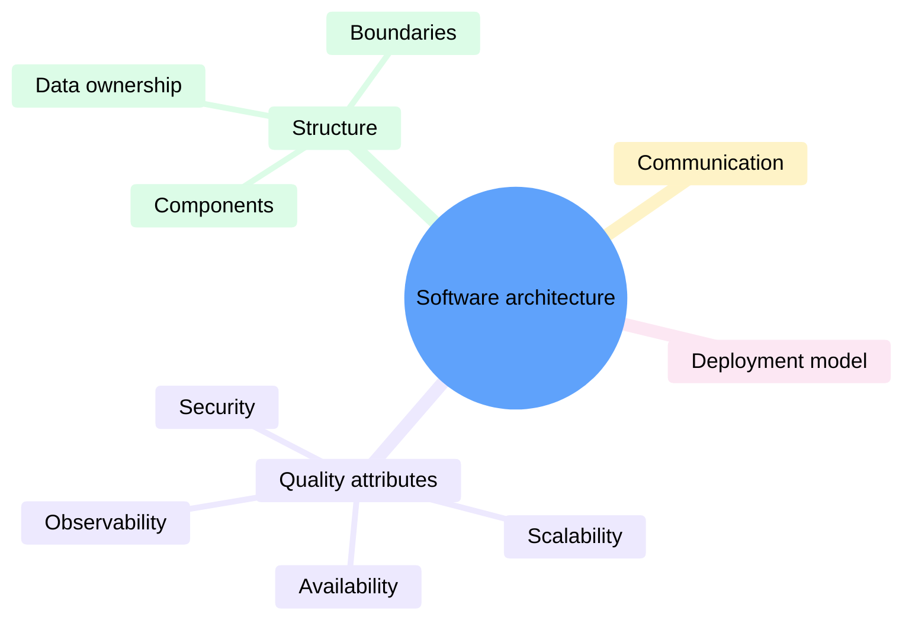

## 1.2 Architectural evolution

A typical evolution is:

1.  A simple monolithic application.
2.  A layered monolith as responsibilities become clearer.
3.  A Clean Architecture implementation to protect business rules.
4.  A modular monolith when the domain grows and boundaries become
    important.
5.  Selected microservices when independent deployment, scaling,
    ownership, or technology choices justify the operational cost.

This is not a mandatory progression. A well-designed monolith can be the
correct long-term architecture.

**Diagram: a typical architecture evolution**

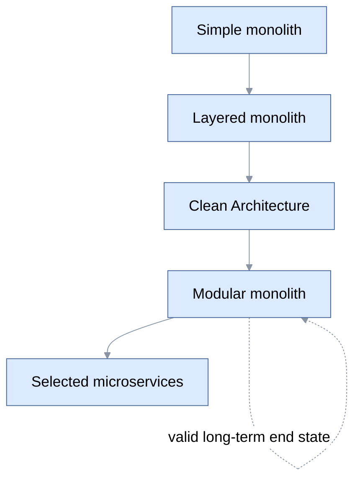

## 1.3 E-commerce domain used throughout the guide

Consider an online shop with these business capabilities:

-   **Catalog:** Products, categories, prices, descriptions, and
    inventory information.
-   **Basket:** A customer's selected products and quantities.
-   **Ordering:** Checkout, order lifecycle, payment coordination, and
    order history.
-   **Identity:** User registration, authentication, roles, and
    permissions.
-   **Messaging:** Notifications and integration events.
-   **Infrastructure:** Databases, cache, message broker, API gateway,
    and observability.

A useful domain flow is:

`Customer -> Catalog -> Basket -> Checkout -> Ordering -> Payment/Fulfilment`

The diagram is conceptual. Each capability should own its business rules
and data.

**Diagram: e-commerce capabilities**

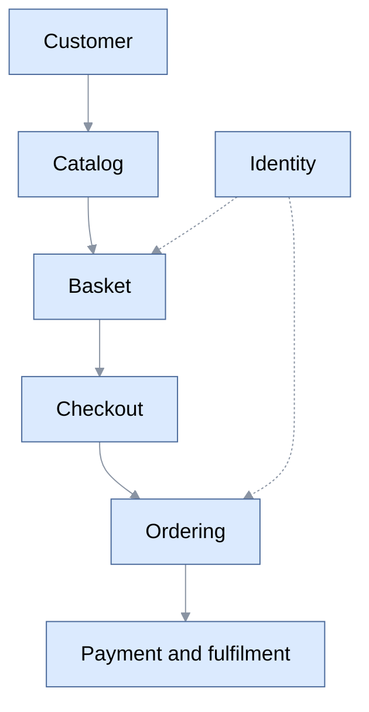

## 1.4 Architecture decision framework

Before choosing an architecture, ask:

-   How many developers and teams will work on it?
-   How often must parts be deployed independently?
-   Do different capabilities have significantly different load
    profiles?
-   Are there clear business boundaries?
-   What consistency requirements exist?
-   Can the organisation operate brokers, containers, monitoring, and
    distributed deployments?
-   What is the cost of network failures and operational complexity?

**Interview answer:** Microservices are not automatically better than
monoliths. Choose the simplest architecture that satisfies current and
reasonably foreseeable requirements. Introduce distribution only when
its benefits exceed the cost.

**Diagram: choosing an architecture**

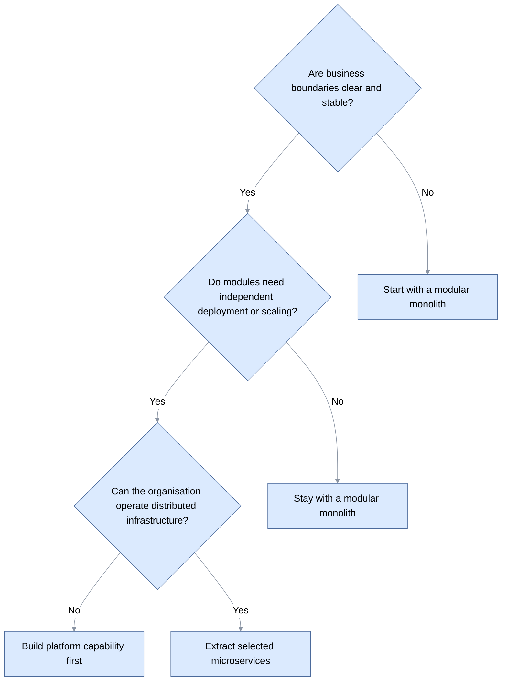

## 1.5 Functional and non-functional requirements

Start every design by writing down two lists.

**Functional requirements** describe what the system does: list and
filter products, add items to a basket, apply a coupon, check out, and
view order history. User stories such as "as a user, I want to filter
products by brand" are a practical way to capture them.

**Non-functional requirements** (the "-ilities") describe how well it
must do those things:

-   **Scalability:** "serve 2,000 concurrent users at 500 requests per
    second now, and grow later."
-   **Availability and reliability:** "available 24/7 with no noticeable
    downtime."
-   **Maintainability:** "developed by several teams for years."
-   **Latency:** "respond in under three seconds at the expected load."

Also write down constraints such as budget, deadline, and team skills.
Non-functional requirements and constraints, more than features, decide
the architecture.

**Diagram: from requirements to architecture**

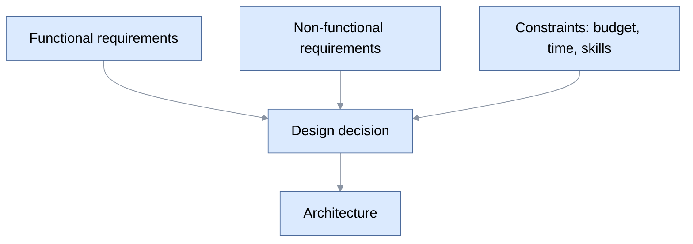

## 1.6 Design principles at architecture level

-   **KISS (Keep It Simple, Stupid):** avoid complexity the problem does
    not need. Most systems work best when kept simple.
-   **YAGNI (You Aren't Gonna Need It):** do not build for requirements
    you only imagine. Do not add Kafka or Kubernetes for 500 requests
    per second "just in case".
-   **DRY (Don't Repeat Yourself):** every piece of knowledge should
    have one authoritative representation. Apply it within a boundary.
    Across service boundaries, some duplication is often cheaper than
    shared coupling.
-   **Separation of Concerns (SoC):** split a system into sections that
    each address one concern, with little overlap. It is the principle
    behind layers, modules, and services. The result you want is low
    coupling and high cohesion.

**SOLID applied to system design:**

| Principle | Architecture-level meaning |
| --- | --- |
| Single Responsibility | A module or service owns one capability and has one reason to change |
| Open/Closed | Add a subscriber to an event without changing the publisher |
| Liskov Substitution | Replace one broker implementation with another behind the same abstraction |
| Interface Segregation | Give each client a focused API instead of one large contract (BFF, gRPC services) |
| Dependency Inversion | Modules depend on contracts rather than on each other's implementations |

**Diagram: principles and what they guard against**

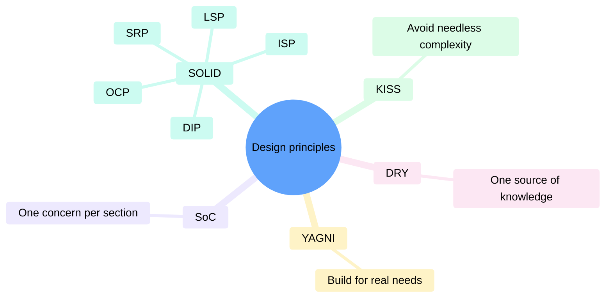

## 1.7 A repeatable way to evolve a design

The Design Microservices course uses one loop for each iteration, and it
works well on a whiteboard:

1.  **Design:** apply what is in your toolbox to the current
    requirements.
2.  **Adapt:** choose a technology stack for that design.
3.  **Evaluate:** list the benefits and the drawbacks.
4.  **Problem:** name the issue that now hurts most, such as "traffic
    increased" or "a query spans three services".
5.  Learn the pattern that addresses that problem and repeat.

Interviewers respond well to this structure because each new pattern is
justified by a concrete problem.

**Interview answer:** "Which architecture is right?" always starts with
"it depends on the non-functional requirements and context". Monolith
and microservices are both patterns, and neither is better in general.
Applying an advanced architecture to a small problem is itself an
anti-pattern.

**Diagram: the design iteration loop**

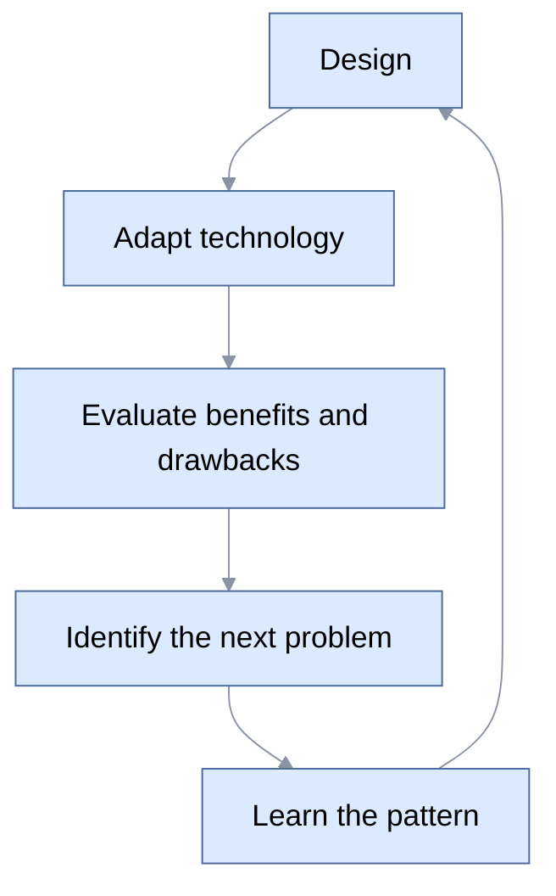

------------------------------------------------------------------------

# 2. Understand the E-commerce Domain

## 2.1 Domain, subdomain, and bounded context

A **domain** is the business area the software supports. E-commerce is
the overall domain.

A **subdomain** is a distinct part of that business problem, such as
product catalog, ordering, payment, or delivery.

A **bounded context** is an explicit boundary within which a domain
model and its terminology have a consistent meaning. The same word may
mean different things in different contexts.

For example:

-   Catalog's `Product` describes what can be sold.
-   Ordering's `OrderItem` records the product description and price
    agreed at purchase time.
-   Inventory's `StockItem` tracks quantities available for fulfilment.

These models should not automatically be one shared entity.

**Diagram: one business concept, different models per context**

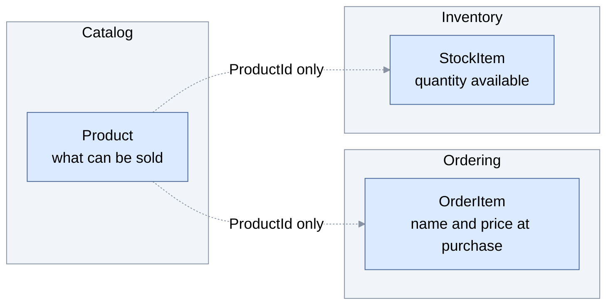

## 2.2 Ubiquitous language

Domain experts and developers should use the same terms. If the business
says "Basket", avoid randomly naming it `Cart`, `ShoppingSession`, and
`CustomerSelection` in different parts of the same context.

A ubiquitous language reduces translation errors and makes code
communicate business intent.

**Diagram: one shared language**

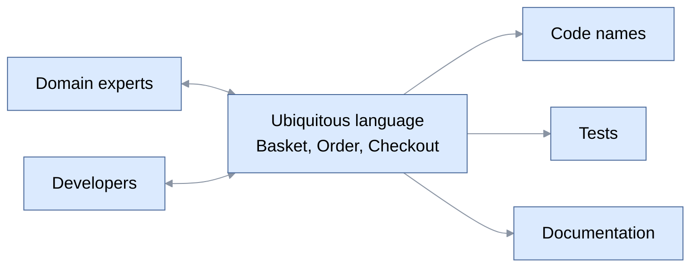

## 2.3 Identify boundaries from business capabilities

Good candidates for boundaries have:

-   A cohesive business responsibility.
-   Their own rules and lifecycle.
-   A clear owner.
-   A reason to change independently.
-   A manageable set of interactions with other contexts.

Do not split a system merely by technical layers such as "database
service", "repository service", and "business logic service". That
creates distributed technical layers rather than business capabilities.

**Diagram: testing a candidate boundary**

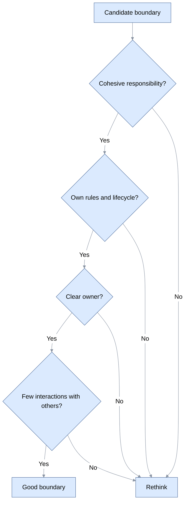

## 2.4 DDD building blocks

-   **Entity:** Has identity and a lifecycle. Two entities may have the
    same values but still be different.
-   **Value Object:** Defined by its values; ideally immutable.
    Examples: `Money`, `Address`, `Quantity`.
-   **Aggregate:** A consistency boundary containing an aggregate root
    and related objects.
-   **Aggregate Root:** The only entry point through which external code
    modifies an aggregate.
-   **Domain Event:** Records that something meaningful happened in the
    domain.
-   **Repository:** Provides persistence-oriented access to aggregate
    roots.
-   **Domain Service:** Holds domain logic that does not naturally
    belong to one entity or value object.
-   **Factory:** Encapsulates complex object or aggregate creation.
-   **Domain Event vs Integration Event:** A domain event is internal to
    a domain model; an integration event communicates a committed
    business fact to another process or service.

**Diagram: how DDD building blocks relate**

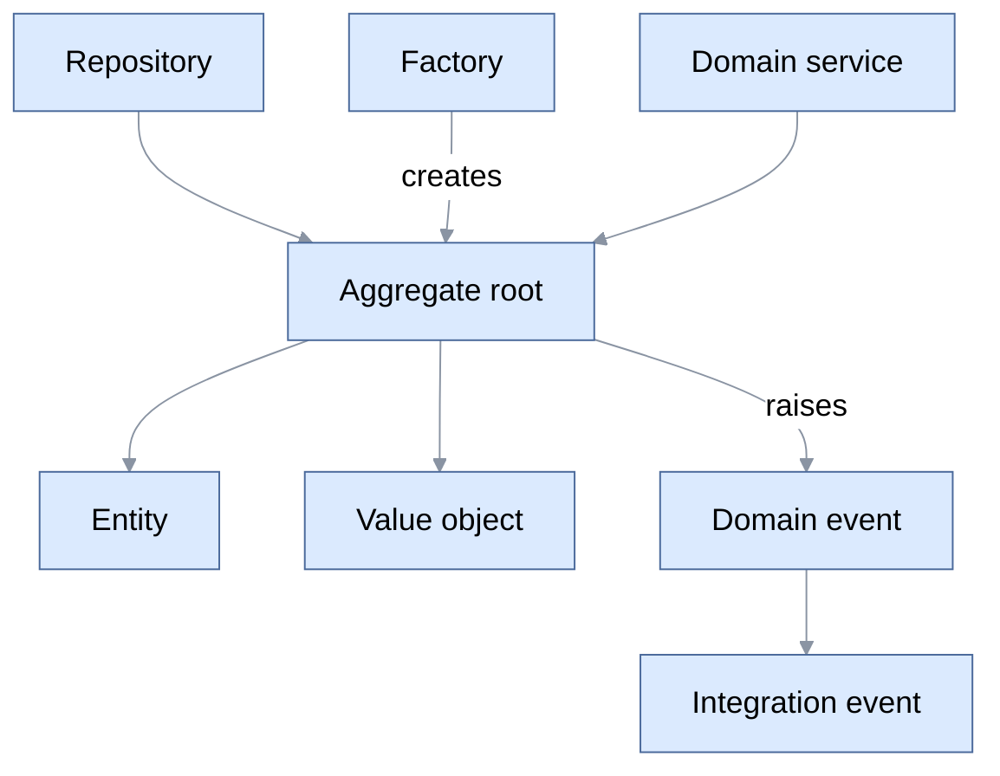

## 2.5 Aggregate example

An `Order` aggregate may contain order lines. The root enforces
invariants such as:

-   An order cannot be submitted with no lines.
-   A submitted order cannot be edited as a draft.
-   Quantity must be positive.
-   The agreed item price is captured when the order is placed.

Do not make every database table an aggregate. Aggregates should be
designed around transactional consistency, not table relationships.

**Diagram: the Order aggregate**

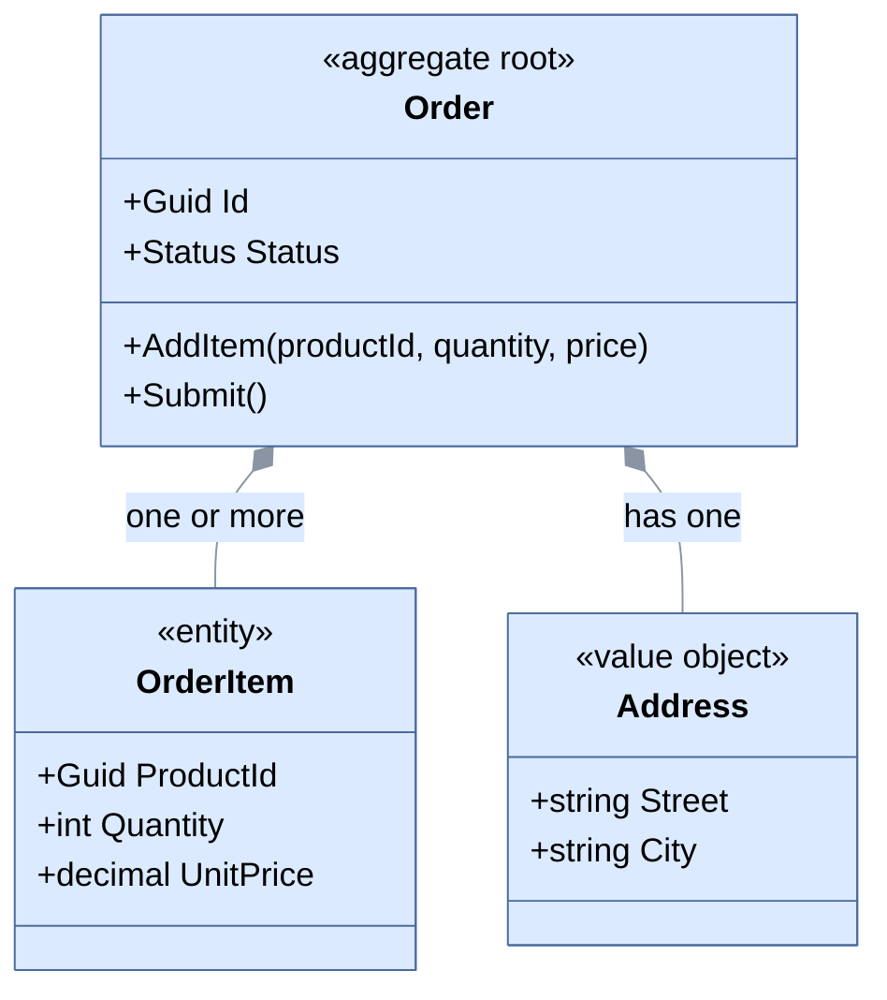

External code changes `OrderItem` only through `Order`, so the root can
protect every invariant.

## 2.6 Context mapping

Common relationships between bounded contexts include:

-   **Customer/Supplier:** One context supplies a model or service to
    another.
-   **Conformist:** A downstream context accepts the upstream model.
-   **Anti-Corruption Layer (ACL):** Translates an external model into
    the local domain model.
-   **Shared Kernel:** A deliberately small shared model, requiring
    coordinated changes.
-   **Published Language:** A stable contract used for integration.

**Interview prompt:** Why should Catalog's `Product` entity not be
directly reused as Ordering's order line?\
**Answer:** The contexts have different responsibilities and lifecycles.
Ordering needs a historical snapshot of product name and price at
purchase time; it must not change when Catalog later changes the
product.

**Diagram: context map**

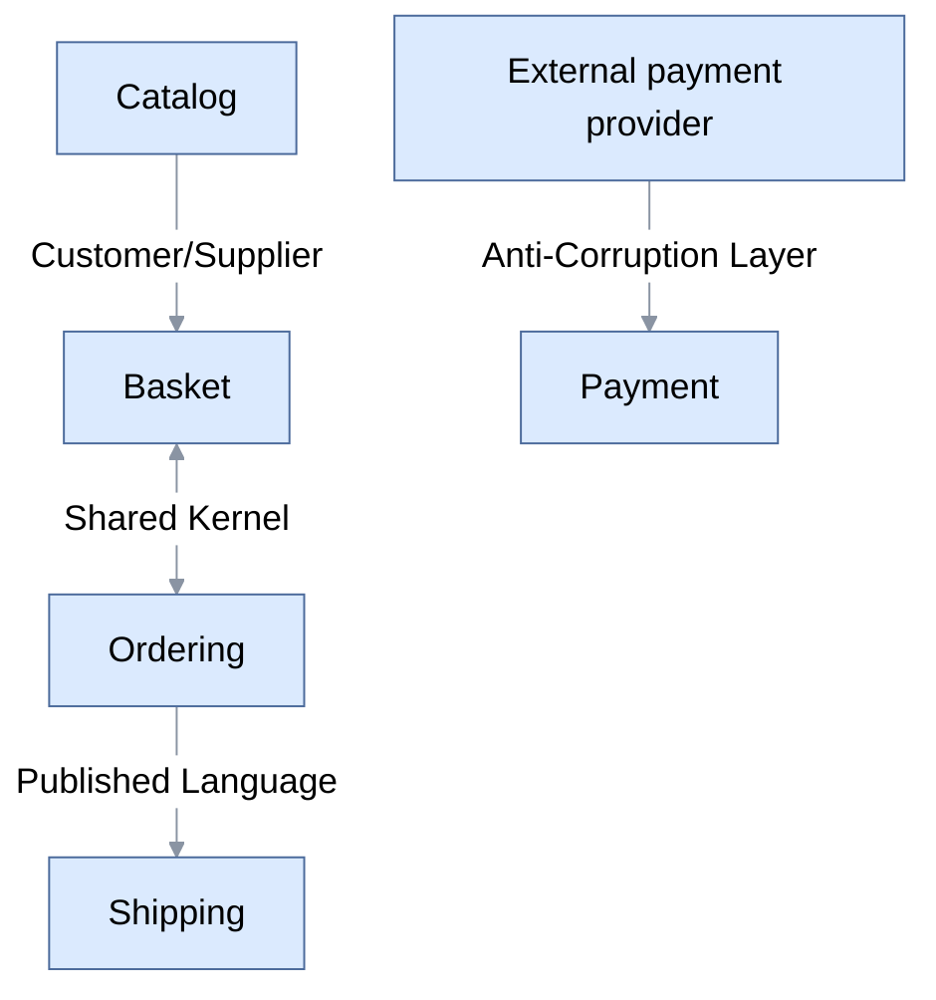

## 2.7 Strategic and tactical DDD

-   **Strategic DDD** models the business: subdomains, bounded contexts,
    ubiquitous language, and context maps. It tells you where the
    boundaries are.
-   **Tactical DDD** gives building blocks inside a boundary: entities,
    value objects, aggregates, repositories, and domain events.

A team can use strategic DDD to find module boundaries and still keep a
simple CRUD implementation inside a low-complexity module.

**Diagram: strategic and tactical DDD**

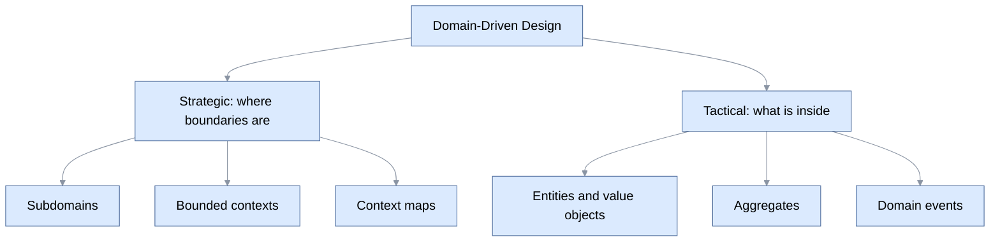

## 2.8 Anemic and rich domain models

An **anemic** entity is only properties with getters and setters.
Business rules live in services, so they spread across the application.

A **rich** entity holds both data and behaviour. It has private setters,
a factory method, and methods that enforce invariants.

``` csharp
public class Order : Aggregate<Guid>
{
    private readonly List<OrderItem> _items = new();
    public IReadOnlyList<OrderItem> Items => _items.AsReadOnly();

    public void AddItem(Guid productId, int quantity, decimal price)
    {
        ArgumentOutOfRangeException.ThrowIfNegativeOrZero(quantity);
        ArgumentOutOfRangeException.ThrowIfNegativeOrZero(price);

        _items.Add(new OrderItem(Id, productId, quantity, price));
    }
}
```

| | Anemic model | Rich model |
| --- | --- | --- |
| Starting effort | Low | Higher |
| Long-term complexity | Grows as rules scatter | Rules stay in one place |
| Good fit | Simple CRUD | Complex rules and invariants |

Make child-entity constructors `internal` so that an `OrderItem` or
`ShoppingCartItem` can only be created through its aggregate root.

**Diagram: where the rules live**

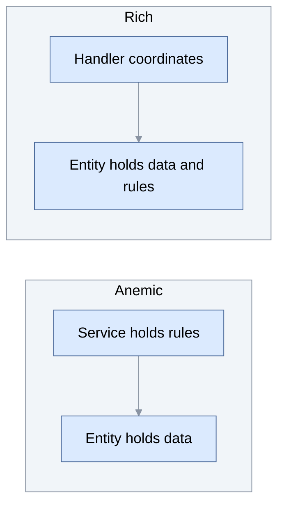

## 2.9 Domain events in practice

Both event types record something that already happened. They differ in
scope and delivery.

| | Domain event | Integration event |
| --- | --- | --- |
| Scope | Inside one bounded context | Across modules or services |
| Delivery | In-process, for example MediatR | Through a broker such as RabbitMQ |
| Purpose | Consistency between aggregates and side effects | Notify other subsystems |
| Timing | During the local unit of work | After the local transaction commits |
| Contract | Can change with the model | Stable and versioned |

The usual flow is **domain event leads to integration event**: an
aggregate raises `ProductPriceChangedEvent`, a local handler reacts, and
that reaction publishes `ProductPriceChangedIntegrationEvent` for other
modules.

**Diagram: a domain event leading to an integration event**

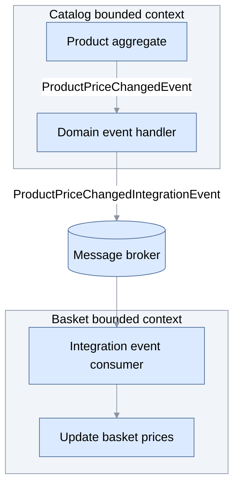

## 2.10 Finding boundaries: nouns, verbs, and domain experts

A simple technique for turning requirements into candidate services:

1.  Write user stories.
2.  Highlight the **nouns** (customer, order, product, shopping cart,
    brand). These suggest domain objects.
3.  Highlight the **verbs** (list, filter, put, check out). These
    suggest interactions and use cases.
4.  Draw an object interaction diagram, then group the objects by
    responsibility.
5.  Review the groups with **domain experts**. Different experts may use
    different names for the same concept, such as "customer" in Orders
    and "user" in Shopping Cart. That is evidence of a context boundary.

For e-commerce, this usually gives three groups:

-   **Core:** Customer, Product, Shopping Cart, Discount, Ordering.
-   **Order fulfilment:** Payment, Inventory, Shipping, Billing,
    Notification.
-   **Supporting and intelligence:** Identity, Marketing, Search,
    Reviews, Recommendations.

**Is one bounded context always one microservice?** No. A microservice
can represent a bounded context or part of one, so a context can produce
more than one service. It is a design decision driven by scaling,
ownership, and how the data changes.

**Diagram: from stories to services**

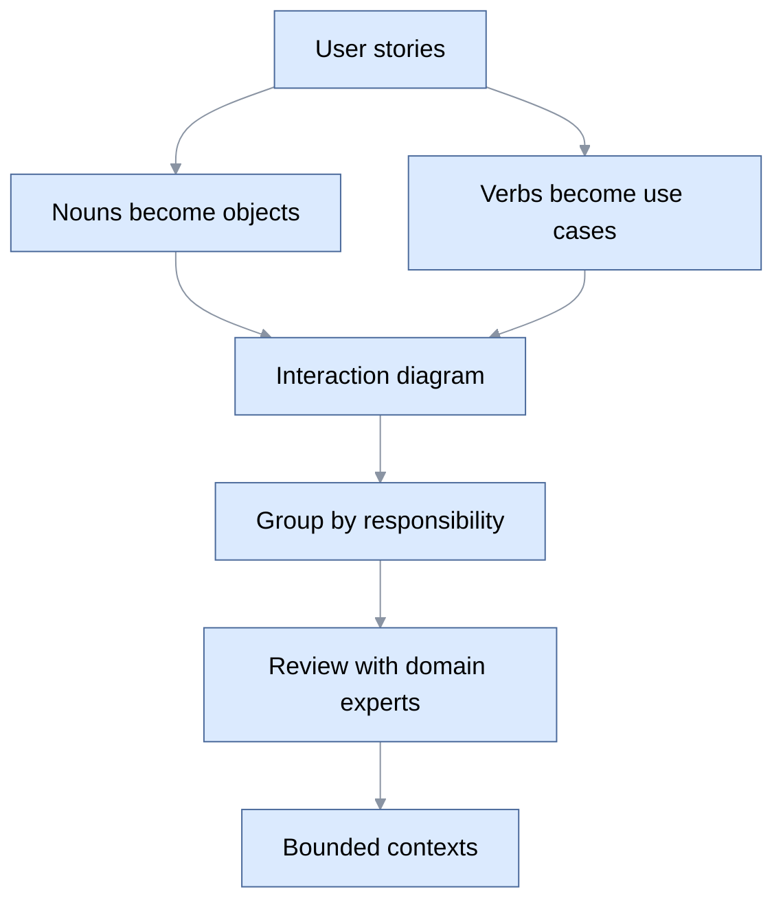

------------------------------------------------------------------------

# 3. Monolithic Architecture and Its Limitations

## 3.1 Definition

A monolith is an application delivered as one deployable unit. It may
contain many internal modules and layers, but the application is
normally built, released, and scaled together.

A monolith can still have excellent internal architecture.

**Diagram: one deployable unit**

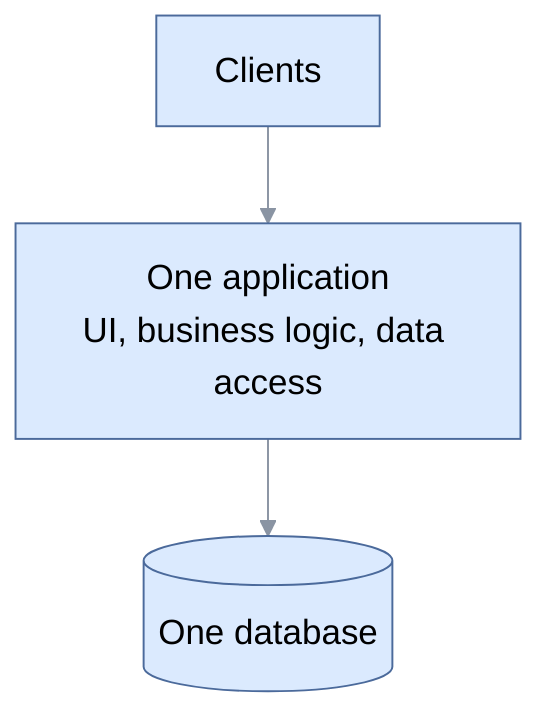

## 3.2 Advantages

-   Simple deployment and local development.
-   In-process calls are fast and straightforward.
-   Easier transactions across one database.
-   Easier debugging and end-to-end testing initially.
-   Lower infrastructure and operational overhead.
-   A single team can move quickly without distributed coordination.

**Diagram: monolith advantages**

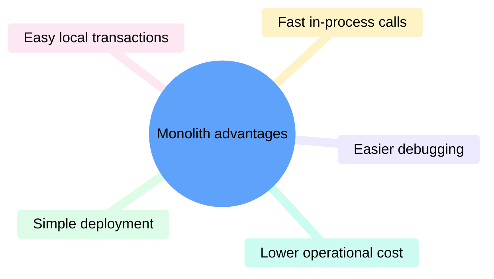

## 3.3 Common problems with a poorly structured monolith

-   **Tight coupling:** A small change affects unrelated areas.
-   **Low cohesion:** Business responsibilities are scattered.
-   **Shared database coupling:** Modules depend on each other's tables
    and schema.
-   **Deployment coupling:** Every feature waits for the same release.
-   **Scaling inefficiency:** The entire application may need to scale
    when only one feature is busy.
-   **Technology lock-in:** Different capabilities cannot easily use
    different technologies.
-   **Long build/test cycles:** The codebase becomes difficult to
    validate.
-   **Team coordination:** Many teams conflict in shared code and
    release schedules.
-   **Regression risk:** A change in one area unexpectedly breaks
    another.

These are often symptoms of poor modularity, not proof that a monolith
is inherently wrong.

**Diagram: monolith problems**

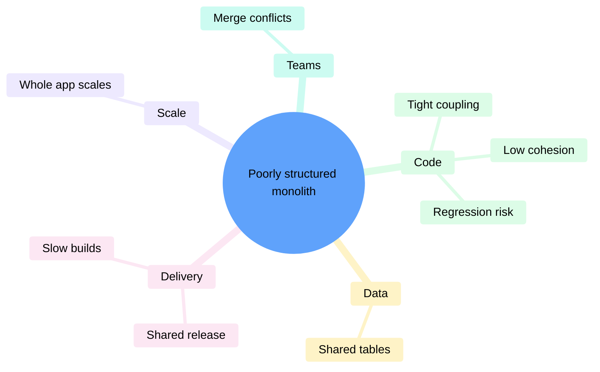

## 3.4 When a monolith is a good choice

-   Early-stage products with uncertain requirements.
-   Small teams and a single deployment cadence.
-   Strong transactional consistency across the core use cases.
-   Low operational maturity.
-   No compelling independent scaling or deployment requirement.

**Diagram: when a monolith fits**

```mermaid
%%{init: {"theme": "base", "themeVariables": {"fontSize": "18px", "primaryColor": "#dbeafe", "primaryTextColor": "#000000", "primaryBorderColor": "#4b6a9b", "secondaryColor": "#dcfce7", "secondaryTextColor": "#000000", "secondaryBorderColor": "#4b8a5f", "tertiaryColor": "#fef3c7", "tertiaryTextColor": "#000000", "tertiaryBorderColor": "#a8853a", "lineColor": "#8a94a3", "textColor": "#000000", "titleColor": "#000000", "classText": "#000000", "nodeTextColor": "#000000", "clusterBkg": "#f1f5f9", "clusterBorder": "#8a94a3", "edgeLabelBackground": "#ffffff", "noteBkgColor": "#fef3c7", "noteTextColor": "#000000", "noteBorderColor": "#a8853a", "actorBkg": "#dbeafe", "actorTextColor": "#000000", "actorBorder": "#4b6a9b", "actorLineColor": "#8a94a3", "signalColor": "#5f6b7a", "signalTextColor": "#000000", "labelBoxBkgColor": "#dbeafe", "labelTextColor": "#000000", "loopTextColor": "#000000", "labelBoxBorderColor": "#4b6a9b", "transitionLabelColor": "#000000", "stateLabelColor": "#000000", "cScale0": "#dbeafe", "cScaleLabel0": "#000000", "cScale1": "#dcfce7", "cScaleLabel1": "#000000", "cScale2": "#fef3c7", "cScaleLabel2": "#000000", "cScale3": "#fce7f3", "cScaleLabel3": "#000000", "cScale4": "#ede9fe", "cScaleLabel4": "#000000", "cScale5": "#ccfbf1", "cScaleLabel5": "#000000"}, "sequence": {"messageFontSize": 18, "actorFontSize": 18, "noteFontSize": 17}}}%%
flowchart TD
    A{Requirements still uncertain?} -- Yes --> M[Monolith is a good choice]
    A -- No --> B{Small team and one release cadence?}
    B -- Yes --> M
    B -- No --> C{Independent scaling needed?}
    C -- No --> M
    C -- Yes --> X[Consider a modular split]
```

## 3.5 How to improve a monolith

-   Establish business modules and ownership.
-   Enforce dependency direction.
-   Hide implementation details behind public contracts.
-   Avoid cross-module table access.
-   Use automated architecture tests.
-   Separate domain logic from infrastructure.
-   Measure bottlenecks before scaling or splitting.

**Interview trap:** "Monoliths do not scale."\
A better answer: Monoliths can scale vertically and horizontally. Their
limitation is often that the whole deployable unit scales together, not
that scaling is impossible.

**Diagram: improving a monolith step by step**

```mermaid
%%{init: {"theme": "base", "themeVariables": {"fontSize": "18px", "primaryColor": "#dbeafe", "primaryTextColor": "#000000", "primaryBorderColor": "#4b6a9b", "secondaryColor": "#dcfce7", "secondaryTextColor": "#000000", "secondaryBorderColor": "#4b8a5f", "tertiaryColor": "#fef3c7", "tertiaryTextColor": "#000000", "tertiaryBorderColor": "#a8853a", "lineColor": "#8a94a3", "textColor": "#000000", "titleColor": "#000000", "classText": "#000000", "nodeTextColor": "#000000", "clusterBkg": "#f1f5f9", "clusterBorder": "#8a94a3", "edgeLabelBackground": "#ffffff", "noteBkgColor": "#fef3c7", "noteTextColor": "#000000", "noteBorderColor": "#a8853a", "actorBkg": "#dbeafe", "actorTextColor": "#000000", "actorBorder": "#4b6a9b", "actorLineColor": "#8a94a3", "signalColor": "#5f6b7a", "signalTextColor": "#000000", "labelBoxBkgColor": "#dbeafe", "labelTextColor": "#000000", "loopTextColor": "#000000", "labelBoxBorderColor": "#4b6a9b", "transitionLabelColor": "#000000", "stateLabelColor": "#000000", "cScale0": "#dbeafe", "cScaleLabel0": "#000000", "cScale1": "#dcfce7", "cScaleLabel1": "#000000", "cScale2": "#fef3c7", "cScaleLabel2": "#000000", "cScale3": "#fce7f3", "cScaleLabel3": "#000000", "cScale4": "#ede9fe", "cScaleLabel4": "#000000", "cScale5": "#ccfbf1", "cScaleLabel5": "#000000"}, "sequence": {"messageFontSize": 18, "actorFontSize": 18, "noteFontSize": 17}}}%%
flowchart TD
    A[Define modules and owners] --> B[Enforce dependency direction]
    B --> C[Hide internals behind contracts]
    C --> D[Stop cross-module table access]
    D --> E[Add architecture tests]
    E --> F[Measure before splitting]
```

## 3.6 Big Ball of Mud

A Big Ball of Mud is a system with no recognisable structure, where the
code is so entangled that nobody can tell where one part ends and
another begins.

It typically comes from rapid delivery that skips good practice, from
design decisions made on the fly, and from a lack of regular
refactoring. Technical debt builds up until every change is risky.

Splitting a Big Ball of Mud into services does not fix it. It produces a
distributed Big Ball of Mud.

**Diagram: how a Big Ball of Mud forms**

```mermaid
%%{init: {"theme": "base", "themeVariables": {"fontSize": "18px", "primaryColor": "#dbeafe", "primaryTextColor": "#000000", "primaryBorderColor": "#4b6a9b", "secondaryColor": "#dcfce7", "secondaryTextColor": "#000000", "secondaryBorderColor": "#4b8a5f", "tertiaryColor": "#fef3c7", "tertiaryTextColor": "#000000", "tertiaryBorderColor": "#a8853a", "lineColor": "#8a94a3", "textColor": "#000000", "titleColor": "#000000", "classText": "#000000", "nodeTextColor": "#000000", "clusterBkg": "#f1f5f9", "clusterBorder": "#8a94a3", "edgeLabelBackground": "#ffffff", "noteBkgColor": "#fef3c7", "noteTextColor": "#000000", "noteBorderColor": "#a8853a", "actorBkg": "#dbeafe", "actorTextColor": "#000000", "actorBorder": "#4b6a9b", "actorLineColor": "#8a94a3", "signalColor": "#5f6b7a", "signalTextColor": "#000000", "labelBoxBkgColor": "#dbeafe", "labelTextColor": "#000000", "loopTextColor": "#000000", "labelBoxBorderColor": "#4b6a9b", "transitionLabelColor": "#000000", "stateLabelColor": "#000000", "cScale0": "#dbeafe", "cScaleLabel0": "#000000", "cScale1": "#dcfce7", "cScaleLabel1": "#000000", "cScale2": "#fef3c7", "cScaleLabel2": "#000000", "cScale3": "#fce7f3", "cScaleLabel3": "#000000", "cScale4": "#ede9fe", "cScaleLabel4": "#000000", "cScale5": "#ccfbf1", "cScaleLabel5": "#000000"}, "sequence": {"messageFontSize": 18, "actorFontSize": 18, "noteFontSize": 17}}}%%
flowchart TD
    A[Rush to deliver] --> D[Quick fixes]
    B[No clear design] --> D
    C[No regular refactoring] --> D
    D --> E[Technical debt]
    E --> F[Big Ball of Mud]
```

## 3.7 Technology lock-in and the fear cycle

Because all components are tightly integrated, a framework or database
change can affect the entire application. Teams spend most of their time
maintaining legacy code.

The **fear cycle** then sets in: code is hard to change, so developers
fear changing it, so they avoid refactoring and take shortcuts, which
makes the code harder to change.

Team-level symptoms include merge conflicts, slow release coordination,
and bug fixes that create new bugs.

**Diagram: the fear cycle**

```mermaid
%%{init: {"theme": "base", "themeVariables": {"fontSize": "18px", "primaryColor": "#dbeafe", "primaryTextColor": "#000000", "primaryBorderColor": "#4b6a9b", "secondaryColor": "#dcfce7", "secondaryTextColor": "#000000", "secondaryBorderColor": "#4b8a5f", "tertiaryColor": "#fef3c7", "tertiaryTextColor": "#000000", "tertiaryBorderColor": "#a8853a", "lineColor": "#8a94a3", "textColor": "#000000", "titleColor": "#000000", "classText": "#000000", "nodeTextColor": "#000000", "clusterBkg": "#f1f5f9", "clusterBorder": "#8a94a3", "edgeLabelBackground": "#ffffff", "noteBkgColor": "#fef3c7", "noteTextColor": "#000000", "noteBorderColor": "#a8853a", "actorBkg": "#dbeafe", "actorTextColor": "#000000", "actorBorder": "#4b6a9b", "actorLineColor": "#8a94a3", "signalColor": "#5f6b7a", "signalTextColor": "#000000", "labelBoxBkgColor": "#dbeafe", "labelTextColor": "#000000", "loopTextColor": "#000000", "labelBoxBorderColor": "#4b6a9b", "transitionLabelColor": "#000000", "stateLabelColor": "#000000", "cScale0": "#dbeafe", "cScaleLabel0": "#000000", "cScale1": "#dcfce7", "cScaleLabel1": "#000000", "cScale2": "#fef3c7", "cScaleLabel2": "#000000", "cScale3": "#fce7f3", "cScaleLabel3": "#000000", "cScale4": "#ede9fe", "cScaleLabel4": "#000000", "cScale5": "#ccfbf1", "cScaleLabel5": "#000000"}, "sequence": {"messageFontSize": 18, "actorFontSize": 18, "noteFontSize": 17}}}%%
flowchart TD
    A[Code is hard to change] --> B[Developers fear changing it]
    B --> C[Refactoring is avoided]
    C --> D[Shortcuts add technical debt]
    D --> A
```

------------------------------------------------------------------------

# 4. Layered (N-Layer) Architecture

## 4.1 Typical layers

A traditional .NET layered application may contain:

1.  **Presentation/API:** HTTP endpoints, request binding,
    authentication, response formatting.
2.  **Application/Business Logic:** Use cases, workflows, validation,
    orchestration.
3.  **Domain:** Business rules and domain objects.
4.  **Data Access/Infrastructure:** EF Core, repositories, external
    services, file systems.

A simpler three-layer design may combine Application and Domain or
Domain and Business Logic, but the responsibilities should remain clear.

**Diagram: typical layers**

```mermaid
%%{init: {"theme": "base", "themeVariables": {"fontSize": "18px", "primaryColor": "#dbeafe", "primaryTextColor": "#000000", "primaryBorderColor": "#4b6a9b", "secondaryColor": "#dcfce7", "secondaryTextColor": "#000000", "secondaryBorderColor": "#4b8a5f", "tertiaryColor": "#fef3c7", "tertiaryTextColor": "#000000", "tertiaryBorderColor": "#a8853a", "lineColor": "#8a94a3", "textColor": "#000000", "titleColor": "#000000", "classText": "#000000", "nodeTextColor": "#000000", "clusterBkg": "#f1f5f9", "clusterBorder": "#8a94a3", "edgeLabelBackground": "#ffffff", "noteBkgColor": "#fef3c7", "noteTextColor": "#000000", "noteBorderColor": "#a8853a", "actorBkg": "#dbeafe", "actorTextColor": "#000000", "actorBorder": "#4b6a9b", "actorLineColor": "#8a94a3", "signalColor": "#5f6b7a", "signalTextColor": "#000000", "labelBoxBkgColor": "#dbeafe", "labelTextColor": "#000000", "loopTextColor": "#000000", "labelBoxBorderColor": "#4b6a9b", "transitionLabelColor": "#000000", "stateLabelColor": "#000000", "cScale0": "#dbeafe", "cScaleLabel0": "#000000", "cScale1": "#dcfce7", "cScaleLabel1": "#000000", "cScale2": "#fef3c7", "cScaleLabel2": "#000000", "cScale3": "#fce7f3", "cScaleLabel3": "#000000", "cScale4": "#ede9fe", "cScaleLabel4": "#000000", "cScale5": "#ccfbf1", "cScaleLabel5": "#000000"}, "sequence": {"messageFontSize": 18, "actorFontSize": 18, "noteFontSize": 17}}}%%
flowchart TD
    A["Presentation: HTTP and formatting"] --> B["Application: use cases"]
    B --> C["Domain: business rules"]
    B --> D["Infrastructure: EF Core and external services"]
```

## 4.2 Dependency direction

In a conventional layered design, upper layers call lower layers:

`API -> Business/Application -> Data Access`

A problem occurs when business logic directly depends on concrete
database or framework implementations. The business layer becomes
difficult to test and change.

**Diagram: layered dependency direction**

```mermaid
%%{init: {"theme": "base", "themeVariables": {"fontSize": "18px", "primaryColor": "#dbeafe", "primaryTextColor": "#000000", "primaryBorderColor": "#4b6a9b", "secondaryColor": "#dcfce7", "secondaryTextColor": "#000000", "secondaryBorderColor": "#4b8a5f", "tertiaryColor": "#fef3c7", "tertiaryTextColor": "#000000", "tertiaryBorderColor": "#a8853a", "lineColor": "#8a94a3", "textColor": "#000000", "titleColor": "#000000", "classText": "#000000", "nodeTextColor": "#000000", "clusterBkg": "#f1f5f9", "clusterBorder": "#8a94a3", "edgeLabelBackground": "#ffffff", "noteBkgColor": "#fef3c7", "noteTextColor": "#000000", "noteBorderColor": "#a8853a", "actorBkg": "#dbeafe", "actorTextColor": "#000000", "actorBorder": "#4b6a9b", "actorLineColor": "#8a94a3", "signalColor": "#5f6b7a", "signalTextColor": "#000000", "labelBoxBkgColor": "#dbeafe", "labelTextColor": "#000000", "loopTextColor": "#000000", "labelBoxBorderColor": "#4b6a9b", "transitionLabelColor": "#000000", "stateLabelColor": "#000000", "cScale0": "#dbeafe", "cScaleLabel0": "#000000", "cScale1": "#dcfce7", "cScaleLabel1": "#000000", "cScale2": "#fef3c7", "cScaleLabel2": "#000000", "cScale3": "#fce7f3", "cScaleLabel3": "#000000", "cScale4": "#ede9fe", "cScaleLabel4": "#000000", "cScale5": "#ccfbf1", "cScaleLabel5": "#000000"}, "sequence": {"messageFontSize": 18, "actorFontSize": 18, "noteFontSize": 17}}}%%
flowchart TD
    API[Presentation or API] --> APP[Business or Application]
    APP --> DATA[Data Access]
    DATA --> DB[(Database)]
```

## 4.3 Layering is not the same as modularity

A project can have perfectly separated API, Services, and Repositories
folders while every feature still shares all tables and business
services. Layers separate technical concerns; modules separate business
capabilities.

**Diagram: layers and modules cut in different directions**

```mermaid
%%{init: {"theme": "base", "themeVariables": {"fontSize": "18px", "primaryColor": "#dbeafe", "primaryTextColor": "#000000", "primaryBorderColor": "#4b6a9b", "secondaryColor": "#dcfce7", "secondaryTextColor": "#000000", "secondaryBorderColor": "#4b8a5f", "tertiaryColor": "#fef3c7", "tertiaryTextColor": "#000000", "tertiaryBorderColor": "#a8853a", "lineColor": "#8a94a3", "textColor": "#000000", "titleColor": "#000000", "classText": "#000000", "nodeTextColor": "#000000", "clusterBkg": "#f1f5f9", "clusterBorder": "#8a94a3", "edgeLabelBackground": "#ffffff", "noteBkgColor": "#fef3c7", "noteTextColor": "#000000", "noteBorderColor": "#a8853a", "actorBkg": "#dbeafe", "actorTextColor": "#000000", "actorBorder": "#4b6a9b", "actorLineColor": "#8a94a3", "signalColor": "#5f6b7a", "signalTextColor": "#000000", "labelBoxBkgColor": "#dbeafe", "labelTextColor": "#000000", "loopTextColor": "#000000", "labelBoxBorderColor": "#4b6a9b", "transitionLabelColor": "#000000", "stateLabelColor": "#000000", "cScale0": "#dbeafe", "cScaleLabel0": "#000000", "cScale1": "#dcfce7", "cScaleLabel1": "#000000", "cScale2": "#fef3c7", "cScaleLabel2": "#000000", "cScale3": "#fce7f3", "cScaleLabel3": "#000000", "cScale4": "#ede9fe", "cScaleLabel4": "#000000", "cScale5": "#ccfbf1", "cScaleLabel5": "#000000"}, "sequence": {"messageFontSize": 18, "actorFontSize": 18, "noteFontSize": 17}}}%%
flowchart LR
    subgraph L[Layers: technical separation]
        A1[Controllers] --> A2[Services] --> A3[Repositories]
    end
    subgraph M[Modules: business separation]
        B1[Catalog]
        B2[Basket]
        B3[Ordering]
    end
```

## 4.4 Common interview questions

**Can the API call the repository directly?**\
For a trivial CRUD application it may be acceptable, but complex use
cases should be orchestrated through application handlers so business
workflows are not embedded in controllers.

**Should every entity have a repository?**\
No. Repositories are most useful around aggregate roots and meaningful
persistence boundaries. Avoid adding abstractions that only duplicate EF
Core without improving the design.

## 4.5 Evaluating layered architecture

Layered architecture is easy to understand and suits simple
applications. Its main problem appears as a system grows: the layers
depend on each other in sequence, so business logic ends up tied to data
access, and one feature change touches every layer.

The Dependency Inversion Principle addresses this, which leads to Clean
Architecture.

**Diagram: why layered systems become coupled**

```mermaid
%%{init: {"theme": "base", "themeVariables": {"fontSize": "18px", "primaryColor": "#dbeafe", "primaryTextColor": "#000000", "primaryBorderColor": "#4b6a9b", "secondaryColor": "#dcfce7", "secondaryTextColor": "#000000", "secondaryBorderColor": "#4b8a5f", "tertiaryColor": "#fef3c7", "tertiaryTextColor": "#000000", "tertiaryBorderColor": "#a8853a", "lineColor": "#8a94a3", "textColor": "#000000", "titleColor": "#000000", "classText": "#000000", "nodeTextColor": "#000000", "clusterBkg": "#f1f5f9", "clusterBorder": "#8a94a3", "edgeLabelBackground": "#ffffff", "noteBkgColor": "#fef3c7", "noteTextColor": "#000000", "noteBorderColor": "#a8853a", "actorBkg": "#dbeafe", "actorTextColor": "#000000", "actorBorder": "#4b6a9b", "actorLineColor": "#8a94a3", "signalColor": "#5f6b7a", "signalTextColor": "#000000", "labelBoxBkgColor": "#dbeafe", "labelTextColor": "#000000", "loopTextColor": "#000000", "labelBoxBorderColor": "#4b6a9b", "transitionLabelColor": "#000000", "stateLabelColor": "#000000", "cScale0": "#dbeafe", "cScaleLabel0": "#000000", "cScale1": "#dcfce7", "cScaleLabel1": "#000000", "cScale2": "#fef3c7", "cScaleLabel2": "#000000", "cScale3": "#fce7f3", "cScaleLabel3": "#000000", "cScale4": "#ede9fe", "cScaleLabel4": "#000000", "cScale5": "#ccfbf1", "cScaleLabel5": "#000000"}, "sequence": {"messageFontSize": 18, "actorFontSize": 18, "noteFontSize": 17}}}%%
flowchart TD
    A[Business logic calls concrete data access] --> B[Layers change together]
    B --> C[Hard to test and replace]
    C --> D[Invert dependencies]
    D --> E[Clean Architecture]
```

------------------------------------------------------------------------

# 5. Clean Architecture

## 5.1 Core idea

Clean Architecture places business policy at the centre and makes outer
details depend inward.

Typical projects:

-   `Domain`
-   `Application`
-   `Infrastructure`
-   `API` or `Web`

Dependency direction:

`API -> Application -> Domain`\
`Infrastructure -> Application/Domain abstractions`

The Domain should not depend on EF Core, ASP.NET Core, a message broker,
or a cloud SDK.

**Diagram: dependencies point inward**

```mermaid
%%{init: {"theme": "base", "themeVariables": {"fontSize": "18px", "primaryColor": "#dbeafe", "primaryTextColor": "#000000", "primaryBorderColor": "#4b6a9b", "secondaryColor": "#dcfce7", "secondaryTextColor": "#000000", "secondaryBorderColor": "#4b8a5f", "tertiaryColor": "#fef3c7", "tertiaryTextColor": "#000000", "tertiaryBorderColor": "#a8853a", "lineColor": "#8a94a3", "textColor": "#000000", "titleColor": "#000000", "classText": "#000000", "nodeTextColor": "#000000", "clusterBkg": "#f1f5f9", "clusterBorder": "#8a94a3", "edgeLabelBackground": "#ffffff", "noteBkgColor": "#fef3c7", "noteTextColor": "#000000", "noteBorderColor": "#a8853a", "actorBkg": "#dbeafe", "actorTextColor": "#000000", "actorBorder": "#4b6a9b", "actorLineColor": "#8a94a3", "signalColor": "#5f6b7a", "signalTextColor": "#000000", "labelBoxBkgColor": "#dbeafe", "labelTextColor": "#000000", "loopTextColor": "#000000", "labelBoxBorderColor": "#4b6a9b", "transitionLabelColor": "#000000", "stateLabelColor": "#000000", "cScale0": "#dbeafe", "cScaleLabel0": "#000000", "cScale1": "#dcfce7", "cScaleLabel1": "#000000", "cScale2": "#fef3c7", "cScaleLabel2": "#000000", "cScale3": "#fce7f3", "cScaleLabel3": "#000000", "cScale4": "#ede9fe", "cScaleLabel4": "#000000", "cScale5": "#ccfbf1", "cScaleLabel5": "#000000"}, "sequence": {"messageFontSize": 18, "actorFontSize": 18, "noteFontSize": 17}}}%%
flowchart TD
    API[API or Web] --> APP[Application]
    INF[Infrastructure] --> APP
    APP --> DOM[Domain]
    INF -. "implements ports" .-> APP
    API -. "composition root only" .-> INF
```

## 5.2 Responsibilities

### Domain

-   Entities, value objects, aggregates.
-   Domain events and domain services.
-   Business invariants.
-   No infrastructure dependencies.

### Application

-   Use cases and commands/queries.
-   Interfaces/ports needed by use cases.
-   Validation and orchestration.
-   DTOs and mapping where appropriate.
-   Transaction boundaries where appropriate.

### Infrastructure

-   EF Core DbContexts and configurations.
-   Repository implementations.
-   Redis, RabbitMQ, email, storage, external API adapters.
-   Database migrations and technical integrations.

### API

-   HTTP endpoints and middleware.
-   Authentication/authorization configuration.
-   Request/response mapping.
-   Dependency injection composition root.

**Diagram: what each project owns**

```mermaid
%%{init: {"theme": "base", "themeVariables": {"fontSize": "18px", "primaryColor": "#dbeafe", "primaryTextColor": "#000000", "primaryBorderColor": "#4b6a9b", "secondaryColor": "#dcfce7", "secondaryTextColor": "#000000", "secondaryBorderColor": "#4b8a5f", "tertiaryColor": "#fef3c7", "tertiaryTextColor": "#000000", "tertiaryBorderColor": "#a8853a", "lineColor": "#8a94a3", "textColor": "#000000", "titleColor": "#000000", "classText": "#000000", "nodeTextColor": "#000000", "clusterBkg": "#f1f5f9", "clusterBorder": "#8a94a3", "edgeLabelBackground": "#ffffff", "noteBkgColor": "#fef3c7", "noteTextColor": "#000000", "noteBorderColor": "#a8853a", "actorBkg": "#dbeafe", "actorTextColor": "#000000", "actorBorder": "#4b6a9b", "actorLineColor": "#8a94a3", "signalColor": "#5f6b7a", "signalTextColor": "#000000", "labelBoxBkgColor": "#dbeafe", "labelTextColor": "#000000", "loopTextColor": "#000000", "labelBoxBorderColor": "#4b6a9b", "transitionLabelColor": "#000000", "stateLabelColor": "#000000", "cScale0": "#dbeafe", "cScaleLabel0": "#000000", "cScale1": "#dcfce7", "cScaleLabel1": "#000000", "cScale2": "#fef3c7", "cScaleLabel2": "#000000", "cScale3": "#fce7f3", "cScaleLabel3": "#000000", "cScale4": "#ede9fe", "cScaleLabel4": "#000000", "cScale5": "#ccfbf1", "cScaleLabel5": "#000000"}, "sequence": {"messageFontSize": 18, "actorFontSize": 18, "noteFontSize": 17}}}%%
flowchart TD
    API["API: endpoints, DI root"] --> APP["Application: use cases, ports"]
    APP --> DOM["Domain: entities, invariants"]
    INF["Infrastructure: EF Core, Redis, RabbitMQ"] --> APP
    INF --> DOM
```

## 5.3 Dependency Inversion Principle

High-level policy should not depend on low-level details. Both should
depend on abstractions.

Example:

``` csharp
public interface IProductRepository
{
    Task<Product?> GetByIdAsync(
        Guid id,
        CancellationToken cancellationToken);

    Task AddAsync(
        Product product,
        CancellationToken cancellationToken);
}
```

Application code depends on `IProductRepository`. Infrastructure
implements it using EF Core.

**Diagram: Dependency Inversion in practice**

```mermaid
%%{init: {"theme": "base", "themeVariables": {"fontSize": "18px", "primaryColor": "#dbeafe", "primaryTextColor": "#000000", "primaryBorderColor": "#4b6a9b", "secondaryColor": "#dcfce7", "secondaryTextColor": "#000000", "secondaryBorderColor": "#4b8a5f", "tertiaryColor": "#fef3c7", "tertiaryTextColor": "#000000", "tertiaryBorderColor": "#a8853a", "lineColor": "#8a94a3", "textColor": "#000000", "titleColor": "#000000", "classText": "#000000", "nodeTextColor": "#000000", "clusterBkg": "#f1f5f9", "clusterBorder": "#8a94a3", "edgeLabelBackground": "#ffffff", "noteBkgColor": "#fef3c7", "noteTextColor": "#000000", "noteBorderColor": "#a8853a", "actorBkg": "#dbeafe", "actorTextColor": "#000000", "actorBorder": "#4b6a9b", "actorLineColor": "#8a94a3", "signalColor": "#5f6b7a", "signalTextColor": "#000000", "labelBoxBkgColor": "#dbeafe", "labelTextColor": "#000000", "loopTextColor": "#000000", "labelBoxBorderColor": "#4b6a9b", "transitionLabelColor": "#000000", "stateLabelColor": "#000000", "cScale0": "#dbeafe", "cScaleLabel0": "#000000", "cScale1": "#dcfce7", "cScaleLabel1": "#000000", "cScale2": "#fef3c7", "cScaleLabel2": "#000000", "cScale3": "#fce7f3", "cScaleLabel3": "#000000", "cScale4": "#ede9fe", "cScaleLabel4": "#000000", "cScale5": "#ccfbf1", "cScaleLabel5": "#000000"}, "sequence": {"messageFontSize": 18, "actorFontSize": 18, "noteFontSize": 17}}}%%
flowchart LR
    H[Application handler] --> I[IProductRepository]
    E[EfProductRepository] -. implements .-> I
    E --> D[(Database)]
```

## 5.4 Important cautions

-   Do not create an interface for every class automatically.
-   Do not let DTOs become domain entities.
-   Do not put business rules in controllers.
-   Do not expose EF entities directly as public API contracts.
-   Avoid a generic repository that hides useful EF Core capabilities.
-   Keep dependency direction enforceable with project references and
    architecture tests.

**Interview answer:** Clean Architecture protects business rules from
infrastructure changes. It is a dependency strategy, not a requirement
to create a large number of projects or interfaces.

**Diagram: common Clean Architecture mistakes**

```mermaid
%%{init: {"theme": "base", "themeVariables": {"fontSize": "18px", "primaryColor": "#dbeafe", "primaryTextColor": "#000000", "primaryBorderColor": "#4b6a9b", "secondaryColor": "#dcfce7", "secondaryTextColor": "#000000", "secondaryBorderColor": "#4b8a5f", "tertiaryColor": "#fef3c7", "tertiaryTextColor": "#000000", "tertiaryBorderColor": "#a8853a", "lineColor": "#8a94a3", "textColor": "#000000", "titleColor": "#000000", "classText": "#000000", "nodeTextColor": "#000000", "clusterBkg": "#f1f5f9", "clusterBorder": "#8a94a3", "edgeLabelBackground": "#ffffff", "noteBkgColor": "#fef3c7", "noteTextColor": "#000000", "noteBorderColor": "#a8853a", "actorBkg": "#dbeafe", "actorTextColor": "#000000", "actorBorder": "#4b6a9b", "actorLineColor": "#8a94a3", "signalColor": "#5f6b7a", "signalTextColor": "#000000", "labelBoxBkgColor": "#dbeafe", "labelTextColor": "#000000", "loopTextColor": "#000000", "labelBoxBorderColor": "#4b6a9b", "transitionLabelColor": "#000000", "stateLabelColor": "#000000", "cScale0": "#dbeafe", "cScaleLabel0": "#000000", "cScale1": "#dcfce7", "cScaleLabel1": "#000000", "cScale2": "#fef3c7", "cScaleLabel2": "#000000", "cScale3": "#fce7f3", "cScaleLabel3": "#000000", "cScale4": "#ede9fe", "cScaleLabel4": "#000000", "cScale5": "#ccfbf1", "cScaleLabel5": "#000000"}, "sequence": {"messageFontSize": 18, "actorFontSize": 18, "noteFontSize": 17}}}%%
mindmap
  root((Cautions))
    Interface for every class
    DTOs as domain entities
    Rules in controllers
    EF entities as API contracts
    Generic repository hiding EF Core
```

## 5.5 The Dependency Rule

Robert C. Martin's Dependency Rule says **source code dependencies can
only point inwards**. Nothing in an inner layer may name a class,
function, or data format declared in an outer layer.

The resulting system is independent of frameworks, the UI, the database,
and external agencies, and business rules can be tested without any of
them.

**Diagram: the concentric layers**

```mermaid
%%{init: {"theme": "base", "themeVariables": {"fontSize": "18px", "primaryColor": "#dbeafe", "primaryTextColor": "#000000", "primaryBorderColor": "#4b6a9b", "secondaryColor": "#dcfce7", "secondaryTextColor": "#000000", "secondaryBorderColor": "#4b8a5f", "tertiaryColor": "#fef3c7", "tertiaryTextColor": "#000000", "tertiaryBorderColor": "#a8853a", "lineColor": "#8a94a3", "textColor": "#000000", "titleColor": "#000000", "classText": "#000000", "nodeTextColor": "#000000", "clusterBkg": "#f1f5f9", "clusterBorder": "#8a94a3", "edgeLabelBackground": "#ffffff", "noteBkgColor": "#fef3c7", "noteTextColor": "#000000", "noteBorderColor": "#a8853a", "actorBkg": "#dbeafe", "actorTextColor": "#000000", "actorBorder": "#4b6a9b", "actorLineColor": "#8a94a3", "signalColor": "#5f6b7a", "signalTextColor": "#000000", "labelBoxBkgColor": "#dbeafe", "labelTextColor": "#000000", "loopTextColor": "#000000", "labelBoxBorderColor": "#4b6a9b", "transitionLabelColor": "#000000", "stateLabelColor": "#000000", "cScale0": "#dbeafe", "cScaleLabel0": "#000000", "cScale1": "#dcfce7", "cScaleLabel1": "#000000", "cScale2": "#fef3c7", "cScaleLabel2": "#000000", "cScale3": "#fce7f3", "cScaleLabel3": "#000000", "cScale4": "#ede9fe", "cScaleLabel4": "#000000", "cScale5": "#ccfbf1", "cScaleLabel5": "#000000"}, "sequence": {"messageFontSize": 18, "actorFontSize": 18, "noteFontSize": 17}}}%%
flowchart TD
    O["Frameworks and drivers"] --> A["Interface adapters"]
    A --> U["Use cases"]
    U --> E["Entities"]
```

## 5.6 Evaluating Clean Architecture

-   **Benefits:** testable domain, replaceable infrastructure, clear
    long-term structure, and strong fit for complex domains.
-   **Drawbacks:** more projects and mapping code, a slower start, and a
    tendency toward indirection in simple features. Changes to one
    feature can still touch several layers.
-   It does not address runtime scalability. A Clean Architecture
    application is still one deployable unit until you scale it.

**Diagram: evaluating Clean Architecture**

```mermaid
%%{init: {"theme": "base", "themeVariables": {"fontSize": "18px", "primaryColor": "#dbeafe", "primaryTextColor": "#000000", "primaryBorderColor": "#4b6a9b", "secondaryColor": "#dcfce7", "secondaryTextColor": "#000000", "secondaryBorderColor": "#4b8a5f", "tertiaryColor": "#fef3c7", "tertiaryTextColor": "#000000", "tertiaryBorderColor": "#a8853a", "lineColor": "#8a94a3", "textColor": "#000000", "titleColor": "#000000", "classText": "#000000", "nodeTextColor": "#000000", "clusterBkg": "#f1f5f9", "clusterBorder": "#8a94a3", "edgeLabelBackground": "#ffffff", "noteBkgColor": "#fef3c7", "noteTextColor": "#000000", "noteBorderColor": "#a8853a", "actorBkg": "#dbeafe", "actorTextColor": "#000000", "actorBorder": "#4b6a9b", "actorLineColor": "#8a94a3", "signalColor": "#5f6b7a", "signalTextColor": "#000000", "labelBoxBkgColor": "#dbeafe", "labelTextColor": "#000000", "loopTextColor": "#000000", "labelBoxBorderColor": "#4b6a9b", "transitionLabelColor": "#000000", "stateLabelColor": "#000000", "cScale0": "#dbeafe", "cScaleLabel0": "#000000", "cScale1": "#dcfce7", "cScaleLabel1": "#000000", "cScale2": "#fef3c7", "cScaleLabel2": "#000000", "cScale3": "#fce7f3", "cScaleLabel3": "#000000", "cScale4": "#ede9fe", "cScaleLabel4": "#000000", "cScale5": "#ccfbf1", "cScaleLabel5": "#000000"}, "sequence": {"messageFontSize": 18, "actorFontSize": 18, "noteFontSize": 17}}}%%
flowchart LR
    C[Clean Architecture] --> B["Benefits<br/>testable, replaceable infrastructure"]
    C --> D["Costs<br/>more projects, more mapping"]
    C --> X["Not solved<br/>runtime scaling"]
```

------------------------------------------------------------------------

# 6. Scalability: Vertical and Horizontal Scaling

## 6.1 Vertical scaling (scale up)

Increase resources on one machine or instance: CPU, RAM, storage, or I/O
capacity.

Advantages: - Simple application model. - Fewer distributed-system
concerns. - Can be effective for databases and smaller workloads.

Disadvantages: - Hardware limits and increasing cost. - Potential
single-instance failure. - Scaling may require downtime or restart.

**Diagram: vertical scaling limit**

```mermaid
%%{init: {"theme": "base", "themeVariables": {"fontSize": "18px", "primaryColor": "#dbeafe", "primaryTextColor": "#000000", "primaryBorderColor": "#4b6a9b", "secondaryColor": "#dcfce7", "secondaryTextColor": "#000000", "secondaryBorderColor": "#4b8a5f", "tertiaryColor": "#fef3c7", "tertiaryTextColor": "#000000", "tertiaryBorderColor": "#a8853a", "lineColor": "#8a94a3", "textColor": "#000000", "titleColor": "#000000", "classText": "#000000", "nodeTextColor": "#000000", "clusterBkg": "#f1f5f9", "clusterBorder": "#8a94a3", "edgeLabelBackground": "#ffffff", "noteBkgColor": "#fef3c7", "noteTextColor": "#000000", "noteBorderColor": "#a8853a", "actorBkg": "#dbeafe", "actorTextColor": "#000000", "actorBorder": "#4b6a9b", "actorLineColor": "#8a94a3", "signalColor": "#5f6b7a", "signalTextColor": "#000000", "labelBoxBkgColor": "#dbeafe", "labelTextColor": "#000000", "loopTextColor": "#000000", "labelBoxBorderColor": "#4b6a9b", "transitionLabelColor": "#000000", "stateLabelColor": "#000000", "cScale0": "#dbeafe", "cScaleLabel0": "#000000", "cScale1": "#dcfce7", "cScaleLabel1": "#000000", "cScale2": "#fef3c7", "cScaleLabel2": "#000000", "cScale3": "#fce7f3", "cScaleLabel3": "#000000", "cScale4": "#ede9fe", "cScaleLabel4": "#000000", "cScale5": "#ccfbf1", "cScaleLabel5": "#000000"}, "sequence": {"messageFontSize": 18, "actorFontSize": 18, "noteFontSize": 17}}}%%
flowchart TD
    A[2 CPU] --> B[8 CPU] --> C[32 CPU] --> D[Hardware or cost limit]
```

## 6.2 Horizontal scaling (scale out)

Run multiple application instances behind a load balancer.

Advantages: - Greater capacity. - Better availability when instances
fail. - Flexible scaling and deployment.

Challenges: - Application instances should be stateless where
possible. - Shared session state must be externalised or avoided. -
Background work must be coordinated. - Duplicate message processing must
be handled. - Database capacity can become the bottleneck.

**Diagram: vertical and horizontal scaling**

```mermaid
%%{init: {"theme": "base", "themeVariables": {"fontSize": "18px", "primaryColor": "#dbeafe", "primaryTextColor": "#000000", "primaryBorderColor": "#4b6a9b", "secondaryColor": "#dcfce7", "secondaryTextColor": "#000000", "secondaryBorderColor": "#4b8a5f", "tertiaryColor": "#fef3c7", "tertiaryTextColor": "#000000", "tertiaryBorderColor": "#a8853a", "lineColor": "#8a94a3", "textColor": "#000000", "titleColor": "#000000", "classText": "#000000", "nodeTextColor": "#000000", "clusterBkg": "#f1f5f9", "clusterBorder": "#8a94a3", "edgeLabelBackground": "#ffffff", "noteBkgColor": "#fef3c7", "noteTextColor": "#000000", "noteBorderColor": "#a8853a", "actorBkg": "#dbeafe", "actorTextColor": "#000000", "actorBorder": "#4b6a9b", "actorLineColor": "#8a94a3", "signalColor": "#5f6b7a", "signalTextColor": "#000000", "labelBoxBkgColor": "#dbeafe", "labelTextColor": "#000000", "loopTextColor": "#000000", "labelBoxBorderColor": "#4b6a9b", "transitionLabelColor": "#000000", "stateLabelColor": "#000000", "cScale0": "#dbeafe", "cScaleLabel0": "#000000", "cScale1": "#dcfce7", "cScaleLabel1": "#000000", "cScale2": "#fef3c7", "cScaleLabel2": "#000000", "cScale3": "#fce7f3", "cScaleLabel3": "#000000", "cScale4": "#ede9fe", "cScaleLabel4": "#000000", "cScale5": "#ccfbf1", "cScaleLabel5": "#000000"}, "sequence": {"messageFontSize": 18, "actorFontSize": 18, "noteFontSize": 17}}}%%
flowchart LR
    subgraph V[Vertical: scale up]
        S1[Small server] --> S2[Larger server]
    end
    subgraph H[Horizontal: scale out]
        LB[Load balancer] --> I1[Instance 1]
        LB --> I2[Instance 2]
        LB --> I3[Instance 3]
    end
```

## 6.3 Stateless application design

Do not keep essential user session state only in process memory if
requests can reach different instances. Use signed tokens, a distributed
cache, or a shared persistence mechanism as appropriate.

**Diagram: externalising session state**

```mermaid
%%{init: {"theme": "base", "themeVariables": {"fontSize": "18px", "primaryColor": "#dbeafe", "primaryTextColor": "#000000", "primaryBorderColor": "#4b6a9b", "secondaryColor": "#dcfce7", "secondaryTextColor": "#000000", "secondaryBorderColor": "#4b8a5f", "tertiaryColor": "#fef3c7", "tertiaryTextColor": "#000000", "tertiaryBorderColor": "#a8853a", "lineColor": "#8a94a3", "textColor": "#000000", "titleColor": "#000000", "classText": "#000000", "nodeTextColor": "#000000", "clusterBkg": "#f1f5f9", "clusterBorder": "#8a94a3", "edgeLabelBackground": "#ffffff", "noteBkgColor": "#fef3c7", "noteTextColor": "#000000", "noteBorderColor": "#a8853a", "actorBkg": "#dbeafe", "actorTextColor": "#000000", "actorBorder": "#4b6a9b", "actorLineColor": "#8a94a3", "signalColor": "#5f6b7a", "signalTextColor": "#000000", "labelBoxBkgColor": "#dbeafe", "labelTextColor": "#000000", "loopTextColor": "#000000", "labelBoxBorderColor": "#4b6a9b", "transitionLabelColor": "#000000", "stateLabelColor": "#000000", "cScale0": "#dbeafe", "cScaleLabel0": "#000000", "cScale1": "#dcfce7", "cScaleLabel1": "#000000", "cScale2": "#fef3c7", "cScaleLabel2": "#000000", "cScale3": "#fce7f3", "cScaleLabel3": "#000000", "cScale4": "#ede9fe", "cScaleLabel4": "#000000", "cScale5": "#ccfbf1", "cScaleLabel5": "#000000"}, "sequence": {"messageFontSize": 18, "actorFontSize": 18, "noteFontSize": 17}}}%%
flowchart TD
    C[Client] --> LB[Load balancer]
    LB --> A[Instance A]
    LB --> B[Instance B]
    A --> S[(Shared cache or token)]
    B --> S
```

## 6.4 Scaling bottlenecks

Measure: - CPU and memory. - Database query duration and connection pool
usage. - Lock contention and slow transactions. - Network latency. -
Cache hit ratio. - Queue depth and consumer throughput. - p95/p99
response times.

**Interview scenario:** Adding more API instances does not improve
throughput. Why?\
Possible causes include database bottlenecks, connection pool
exhaustion, a hot partition/key, synchronous downstream dependencies,
lock contention, or an overloaded message broker.

**Diagram: finding the real bottleneck**

```mermaid
%%{init: {"theme": "base", "themeVariables": {"fontSize": "18px", "primaryColor": "#dbeafe", "primaryTextColor": "#000000", "primaryBorderColor": "#4b6a9b", "secondaryColor": "#dcfce7", "secondaryTextColor": "#000000", "secondaryBorderColor": "#4b8a5f", "tertiaryColor": "#fef3c7", "tertiaryTextColor": "#000000", "tertiaryBorderColor": "#a8853a", "lineColor": "#8a94a3", "textColor": "#000000", "titleColor": "#000000", "classText": "#000000", "nodeTextColor": "#000000", "clusterBkg": "#f1f5f9", "clusterBorder": "#8a94a3", "edgeLabelBackground": "#ffffff", "noteBkgColor": "#fef3c7", "noteTextColor": "#000000", "noteBorderColor": "#a8853a", "actorBkg": "#dbeafe", "actorTextColor": "#000000", "actorBorder": "#4b6a9b", "actorLineColor": "#8a94a3", "signalColor": "#5f6b7a", "signalTextColor": "#000000", "labelBoxBkgColor": "#dbeafe", "labelTextColor": "#000000", "loopTextColor": "#000000", "labelBoxBorderColor": "#4b6a9b", "transitionLabelColor": "#000000", "stateLabelColor": "#000000", "cScale0": "#dbeafe", "cScaleLabel0": "#000000", "cScale1": "#dcfce7", "cScaleLabel1": "#000000", "cScale2": "#fef3c7", "cScaleLabel2": "#000000", "cScale3": "#fce7f3", "cScaleLabel3": "#000000", "cScale4": "#ede9fe", "cScaleLabel4": "#000000", "cScale5": "#ccfbf1", "cScaleLabel5": "#000000"}, "sequence": {"messageFontSize": 18, "actorFontSize": 18, "noteFontSize": 17}}}%%
flowchart TD
    A[Throughput stops rising] --> B{Where is the wait?}
    B --> C[Database or connection pool]
    B --> D[Locks and slow transactions]
    B --> E[Downstream service]
    B --> F[Hot key or partition]
    B --> G[Broker or consumers]
```

## 6.5 Load balancers and consistent hashing

A load balancer accepts incoming traffic and distributes it across
backend instances. It improves responsiveness and provides fault
tolerance, because traffic is routed away from an instance that fails.
NGINX is a common software choice.

Common algorithms:

-   **Round robin:** each instance receives requests in turn.
-   **Least connections:** new requests go to the least busy instance.
-   **Weighted routing:** instances receive traffic in proportion to
    their capacity.
-   **Consistent hashing:** requests with the same key map to the same
    node.

**Consistent hashing** places nodes and keys on a logical ring, and a
key belongs to the next node around the ring. When a node joins or
leaves, only about `1/N` of the keys move, whereas plain `hash(key) % N`
remaps nearly all of them.

Use it when placement matters, such as for distributed caches,
partitioned databases, or sticky routing. Stateless API traffic usually
works well with round robin or least connections.

**Diagram: where a load balancer sits**

```mermaid
%%{init: {"theme": "base", "themeVariables": {"fontSize": "18px", "primaryColor": "#dbeafe", "primaryTextColor": "#000000", "primaryBorderColor": "#4b6a9b", "secondaryColor": "#dcfce7", "secondaryTextColor": "#000000", "secondaryBorderColor": "#4b8a5f", "tertiaryColor": "#fef3c7", "tertiaryTextColor": "#000000", "tertiaryBorderColor": "#a8853a", "lineColor": "#8a94a3", "textColor": "#000000", "titleColor": "#000000", "classText": "#000000", "nodeTextColor": "#000000", "clusterBkg": "#f1f5f9", "clusterBorder": "#8a94a3", "edgeLabelBackground": "#ffffff", "noteBkgColor": "#fef3c7", "noteTextColor": "#000000", "noteBorderColor": "#a8853a", "actorBkg": "#dbeafe", "actorTextColor": "#000000", "actorBorder": "#4b6a9b", "actorLineColor": "#8a94a3", "signalColor": "#5f6b7a", "signalTextColor": "#000000", "labelBoxBkgColor": "#dbeafe", "labelTextColor": "#000000", "loopTextColor": "#000000", "labelBoxBorderColor": "#4b6a9b", "transitionLabelColor": "#000000", "stateLabelColor": "#000000", "cScale0": "#dbeafe", "cScaleLabel0": "#000000", "cScale1": "#dcfce7", "cScaleLabel1": "#000000", "cScale2": "#fef3c7", "cScaleLabel2": "#000000", "cScale3": "#fce7f3", "cScaleLabel3": "#000000", "cScale4": "#ede9fe", "cScaleLabel4": "#000000", "cScale5": "#ccfbf1", "cScaleLabel5": "#000000"}, "sequence": {"messageFontSize": 18, "actorFontSize": 18, "noteFontSize": 17}}}%%
flowchart TD
    C[Clients] --> LB{Load balancer algorithm}
    LB -- Round robin --> A[Instance A]
    LB -- Least connections --> B[Instance B]
    LB -- Consistent hash on key --> D[Instance C]
    X[Failed instance] -. removed .-> LB
```

------------------------------------------------------------------------

# 7. Modular Monolith Architecture

## 7.1 Definition

A modular monolith is one deployable application organised into strongly
bounded business modules. Modules run in one process but have explicit
interfaces, ownership, and controlled dependencies.

It combines the operational simplicity of a monolith with many of the
design benefits of microservices.

**Diagram: monolith, modular monolith, microservices**

```mermaid
%%{init: {"theme": "base", "themeVariables": {"fontSize": "18px", "primaryColor": "#dbeafe", "primaryTextColor": "#000000", "primaryBorderColor": "#4b6a9b", "secondaryColor": "#dcfce7", "secondaryTextColor": "#000000", "secondaryBorderColor": "#4b8a5f", "tertiaryColor": "#fef3c7", "tertiaryTextColor": "#000000", "tertiaryBorderColor": "#a8853a", "lineColor": "#8a94a3", "textColor": "#000000", "titleColor": "#000000", "classText": "#000000", "nodeTextColor": "#000000", "clusterBkg": "#f1f5f9", "clusterBorder": "#8a94a3", "edgeLabelBackground": "#ffffff", "noteBkgColor": "#fef3c7", "noteTextColor": "#000000", "noteBorderColor": "#a8853a", "actorBkg": "#dbeafe", "actorTextColor": "#000000", "actorBorder": "#4b6a9b", "actorLineColor": "#8a94a3", "signalColor": "#5f6b7a", "signalTextColor": "#000000", "labelBoxBkgColor": "#dbeafe", "labelTextColor": "#000000", "loopTextColor": "#000000", "labelBoxBorderColor": "#4b6a9b", "transitionLabelColor": "#000000", "stateLabelColor": "#000000", "cScale0": "#dbeafe", "cScaleLabel0": "#000000", "cScale1": "#dcfce7", "cScaleLabel1": "#000000", "cScale2": "#fef3c7", "cScaleLabel2": "#000000", "cScale3": "#fce7f3", "cScaleLabel3": "#000000", "cScale4": "#ede9fe", "cScaleLabel4": "#000000", "cScale5": "#ccfbf1", "cScaleLabel5": "#000000"}, "sequence": {"messageFontSize": 18, "actorFontSize": 18, "noteFontSize": 17}}}%%
flowchart LR
    A["Monolith<br/>one tangled unit"] --> B["Modular monolith<br/>one unit, clear modules"] --> C["Microservices<br/>many units, network calls"]
```

## 7.2 Modular monolith vs traditional monolith

  Concern               Poorly structured monolith   Modular monolith
  --------------------- ---------------------------- -------------------
  Business boundaries   Blurred                      Explicit
  Dependencies          Often unrestricted           Controlled
  Data ownership        Commonly shared              Module-owned
  Deployment            One unit                     One unit
  In-process calls      Anything can call anything   Public contracts
  Operations            Relatively simple            Relatively simple

**Diagram: eShop modular monolith**

```mermaid
%%{init: {"theme": "base", "themeVariables": {"fontSize": "18px", "primaryColor": "#dbeafe", "primaryTextColor": "#000000", "primaryBorderColor": "#4b6a9b", "secondaryColor": "#dcfce7", "secondaryTextColor": "#000000", "secondaryBorderColor": "#4b8a5f", "tertiaryColor": "#fef3c7", "tertiaryTextColor": "#000000", "tertiaryBorderColor": "#a8853a", "lineColor": "#8a94a3", "textColor": "#000000", "titleColor": "#000000", "classText": "#000000", "nodeTextColor": "#000000", "clusterBkg": "#f1f5f9", "clusterBorder": "#8a94a3", "edgeLabelBackground": "#ffffff", "noteBkgColor": "#fef3c7", "noteTextColor": "#000000", "noteBorderColor": "#a8853a", "actorBkg": "#dbeafe", "actorTextColor": "#000000", "actorBorder": "#4b6a9b", "actorLineColor": "#8a94a3", "signalColor": "#5f6b7a", "signalTextColor": "#000000", "labelBoxBkgColor": "#dbeafe", "labelTextColor": "#000000", "loopTextColor": "#000000", "labelBoxBorderColor": "#4b6a9b", "transitionLabelColor": "#000000", "stateLabelColor": "#000000", "cScale0": "#dbeafe", "cScaleLabel0": "#000000", "cScale1": "#dcfce7", "cScaleLabel1": "#000000", "cScale2": "#fef3c7", "cScaleLabel2": "#000000", "cScale3": "#fce7f3", "cScaleLabel3": "#000000", "cScale4": "#ede9fe", "cScaleLabel4": "#000000", "cScale5": "#ccfbf1", "cScaleLabel5": "#000000"}, "sequence": {"messageFontSize": 18, "actorFontSize": 18, "noteFontSize": 17}}}%%
flowchart TB
    Client[Client apps] --> API["Bootstrapper API (one process)"]
    subgraph Process[Single deployable unit]
        API --> Catalog[Catalog module]
        API --> Basket[Basket module]
        API --> Ordering[Ordering module]
    end
    subgraph Backing[Backing services]
        PG[("PostgreSQL<br/>catalog, basket, ordering schemas")]
        Redis[(Redis)]
        MQ[(RabbitMQ)]
        KC[Keycloak]
    end
    Catalog --> PG
    Basket --> PG
    Ordering --> PG
    Basket --> Redis
    Catalog --> MQ
    Basket --> MQ
    Ordering --> MQ
    API --> KC
```

## 7.3 Example solution structure

The eShop implementation uses three top-level folders:

``` text
src/
  Bootstrapper/
    Api/                      # ASP.NET Core host and Program.cs
  Modules/
    Catalog/
      Catalog/                # Data, Models, Events, Products/Features
      Catalog.Contracts/      # Public queries, commands, and DTOs
    Basket/
      Basket/
    Ordering/
      Ordering/
  Shared/
    Shared/                   # DDD base types, behaviours, exceptions
    Shared.Contracts/         # ICommand, IQuery, and handler interfaces
    Shared.Messaging/         # Integration events and MassTransit setup
```

-   **Bootstrapper** is the entry point. It composes the modules, the
    middleware, and the routing.
-   **Modules** hold business logic. Each maps to a bounded context and
    is usually a class library using Vertical Slice folders.
-   **Shared** implements the **Shared Kernel** pattern: a small,
    deliberately shared subset that ensures consistency and reduces
    duplication.

Keep the Shared Kernel small. Only technical abstractions and genuinely
common concepts belong in it, because a change there affects every
module.

This is one possible structure. A larger module can be split into
`Domain`, `Application`, `Infrastructure`, and `Presentation` projects
if that complexity is justified.

**Diagram: allowed project references**

```mermaid
%%{init: {"theme": "base", "themeVariables": {"fontSize": "18px", "primaryColor": "#dbeafe", "primaryTextColor": "#000000", "primaryBorderColor": "#4b6a9b", "secondaryColor": "#dcfce7", "secondaryTextColor": "#000000", "secondaryBorderColor": "#4b8a5f", "tertiaryColor": "#fef3c7", "tertiaryTextColor": "#000000", "tertiaryBorderColor": "#a8853a", "lineColor": "#8a94a3", "textColor": "#000000", "titleColor": "#000000", "classText": "#000000", "nodeTextColor": "#000000", "clusterBkg": "#f1f5f9", "clusterBorder": "#8a94a3", "edgeLabelBackground": "#ffffff", "noteBkgColor": "#fef3c7", "noteTextColor": "#000000", "noteBorderColor": "#a8853a", "actorBkg": "#dbeafe", "actorTextColor": "#000000", "actorBorder": "#4b6a9b", "actorLineColor": "#8a94a3", "signalColor": "#5f6b7a", "signalTextColor": "#000000", "labelBoxBkgColor": "#dbeafe", "labelTextColor": "#000000", "loopTextColor": "#000000", "labelBoxBorderColor": "#4b6a9b", "transitionLabelColor": "#000000", "stateLabelColor": "#000000", "cScale0": "#dbeafe", "cScaleLabel0": "#000000", "cScale1": "#dcfce7", "cScaleLabel1": "#000000", "cScale2": "#fef3c7", "cScaleLabel2": "#000000", "cScale3": "#fce7f3", "cScaleLabel3": "#000000", "cScale4": "#ede9fe", "cScaleLabel4": "#000000", "cScale5": "#ccfbf1", "cScaleLabel5": "#000000"}, "sequence": {"messageFontSize": 18, "actorFontSize": 18, "noteFontSize": 17}}}%%
flowchart TD
    API[Bootstrapper API] --> Catalog
    API --> Basket
    API --> Ordering
    Basket --> CC[Catalog.Contracts]
    Catalog --> CC
    Catalog --> Shared
    Basket --> Shared
    Ordering --> Shared
    CC --> SC[Shared.Contracts]
    Shared --> SC
    Catalog --> SM[Shared.Messaging]
    Basket --> SM
    Ordering --> SM
    Basket -. "not allowed" .-x Catalog
```

## 7.4 Public contracts and dependency wiring

A module should expose only the operations other modules need. For
example:

``` csharp
public interface ICatalogModule
{
    Task<ProductSnapshot?> GetProductAsync(
        Guid productId,
        CancellationToken cancellationToken);
}
```

The Basket module should not reference Catalog's EF Core DbContext or
query Catalog's tables directly.

At startup, each module can register its own dependencies:

``` csharp
builder.Services
    .AddCatalogModule(builder.Configuration)
    .AddBasketModule(builder.Configuration)
    .AddOrderingModule(builder.Configuration);
```

A module registration extension keeps the composition root clean.

**Diagram: how modules register themselves**

```mermaid
%%{init: {"theme": "base", "themeVariables": {"fontSize": "18px", "primaryColor": "#dbeafe", "primaryTextColor": "#000000", "primaryBorderColor": "#4b6a9b", "secondaryColor": "#dcfce7", "secondaryTextColor": "#000000", "secondaryBorderColor": "#4b8a5f", "tertiaryColor": "#fef3c7", "tertiaryTextColor": "#000000", "tertiaryBorderColor": "#a8853a", "lineColor": "#8a94a3", "textColor": "#000000", "titleColor": "#000000", "classText": "#000000", "nodeTextColor": "#000000", "clusterBkg": "#f1f5f9", "clusterBorder": "#8a94a3", "edgeLabelBackground": "#ffffff", "noteBkgColor": "#fef3c7", "noteTextColor": "#000000", "noteBorderColor": "#a8853a", "actorBkg": "#dbeafe", "actorTextColor": "#000000", "actorBorder": "#4b6a9b", "actorLineColor": "#8a94a3", "signalColor": "#5f6b7a", "signalTextColor": "#000000", "labelBoxBkgColor": "#dbeafe", "labelTextColor": "#000000", "loopTextColor": "#000000", "labelBoxBorderColor": "#4b6a9b", "transitionLabelColor": "#000000", "stateLabelColor": "#000000", "cScale0": "#dbeafe", "cScaleLabel0": "#000000", "cScale1": "#dcfce7", "cScaleLabel1": "#000000", "cScale2": "#fef3c7", "cScaleLabel2": "#000000", "cScale3": "#fce7f3", "cScaleLabel3": "#000000", "cScale4": "#ede9fe", "cScaleLabel4": "#000000", "cScale5": "#ccfbf1", "cScaleLabel5": "#000000"}, "sequence": {"messageFontSize": 18, "actorFontSize": 18, "noteFontSize": 17}}}%%
flowchart TD
    P[Program.cs] --> A[AddCatalogModule]
    P --> B[AddBasketModule]
    P --> C[AddOrderingModule]
    A --> D[Module services and DbContext]
    B --> D
    C --> D
    P --> U[UseCatalogModule and others]
    U --> M[Module pipeline and migrations]
```

## 7.5 In-process communication

For synchronous communication, call a module's public application API or
contract. An in-process mediator can dispatch requests, but a mediator
does not automatically create a module boundary. The boundary is created
by ownership and dependency rules.

Use synchronous calls when the caller needs an immediate answer and the
operation is safe to perform in the same request.

### Contract class libraries

The eShop implementation enforces the boundary at compile time with a
lightweight `Catalog.Contracts` project. It holds only the queries,
commands, and DTOs that Catalog exposes.

`Basket` references `Catalog.Contracts` and never references `Catalog`.
This is the Dependency Inversion Principle applied to modules. It also
makes later extraction simpler, because the contract is already
explicit.

Benefits of in-process calls: no network latency, simple debugging, and
compile-time checks on method signatures and data types.

### When synchronous calls hurt

A chain of synchronous module calls creates high coupling even inside
one process. Prefer asynchronous events when the caller does not need an
immediate answer. The benefits are decoupling, scalability, resilience
through retries, and faster responses to the user.

**Diagram: in-process call through a contract**

```mermaid
%%{init: {"theme": "base", "themeVariables": {"fontSize": "18px", "primaryColor": "#dbeafe", "primaryTextColor": "#000000", "primaryBorderColor": "#4b6a9b", "secondaryColor": "#dcfce7", "secondaryTextColor": "#000000", "secondaryBorderColor": "#4b8a5f", "tertiaryColor": "#fef3c7", "tertiaryTextColor": "#000000", "tertiaryBorderColor": "#a8853a", "lineColor": "#8a94a3", "textColor": "#000000", "titleColor": "#000000", "classText": "#000000", "nodeTextColor": "#000000", "clusterBkg": "#f1f5f9", "clusterBorder": "#8a94a3", "edgeLabelBackground": "#ffffff", "noteBkgColor": "#fef3c7", "noteTextColor": "#000000", "noteBorderColor": "#a8853a", "actorBkg": "#dbeafe", "actorTextColor": "#000000", "actorBorder": "#4b6a9b", "actorLineColor": "#8a94a3", "signalColor": "#5f6b7a", "signalTextColor": "#000000", "labelBoxBkgColor": "#dbeafe", "labelTextColor": "#000000", "loopTextColor": "#000000", "labelBoxBorderColor": "#4b6a9b", "transitionLabelColor": "#000000", "stateLabelColor": "#000000", "cScale0": "#dbeafe", "cScaleLabel0": "#000000", "cScale1": "#dcfce7", "cScaleLabel1": "#000000", "cScale2": "#fef3c7", "cScaleLabel2": "#000000", "cScale3": "#fce7f3", "cScaleLabel3": "#000000", "cScale4": "#ede9fe", "cScaleLabel4": "#000000", "cScale5": "#ccfbf1", "cScaleLabel5": "#000000"}, "sequence": {"messageFontSize": 18, "actorFontSize": 18, "noteFontSize": 17}}}%%
sequenceDiagram
    participant H as Basket handler
    participant M as MediatR
    participant Q as Catalog query handler
    participant D as CatalogDbContext
    rect rgb(255, 255, 255)
        H->>M: Send GetProductByIdQuery
        M->>Q: Handle query
        Q->>D: Read product
        D-->>Q: Product
        Q-->>M: GetProductByIdResult
        M-->>H: Name and price
    end
```

## 7.6 Cross-cutting concerns

Common concerns include: - Authentication and authorization. -
Validation. - Logging and correlation IDs. - Exception handling. -
Telemetry. - Caching. - Transactions. - Idempotency. - Audit logging.

Implement cross-cutting concerns centrally where appropriate, but avoid
turning a shared library into a dumping ground for business logic.

**Diagram: cross-cutting concerns**

```mermaid
%%{init: {"theme": "base", "themeVariables": {"fontSize": "18px", "primaryColor": "#dbeafe", "primaryTextColor": "#000000", "primaryBorderColor": "#4b6a9b", "secondaryColor": "#dcfce7", "secondaryTextColor": "#000000", "secondaryBorderColor": "#4b8a5f", "tertiaryColor": "#fef3c7", "tertiaryTextColor": "#000000", "tertiaryBorderColor": "#a8853a", "lineColor": "#8a94a3", "textColor": "#000000", "titleColor": "#000000", "classText": "#000000", "nodeTextColor": "#000000", "clusterBkg": "#f1f5f9", "clusterBorder": "#8a94a3", "edgeLabelBackground": "#ffffff", "noteBkgColor": "#fef3c7", "noteTextColor": "#000000", "noteBorderColor": "#a8853a", "actorBkg": "#dbeafe", "actorTextColor": "#000000", "actorBorder": "#4b6a9b", "actorLineColor": "#8a94a3", "signalColor": "#5f6b7a", "signalTextColor": "#000000", "labelBoxBkgColor": "#dbeafe", "labelTextColor": "#000000", "loopTextColor": "#000000", "labelBoxBorderColor": "#4b6a9b", "transitionLabelColor": "#000000", "stateLabelColor": "#000000", "cScale0": "#dbeafe", "cScaleLabel0": "#000000", "cScale1": "#dcfce7", "cScaleLabel1": "#000000", "cScale2": "#fef3c7", "cScaleLabel2": "#000000", "cScale3": "#fce7f3", "cScaleLabel3": "#000000", "cScale4": "#ede9fe", "cScaleLabel4": "#000000", "cScale5": "#ccfbf1", "cScaleLabel5": "#000000"}, "sequence": {"messageFontSize": 18, "actorFontSize": 18, "noteFontSize": 17}}}%%
mindmap
  root((Cross-cutting concerns))
    Security
      Authentication
      Authorization
    Quality
      Validation
      Exception handling
    Visibility
      Logging
      Telemetry
      Audit
    Data
      Caching
      Transactions
      Idempotency
```

## 7.7 Module data ownership

A modular monolith can use one physical database while maintaining
logical ownership:

-   Catalog owns Catalog tables.
-   Basket owns Basket tables.
-   Ordering owns Ordering tables.
-   Other modules access data through contracts, not direct table
    access.

Separate schemas can help enforce ownership. Separate databases are
possible but introduce operational and transaction complexity.

### The four data isolation strategies

| Strategy | Advantages | Disadvantages |
| --- | --- | --- |
| Separate tables | Simple to implement, easy to query across modules | Weak isolation, hard to enforce boundaries |
| Separate schemas | Good balance, clear ownership, schema-level access control | Shared database resources can become a bottleneck |
| Separate databases | Strong isolation and independent scaling | Higher cost, harder backups and cross-module queries |
| Different persistence types | Best storage per module | Highest complexity and operational overhead |

**Separate schemas are the recommended default**, and they are what the
eShop application uses: one PostgreSQL database with `catalog`,
`basket`, and `ordering` schemas. Each module has its own `DbContext`:

``` csharp
protected override void OnModelCreating(ModelBuilder builder)
{
    builder.HasDefaultSchema("catalog");
    builder.ApplyConfigurationsFromAssembly(Assembly.GetExecutingAssembly());
}
```

Isolation matters for maintainability, security, reduced conflicts
between modules, and later extraction. Consider giving each context its
own migrations history table in its schema, so that migrations stay
clearly owned.

**Diagram: data isolation spectrum**

```mermaid
%%{init: {"theme": "base", "themeVariables": {"fontSize": "18px", "primaryColor": "#dbeafe", "primaryTextColor": "#000000", "primaryBorderColor": "#4b6a9b", "secondaryColor": "#dcfce7", "secondaryTextColor": "#000000", "secondaryBorderColor": "#4b8a5f", "tertiaryColor": "#fef3c7", "tertiaryTextColor": "#000000", "tertiaryBorderColor": "#a8853a", "lineColor": "#8a94a3", "textColor": "#000000", "titleColor": "#000000", "classText": "#000000", "nodeTextColor": "#000000", "clusterBkg": "#f1f5f9", "clusterBorder": "#8a94a3", "edgeLabelBackground": "#ffffff", "noteBkgColor": "#fef3c7", "noteTextColor": "#000000", "noteBorderColor": "#a8853a", "actorBkg": "#dbeafe", "actorTextColor": "#000000", "actorBorder": "#4b6a9b", "actorLineColor": "#8a94a3", "signalColor": "#5f6b7a", "signalTextColor": "#000000", "labelBoxBkgColor": "#dbeafe", "labelTextColor": "#000000", "loopTextColor": "#000000", "labelBoxBorderColor": "#4b6a9b", "transitionLabelColor": "#000000", "stateLabelColor": "#000000", "cScale0": "#dbeafe", "cScaleLabel0": "#000000", "cScale1": "#dcfce7", "cScaleLabel1": "#000000", "cScale2": "#fef3c7", "cScaleLabel2": "#000000", "cScale3": "#fce7f3", "cScaleLabel3": "#000000", "cScale4": "#ede9fe", "cScaleLabel4": "#000000", "cScale5": "#ccfbf1", "cScaleLabel5": "#000000"}, "sequence": {"messageFontSize": 18, "actorFontSize": 18, "noteFontSize": 17}}}%%
flowchart LR
    A[Separate tables] --> B[Separate schemas]
    B --> C[Separate databases]
    C --> D[Different persistence types]
```

Isolation and operational complexity both increase from left to right.

## 7.8 PostgreSQL as the modular-monolith database

A single PostgreSQL database can host multiple module schemas or table
groups. Each module should own its EF Core model/configurations and
migrations as far as the chosen setup permits.

Consider: - Naming and schema ownership. - Migration coordination. -
Transaction boundaries. - Connection management. - Backup and restore. -
Data access permissions. - Avoiding cross-module foreign keys that
create hidden coupling.

**Diagram: schemas in one PostgreSQL database**

```mermaid
%%{init: {"theme": "base", "themeVariables": {"fontSize": "18px", "primaryColor": "#dbeafe", "primaryTextColor": "#000000", "primaryBorderColor": "#4b6a9b", "secondaryColor": "#dcfce7", "secondaryTextColor": "#000000", "secondaryBorderColor": "#4b8a5f", "tertiaryColor": "#fef3c7", "tertiaryTextColor": "#000000", "tertiaryBorderColor": "#a8853a", "lineColor": "#8a94a3", "textColor": "#000000", "titleColor": "#000000", "classText": "#000000", "nodeTextColor": "#000000", "clusterBkg": "#f1f5f9", "clusterBorder": "#8a94a3", "edgeLabelBackground": "#ffffff", "noteBkgColor": "#fef3c7", "noteTextColor": "#000000", "noteBorderColor": "#a8853a", "actorBkg": "#dbeafe", "actorTextColor": "#000000", "actorBorder": "#4b6a9b", "actorLineColor": "#8a94a3", "signalColor": "#5f6b7a", "signalTextColor": "#000000", "labelBoxBkgColor": "#dbeafe", "labelTextColor": "#000000", "loopTextColor": "#000000", "labelBoxBorderColor": "#4b6a9b", "transitionLabelColor": "#000000", "stateLabelColor": "#000000", "cScale0": "#dbeafe", "cScaleLabel0": "#000000", "cScale1": "#dcfce7", "cScaleLabel1": "#000000", "cScale2": "#fef3c7", "cScaleLabel2": "#000000", "cScale3": "#fce7f3", "cScaleLabel3": "#000000", "cScale4": "#ede9fe", "cScaleLabel4": "#000000", "cScale5": "#ccfbf1", "cScaleLabel5": "#000000"}, "sequence": {"messageFontSize": 18, "actorFontSize": 18, "noteFontSize": 17}}}%%
flowchart LR
    C[CatalogDbContext] --> S1[catalog schema]
    B[BasketDbContext] --> S2[basket schema]
    O[OrderingDbContext] --> S3[ordering schema]
    subgraph PG[One PostgreSQL database]
        S1
        S2
        S3
    end
```

## 7.9 Vertical Slice Architecture

A vertical slice groups code by use case or feature rather than by
technical layer.

Example:

``` text
Catalog/
  Features/
    CreateProduct/
      CreateProductEndpoint.cs
      CreateProductCommand.cs
      CreateProductHandler.cs
      CreateProductValidator.cs
    GetProduct/
      GetProductQuery.cs
      GetProductHandler.cs
```

A vertical slice contains the pieces needed for one feature. It reduces
the need to navigate many global folders and makes changes more local.

### Origin and structure

Vertical Slice Architecture was popularised by Jimmy Bogard. Each slice
is a self-contained path through the whole stack, so dependencies
between features stay small. In the eShop application, a feature folder
holds an `Endpoint` class and a `Handler` class.

### Vertical Slice versus Clean Architecture

| | Vertical Slice | Clean Architecture |
| --- | --- | --- |
| Organised by | Feature or use case | Technical layer and dependency rule |
| Strength | Fast, local feature changes | Long-term protection of core rules |
| Fits best | Feature-rich apps, agile teams, microservices | Large systems with complex, stable business rules |
| Risk | Duplicated logic between slices | Ceremony, and one change spread over many layers |

They can be combined. A slice can call a rich domain model, and common
behaviour can be extracted when real duplication appears.

**Diagram: layers compared with vertical slices**

```mermaid
%%{init: {"theme": "base", "themeVariables": {"fontSize": "18px", "primaryColor": "#dbeafe", "primaryTextColor": "#000000", "primaryBorderColor": "#4b6a9b", "secondaryColor": "#dcfce7", "secondaryTextColor": "#000000", "secondaryBorderColor": "#4b8a5f", "tertiaryColor": "#fef3c7", "tertiaryTextColor": "#000000", "tertiaryBorderColor": "#a8853a", "lineColor": "#8a94a3", "textColor": "#000000", "titleColor": "#000000", "classText": "#000000", "nodeTextColor": "#000000", "clusterBkg": "#f1f5f9", "clusterBorder": "#8a94a3", "edgeLabelBackground": "#ffffff", "noteBkgColor": "#fef3c7", "noteTextColor": "#000000", "noteBorderColor": "#a8853a", "actorBkg": "#dbeafe", "actorTextColor": "#000000", "actorBorder": "#4b6a9b", "actorLineColor": "#8a94a3", "signalColor": "#5f6b7a", "signalTextColor": "#000000", "labelBoxBkgColor": "#dbeafe", "labelTextColor": "#000000", "loopTextColor": "#000000", "labelBoxBorderColor": "#4b6a9b", "transitionLabelColor": "#000000", "stateLabelColor": "#000000", "cScale0": "#dbeafe", "cScaleLabel0": "#000000", "cScale1": "#dcfce7", "cScaleLabel1": "#000000", "cScale2": "#fef3c7", "cScaleLabel2": "#000000", "cScale3": "#fce7f3", "cScaleLabel3": "#000000", "cScale4": "#ede9fe", "cScaleLabel4": "#000000", "cScale5": "#ccfbf1", "cScaleLabel5": "#000000"}, "sequence": {"messageFontSize": 18, "actorFontSize": 18, "noteFontSize": 17}}}%%
flowchart LR
    subgraph Layered[Layered: one change crosses shared layers]
        direction TB
        L1[All controllers] --> L2[All services] --> L3[All repositories]
    end
    subgraph Slices[Vertical slices: one change stays in a feature]
        direction TB
        F1["CreateProduct<br/>endpoint, handler, data"]
        F2["GetProduct<br/>endpoint, handler, data"]
        F3["UpdatePrice<br/>endpoint, handler, data"]
    end
```

## 7.10 CQRS

Command Query Responsibility Segregation separates operations that
change state from operations that read state.

-   **Command:** Expresses an intention to change state. It should not
    return a read model as its primary purpose.
-   **Query:** Retrieves data and should not change business state.

CQRS does not require separate databases. It can be implemented inside
one process with one database.

Example:

``` csharp
public sealed record CreateProductCommand(
    string Name,
    decimal Price);

public sealed class CreateProductHandler
{
    private readonly CatalogDbContext _db;

    public CreateProductHandler(CatalogDbContext db) => _db = db;

    public async Task<Guid> Handle(
        CreateProductCommand command,
        CancellationToken cancellationToken)
    {
        var product = Product.Create(command.Name, command.Price);
        _db.Products.Add(product);
        await _db.SaveChangesAsync(cancellationToken);
        return product.Id;
    }
}
```

### Logical and physical CQRS

-   **Logical CQRS:** commands and queries are separated in code, but
    both use the same database. Reads can use simple DTO projections
    while writes use the domain model.
-   **Physical CQRS:** reads and writes use separate data stores. It can
    improve performance and scaling, but it requires synchronisation and
    brings eventual consistency.

Start with logical CQRS, and move to physical only when the read and
write loads justify it. The eShop application uses logical CQRS.

**Diagram: logical and physical CQRS**

```mermaid
%%{init: {"theme": "base", "themeVariables": {"fontSize": "18px", "primaryColor": "#dbeafe", "primaryTextColor": "#000000", "primaryBorderColor": "#4b6a9b", "secondaryColor": "#dcfce7", "secondaryTextColor": "#000000", "secondaryBorderColor": "#4b8a5f", "tertiaryColor": "#fef3c7", "tertiaryTextColor": "#000000", "tertiaryBorderColor": "#a8853a", "lineColor": "#8a94a3", "textColor": "#000000", "titleColor": "#000000", "classText": "#000000", "nodeTextColor": "#000000", "clusterBkg": "#f1f5f9", "clusterBorder": "#8a94a3", "edgeLabelBackground": "#ffffff", "noteBkgColor": "#fef3c7", "noteTextColor": "#000000", "noteBorderColor": "#a8853a", "actorBkg": "#dbeafe", "actorTextColor": "#000000", "actorBorder": "#4b6a9b", "actorLineColor": "#8a94a3", "signalColor": "#5f6b7a", "signalTextColor": "#000000", "labelBoxBkgColor": "#dbeafe", "labelTextColor": "#000000", "loopTextColor": "#000000", "labelBoxBorderColor": "#4b6a9b", "transitionLabelColor": "#000000", "stateLabelColor": "#000000", "cScale0": "#dbeafe", "cScaleLabel0": "#000000", "cScale1": "#dcfce7", "cScaleLabel1": "#000000", "cScale2": "#fef3c7", "cScaleLabel2": "#000000", "cScale3": "#fce7f3", "cScaleLabel3": "#000000", "cScale4": "#ede9fe", "cScaleLabel4": "#000000", "cScale5": "#ccfbf1", "cScaleLabel5": "#000000"}, "sequence": {"messageFontSize": 18, "actorFontSize": 18, "noteFontSize": 17}}}%%
flowchart TB
    subgraph Logical[Logical CQRS]
        C1[Command handler] --> DB1[(One database)]
        Q1[Query handler] --> DB1
    end
    subgraph Physical[Physical CQRS]
        C2[Command handler] --> W[(Write database)]
        W -- "events or replication" --> R[(Read database)]
        Q2[Query handler] --> R
    end
```

## 7.11 MediatR and alternatives

MediatR is commonly used to dispatch commands, queries, and
notifications through handlers. It is a library, not an architecture.
Keep handlers focused and avoid using mediator notifications as a
substitute for durable integration messaging.

If a library's licence or cost changes, alternatives include a small
application-specific dispatcher or another suitable mediator library. Do
not let the library define the domain architecture.

### Pipeline behaviours

A MediatR pipeline behaviour wraps request handling like ASP.NET Core
middleware wraps an HTTP request. Validation, logging, and performance
tracking go there, so handlers stay focused. `TRequest` constraints let
you apply a behaviour to commands only.

Licensing note: MediatR and MassTransit introduced commercial licensing
for newer major versions in 2025. Check the current terms before
adopting a new version.

**Diagram: MediatR request and notification**

```mermaid
%%{init: {"theme": "base", "themeVariables": {"fontSize": "18px", "primaryColor": "#dbeafe", "primaryTextColor": "#000000", "primaryBorderColor": "#4b6a9b", "secondaryColor": "#dcfce7", "secondaryTextColor": "#000000", "secondaryBorderColor": "#4b8a5f", "tertiaryColor": "#fef3c7", "tertiaryTextColor": "#000000", "tertiaryBorderColor": "#a8853a", "lineColor": "#8a94a3", "textColor": "#000000", "titleColor": "#000000", "classText": "#000000", "nodeTextColor": "#000000", "clusterBkg": "#f1f5f9", "clusterBorder": "#8a94a3", "edgeLabelBackground": "#ffffff", "noteBkgColor": "#fef3c7", "noteTextColor": "#000000", "noteBorderColor": "#a8853a", "actorBkg": "#dbeafe", "actorTextColor": "#000000", "actorBorder": "#4b6a9b", "actorLineColor": "#8a94a3", "signalColor": "#5f6b7a", "signalTextColor": "#000000", "labelBoxBkgColor": "#dbeafe", "labelTextColor": "#000000", "loopTextColor": "#000000", "labelBoxBorderColor": "#4b6a9b", "transitionLabelColor": "#000000", "stateLabelColor": "#000000", "cScale0": "#dbeafe", "cScaleLabel0": "#000000", "cScale1": "#dcfce7", "cScaleLabel1": "#000000", "cScale2": "#fef3c7", "cScaleLabel2": "#000000", "cScale3": "#fce7f3", "cScaleLabel3": "#000000", "cScale4": "#ede9fe", "cScaleLabel4": "#000000", "cScale5": "#ccfbf1", "cScaleLabel5": "#000000"}, "sequence": {"messageFontSize": 18, "actorFontSize": 18, "noteFontSize": 17}}}%%
flowchart LR
    S[Sender] -- "Send: one handler" --> H[Request handler]
    P[Publisher] -- "Publish: many handlers" --> N1[Notification handler A]
    P --> N2[Notification handler B]
```

## 7.12 Carter and REPR

-   **REPR:** Request-Endpoint-Response. Each endpoint owns its request,
    endpoint behavior, and response contract.
-   **Carter:** A lightweight library for organising ASP.NET Core
    minimal API routes into modules.

Example:

``` csharp
public sealed class GetProductByIdEndpoint : ICarterModule
{
    public void AddRoutes(IEndpointRouteBuilder app)
    {
        app.MapGet("/api/products/{id:guid}", async (
            Guid id,
            ISender sender,
            CancellationToken ct) =>
        {
            var product = await sender.Send(
                new GetProductQuery(id), ct);

            return product is null
                ? Results.NotFound()
                : Results.Ok(product);
        });
    }
}
```

Keep HTTP concerns in endpoints and business rules in the
application/domain layers.

### Request lifecycle

`Client -> Carter endpoint -> map request to command or query -> MediatR
pipeline behaviours -> handler -> result -> map to response -> client`

The eShop application uses **Mapster** for the request-to-command and
result-to-response conversions, through `Adapt<T>()`.

**Diagram: the MediatR request pipeline**

```mermaid
%%{init: {"theme": "base", "themeVariables": {"fontSize": "18px", "primaryColor": "#dbeafe", "primaryTextColor": "#000000", "primaryBorderColor": "#4b6a9b", "secondaryColor": "#dcfce7", "secondaryTextColor": "#000000", "secondaryBorderColor": "#4b8a5f", "tertiaryColor": "#fef3c7", "tertiaryTextColor": "#000000", "tertiaryBorderColor": "#a8853a", "lineColor": "#8a94a3", "textColor": "#000000", "titleColor": "#000000", "classText": "#000000", "nodeTextColor": "#000000", "clusterBkg": "#f1f5f9", "clusterBorder": "#8a94a3", "edgeLabelBackground": "#ffffff", "noteBkgColor": "#fef3c7", "noteTextColor": "#000000", "noteBorderColor": "#a8853a", "actorBkg": "#dbeafe", "actorTextColor": "#000000", "actorBorder": "#4b6a9b", "actorLineColor": "#8a94a3", "signalColor": "#5f6b7a", "signalTextColor": "#000000", "labelBoxBkgColor": "#dbeafe", "labelTextColor": "#000000", "loopTextColor": "#000000", "labelBoxBorderColor": "#4b6a9b", "transitionLabelColor": "#000000", "stateLabelColor": "#000000", "cScale0": "#dbeafe", "cScaleLabel0": "#000000", "cScale1": "#dcfce7", "cScaleLabel1": "#000000", "cScale2": "#fef3c7", "cScaleLabel2": "#000000", "cScale3": "#fce7f3", "cScaleLabel3": "#000000", "cScale4": "#ede9fe", "cScaleLabel4": "#000000", "cScale5": "#ccfbf1", "cScaleLabel5": "#000000"}, "sequence": {"messageFontSize": 18, "actorFontSize": 18, "noteFontSize": 17}}}%%
sequenceDiagram
    participant C as Client
    participant E as Carter endpoint
    participant L as LoggingBehavior
    participant V as ValidationBehavior
    participant H as Handler
    rect rgb(255, 255, 255)
        C->>E: HTTP request
        E->>L: Send command
        L->>V: next()
        V->>H: next(), if valid
        H-->>V: Result
        V-->>L: Result
        L-->>E: Result
        E-->>C: HTTP response
    end
```

## 7.13 Basket module implementation

Typical responsibilities: - Add, remove, and update basket items. -
Validate product identifiers and quantities. - Calculate subtotal and
totals. - Apply promotions only if Basket owns that rule. - Retrieve
product snapshots through Catalog's public contract. - Persist basket
state. - Cache active baskets where appropriate.

Do not assume the basket's cached price is authoritative at checkout.
Ordering should validate price and availability according to business
rules.

**Diagram: add item to basket**

```mermaid
%%{init: {"theme": "base", "themeVariables": {"fontSize": "18px", "primaryColor": "#dbeafe", "primaryTextColor": "#000000", "primaryBorderColor": "#4b6a9b", "secondaryColor": "#dcfce7", "secondaryTextColor": "#000000", "secondaryBorderColor": "#4b8a5f", "tertiaryColor": "#fef3c7", "tertiaryTextColor": "#000000", "tertiaryBorderColor": "#a8853a", "lineColor": "#8a94a3", "textColor": "#000000", "titleColor": "#000000", "classText": "#000000", "nodeTextColor": "#000000", "clusterBkg": "#f1f5f9", "clusterBorder": "#8a94a3", "edgeLabelBackground": "#ffffff", "noteBkgColor": "#fef3c7", "noteTextColor": "#000000", "noteBorderColor": "#a8853a", "actorBkg": "#dbeafe", "actorTextColor": "#000000", "actorBorder": "#4b6a9b", "actorLineColor": "#8a94a3", "signalColor": "#5f6b7a", "signalTextColor": "#000000", "labelBoxBkgColor": "#dbeafe", "labelTextColor": "#000000", "loopTextColor": "#000000", "labelBoxBorderColor": "#4b6a9b", "transitionLabelColor": "#000000", "stateLabelColor": "#000000", "cScale0": "#dbeafe", "cScaleLabel0": "#000000", "cScale1": "#dcfce7", "cScaleLabel1": "#000000", "cScale2": "#fef3c7", "cScaleLabel2": "#000000", "cScale3": "#fce7f3", "cScaleLabel3": "#000000", "cScale4": "#ede9fe", "cScaleLabel4": "#000000", "cScale5": "#ccfbf1", "cScaleLabel5": "#000000"}, "sequence": {"messageFontSize": 18, "actorFontSize": 18, "noteFontSize": 17}}}%%
flowchart TD
    A[Add item request] --> B[Validate quantity]
    B --> C[Get product from Catalog contract]
    C --> D[Update basket aggregate]
    D --> E[Persist to PostgreSQL]
    E --> F[Update Redis]
```

## 7.14 Redis distributed caching in Basket

Redis can store short-lived basket data or frequently accessed
information.

Cache-aside flow: 1. Check Redis. 2. If found, return the cached value.
3. If missing, read the source of truth. 4. Store the result with a TTL.
5. Return it.

Consider invalidation, TTL, serialization versioning, cache stampedes,
stale data, and failure behavior. Redis is not automatically the source
of truth.

### Caching with Proxy and Decorator patterns

-   **Proxy:** a stand-in object controls access to the real one.
-   **Decorator:** adds behaviour to an object without changing its
    code, by implementing the same interface and wrapping it.

`CachedBasketRepository` implements `IBasketRepository` and wraps the
real EF Core repository. Handlers stay unaware of caching. This keeps
the Open/Closed Principle intact, and caching can be removed by changing
one registration. The **Scrutor** library simplifies the registration
(see 22.14).

**Diagram: cache-aside through a decorator**

```mermaid
%%{init: {"theme": "base", "themeVariables": {"fontSize": "18px", "primaryColor": "#dbeafe", "primaryTextColor": "#000000", "primaryBorderColor": "#4b6a9b", "secondaryColor": "#dcfce7", "secondaryTextColor": "#000000", "secondaryBorderColor": "#4b8a5f", "tertiaryColor": "#fef3c7", "tertiaryTextColor": "#000000", "tertiaryBorderColor": "#a8853a", "lineColor": "#8a94a3", "textColor": "#000000", "titleColor": "#000000", "classText": "#000000", "nodeTextColor": "#000000", "clusterBkg": "#f1f5f9", "clusterBorder": "#8a94a3", "edgeLabelBackground": "#ffffff", "noteBkgColor": "#fef3c7", "noteTextColor": "#000000", "noteBorderColor": "#a8853a", "actorBkg": "#dbeafe", "actorTextColor": "#000000", "actorBorder": "#4b6a9b", "actorLineColor": "#8a94a3", "signalColor": "#5f6b7a", "signalTextColor": "#000000", "labelBoxBkgColor": "#dbeafe", "labelTextColor": "#000000", "loopTextColor": "#000000", "labelBoxBorderColor": "#4b6a9b", "transitionLabelColor": "#000000", "stateLabelColor": "#000000", "cScale0": "#dbeafe", "cScaleLabel0": "#000000", "cScale1": "#dcfce7", "cScaleLabel1": "#000000", "cScale2": "#fef3c7", "cScaleLabel2": "#000000", "cScale3": "#fce7f3", "cScaleLabel3": "#000000", "cScale4": "#ede9fe", "cScaleLabel4": "#000000", "cScale5": "#ccfbf1", "cScaleLabel5": "#000000"}, "sequence": {"messageFontSize": 18, "actorFontSize": 18, "noteFontSize": 17}}}%%
sequenceDiagram
    participant H as Handler
    participant C as CachedBasketRepository
    participant R as Redis
    participant B as BasketRepository
    participant D as PostgreSQL
    rect rgb(255, 255, 255)
        H->>C: GetBasket(userName)
        C->>R: Get key
        alt Cache hit
            R-->>C: Cached basket
        else Cache miss
            R-->>C: Nothing
            C->>B: GetBasket(userName)
            B->>D: Query basket
            D-->>B: Basket
            B-->>C: Basket
            C->>R: Store basket
        end
        C-->>H: Basket
    end
```

## 7.15 Identity module and Keycloak

Keycloak is an identity and access management solution supporting
standards such as OpenID Connect and OAuth 2.0.

Typical flow: 1. User authenticates with the identity provider. 2.
Client receives tokens. 3. API validates token signature, issuer,
audience, expiry, and relevant claims. 4. Authorization policies
evaluate roles, scopes, or permissions.

Authentication answers "who are you?" Authorization answers "what are
you allowed to do?"

Do not trust a token merely because it is a JWT. Validate it correctly,
use HTTPS, protect secrets, and apply least privilege.

### OAuth 2.0 and OpenID Connect

**OAuth 2.0** is an authorization framework with four roles: the
resource owner (the user), the client (the application), the
authorization server (Keycloak), and the resource server (the API).

**OpenID Connect** is an identity layer on top of OAuth 2.0. It adds an
**ID token** and a user-info endpoint.

| Flow | Use | Guidance |
| --- | --- | --- |
| Authorization Code | Web and SPA user login | Standard choice, with PKCE for public clients |
| Client Credentials | Machine-to-machine | Use for service identities |
| Implicit | Legacy SPAs | Avoid in new applications |
| Resource Owner Password | Highly trusted legacy clients | Avoid in new applications |

**Why Keycloak?** Single sign-on, OAuth 2.0, OIDC and SAML 2.0 support,
identity brokering and social login, user federation, an admin console,
password policies, and SQL database storage.

**Good practice:** run it with PostgreSQL rather than the development
database, run multiple nodes (for example on Kubernetes) so identity is
not a single point of failure, and use the framework's JWT bearer or
OIDC middleware rather than hand-written token validation.

Keycloak is a **backing service**, which also makes Identity a natural
first candidate for extraction to a separate service.

**Diagram: Authorization Code flow with PKCE**

```mermaid
%%{init: {"theme": "base", "themeVariables": {"fontSize": "18px", "primaryColor": "#dbeafe", "primaryTextColor": "#000000", "primaryBorderColor": "#4b6a9b", "secondaryColor": "#dcfce7", "secondaryTextColor": "#000000", "secondaryBorderColor": "#4b8a5f", "tertiaryColor": "#fef3c7", "tertiaryTextColor": "#000000", "tertiaryBorderColor": "#a8853a", "lineColor": "#8a94a3", "textColor": "#000000", "titleColor": "#000000", "classText": "#000000", "nodeTextColor": "#000000", "clusterBkg": "#f1f5f9", "clusterBorder": "#8a94a3", "edgeLabelBackground": "#ffffff", "noteBkgColor": "#fef3c7", "noteTextColor": "#000000", "noteBorderColor": "#a8853a", "actorBkg": "#dbeafe", "actorTextColor": "#000000", "actorBorder": "#4b6a9b", "actorLineColor": "#8a94a3", "signalColor": "#5f6b7a", "signalTextColor": "#000000", "labelBoxBkgColor": "#dbeafe", "labelTextColor": "#000000", "loopTextColor": "#000000", "labelBoxBorderColor": "#4b6a9b", "transitionLabelColor": "#000000", "stateLabelColor": "#000000", "cScale0": "#dbeafe", "cScaleLabel0": "#000000", "cScale1": "#dcfce7", "cScaleLabel1": "#000000", "cScale2": "#fef3c7", "cScaleLabel2": "#000000", "cScale3": "#fce7f3", "cScaleLabel3": "#000000", "cScale4": "#ede9fe", "cScaleLabel4": "#000000", "cScale5": "#ccfbf1", "cScaleLabel5": "#000000"}, "sequence": {"messageFontSize": 18, "actorFontSize": 18, "noteFontSize": 17}}}%%
sequenceDiagram
    participant U as User
    participant C as Client app
    participant K as Keycloak
    participant A as API
    rect rgb(255, 255, 255)
        U->>C: Open application
        C->>K: Redirect with code challenge
        U->>K: Log in and consent
        K-->>C: Authorization code
        C->>K: Exchange code and code verifier
        K-->>C: Access token and ID token
        C->>A: Call API with bearer token
        A->>A: Validate signature, issuer, audience, expiry
        A-->>C: Protected data
    end
```

## 7.16 Ordering module

Ordering owns order creation and lifecycle. It should capture the
purchase-time product description and price rather than depending on
mutable Catalog records.

Typical states:
`Pending -> Confirmed -> Paid -> Processing -> Shipped -> Completed`

Other terminal or exception states may include `Cancelled`,
`PaymentFailed`, and `Refunded`. State transitions should be explicit
and validated by the domain.

**Diagram: order lifecycle**

```mermaid
%%{init: {"theme": "base", "themeVariables": {"fontSize": "18px", "primaryColor": "#dbeafe", "primaryTextColor": "#000000", "primaryBorderColor": "#4b6a9b", "secondaryColor": "#dcfce7", "secondaryTextColor": "#000000", "secondaryBorderColor": "#4b8a5f", "tertiaryColor": "#fef3c7", "tertiaryTextColor": "#000000", "tertiaryBorderColor": "#a8853a", "lineColor": "#8a94a3", "textColor": "#000000", "titleColor": "#000000", "classText": "#000000", "nodeTextColor": "#000000", "clusterBkg": "#f1f5f9", "clusterBorder": "#8a94a3", "edgeLabelBackground": "#ffffff", "noteBkgColor": "#fef3c7", "noteTextColor": "#000000", "noteBorderColor": "#a8853a", "actorBkg": "#dbeafe", "actorTextColor": "#000000", "actorBorder": "#4b6a9b", "actorLineColor": "#8a94a3", "signalColor": "#5f6b7a", "signalTextColor": "#000000", "labelBoxBkgColor": "#dbeafe", "labelTextColor": "#000000", "loopTextColor": "#000000", "labelBoxBorderColor": "#4b6a9b", "transitionLabelColor": "#000000", "stateLabelColor": "#000000", "cScale0": "#dbeafe", "cScaleLabel0": "#000000", "cScale1": "#dcfce7", "cScaleLabel1": "#000000", "cScale2": "#fef3c7", "cScaleLabel2": "#000000", "cScale3": "#fce7f3", "cScaleLabel3": "#000000", "cScale4": "#ede9fe", "cScaleLabel4": "#000000", "cScale5": "#ccfbf1", "cScaleLabel5": "#000000"}, "sequence": {"messageFontSize": 18, "actorFontSize": 18, "noteFontSize": 17}}}%%
stateDiagram-v2
    [*] --> Pending
    Pending --> Confirmed
    Pending --> Cancelled
    Confirmed --> Paid
    Confirmed --> PaymentFailed
    PaymentFailed --> Cancelled
    Paid --> Processing
    Paid --> Refunded
    Processing --> Shipped
    Shipped --> Completed
    Cancelled --> [*]
    Refunded --> [*]
    Completed --> [*]
```

## 7.17 Modular monolith to microservices: Strangler Fig

The Strangler Fig pattern migrates a legacy system incrementally:

1.  Identify a bounded capability.
2.  Put a routing/facade boundary in front of the old behavior.
3.  Implement the new capability separately.
4.  Route selected traffic to the new implementation.
5.  Migrate data and integrations carefully.
6.  Observe behavior and compare results.
7.  Retire the old implementation when safe.

Avoid a big-bang rewrite. Data ownership and dual-write problems are
usually harder than moving HTTP endpoints.

### The eight-step migration path

| Step | Action | eShop example |
| --- | --- | --- |
| 1 | Decompose by bounded context | Catalog, Basket, Ordering, Identity |
| 2 | Prioritise by complexity, coupling, and business impact | Identity first, because it is well decoupled |
| 3 | Extract the code and data, keep APIs backward compatible | Identity becomes a standalone service |
| 4 | Split the database gradually and synchronise with CDC or events | Identity gets its own PostgreSQL database |
| 5 | Replace in-process calls with REST or gRPC | Contract query becomes `GET /products/{id}` |
| 6 | Move to event-driven communication between services | RabbitMQ events continue between services |
| 7 | Handle distributed transactions | Saga and Outbox for checkout |
| 8 | Containerise, automate CI/CD, add monitoring | Docker, Kubernetes, Prometheus, Grafana |

When an in-process contract becomes a network call, you also add service
discovery, an API gateway, timeouts, retries, and versioning. The
Bootstrapper API often evolves into the gateway.

Migration is also an organisational change. It needs clear team
ownership, a DevOps culture, and up-to-date API and architecture
documentation.

**Diagram: Strangler Fig migration**

```mermaid
%%{init: {"theme": "base", "themeVariables": {"fontSize": "18px", "primaryColor": "#dbeafe", "primaryTextColor": "#000000", "primaryBorderColor": "#4b6a9b", "secondaryColor": "#dcfce7", "secondaryTextColor": "#000000", "secondaryBorderColor": "#4b8a5f", "tertiaryColor": "#fef3c7", "tertiaryTextColor": "#000000", "tertiaryBorderColor": "#a8853a", "lineColor": "#8a94a3", "textColor": "#000000", "titleColor": "#000000", "classText": "#000000", "nodeTextColor": "#000000", "clusterBkg": "#f1f5f9", "clusterBorder": "#8a94a3", "edgeLabelBackground": "#ffffff", "noteBkgColor": "#fef3c7", "noteTextColor": "#000000", "noteBorderColor": "#a8853a", "actorBkg": "#dbeafe", "actorTextColor": "#000000", "actorBorder": "#4b6a9b", "actorLineColor": "#8a94a3", "signalColor": "#5f6b7a", "signalTextColor": "#000000", "labelBoxBkgColor": "#dbeafe", "labelTextColor": "#000000", "loopTextColor": "#000000", "labelBoxBorderColor": "#4b6a9b", "transitionLabelColor": "#000000", "stateLabelColor": "#000000", "cScale0": "#dbeafe", "cScaleLabel0": "#000000", "cScale1": "#dcfce7", "cScaleLabel1": "#000000", "cScale2": "#fef3c7", "cScaleLabel2": "#000000", "cScale3": "#fce7f3", "cScaleLabel3": "#000000", "cScale4": "#ede9fe", "cScaleLabel4": "#000000", "cScale5": "#ccfbf1", "cScaleLabel5": "#000000"}, "sequence": {"messageFontSize": 18, "actorFontSize": 18, "noteFontSize": 17}}}%%
flowchart TD
    C[Clients] --> G[Routing facade or gateway]
    G -- "existing routes" --> M[Modular monolith]
    G -- "migrated routes" --> S[New Identity service]
    M --> MDB[(Monolith data)]
    S --> SDB[(Identity data)]
    M -. "events or API during transition" .-> S
```

Over time, more routes move to new services until the old implementation
can be retired.

## 7.18 Why modular monoliths are gaining popularity

Advantages over microservices:

-   Simple communication with no network overhead.
-   Local transactions and simpler data management.
-   One deployment pipeline and simpler operations.
-   Easier development, debugging, and testing.
-   A safe path to services, because boundaries are already established.

Challenges compared with microservices:

-   No independent deployment or scaling per module.
-   Limited technology diversity, because everything runs in one
    process.
-   One bad module can still affect the whole process.
-   Boundaries need active enforcement, or the system can decay into a
    traditional monolith.

**Diagram: modular monolith trade-offs**

```mermaid
%%{init: {"theme": "base", "themeVariables": {"fontSize": "18px", "primaryColor": "#dbeafe", "primaryTextColor": "#000000", "primaryBorderColor": "#4b6a9b", "secondaryColor": "#dcfce7", "secondaryTextColor": "#000000", "secondaryBorderColor": "#4b8a5f", "tertiaryColor": "#fef3c7", "tertiaryTextColor": "#000000", "tertiaryBorderColor": "#a8853a", "lineColor": "#8a94a3", "textColor": "#000000", "titleColor": "#000000", "classText": "#000000", "nodeTextColor": "#000000", "clusterBkg": "#f1f5f9", "clusterBorder": "#8a94a3", "edgeLabelBackground": "#ffffff", "noteBkgColor": "#fef3c7", "noteTextColor": "#000000", "noteBorderColor": "#a8853a", "actorBkg": "#dbeafe", "actorTextColor": "#000000", "actorBorder": "#4b6a9b", "actorLineColor": "#8a94a3", "signalColor": "#5f6b7a", "signalTextColor": "#000000", "labelBoxBkgColor": "#dbeafe", "labelTextColor": "#000000", "loopTextColor": "#000000", "labelBoxBorderColor": "#4b6a9b", "transitionLabelColor": "#000000", "stateLabelColor": "#000000", "cScale0": "#dbeafe", "cScaleLabel0": "#000000", "cScale1": "#dcfce7", "cScaleLabel1": "#000000", "cScale2": "#fef3c7", "cScaleLabel2": "#000000", "cScale3": "#fce7f3", "cScaleLabel3": "#000000", "cScale4": "#ede9fe", "cScaleLabel4": "#000000", "cScale5": "#ccfbf1", "cScaleLabel5": "#000000"}, "sequence": {"messageFontSize": 18, "actorFontSize": 18, "noteFontSize": 17}}}%%
mindmap
  root((Modular monolith))
    Gains
      No network overhead
      Local transactions
      One pipeline
      Path to services
    Limits
      No per-module deployment
      One technology stack
      Shared process failures
      Boundaries need enforcement
```

## 7.19 Monolith, modular monolith, and microservices compared

| Aspect | Monolith | Modular monolith | Microservices |
| --- | --- | --- | --- |
| Structure | One tightly integrated unit | One unit with loosely coupled modules | Independent distributed services |
| Communication | In-process, often unrestricted | In-process through public APIs, plus events | REST, gRPC, messaging |
| Data | One shared database | One database with module-owned schemas | Database per service |
| Transactions | Local ACID | Local ACID in most cases | Saga and eventual consistency |
| Deployment | Single unit, large releases | Single unit | Independent per service |
| Scaling | Whole application | Whole application | Per service |
| Codebase | One, grows hard to manage | One, organised by module | Many, one per service |
| Team fit | Small team | Small to medium teams | Many autonomous teams |
| Operational cost | Low | Low | High |

**Diagram: trade-off direction across styles**

```mermaid
%%{init: {"theme": "base", "themeVariables": {"fontSize": "18px", "primaryColor": "#dbeafe", "primaryTextColor": "#000000", "primaryBorderColor": "#4b6a9b", "secondaryColor": "#dcfce7", "secondaryTextColor": "#000000", "secondaryBorderColor": "#4b8a5f", "tertiaryColor": "#fef3c7", "tertiaryTextColor": "#000000", "tertiaryBorderColor": "#a8853a", "lineColor": "#8a94a3", "textColor": "#000000", "titleColor": "#000000", "classText": "#000000", "nodeTextColor": "#000000", "clusterBkg": "#f1f5f9", "clusterBorder": "#8a94a3", "edgeLabelBackground": "#ffffff", "noteBkgColor": "#fef3c7", "noteTextColor": "#000000", "noteBorderColor": "#a8853a", "actorBkg": "#dbeafe", "actorTextColor": "#000000", "actorBorder": "#4b6a9b", "actorLineColor": "#8a94a3", "signalColor": "#5f6b7a", "signalTextColor": "#000000", "labelBoxBkgColor": "#dbeafe", "labelTextColor": "#000000", "loopTextColor": "#000000", "labelBoxBorderColor": "#4b6a9b", "transitionLabelColor": "#000000", "stateLabelColor": "#000000", "cScale0": "#dbeafe", "cScaleLabel0": "#000000", "cScale1": "#dcfce7", "cScaleLabel1": "#000000", "cScale2": "#fef3c7", "cScaleLabel2": "#000000", "cScale3": "#fce7f3", "cScaleLabel3": "#000000", "cScale4": "#ede9fe", "cScaleLabel4": "#000000", "cScale5": "#ccfbf1", "cScaleLabel5": "#000000"}, "sequence": {"messageFontSize": 18, "actorFontSize": 18, "noteFontSize": 17}}}%%
flowchart LR
    A["Monolith<br/>lowest operational cost"] --> B["Modular monolith<br/>clear boundaries, simple operations"] --> C["Microservices<br/>most autonomy, highest operational cost"]
```

## 7.20 External and internal architecture

-   **External architecture** describes how the system fits in its
    ecosystem: client apps, the API, backing services, and module or
    service boundaries.
-   **Internal architecture** describes how one module is built. Each
    module can pick what its domain needs: simple CRUD for low
    complexity, Vertical Slice for feature-rich modules, or Clean
    Architecture for complex rules.

This is sometimes called **polyglot architecture**. The eShop
application uses a modular monolith externally and Vertical Slice with
DDD and CQRS internally.

**Backing services** are attached external resources that the
application uses, such as databases, Redis, message brokers, and
identity providers. A cloud-native application should be able to replace
them through configuration without changing its core logic.

**Diagram: external and internal architecture**

```mermaid
%%{init: {"theme": "base", "themeVariables": {"fontSize": "18px", "primaryColor": "#dbeafe", "primaryTextColor": "#000000", "primaryBorderColor": "#4b6a9b", "secondaryColor": "#dcfce7", "secondaryTextColor": "#000000", "secondaryBorderColor": "#4b8a5f", "tertiaryColor": "#fef3c7", "tertiaryTextColor": "#000000", "tertiaryBorderColor": "#a8853a", "lineColor": "#8a94a3", "textColor": "#000000", "titleColor": "#000000", "classText": "#000000", "nodeTextColor": "#000000", "clusterBkg": "#f1f5f9", "clusterBorder": "#8a94a3", "edgeLabelBackground": "#ffffff", "noteBkgColor": "#fef3c7", "noteTextColor": "#000000", "noteBorderColor": "#a8853a", "actorBkg": "#dbeafe", "actorTextColor": "#000000", "actorBorder": "#4b6a9b", "actorLineColor": "#8a94a3", "signalColor": "#5f6b7a", "signalTextColor": "#000000", "labelBoxBkgColor": "#dbeafe", "labelTextColor": "#000000", "loopTextColor": "#000000", "labelBoxBorderColor": "#4b6a9b", "transitionLabelColor": "#000000", "stateLabelColor": "#000000", "cScale0": "#dbeafe", "cScaleLabel0": "#000000", "cScale1": "#dcfce7", "cScaleLabel1": "#000000", "cScale2": "#fef3c7", "cScaleLabel2": "#000000", "cScale3": "#fce7f3", "cScaleLabel3": "#000000", "cScale4": "#ede9fe", "cScaleLabel4": "#000000", "cScale5": "#ccfbf1", "cScaleLabel5": "#000000"}, "sequence": {"messageFontSize": 18, "actorFontSize": 18, "noteFontSize": 17}}}%%
flowchart TD
    subgraph EXT[External architecture]
        C[Clients] --> API[API]
        API --> B[(Backing services)]
    end
    API --> M1["Catalog: Vertical Slice"]
    API --> M2["Basket: Vertical Slice"]
    API --> M3["Complex module: Clean Architecture"]
```

## 7.21 Monolith First

**Martin Fowler** observed in 2015 that almost all successful
microservice stories began with a monolith that grew too big, while
systems built as microservices from scratch often ran into serious
trouble. Two reasons stand out: you do not yet know whether the product
is useful, and microservices only work with stable boundaries, which are
hard to get right early.

**Sam Newman** likewise treats a monolith as a valid default and
recommends adopting microservices only when you are convinced of the
benefit.

Practical strategy: build a modular monolith, watch the boundaries under
real use, then extract incrementally. Avoid a big-bang migration. A
typical sequence is to identify a candidate, define its boundaries,
extract it, set up communication, test it, then monitor and repeat.

**Diagram: Monolith First path**

```mermaid
%%{init: {"theme": "base", "themeVariables": {"fontSize": "18px", "primaryColor": "#dbeafe", "primaryTextColor": "#000000", "primaryBorderColor": "#4b6a9b", "secondaryColor": "#dcfce7", "secondaryTextColor": "#000000", "secondaryBorderColor": "#4b8a5f", "tertiaryColor": "#fef3c7", "tertiaryTextColor": "#000000", "tertiaryBorderColor": "#a8853a", "lineColor": "#8a94a3", "textColor": "#000000", "titleColor": "#000000", "classText": "#000000", "nodeTextColor": "#000000", "clusterBkg": "#f1f5f9", "clusterBorder": "#8a94a3", "edgeLabelBackground": "#ffffff", "noteBkgColor": "#fef3c7", "noteTextColor": "#000000", "noteBorderColor": "#a8853a", "actorBkg": "#dbeafe", "actorTextColor": "#000000", "actorBorder": "#4b6a9b", "actorLineColor": "#8a94a3", "signalColor": "#5f6b7a", "signalTextColor": "#000000", "labelBoxBkgColor": "#dbeafe", "labelTextColor": "#000000", "loopTextColor": "#000000", "labelBoxBorderColor": "#4b6a9b", "transitionLabelColor": "#000000", "stateLabelColor": "#000000", "cScale0": "#dbeafe", "cScaleLabel0": "#000000", "cScale1": "#dcfce7", "cScaleLabel1": "#000000", "cScale2": "#fef3c7", "cScaleLabel2": "#000000", "cScale3": "#fce7f3", "cScaleLabel3": "#000000", "cScale4": "#ede9fe", "cScaleLabel4": "#000000", "cScale5": "#ccfbf1", "cScaleLabel5": "#000000"}, "sequence": {"messageFontSize": 18, "actorFontSize": 18, "noteFontSize": 17}}}%%
flowchart TD
    A[Build a modular monolith] --> B[Observe boundaries under real use]
    B --> C{Measured need for a service?}
    C -- No --> A
    C -- Yes --> D[Extract one module]
    D --> E[Monitor and repeat]
    E --> B
```

## 7.22 Case study: Shopify

Shopify's core Ruby on Rails application had around 2.8 million lines of
code when the team began modularising it. Instead of moving to
microservices, it split the codebase into components aligned to business
domains, with enforced API boundaries and no circular dependencies.

It serves very high peak traffic such as Black Friday with this
architecture, supported by layered testing and canary deployments.

**Interview takeaway:** scale alone does not require microservices.
Enforced modularity solved Shopify's main problem, which was developer
productivity.

**Diagram: Shopify's approach**

```mermaid
%%{init: {"theme": "base", "themeVariables": {"fontSize": "18px", "primaryColor": "#dbeafe", "primaryTextColor": "#000000", "primaryBorderColor": "#4b6a9b", "secondaryColor": "#dcfce7", "secondaryTextColor": "#000000", "secondaryBorderColor": "#4b8a5f", "tertiaryColor": "#fef3c7", "tertiaryTextColor": "#000000", "tertiaryBorderColor": "#a8853a", "lineColor": "#8a94a3", "textColor": "#000000", "titleColor": "#000000", "classText": "#000000", "nodeTextColor": "#000000", "clusterBkg": "#f1f5f9", "clusterBorder": "#8a94a3", "edgeLabelBackground": "#ffffff", "noteBkgColor": "#fef3c7", "noteTextColor": "#000000", "noteBorderColor": "#a8853a", "actorBkg": "#dbeafe", "actorTextColor": "#000000", "actorBorder": "#4b6a9b", "actorLineColor": "#8a94a3", "signalColor": "#5f6b7a", "signalTextColor": "#000000", "labelBoxBkgColor": "#dbeafe", "labelTextColor": "#000000", "loopTextColor": "#000000", "labelBoxBorderColor": "#4b6a9b", "transitionLabelColor": "#000000", "stateLabelColor": "#000000", "cScale0": "#dbeafe", "cScaleLabel0": "#000000", "cScale1": "#dcfce7", "cScaleLabel1": "#000000", "cScale2": "#fef3c7", "cScaleLabel2": "#000000", "cScale3": "#fce7f3", "cScaleLabel3": "#000000", "cScale4": "#ede9fe", "cScaleLabel4": "#000000", "cScale5": "#ccfbf1", "cScaleLabel5": "#000000"}, "sequence": {"messageFontSize": 18, "actorFontSize": 18, "noteFontSize": 17}}}%%
flowchart TD
    A[Large Rails monolith] --> B[Components per business domain]
    B --> C[Enforced API boundaries]
    C --> D[No circular dependencies]
    D --> E[Better developer productivity at high scale]
```

------------------------------------------------------------------------

# Part II --- Microservices Architecture

# 8. Microservices Architecture: Benefits, Costs, and Fit

## 8.1 Definition

Microservices architecture structures a system as independently
deployable services aligned with business capabilities. Each service
owns its logic and data and communicates through explicit contracts.

A microservice is not simply a small API. It needs independent
ownership, deployment, data boundaries, and operational responsibility.

**Diagram: independently deployable services**

```mermaid
%%{init: {"theme": "base", "themeVariables": {"fontSize": "18px", "primaryColor": "#dbeafe", "primaryTextColor": "#000000", "primaryBorderColor": "#4b6a9b", "secondaryColor": "#dcfce7", "secondaryTextColor": "#000000", "secondaryBorderColor": "#4b8a5f", "tertiaryColor": "#fef3c7", "tertiaryTextColor": "#000000", "tertiaryBorderColor": "#a8853a", "lineColor": "#8a94a3", "textColor": "#000000", "titleColor": "#000000", "classText": "#000000", "nodeTextColor": "#000000", "clusterBkg": "#f1f5f9", "clusterBorder": "#8a94a3", "edgeLabelBackground": "#ffffff", "noteBkgColor": "#fef3c7", "noteTextColor": "#000000", "noteBorderColor": "#a8853a", "actorBkg": "#dbeafe", "actorTextColor": "#000000", "actorBorder": "#4b6a9b", "actorLineColor": "#8a94a3", "signalColor": "#5f6b7a", "signalTextColor": "#000000", "labelBoxBkgColor": "#dbeafe", "labelTextColor": "#000000", "loopTextColor": "#000000", "labelBoxBorderColor": "#4b6a9b", "transitionLabelColor": "#000000", "stateLabelColor": "#000000", "cScale0": "#dbeafe", "cScaleLabel0": "#000000", "cScale1": "#dcfce7", "cScaleLabel1": "#000000", "cScale2": "#fef3c7", "cScaleLabel2": "#000000", "cScale3": "#fce7f3", "cScaleLabel3": "#000000", "cScale4": "#ede9fe", "cScaleLabel4": "#000000", "cScale5": "#ccfbf1", "cScaleLabel5": "#000000"}, "sequence": {"messageFontSize": 18, "actorFontSize": 18, "noteFontSize": 17}}}%%
flowchart TB
    C[Clients] --> G[API gateway]
    G --> CAT[Catalog service]
    G --> BAS[Basket service]
    G --> ORD[Ordering service]
    CAT --> DB1[(Catalog data)]
    BAS --> DB2[(Basket data)]
    ORD --> DB3[(Ordering data)]
    BAS -- "event" --> B[(Message broker)]
    B --> ORD
```

## 8.2 Benefits

-   Independent deployment.
-   Independent scaling.
-   Fault isolation when designed correctly.
-   Team autonomy.
-   Technology flexibility.
-   Smaller codebases per service.
-   Capability-specific release cadence.

**Diagram: microservices benefits**

```mermaid
%%{init: {"theme": "base", "themeVariables": {"fontSize": "18px", "primaryColor": "#dbeafe", "primaryTextColor": "#000000", "primaryBorderColor": "#4b6a9b", "secondaryColor": "#dcfce7", "secondaryTextColor": "#000000", "secondaryBorderColor": "#4b8a5f", "tertiaryColor": "#fef3c7", "tertiaryTextColor": "#000000", "tertiaryBorderColor": "#a8853a", "lineColor": "#8a94a3", "textColor": "#000000", "titleColor": "#000000", "classText": "#000000", "nodeTextColor": "#000000", "clusterBkg": "#f1f5f9", "clusterBorder": "#8a94a3", "edgeLabelBackground": "#ffffff", "noteBkgColor": "#fef3c7", "noteTextColor": "#000000", "noteBorderColor": "#a8853a", "actorBkg": "#dbeafe", "actorTextColor": "#000000", "actorBorder": "#4b6a9b", "actorLineColor": "#8a94a3", "signalColor": "#5f6b7a", "signalTextColor": "#000000", "labelBoxBkgColor": "#dbeafe", "labelTextColor": "#000000", "loopTextColor": "#000000", "labelBoxBorderColor": "#4b6a9b", "transitionLabelColor": "#000000", "stateLabelColor": "#000000", "cScale0": "#dbeafe", "cScaleLabel0": "#000000", "cScale1": "#dcfce7", "cScaleLabel1": "#000000", "cScale2": "#fef3c7", "cScaleLabel2": "#000000", "cScale3": "#fce7f3", "cScaleLabel3": "#000000", "cScale4": "#ede9fe", "cScaleLabel4": "#000000", "cScale5": "#ccfbf1", "cScaleLabel5": "#000000"}, "sequence": {"messageFontSize": 18, "actorFontSize": 18, "noteFontSize": 17}}}%%
mindmap
  root((Microservices benefits))
    Delivery
      Independent deployment
      Own release cadence
    Runtime
      Independent scaling
      Fault isolation
    Teams
      Autonomy
      Technology choice
```

## 8.3 Costs and risks

-   Network latency and failure.
-   Distributed transactions and eventual consistency.
-   More infrastructure and operational work.
-   Distributed tracing and debugging complexity.
-   Contract and version management.
-   Data duplication and synchronisation.
-   More complex local development and testing.
-   Increased security surface.
-   Need for mature CI/CD and observability.

**Diagram: microservices costs**

```mermaid
%%{init: {"theme": "base", "themeVariables": {"fontSize": "18px", "primaryColor": "#dbeafe", "primaryTextColor": "#000000", "primaryBorderColor": "#4b6a9b", "secondaryColor": "#dcfce7", "secondaryTextColor": "#000000", "secondaryBorderColor": "#4b8a5f", "tertiaryColor": "#fef3c7", "tertiaryTextColor": "#000000", "tertiaryBorderColor": "#a8853a", "lineColor": "#8a94a3", "textColor": "#000000", "titleColor": "#000000", "classText": "#000000", "nodeTextColor": "#000000", "clusterBkg": "#f1f5f9", "clusterBorder": "#8a94a3", "edgeLabelBackground": "#ffffff", "noteBkgColor": "#fef3c7", "noteTextColor": "#000000", "noteBorderColor": "#a8853a", "actorBkg": "#dbeafe", "actorTextColor": "#000000", "actorBorder": "#4b6a9b", "actorLineColor": "#8a94a3", "signalColor": "#5f6b7a", "signalTextColor": "#000000", "labelBoxBkgColor": "#dbeafe", "labelTextColor": "#000000", "loopTextColor": "#000000", "labelBoxBorderColor": "#4b6a9b", "transitionLabelColor": "#000000", "stateLabelColor": "#000000", "cScale0": "#dbeafe", "cScaleLabel0": "#000000", "cScale1": "#dcfce7", "cScaleLabel1": "#000000", "cScale2": "#fef3c7", "cScaleLabel2": "#000000", "cScale3": "#fce7f3", "cScaleLabel3": "#000000", "cScale4": "#ede9fe", "cScaleLabel4": "#000000", "cScale5": "#ccfbf1", "cScaleLabel5": "#000000"}, "sequence": {"messageFontSize": 18, "actorFontSize": 18, "noteFontSize": 17}}}%%
mindmap
  root((Microservices costs))
    Network
      Latency
      Partial failure
    Data
      Eventual consistency
      Duplication
    Operations
      CI/CD
      Tracing
      Security surface
    Development
      Contract versioning
      Harder local testing
```

## 8.4 When microservices may not fit

-   Small team or simple domain.
-   Unclear business boundaries.
-   One deployment cadence is sufficient.
-   Strong cross-domain ACID transactions dominate.
-   No capacity to operate distributed infrastructure.
-   The system is still changing too rapidly to identify stable
    boundaries.

**Diagram: should you use microservices?**

```mermaid
%%{init: {"theme": "base", "themeVariables": {"fontSize": "18px", "primaryColor": "#dbeafe", "primaryTextColor": "#000000", "primaryBorderColor": "#4b6a9b", "secondaryColor": "#dcfce7", "secondaryTextColor": "#000000", "secondaryBorderColor": "#4b8a5f", "tertiaryColor": "#fef3c7", "tertiaryTextColor": "#000000", "tertiaryBorderColor": "#a8853a", "lineColor": "#8a94a3", "textColor": "#000000", "titleColor": "#000000", "classText": "#000000", "nodeTextColor": "#000000", "clusterBkg": "#f1f5f9", "clusterBorder": "#8a94a3", "edgeLabelBackground": "#ffffff", "noteBkgColor": "#fef3c7", "noteTextColor": "#000000", "noteBorderColor": "#a8853a", "actorBkg": "#dbeafe", "actorTextColor": "#000000", "actorBorder": "#4b6a9b", "actorLineColor": "#8a94a3", "signalColor": "#5f6b7a", "signalTextColor": "#000000", "labelBoxBkgColor": "#dbeafe", "labelTextColor": "#000000", "loopTextColor": "#000000", "labelBoxBorderColor": "#4b6a9b", "transitionLabelColor": "#000000", "stateLabelColor": "#000000", "cScale0": "#dbeafe", "cScaleLabel0": "#000000", "cScale1": "#dcfce7", "cScaleLabel1": "#000000", "cScale2": "#fef3c7", "cScaleLabel2": "#000000", "cScale3": "#fce7f3", "cScaleLabel3": "#000000", "cScale4": "#ede9fe", "cScaleLabel4": "#000000", "cScale5": "#ccfbf1", "cScaleLabel5": "#000000"}, "sequence": {"messageFontSize": 18, "actorFontSize": 18, "noteFontSize": 17}}}%%
flowchart TD
    A{Large domain with clear boundaries?} -- No --> N[Not yet]
    A -- Yes --> B{Multiple teams and release cadences?}
    B -- No --> N
    B -- Yes --> C{Can you run distributed infrastructure?}
    C -- No --> N
    C -- Yes --> Y[Microservices may fit]
```

## 8.5 Microservice characteristics

A useful service boundary has: - High cohesion. - Low coupling. -
Business capability ownership. - Independent deployment. - Data
ownership. - Explicit contracts. - Resilience to dependency failure.

**Interview answer:** The goal is not to maximise the number of
services. The goal is to minimise unnecessary coupling while enabling
the autonomy the business actually needs.

**Diagram: properties of a useful service**

```mermaid
%%{init: {"theme": "base", "themeVariables": {"fontSize": "18px", "primaryColor": "#dbeafe", "primaryTextColor": "#000000", "primaryBorderColor": "#4b6a9b", "secondaryColor": "#dcfce7", "secondaryTextColor": "#000000", "secondaryBorderColor": "#4b8a5f", "tertiaryColor": "#fef3c7", "tertiaryTextColor": "#000000", "tertiaryBorderColor": "#a8853a", "lineColor": "#8a94a3", "textColor": "#000000", "titleColor": "#000000", "classText": "#000000", "nodeTextColor": "#000000", "clusterBkg": "#f1f5f9", "clusterBorder": "#8a94a3", "edgeLabelBackground": "#ffffff", "noteBkgColor": "#fef3c7", "noteTextColor": "#000000", "noteBorderColor": "#a8853a", "actorBkg": "#dbeafe", "actorTextColor": "#000000", "actorBorder": "#4b6a9b", "actorLineColor": "#8a94a3", "signalColor": "#5f6b7a", "signalTextColor": "#000000", "labelBoxBkgColor": "#dbeafe", "labelTextColor": "#000000", "loopTextColor": "#000000", "labelBoxBorderColor": "#4b6a9b", "transitionLabelColor": "#000000", "stateLabelColor": "#000000", "cScale0": "#dbeafe", "cScaleLabel0": "#000000", "cScale1": "#dcfce7", "cScaleLabel1": "#000000", "cScale2": "#fef3c7", "cScaleLabel2": "#000000", "cScale3": "#fce7f3", "cScaleLabel3": "#000000", "cScale4": "#ede9fe", "cScaleLabel4": "#000000", "cScale5": "#ccfbf1", "cScaleLabel5": "#000000"}, "sequence": {"messageFontSize": 18, "actorFontSize": 18, "noteFontSize": 17}}}%%
mindmap
  root((Good service))
    High cohesion
    Low coupling
    Owns a capability
    Owns its data
    Deploys alone
    Explicit contracts
    Tolerates dependency failure
```

## 8.6 Characteristics from Fowler and Lewis

-   Componentisation via services.
-   Organised around business capabilities.
-   Products, not projects ("you build it, you run it").
-   **Smart endpoints and dumb pipes:** logic stays in the services, and
    the transport stays simple.
-   Decentralised governance.
-   Decentralised data management.
-   Infrastructure automation.
-   Design for failure.

**Diagram: Fowler and Lewis characteristics**

```mermaid
%%{init: {"theme": "base", "themeVariables": {"fontSize": "18px", "primaryColor": "#dbeafe", "primaryTextColor": "#000000", "primaryBorderColor": "#4b6a9b", "secondaryColor": "#dcfce7", "secondaryTextColor": "#000000", "secondaryBorderColor": "#4b8a5f", "tertiaryColor": "#fef3c7", "tertiaryTextColor": "#000000", "tertiaryBorderColor": "#a8853a", "lineColor": "#8a94a3", "textColor": "#000000", "titleColor": "#000000", "classText": "#000000", "nodeTextColor": "#000000", "clusterBkg": "#f1f5f9", "clusterBorder": "#8a94a3", "edgeLabelBackground": "#ffffff", "noteBkgColor": "#fef3c7", "noteTextColor": "#000000", "noteBorderColor": "#a8853a", "actorBkg": "#dbeafe", "actorTextColor": "#000000", "actorBorder": "#4b6a9b", "actorLineColor": "#8a94a3", "signalColor": "#5f6b7a", "signalTextColor": "#000000", "labelBoxBkgColor": "#dbeafe", "labelTextColor": "#000000", "loopTextColor": "#000000", "labelBoxBorderColor": "#4b6a9b", "transitionLabelColor": "#000000", "stateLabelColor": "#000000", "cScale0": "#dbeafe", "cScaleLabel0": "#000000", "cScale1": "#dcfce7", "cScaleLabel1": "#000000", "cScale2": "#fef3c7", "cScaleLabel2": "#000000", "cScale3": "#fce7f3", "cScaleLabel3": "#000000", "cScale4": "#ede9fe", "cScaleLabel4": "#000000", "cScale5": "#ccfbf1", "cScaleLabel5": "#000000"}, "sequence": {"messageFontSize": 18, "actorFontSize": 18, "noteFontSize": 17}}}%%
mindmap
  root((Microservice characteristics))
    Services as components
    Business capabilities
    Products not projects
    Smart endpoints dumb pipes
    Decentralised governance
    Decentralised data
    Infrastructure automation
    Design for failure
```

## 8.7 The eight fallacies of distributed computing

| Fallacy | Reality | Mitigation |
| --- | --- | --- |
| The network is reliable | Packets are lost and partitions occur | Timeouts, retries, circuit breakers |
| Latency is zero | Remote calls add up | Fewer calls, caching, batching |
| Bandwidth is infinite | Large payloads cause delays | Compression, efficient formats, smaller responses |
| The network is secure | It can be attacked | TLS, authentication, authorization |
| Topology doesn't change | Instances and IPs move | Service discovery |
| There is one administrator | Many teams are involved | Automation, centralised configuration |
| Transport cost is zero | Data transfer costs money and time | Efficient protocols, usage monitoring |
| The network is homogeneous | Networks vary | Abstractions, testing in varied conditions |

Peter Deutsch and colleagues at Sun Microsystems identified these
fallacies. Quoting two or three with their mitigations is a strong way
to explain why a network call differs from a method call.

**Diagram: fallacies grouped by theme**

```mermaid
%%{init: {"theme": "base", "themeVariables": {"fontSize": "18px", "primaryColor": "#dbeafe", "primaryTextColor": "#000000", "primaryBorderColor": "#4b6a9b", "secondaryColor": "#dcfce7", "secondaryTextColor": "#000000", "secondaryBorderColor": "#4b8a5f", "tertiaryColor": "#fef3c7", "tertiaryTextColor": "#000000", "tertiaryBorderColor": "#a8853a", "lineColor": "#8a94a3", "textColor": "#000000", "titleColor": "#000000", "classText": "#000000", "nodeTextColor": "#000000", "clusterBkg": "#f1f5f9", "clusterBorder": "#8a94a3", "edgeLabelBackground": "#ffffff", "noteBkgColor": "#fef3c7", "noteTextColor": "#000000", "noteBorderColor": "#a8853a", "actorBkg": "#dbeafe", "actorTextColor": "#000000", "actorBorder": "#4b6a9b", "actorLineColor": "#8a94a3", "signalColor": "#5f6b7a", "signalTextColor": "#000000", "labelBoxBkgColor": "#dbeafe", "labelTextColor": "#000000", "loopTextColor": "#000000", "labelBoxBorderColor": "#4b6a9b", "transitionLabelColor": "#000000", "stateLabelColor": "#000000", "cScale0": "#dbeafe", "cScaleLabel0": "#000000", "cScale1": "#dcfce7", "cScaleLabel1": "#000000", "cScale2": "#fef3c7", "cScaleLabel2": "#000000", "cScale3": "#fce7f3", "cScaleLabel3": "#000000", "cScale4": "#ede9fe", "cScaleLabel4": "#000000", "cScale5": "#ccfbf1", "cScaleLabel5": "#000000"}, "sequence": {"messageFontSize": 18, "actorFontSize": 18, "noteFontSize": 17}}}%%
mindmap
  root((Eight fallacies))
    Network behaviour
      Reliable
      Zero latency
      Infinite bandwidth
    Security
      Network is secure
    Change
      Fixed topology
      One administrator
    Cost and variety
      Zero transport cost
      Homogeneous network
```

## 8.8 When not to use microservices

-   **You would build a distributed monolith.** You take on all the
    complexity and none of the benefits. Common causes are poor
    boundaries, no domain analysis, a shared database, and migrating
    legacy practices unchanged.
-   **You lack DevOps or cloud capability.** CI/CD, containers,
    orchestration, and monitoring are prerequisites.
-   **The team is small.** The operational work takes time from building
    the product.
-   **It is a new product or startup.** Domain models still pivot, and
    changing service boundaries is expensive. Start modular and move
    once the domain stabilises.
-   **You plan to use a shared database.** If that looks like the best
    option, a monolith is probably the better choice.

**Diagram: warning signs**

```mermaid
%%{init: {"theme": "base", "themeVariables": {"fontSize": "18px", "primaryColor": "#dbeafe", "primaryTextColor": "#000000", "primaryBorderColor": "#4b6a9b", "secondaryColor": "#dcfce7", "secondaryTextColor": "#000000", "secondaryBorderColor": "#4b8a5f", "tertiaryColor": "#fef3c7", "tertiaryTextColor": "#000000", "tertiaryBorderColor": "#a8853a", "lineColor": "#8a94a3", "textColor": "#000000", "titleColor": "#000000", "classText": "#000000", "nodeTextColor": "#000000", "clusterBkg": "#f1f5f9", "clusterBorder": "#8a94a3", "edgeLabelBackground": "#ffffff", "noteBkgColor": "#fef3c7", "noteTextColor": "#000000", "noteBorderColor": "#a8853a", "actorBkg": "#dbeafe", "actorTextColor": "#000000", "actorBorder": "#4b6a9b", "actorLineColor": "#8a94a3", "signalColor": "#5f6b7a", "signalTextColor": "#000000", "labelBoxBkgColor": "#dbeafe", "labelTextColor": "#000000", "loopTextColor": "#000000", "labelBoxBorderColor": "#4b6a9b", "transitionLabelColor": "#000000", "stateLabelColor": "#000000", "cScale0": "#dbeafe", "cScaleLabel0": "#000000", "cScale1": "#dcfce7", "cScaleLabel1": "#000000", "cScale2": "#fef3c7", "cScaleLabel2": "#000000", "cScale3": "#fce7f3", "cScaleLabel3": "#000000", "cScale4": "#ede9fe", "cScaleLabel4": "#000000", "cScale5": "#ccfbf1", "cScaleLabel5": "#000000"}, "sequence": {"messageFontSize": 18, "actorFontSize": 18, "noteFontSize": 17}}}%%
flowchart TD
    A[Planning microservices] --> B{Any warning sign?}
    B --> C[Poor boundaries]
    B --> D[No DevOps capability]
    B --> E[Small team]
    B --> F[New product]
    B --> G[Shared database]
    C --> M[Prefer a modular monolith]
    D --> M
    E --> M
    F --> M
    G --> M
```

## 8.9 Case study: Amazon Prime Video

In 2023 a Prime Video team published how it re-architected one
audio/video quality monitoring tool. The original design used
distributed components orchestrated by AWS Step Functions, with Amazon
S3 as temporary storage between steps.

High state-transition counts and S3 transfers made it expensive and hit
scaling limits. The team moved the components into a single process on
Amazon ECS, sharing data through memory and uploading only final results
to S3. Infrastructure cost fell by **over 90%**, and scaling capability
increased.

**Be precise in an interview:** this was one workload with very chatty
data movement, not all of Prime Video abandoning microservices. The
lesson is to match the architecture to the data flow.

**Diagram: Prime Video before and after**

```mermaid
%%{init: {"theme": "base", "themeVariables": {"fontSize": "18px", "primaryColor": "#dbeafe", "primaryTextColor": "#000000", "primaryBorderColor": "#4b6a9b", "secondaryColor": "#dcfce7", "secondaryTextColor": "#000000", "secondaryBorderColor": "#4b8a5f", "tertiaryColor": "#fef3c7", "tertiaryTextColor": "#000000", "tertiaryBorderColor": "#a8853a", "lineColor": "#8a94a3", "textColor": "#000000", "titleColor": "#000000", "classText": "#000000", "nodeTextColor": "#000000", "clusterBkg": "#f1f5f9", "clusterBorder": "#8a94a3", "edgeLabelBackground": "#ffffff", "noteBkgColor": "#fef3c7", "noteTextColor": "#000000", "noteBorderColor": "#a8853a", "actorBkg": "#dbeafe", "actorTextColor": "#000000", "actorBorder": "#4b6a9b", "actorLineColor": "#8a94a3", "signalColor": "#5f6b7a", "signalTextColor": "#000000", "labelBoxBkgColor": "#dbeafe", "labelTextColor": "#000000", "loopTextColor": "#000000", "labelBoxBorderColor": "#4b6a9b", "transitionLabelColor": "#000000", "stateLabelColor": "#000000", "cScale0": "#dbeafe", "cScaleLabel0": "#000000", "cScale1": "#dcfce7", "cScaleLabel1": "#000000", "cScale2": "#fef3c7", "cScaleLabel2": "#000000", "cScale3": "#fce7f3", "cScaleLabel3": "#000000", "cScale4": "#ede9fe", "cScaleLabel4": "#000000", "cScale5": "#ccfbf1", "cScaleLabel5": "#000000"}, "sequence": {"messageFontSize": 18, "actorFontSize": 18, "noteFontSize": 17}}}%%
flowchart TB
    subgraph Before[Distributed design]
        A1[Step Functions] --> A2[Converter]
        A2 --> S[(S3 temporary storage)]
        S --> A3[Detectors]
    end
    subgraph After[Single process on ECS]
        B1[Converter] --> M[In-memory data]
        M --> B2[Detectors]
        B2 --> F[(S3 final results only)]
    end
```

------------------------------------------------------------------------

# 9. Decomposition of Microservices

## 9.1 Decomposition strategies

### By business capability

Split around Catalog, Ordering, Payment, Inventory, and Shipping.

### By subdomain / bounded context

Use DDD to identify distinct models, language, and consistency
boundaries.

### By data ownership

A service owns the data it writes. Other services use APIs or events
rather than directly querying its tables.

### By team ownership

A team should be able to build, test, deploy, and operate its service
with limited coordination.

**Diagram: decomposition strategies**

```mermaid
%%{init: {"theme": "base", "themeVariables": {"fontSize": "18px", "primaryColor": "#dbeafe", "primaryTextColor": "#000000", "primaryBorderColor": "#4b6a9b", "secondaryColor": "#dcfce7", "secondaryTextColor": "#000000", "secondaryBorderColor": "#4b8a5f", "tertiaryColor": "#fef3c7", "tertiaryTextColor": "#000000", "tertiaryBorderColor": "#a8853a", "lineColor": "#8a94a3", "textColor": "#000000", "titleColor": "#000000", "classText": "#000000", "nodeTextColor": "#000000", "clusterBkg": "#f1f5f9", "clusterBorder": "#8a94a3", "edgeLabelBackground": "#ffffff", "noteBkgColor": "#fef3c7", "noteTextColor": "#000000", "noteBorderColor": "#a8853a", "actorBkg": "#dbeafe", "actorTextColor": "#000000", "actorBorder": "#4b6a9b", "actorLineColor": "#8a94a3", "signalColor": "#5f6b7a", "signalTextColor": "#000000", "labelBoxBkgColor": "#dbeafe", "labelTextColor": "#000000", "loopTextColor": "#000000", "labelBoxBorderColor": "#4b6a9b", "transitionLabelColor": "#000000", "stateLabelColor": "#000000", "cScale0": "#dbeafe", "cScaleLabel0": "#000000", "cScale1": "#dcfce7", "cScaleLabel1": "#000000", "cScale2": "#fef3c7", "cScaleLabel2": "#000000", "cScale3": "#fce7f3", "cScaleLabel3": "#000000", "cScale4": "#ede9fe", "cScaleLabel4": "#000000", "cScale5": "#ccfbf1", "cScaleLabel5": "#000000"}, "sequence": {"messageFontSize": 18, "actorFontSize": 18, "noteFontSize": 17}}}%%
mindmap
  root((Decompose by))
    Business capability
    Subdomain or bounded context
    Data ownership
    Team ownership
```

## 9.2 Signs of a poor boundary

-   Services constantly call each other for every small operation.
-   A single user action requires a long synchronous chain.
-   Multiple services update the same database tables.
-   A small change requires coordinated deployments.
-   The same business rule is copied and diverges.
-   Services are split by CRUD table rather than business capability.

**Diagram: signs of a poor boundary**

```mermaid
%%{init: {"theme": "base", "themeVariables": {"fontSize": "18px", "primaryColor": "#dbeafe", "primaryTextColor": "#000000", "primaryBorderColor": "#4b6a9b", "secondaryColor": "#dcfce7", "secondaryTextColor": "#000000", "secondaryBorderColor": "#4b8a5f", "tertiaryColor": "#fef3c7", "tertiaryTextColor": "#000000", "tertiaryBorderColor": "#a8853a", "lineColor": "#8a94a3", "textColor": "#000000", "titleColor": "#000000", "classText": "#000000", "nodeTextColor": "#000000", "clusterBkg": "#f1f5f9", "clusterBorder": "#8a94a3", "edgeLabelBackground": "#ffffff", "noteBkgColor": "#fef3c7", "noteTextColor": "#000000", "noteBorderColor": "#a8853a", "actorBkg": "#dbeafe", "actorTextColor": "#000000", "actorBorder": "#4b6a9b", "actorLineColor": "#8a94a3", "signalColor": "#5f6b7a", "signalTextColor": "#000000", "labelBoxBkgColor": "#dbeafe", "labelTextColor": "#000000", "loopTextColor": "#000000", "labelBoxBorderColor": "#4b6a9b", "transitionLabelColor": "#000000", "stateLabelColor": "#000000", "cScale0": "#dbeafe", "cScaleLabel0": "#000000", "cScale1": "#dcfce7", "cScaleLabel1": "#000000", "cScale2": "#fef3c7", "cScaleLabel2": "#000000", "cScale3": "#fce7f3", "cScaleLabel3": "#000000", "cScale4": "#ede9fe", "cScaleLabel4": "#000000", "cScale5": "#ccfbf1", "cScaleLabel5": "#000000"}, "sequence": {"messageFontSize": 18, "actorFontSize": 18, "noteFontSize": 17}}}%%
flowchart TD
    A[Poor boundary] --> B[Chatty calls]
    A --> C[Long synchronous chains]
    A --> D[Shared tables]
    A --> E[Coordinated deployments]
    A --> F[Duplicated rules]
```

## 9.3 Avoid distributed monoliths

A distributed monolith consists of multiple deployable services that
remain tightly coupled through synchronous calls, shared databases,
coordinated releases, or shared runtime assumptions.

It has the operational cost of microservices without their autonomy.

**Diagram: distributed monolith compared with loose coupling**

```mermaid
%%{init: {"theme": "base", "themeVariables": {"fontSize": "18px", "primaryColor": "#dbeafe", "primaryTextColor": "#000000", "primaryBorderColor": "#4b6a9b", "secondaryColor": "#dcfce7", "secondaryTextColor": "#000000", "secondaryBorderColor": "#4b8a5f", "tertiaryColor": "#fef3c7", "tertiaryTextColor": "#000000", "tertiaryBorderColor": "#a8853a", "lineColor": "#8a94a3", "textColor": "#000000", "titleColor": "#000000", "classText": "#000000", "nodeTextColor": "#000000", "clusterBkg": "#f1f5f9", "clusterBorder": "#8a94a3", "edgeLabelBackground": "#ffffff", "noteBkgColor": "#fef3c7", "noteTextColor": "#000000", "noteBorderColor": "#a8853a", "actorBkg": "#dbeafe", "actorTextColor": "#000000", "actorBorder": "#4b6a9b", "actorLineColor": "#8a94a3", "signalColor": "#5f6b7a", "signalTextColor": "#000000", "labelBoxBkgColor": "#dbeafe", "labelTextColor": "#000000", "loopTextColor": "#000000", "labelBoxBorderColor": "#4b6a9b", "transitionLabelColor": "#000000", "stateLabelColor": "#000000", "cScale0": "#dbeafe", "cScaleLabel0": "#000000", "cScale1": "#dcfce7", "cScaleLabel1": "#000000", "cScale2": "#fef3c7", "cScaleLabel2": "#000000", "cScale3": "#fce7f3", "cScaleLabel3": "#000000", "cScale4": "#ede9fe", "cScaleLabel4": "#000000", "cScale5": "#ccfbf1", "cScaleLabel5": "#000000"}, "sequence": {"messageFontSize": 18, "actorFontSize": 18, "noteFontSize": 17}}}%%
flowchart TB
    subgraph Bad[Distributed monolith]
        A1[Service A] <--> B1[Service B]
        B1 <--> C1[Service C]
        A1 --> DB[(Shared database)]
        B1 --> DB
        C1 --> DB
    end
    subgraph Good[Loosely coupled services]
        A2[Service A] --> DA[(A data)]
        B2[Service B] --> DB2[(B data)]
        A2 -- "event" --> BR[(Broker)]
        BR --> B2
    end
```

## 9.4 API composition and data aggregation

A client-facing API may need data from several services. Options
include: - API composition: call multiple services and combine
results. - A Backend-for-Frontend (BFF): shape APIs for a specific
client. - CQRS read model: maintain a read-optimised projection. - API
gateway aggregation: appropriate for simple aggregation, but avoid
placing domain orchestration there.

Choose based on latency, ownership, consistency, and complexity.

**Diagram: API composition**

```mermaid
%%{init: {"theme": "base", "themeVariables": {"fontSize": "18px", "primaryColor": "#dbeafe", "primaryTextColor": "#000000", "primaryBorderColor": "#4b6a9b", "secondaryColor": "#dcfce7", "secondaryTextColor": "#000000", "secondaryBorderColor": "#4b8a5f", "tertiaryColor": "#fef3c7", "tertiaryTextColor": "#000000", "tertiaryBorderColor": "#a8853a", "lineColor": "#8a94a3", "textColor": "#000000", "titleColor": "#000000", "classText": "#000000", "nodeTextColor": "#000000", "clusterBkg": "#f1f5f9", "clusterBorder": "#8a94a3", "edgeLabelBackground": "#ffffff", "noteBkgColor": "#fef3c7", "noteTextColor": "#000000", "noteBorderColor": "#a8853a", "actorBkg": "#dbeafe", "actorTextColor": "#000000", "actorBorder": "#4b6a9b", "actorLineColor": "#8a94a3", "signalColor": "#5f6b7a", "signalTextColor": "#000000", "labelBoxBkgColor": "#dbeafe", "labelTextColor": "#000000", "loopTextColor": "#000000", "labelBoxBorderColor": "#4b6a9b", "transitionLabelColor": "#000000", "stateLabelColor": "#000000", "cScale0": "#dbeafe", "cScaleLabel0": "#000000", "cScale1": "#dcfce7", "cScaleLabel1": "#000000", "cScale2": "#fef3c7", "cScaleLabel2": "#000000", "cScale3": "#fce7f3", "cScaleLabel3": "#000000", "cScale4": "#ede9fe", "cScaleLabel4": "#000000", "cScale5": "#ccfbf1", "cScaleLabel5": "#000000"}, "sequence": {"messageFontSize": 18, "actorFontSize": 18, "noteFontSize": 17}}}%%
flowchart LR
    C[Client] --> A[API composer]
    A --> O[Ordering]
    A --> P[Payment]
    A --> S[Shipping]
    A -- combined response --> C
```

## 9.5 Decomposition checklist

After drawing boundaries, confirm the following:

-   **Each service does one thing.** It has a single responsibility.
-   **Size is manageable.** A small team can build it independently, and
    it is not so small that it is meaningless alone.
-   **Communication is not chatty.** If two services constantly talk to
    each other, consider merging them.
-   **There are no lock-step dependencies.** A service can be deployed
    without redeploying others. More than two or three required
    dependencies is a warning sign.

**Diagram: decomposition checklist**

```mermaid
%%{init: {"theme": "base", "themeVariables": {"fontSize": "18px", "primaryColor": "#dbeafe", "primaryTextColor": "#000000", "primaryBorderColor": "#4b6a9b", "secondaryColor": "#dcfce7", "secondaryTextColor": "#000000", "secondaryBorderColor": "#4b8a5f", "tertiaryColor": "#fef3c7", "tertiaryTextColor": "#000000", "tertiaryBorderColor": "#a8853a", "lineColor": "#8a94a3", "textColor": "#000000", "titleColor": "#000000", "classText": "#000000", "nodeTextColor": "#000000", "clusterBkg": "#f1f5f9", "clusterBorder": "#8a94a3", "edgeLabelBackground": "#ffffff", "noteBkgColor": "#fef3c7", "noteTextColor": "#000000", "noteBorderColor": "#a8853a", "actorBkg": "#dbeafe", "actorTextColor": "#000000", "actorBorder": "#4b6a9b", "actorLineColor": "#8a94a3", "signalColor": "#5f6b7a", "signalTextColor": "#000000", "labelBoxBkgColor": "#dbeafe", "labelTextColor": "#000000", "loopTextColor": "#000000", "labelBoxBorderColor": "#4b6a9b", "transitionLabelColor": "#000000", "stateLabelColor": "#000000", "cScale0": "#dbeafe", "cScaleLabel0": "#000000", "cScale1": "#dcfce7", "cScaleLabel1": "#000000", "cScale2": "#fef3c7", "cScaleLabel2": "#000000", "cScale3": "#fce7f3", "cScaleLabel3": "#000000", "cScale4": "#ede9fe", "cScaleLabel4": "#000000", "cScale5": "#ccfbf1", "cScaleLabel5": "#000000"}, "sequence": {"messageFontSize": 18, "actorFontSize": 18, "noteFontSize": 17}}}%%
flowchart TD
    A{Does one thing?} -- Yes --> B{Small team can own it?}
    B -- Yes --> C{Communication is not chatty?}
    C -- Yes --> D{Deploys without others?}
    D -- Yes --> G[Boundary passes]
    A -- No --> R[Redraw the boundary]
    B -- No --> R
    C -- No --> R
    D -- No --> R
```

## 9.6 Decompose by scalability requirements

A public shop and an admin site have very different traffic patterns,
which is a reason to separate them. See the Scale Cube in 13.8.

**Diagram: different load profiles**

```mermaid
%%{init: {"theme": "base", "themeVariables": {"fontSize": "18px", "primaryColor": "#dbeafe", "primaryTextColor": "#000000", "primaryBorderColor": "#4b6a9b", "secondaryColor": "#dcfce7", "secondaryTextColor": "#000000", "secondaryBorderColor": "#4b8a5f", "tertiaryColor": "#fef3c7", "tertiaryTextColor": "#000000", "tertiaryBorderColor": "#a8853a", "lineColor": "#8a94a3", "textColor": "#000000", "titleColor": "#000000", "classText": "#000000", "nodeTextColor": "#000000", "clusterBkg": "#f1f5f9", "clusterBorder": "#8a94a3", "edgeLabelBackground": "#ffffff", "noteBkgColor": "#fef3c7", "noteTextColor": "#000000", "noteBorderColor": "#a8853a", "actorBkg": "#dbeafe", "actorTextColor": "#000000", "actorBorder": "#4b6a9b", "actorLineColor": "#8a94a3", "signalColor": "#5f6b7a", "signalTextColor": "#000000", "labelBoxBkgColor": "#dbeafe", "labelTextColor": "#000000", "loopTextColor": "#000000", "labelBoxBorderColor": "#4b6a9b", "transitionLabelColor": "#000000", "stateLabelColor": "#000000", "cScale0": "#dbeafe", "cScaleLabel0": "#000000", "cScale1": "#dcfce7", "cScaleLabel1": "#000000", "cScale2": "#fef3c7", "cScaleLabel2": "#000000", "cScale3": "#fce7f3", "cScaleLabel3": "#000000", "cScale4": "#ede9fe", "cScaleLabel4": "#000000", "cScale5": "#ccfbf1", "cScaleLabel5": "#000000"}, "sequence": {"messageFontSize": 18, "actorFontSize": 18, "noteFontSize": 17}}}%%
flowchart LR
    P[Public shop: traffic spikes] --> S1[Scale to many instances]
    A[Admin site: steady low load] --> S2[Keep few instances]
```

------------------------------------------------------------------------

# 10. Microservices Communication: The Basics

## 10.1 Synchronous vs asynchronous

  -----------------------------------------------------------------------
  Aspect                  Synchronous             Asynchronous
  ----------------------- ----------------------- -----------------------
  Caller waits            Yes                     Usually no

  Typical technology      HTTP, gRPC              RabbitMQ, Kafka

  Coupling                Runtime availability    Contract and event
                          coupling                coupling

  Response                Immediate               Later or event-driven

  Failure                 Can fail the request    Can retry/reprocess

  Consistency             Often immediate         Often eventual
                          response                
  -----------------------------------------------------------------------

**Diagram: synchronous and asynchronous communication**

```mermaid
%%{init: {"theme": "base", "themeVariables": {"fontSize": "18px", "primaryColor": "#dbeafe", "primaryTextColor": "#000000", "primaryBorderColor": "#4b6a9b", "secondaryColor": "#dcfce7", "secondaryTextColor": "#000000", "secondaryBorderColor": "#4b8a5f", "tertiaryColor": "#fef3c7", "tertiaryTextColor": "#000000", "tertiaryBorderColor": "#a8853a", "lineColor": "#8a94a3", "textColor": "#000000", "titleColor": "#000000", "classText": "#000000", "nodeTextColor": "#000000", "clusterBkg": "#f1f5f9", "clusterBorder": "#8a94a3", "edgeLabelBackground": "#ffffff", "noteBkgColor": "#fef3c7", "noteTextColor": "#000000", "noteBorderColor": "#a8853a", "actorBkg": "#dbeafe", "actorTextColor": "#000000", "actorBorder": "#4b6a9b", "actorLineColor": "#8a94a3", "signalColor": "#5f6b7a", "signalTextColor": "#000000", "labelBoxBkgColor": "#dbeafe", "labelTextColor": "#000000", "loopTextColor": "#000000", "labelBoxBorderColor": "#4b6a9b", "transitionLabelColor": "#000000", "stateLabelColor": "#000000", "cScale0": "#dbeafe", "cScaleLabel0": "#000000", "cScale1": "#dcfce7", "cScaleLabel1": "#000000", "cScale2": "#fef3c7", "cScaleLabel2": "#000000", "cScale3": "#fce7f3", "cScaleLabel3": "#000000", "cScale4": "#ede9fe", "cScaleLabel4": "#000000", "cScale5": "#ccfbf1", "cScaleLabel5": "#000000"}, "sequence": {"messageFontSize": 18, "actorFontSize": 18, "noteFontSize": 17}}}%%
sequenceDiagram
    participant A as Caller
    participant B as Service
    participant Q as Broker
    participant C as Consumer
    rect rgb(255, 255, 255)
        Note over A,B: Synchronous: caller waits
        A->>B: Request
        B-->>A: Response
        Note over A,C: Asynchronous: caller continues
        A->>Q: Publish event
        Q-->>A: Stored
        Q->>C: Deliver later
    end
```

## 10.2 Request-driven communication

A service asks another service for an answer. Examples: - Basket asks
Catalog for product information. - API asks Ordering for an order. - A
BFF aggregates data for a screen.

Use it when the caller genuinely needs an answer now. Set timeouts,
cancellation, retries only where safe, and circuit breakers.

**Diagram: request-driven call**

```mermaid
%%{init: {"theme": "base", "themeVariables": {"fontSize": "18px", "primaryColor": "#dbeafe", "primaryTextColor": "#000000", "primaryBorderColor": "#4b6a9b", "secondaryColor": "#dcfce7", "secondaryTextColor": "#000000", "secondaryBorderColor": "#4b8a5f", "tertiaryColor": "#fef3c7", "tertiaryTextColor": "#000000", "tertiaryBorderColor": "#a8853a", "lineColor": "#8a94a3", "textColor": "#000000", "titleColor": "#000000", "classText": "#000000", "nodeTextColor": "#000000", "clusterBkg": "#f1f5f9", "clusterBorder": "#8a94a3", "edgeLabelBackground": "#ffffff", "noteBkgColor": "#fef3c7", "noteTextColor": "#000000", "noteBorderColor": "#a8853a", "actorBkg": "#dbeafe", "actorTextColor": "#000000", "actorBorder": "#4b6a9b", "actorLineColor": "#8a94a3", "signalColor": "#5f6b7a", "signalTextColor": "#000000", "labelBoxBkgColor": "#dbeafe", "labelTextColor": "#000000", "loopTextColor": "#000000", "labelBoxBorderColor": "#4b6a9b", "transitionLabelColor": "#000000", "stateLabelColor": "#000000", "cScale0": "#dbeafe", "cScaleLabel0": "#000000", "cScale1": "#dcfce7", "cScaleLabel1": "#000000", "cScale2": "#fef3c7", "cScaleLabel2": "#000000", "cScale3": "#fce7f3", "cScaleLabel3": "#000000", "cScale4": "#ede9fe", "cScaleLabel4": "#000000", "cScale5": "#ccfbf1", "cScaleLabel5": "#000000"}, "sequence": {"messageFontSize": 18, "actorFontSize": 18, "noteFontSize": 17}}}%%
sequenceDiagram
    participant B as Basket
    participant C as Catalog
    rect rgb(255, 255, 255)
        B->>C: Get product, with timeout
        alt Answer in time
            C-->>B: Product
        else Timeout or failure
            B->>B: Retry if safe or use fallback
        end
    end
```

## 10.3 Event-driven communication

A service publishes a fact such as `OrderPlaced`. Interested consumers
react independently.

Events should describe something that happened, not merely issue a
command to another service disguised as an event.

**Diagram: event-driven reaction**

```mermaid
%%{init: {"theme": "base", "themeVariables": {"fontSize": "18px", "primaryColor": "#dbeafe", "primaryTextColor": "#000000", "primaryBorderColor": "#4b6a9b", "secondaryColor": "#dcfce7", "secondaryTextColor": "#000000", "secondaryBorderColor": "#4b8a5f", "tertiaryColor": "#fef3c7", "tertiaryTextColor": "#000000", "tertiaryBorderColor": "#a8853a", "lineColor": "#8a94a3", "textColor": "#000000", "titleColor": "#000000", "classText": "#000000", "nodeTextColor": "#000000", "clusterBkg": "#f1f5f9", "clusterBorder": "#8a94a3", "edgeLabelBackground": "#ffffff", "noteBkgColor": "#fef3c7", "noteTextColor": "#000000", "noteBorderColor": "#a8853a", "actorBkg": "#dbeafe", "actorTextColor": "#000000", "actorBorder": "#4b6a9b", "actorLineColor": "#8a94a3", "signalColor": "#5f6b7a", "signalTextColor": "#000000", "labelBoxBkgColor": "#dbeafe", "labelTextColor": "#000000", "loopTextColor": "#000000", "labelBoxBorderColor": "#4b6a9b", "transitionLabelColor": "#000000", "stateLabelColor": "#000000", "cScale0": "#dbeafe", "cScaleLabel0": "#000000", "cScale1": "#dcfce7", "cScaleLabel1": "#000000", "cScale2": "#fef3c7", "cScaleLabel2": "#000000", "cScale3": "#fce7f3", "cScaleLabel3": "#000000", "cScale4": "#ede9fe", "cScaleLabel4": "#000000", "cScale5": "#ccfbf1", "cScaleLabel5": "#000000"}, "sequence": {"messageFontSize": 18, "actorFontSize": 18, "noteFontSize": 17}}}%%
flowchart LR
    O[Ordering] -- "OrderPlaced: a fact" --> B[(Broker)]
    B --> N[Notification decides to email]
    B --> I[Inventory decides to reserve]
```

## 10.4 In-process calls vs network calls

In a modular monolith, a public module API can be called in-process. In
microservices, the boundary is crossed over a network. A network call
can time out, fail, be duplicated, or arrive late.

Do not assume that a method call and an HTTP call have equivalent
reliability.

**Diagram: method call and network call**

```mermaid
%%{init: {"theme": "base", "themeVariables": {"fontSize": "18px", "primaryColor": "#dbeafe", "primaryTextColor": "#000000", "primaryBorderColor": "#4b6a9b", "secondaryColor": "#dcfce7", "secondaryTextColor": "#000000", "secondaryBorderColor": "#4b8a5f", "tertiaryColor": "#fef3c7", "tertiaryTextColor": "#000000", "tertiaryBorderColor": "#a8853a", "lineColor": "#8a94a3", "textColor": "#000000", "titleColor": "#000000", "classText": "#000000", "nodeTextColor": "#000000", "clusterBkg": "#f1f5f9", "clusterBorder": "#8a94a3", "edgeLabelBackground": "#ffffff", "noteBkgColor": "#fef3c7", "noteTextColor": "#000000", "noteBorderColor": "#a8853a", "actorBkg": "#dbeafe", "actorTextColor": "#000000", "actorBorder": "#4b6a9b", "actorLineColor": "#8a94a3", "signalColor": "#5f6b7a", "signalTextColor": "#000000", "labelBoxBkgColor": "#dbeafe", "labelTextColor": "#000000", "loopTextColor": "#000000", "labelBoxBorderColor": "#4b6a9b", "transitionLabelColor": "#000000", "stateLabelColor": "#000000", "cScale0": "#dbeafe", "cScaleLabel0": "#000000", "cScale1": "#dcfce7", "cScaleLabel1": "#000000", "cScale2": "#fef3c7", "cScaleLabel2": "#000000", "cScale3": "#fce7f3", "cScaleLabel3": "#000000", "cScale4": "#ede9fe", "cScaleLabel4": "#000000", "cScale5": "#ccfbf1", "cScaleLabel5": "#000000"}, "sequence": {"messageFontSize": 18, "actorFontSize": 18, "noteFontSize": 17}}}%%
flowchart LR
    subgraph InProcess[In-process]
        A1[Module A] -- "fast, compile-time checked" --> B1[Module B]
    end
    subgraph Network[Network]
        A2[Service A] -- "can fail, duplicate, or arrive late" --> B2[Service B]
    end
```

## 10.5 Communication patterns

-   Request/response.
-   Publish/subscribe.
-   Point-to-point queue.
-   Competing consumers.
-   Event notification.
-   Event-carried state transfer.
-   Command messaging.
-   Streaming.

**Diagram: communication patterns**

```mermaid
%%{init: {"theme": "base", "themeVariables": {"fontSize": "18px", "primaryColor": "#dbeafe", "primaryTextColor": "#000000", "primaryBorderColor": "#4b6a9b", "secondaryColor": "#dcfce7", "secondaryTextColor": "#000000", "secondaryBorderColor": "#4b8a5f", "tertiaryColor": "#fef3c7", "tertiaryTextColor": "#000000", "tertiaryBorderColor": "#a8853a", "lineColor": "#8a94a3", "textColor": "#000000", "titleColor": "#000000", "classText": "#000000", "nodeTextColor": "#000000", "clusterBkg": "#f1f5f9", "clusterBorder": "#8a94a3", "edgeLabelBackground": "#ffffff", "noteBkgColor": "#fef3c7", "noteTextColor": "#000000", "noteBorderColor": "#a8853a", "actorBkg": "#dbeafe", "actorTextColor": "#000000", "actorBorder": "#4b6a9b", "actorLineColor": "#8a94a3", "signalColor": "#5f6b7a", "signalTextColor": "#000000", "labelBoxBkgColor": "#dbeafe", "labelTextColor": "#000000", "loopTextColor": "#000000", "labelBoxBorderColor": "#4b6a9b", "transitionLabelColor": "#000000", "stateLabelColor": "#000000", "cScale0": "#dbeafe", "cScaleLabel0": "#000000", "cScale1": "#dcfce7", "cScaleLabel1": "#000000", "cScale2": "#fef3c7", "cScaleLabel2": "#000000", "cScale3": "#fce7f3", "cScaleLabel3": "#000000", "cScale4": "#ede9fe", "cScaleLabel4": "#000000", "cScale5": "#ccfbf1", "cScaleLabel5": "#000000"}, "sequence": {"messageFontSize": 18, "actorFontSize": 18, "noteFontSize": 17}}}%%
mindmap
  root((Communication patterns))
    Synchronous
      Request response
    Queues
      Point to point
      Competing consumers
      Command messaging
    Events
      Publish subscribe
      Event notification
      Event-carried state
    Streams
```

## 10.6 N+1 network request problem

If an endpoint retrieves 100 orders and calls another service once for
each order, it may produce 101 calls. Prefer bulk endpoints, a read
model, or event-maintained local data when appropriate.

**Diagram: N+1 calls and a bulk call**

```mermaid
%%{init: {"theme": "base", "themeVariables": {"fontSize": "18px", "primaryColor": "#dbeafe", "primaryTextColor": "#000000", "primaryBorderColor": "#4b6a9b", "secondaryColor": "#dcfce7", "secondaryTextColor": "#000000", "secondaryBorderColor": "#4b8a5f", "tertiaryColor": "#fef3c7", "tertiaryTextColor": "#000000", "tertiaryBorderColor": "#a8853a", "lineColor": "#8a94a3", "textColor": "#000000", "titleColor": "#000000", "classText": "#000000", "nodeTextColor": "#000000", "clusterBkg": "#f1f5f9", "clusterBorder": "#8a94a3", "edgeLabelBackground": "#ffffff", "noteBkgColor": "#fef3c7", "noteTextColor": "#000000", "noteBorderColor": "#a8853a", "actorBkg": "#dbeafe", "actorTextColor": "#000000", "actorBorder": "#4b6a9b", "actorLineColor": "#8a94a3", "signalColor": "#5f6b7a", "signalTextColor": "#000000", "labelBoxBkgColor": "#dbeafe", "labelTextColor": "#000000", "loopTextColor": "#000000", "labelBoxBorderColor": "#4b6a9b", "transitionLabelColor": "#000000", "stateLabelColor": "#000000", "cScale0": "#dbeafe", "cScaleLabel0": "#000000", "cScale1": "#dcfce7", "cScaleLabel1": "#000000", "cScale2": "#fef3c7", "cScaleLabel2": "#000000", "cScale3": "#fce7f3", "cScaleLabel3": "#000000", "cScale4": "#ede9fe", "cScaleLabel4": "#000000", "cScale5": "#ccfbf1", "cScaleLabel5": "#000000"}, "sequence": {"messageFontSize": 18, "actorFontSize": 18, "noteFontSize": 17}}}%%
flowchart TB
    subgraph Bad[N+1: 101 calls]
        A1[Get 100 orders] --> B1[Call Customer 100 times]
    end
    subgraph Good[Bulk: 2 calls]
        A2[Get 100 orders] --> B2[Call Customer once with 100 IDs]
    end
```

## 10.7 Communication styles

| Style | Protocols | Example |
| --- | --- | --- |
| Request/response | REST, gRPC, GraphQL | Get product details |
| Push and real time | WebSocket | Support chat |
| Pull | HTTP short or long polling | Poll a report's status |
| Event-driven | Pub/sub through a broker | `OrderPlaced` handling |
| Hybrid | A deliberate mix | REST at the edge, events inside |

A common guideline is REST for external clients, gRPC for
performance-sensitive internal calls, and asynchronous messaging for
anything that does not need an immediate answer.

**Diagram: choosing a style**

```mermaid
%%{init: {"theme": "base", "themeVariables": {"fontSize": "18px", "primaryColor": "#dbeafe", "primaryTextColor": "#000000", "primaryBorderColor": "#4b6a9b", "secondaryColor": "#dcfce7", "secondaryTextColor": "#000000", "secondaryBorderColor": "#4b8a5f", "tertiaryColor": "#fef3c7", "tertiaryTextColor": "#000000", "tertiaryBorderColor": "#a8853a", "lineColor": "#8a94a3", "textColor": "#000000", "titleColor": "#000000", "classText": "#000000", "nodeTextColor": "#000000", "clusterBkg": "#f1f5f9", "clusterBorder": "#8a94a3", "edgeLabelBackground": "#ffffff", "noteBkgColor": "#fef3c7", "noteTextColor": "#000000", "noteBorderColor": "#a8853a", "actorBkg": "#dbeafe", "actorTextColor": "#000000", "actorBorder": "#4b6a9b", "actorLineColor": "#8a94a3", "signalColor": "#5f6b7a", "signalTextColor": "#000000", "labelBoxBkgColor": "#dbeafe", "labelTextColor": "#000000", "loopTextColor": "#000000", "labelBoxBorderColor": "#4b6a9b", "transitionLabelColor": "#000000", "stateLabelColor": "#000000", "cScale0": "#dbeafe", "cScaleLabel0": "#000000", "cScale1": "#dcfce7", "cScaleLabel1": "#000000", "cScale2": "#fef3c7", "cScaleLabel2": "#000000", "cScale3": "#fce7f3", "cScaleLabel3": "#000000", "cScale4": "#ede9fe", "cScaleLabel4": "#000000", "cScale5": "#ccfbf1", "cScaleLabel5": "#000000"}, "sequence": {"messageFontSize": 18, "actorFontSize": 18, "noteFontSize": 17}}}%%
flowchart TD
    A{Caller needs the answer now?} -- No --> E[Events or queues]
    A -- Yes --> B{External client?}
    B -- Yes --> R[REST]
    B -- No --> G[gRPC]
    A -- "Yes, continuous two-way" --> W[WebSocket]
```

## 10.8 Long chains and long-running operations

Placing an order may involve Ordering, Payment, Inventory, Shipping, and
Notification. If that is six chained HTTP calls for one client request,
latency adds up, and a failure or slow service near the end affects the
entire request.

Options:

-   Aggregate query operations (Service Aggregator, 11.13). This reduces
    chattiness but is still synchronous.
-   Move workflows to **asynchronous messaging**. This is usually the
    right answer for long-running operations.
-   Respond with `202 Accepted` and a status resource so the client can
    follow progress.

**Diagram: synchronous chain compared with event-driven flow**

```mermaid
%%{init: {"theme": "base", "themeVariables": {"fontSize": "18px", "primaryColor": "#dbeafe", "primaryTextColor": "#000000", "primaryBorderColor": "#4b6a9b", "secondaryColor": "#dcfce7", "secondaryTextColor": "#000000", "secondaryBorderColor": "#4b8a5f", "tertiaryColor": "#fef3c7", "tertiaryTextColor": "#000000", "tertiaryBorderColor": "#a8853a", "lineColor": "#8a94a3", "textColor": "#000000", "titleColor": "#000000", "classText": "#000000", "nodeTextColor": "#000000", "clusterBkg": "#f1f5f9", "clusterBorder": "#8a94a3", "edgeLabelBackground": "#ffffff", "noteBkgColor": "#fef3c7", "noteTextColor": "#000000", "noteBorderColor": "#a8853a", "actorBkg": "#dbeafe", "actorTextColor": "#000000", "actorBorder": "#4b6a9b", "actorLineColor": "#8a94a3", "signalColor": "#5f6b7a", "signalTextColor": "#000000", "labelBoxBkgColor": "#dbeafe", "labelTextColor": "#000000", "loopTextColor": "#000000", "labelBoxBorderColor": "#4b6a9b", "transitionLabelColor": "#000000", "stateLabelColor": "#000000", "cScale0": "#dbeafe", "cScaleLabel0": "#000000", "cScale1": "#dcfce7", "cScaleLabel1": "#000000", "cScale2": "#fef3c7", "cScaleLabel2": "#000000", "cScale3": "#fce7f3", "cScaleLabel3": "#000000", "cScale4": "#ede9fe", "cScaleLabel4": "#000000", "cScale5": "#ccfbf1", "cScaleLabel5": "#000000"}, "sequence": {"messageFontSize": 18, "actorFontSize": 18, "noteFontSize": 17}}}%%
flowchart TB
    subgraph Chain[Synchronous chain: latency adds up]
        O1[Ordering] --> P1[Payment] --> I1[Inventory] --> S1[Shipping]
    end
    subgraph Events[Event-driven: consumers work independently]
        O2[Ordering] --> B[(Broker)]
        B --> P2[Payment]
        B --> I2[Inventory]
        B --> S2[Shipping]
    end
```

------------------------------------------------------------------------

# 11. API Gateways and API Design

## 11.1 Why an API gateway?

An API gateway is a single entry point that can provide: - Routing. -
TLS termination. - Authentication integration. - Rate limiting and
throttling. - Request/response transformation. - Observability and
correlation. - API version routing. - Basic aggregation.

Examples include YARP, Azure API Management, and other gateway products.

**Diagram: API gateway responsibilities**

```mermaid
%%{init: {"theme": "base", "themeVariables": {"fontSize": "18px", "primaryColor": "#dbeafe", "primaryTextColor": "#000000", "primaryBorderColor": "#4b6a9b", "secondaryColor": "#dcfce7", "secondaryTextColor": "#000000", "secondaryBorderColor": "#4b8a5f", "tertiaryColor": "#fef3c7", "tertiaryTextColor": "#000000", "tertiaryBorderColor": "#a8853a", "lineColor": "#8a94a3", "textColor": "#000000", "titleColor": "#000000", "classText": "#000000", "nodeTextColor": "#000000", "clusterBkg": "#f1f5f9", "clusterBorder": "#8a94a3", "edgeLabelBackground": "#ffffff", "noteBkgColor": "#fef3c7", "noteTextColor": "#000000", "noteBorderColor": "#a8853a", "actorBkg": "#dbeafe", "actorTextColor": "#000000", "actorBorder": "#4b6a9b", "actorLineColor": "#8a94a3", "signalColor": "#5f6b7a", "signalTextColor": "#000000", "labelBoxBkgColor": "#dbeafe", "labelTextColor": "#000000", "loopTextColor": "#000000", "labelBoxBorderColor": "#4b6a9b", "transitionLabelColor": "#000000", "stateLabelColor": "#000000", "cScale0": "#dbeafe", "cScaleLabel0": "#000000", "cScale1": "#dcfce7", "cScaleLabel1": "#000000", "cScale2": "#fef3c7", "cScaleLabel2": "#000000", "cScale3": "#fce7f3", "cScaleLabel3": "#000000", "cScale4": "#ede9fe", "cScaleLabel4": "#000000", "cScale5": "#ccfbf1", "cScaleLabel5": "#000000"}, "sequence": {"messageFontSize": 18, "actorFontSize": 18, "noteFontSize": 17}}}%%
flowchart LR
    C[Clients] --> G["API gateway<br/>routing, TLS, auth, rate limits, logging"]
    G --> S1[Catalog]
    G --> S2[Basket]
    G --> S3[Ordering]
```

## 11.2 Gateway is not the domain layer

Avoid putting complex business rules, long-running workflows, or all
service-to-service orchestration in the gateway. Those belong in
application services or dedicated process managers.

**Diagram: what belongs in a gateway**

```mermaid
%%{init: {"theme": "base", "themeVariables": {"fontSize": "18px", "primaryColor": "#dbeafe", "primaryTextColor": "#000000", "primaryBorderColor": "#4b6a9b", "secondaryColor": "#dcfce7", "secondaryTextColor": "#000000", "secondaryBorderColor": "#4b8a5f", "tertiaryColor": "#fef3c7", "tertiaryTextColor": "#000000", "tertiaryBorderColor": "#a8853a", "lineColor": "#8a94a3", "textColor": "#000000", "titleColor": "#000000", "classText": "#000000", "nodeTextColor": "#000000", "clusterBkg": "#f1f5f9", "clusterBorder": "#8a94a3", "edgeLabelBackground": "#ffffff", "noteBkgColor": "#fef3c7", "noteTextColor": "#000000", "noteBorderColor": "#a8853a", "actorBkg": "#dbeafe", "actorTextColor": "#000000", "actorBorder": "#4b6a9b", "actorLineColor": "#8a94a3", "signalColor": "#5f6b7a", "signalTextColor": "#000000", "labelBoxBkgColor": "#dbeafe", "labelTextColor": "#000000", "loopTextColor": "#000000", "labelBoxBorderColor": "#4b6a9b", "transitionLabelColor": "#000000", "stateLabelColor": "#000000", "cScale0": "#dbeafe", "cScaleLabel0": "#000000", "cScale1": "#dcfce7", "cScaleLabel1": "#000000", "cScale2": "#fef3c7", "cScaleLabel2": "#000000", "cScale3": "#fce7f3", "cScaleLabel3": "#000000", "cScale4": "#ede9fe", "cScaleLabel4": "#000000", "cScale5": "#ccfbf1", "cScaleLabel5": "#000000"}, "sequence": {"messageFontSize": 18, "actorFontSize": 18, "noteFontSize": 17}}}%%
flowchart LR
    subgraph Belongs[Belongs in gateway]
        A[Routing]
        B[Auth checks]
        C[Rate limits]
    end
    subgraph Elsewhere[Belongs in services]
        D[Business rules]
        E[Long workflows]
    end
```

## 11.3 BFF pattern

A Backend-for-Frontend tailors APIs for a web, mobile, or other client.

Example:

`Browser -> Next.js BFF -> Internal .NET services`

Benefits: - Client-specific response shape. - Hides internal service
topology. - Centralises client session handling. - Reduces chatty
browser-to-service calls.

Trade-offs: - Another component to deploy and observe. - Risk of
duplicating business logic. - Must not become a generic business
service.

**Diagram: Backend-for-Frontend**

```mermaid
%%{init: {"theme": "base", "themeVariables": {"fontSize": "18px", "primaryColor": "#dbeafe", "primaryTextColor": "#000000", "primaryBorderColor": "#4b6a9b", "secondaryColor": "#dcfce7", "secondaryTextColor": "#000000", "secondaryBorderColor": "#4b8a5f", "tertiaryColor": "#fef3c7", "tertiaryTextColor": "#000000", "tertiaryBorderColor": "#a8853a", "lineColor": "#8a94a3", "textColor": "#000000", "titleColor": "#000000", "classText": "#000000", "nodeTextColor": "#000000", "clusterBkg": "#f1f5f9", "clusterBorder": "#8a94a3", "edgeLabelBackground": "#ffffff", "noteBkgColor": "#fef3c7", "noteTextColor": "#000000", "noteBorderColor": "#a8853a", "actorBkg": "#dbeafe", "actorTextColor": "#000000", "actorBorder": "#4b6a9b", "actorLineColor": "#8a94a3", "signalColor": "#5f6b7a", "signalTextColor": "#000000", "labelBoxBkgColor": "#dbeafe", "labelTextColor": "#000000", "loopTextColor": "#000000", "labelBoxBorderColor": "#4b6a9b", "transitionLabelColor": "#000000", "stateLabelColor": "#000000", "cScale0": "#dbeafe", "cScaleLabel0": "#000000", "cScale1": "#dcfce7", "cScaleLabel1": "#000000", "cScale2": "#fef3c7", "cScaleLabel2": "#000000", "cScale3": "#fce7f3", "cScaleLabel3": "#000000", "cScale4": "#ede9fe", "cScaleLabel4": "#000000", "cScale5": "#ccfbf1", "cScaleLabel5": "#000000"}, "sequence": {"messageFontSize": 18, "actorFontSize": 18, "noteFontSize": 17}}}%%
flowchart LR
    W[Web app] --> BW[Web BFF]
    M[Mobile app] --> BM[Mobile BFF]
    BW --> C[Catalog]
    BW --> O[Ordering]
    BM --> C
    BM --> O
```

## 11.4 RESTful API design

Use resource-oriented URLs: - `GET /products/{id}` - `POST /products` -
`PUT /products/{id}` - `PATCH /products/{id}` - `DELETE /products/{id}`

Use HTTP semantics correctly: - `GET`: safe read. - `POST`: create or
initiate an operation. - `PUT`: replace resource state, generally
idempotent. - `PATCH`: partial update. - `DELETE`: remove or deactivate
according to contract.

Useful status codes: - `200 OK` - `201 Created` with `Location` -
`202 Accepted` for asynchronous processing - `204 No Content` -
`400 Bad Request` - `401 Unauthorized` (authentication
missing/invalid) - `403 Forbidden` (authenticated but not permitted) -
`404 Not Found` - `409 Conflict` - `422 Unprocessable Content` where
used by the API convention - `429 Too Many Requests` -
`500 Internal Server Error` - `503 Service Unavailable`

**Diagram: status codes by outcome**

```mermaid
%%{init: {"theme": "base", "themeVariables": {"fontSize": "18px", "primaryColor": "#dbeafe", "primaryTextColor": "#000000", "primaryBorderColor": "#4b6a9b", "secondaryColor": "#dcfce7", "secondaryTextColor": "#000000", "secondaryBorderColor": "#4b8a5f", "tertiaryColor": "#fef3c7", "tertiaryTextColor": "#000000", "tertiaryBorderColor": "#a8853a", "lineColor": "#8a94a3", "textColor": "#000000", "titleColor": "#000000", "classText": "#000000", "nodeTextColor": "#000000", "clusterBkg": "#f1f5f9", "clusterBorder": "#8a94a3", "edgeLabelBackground": "#ffffff", "noteBkgColor": "#fef3c7", "noteTextColor": "#000000", "noteBorderColor": "#a8853a", "actorBkg": "#dbeafe", "actorTextColor": "#000000", "actorBorder": "#4b6a9b", "actorLineColor": "#8a94a3", "signalColor": "#5f6b7a", "signalTextColor": "#000000", "labelBoxBkgColor": "#dbeafe", "labelTextColor": "#000000", "loopTextColor": "#000000", "labelBoxBorderColor": "#4b6a9b", "transitionLabelColor": "#000000", "stateLabelColor": "#000000", "cScale0": "#dbeafe", "cScaleLabel0": "#000000", "cScale1": "#dcfce7", "cScaleLabel1": "#000000", "cScale2": "#fef3c7", "cScaleLabel2": "#000000", "cScale3": "#fce7f3", "cScaleLabel3": "#000000", "cScale4": "#ede9fe", "cScaleLabel4": "#000000", "cScale5": "#ccfbf1", "cScaleLabel5": "#000000"}, "sequence": {"messageFontSize": 18, "actorFontSize": 18, "noteFontSize": 17}}}%%
flowchart TD
    R[Request] --> A{Outcome}
    A -- Read succeeded --> O[200 OK]
    A -- Created --> C[201 Created]
    A -- Queued --> Q[202 Accepted]
    A -- Invalid input --> B[400 Bad Request]
    A -- No identity --> U[401 Unauthorized]
    A -- Not permitted --> F[403 Forbidden]
    A -- Too many requests --> T[429 Too Many Requests]
```

## 11.5 API versioning

Version when a change is incompatible with existing consumers. Common
approaches: - URL: `/api/v1/products` - Header-based versioning. -
Media-type versioning.

Prefer additive compatible changes where possible. Define deprecation
timelines and communicate breaking changes.

**Diagram: deciding on a new version**

```mermaid
%%{init: {"theme": "base", "themeVariables": {"fontSize": "18px", "primaryColor": "#dbeafe", "primaryTextColor": "#000000", "primaryBorderColor": "#4b6a9b", "secondaryColor": "#dcfce7", "secondaryTextColor": "#000000", "secondaryBorderColor": "#4b8a5f", "tertiaryColor": "#fef3c7", "tertiaryTextColor": "#000000", "tertiaryBorderColor": "#a8853a", "lineColor": "#8a94a3", "textColor": "#000000", "titleColor": "#000000", "classText": "#000000", "nodeTextColor": "#000000", "clusterBkg": "#f1f5f9", "clusterBorder": "#8a94a3", "edgeLabelBackground": "#ffffff", "noteBkgColor": "#fef3c7", "noteTextColor": "#000000", "noteBorderColor": "#a8853a", "actorBkg": "#dbeafe", "actorTextColor": "#000000", "actorBorder": "#4b6a9b", "actorLineColor": "#8a94a3", "signalColor": "#5f6b7a", "signalTextColor": "#000000", "labelBoxBkgColor": "#dbeafe", "labelTextColor": "#000000", "loopTextColor": "#000000", "labelBoxBorderColor": "#4b6a9b", "transitionLabelColor": "#000000", "stateLabelColor": "#000000", "cScale0": "#dbeafe", "cScaleLabel0": "#000000", "cScale1": "#dcfce7", "cScaleLabel1": "#000000", "cScale2": "#fef3c7", "cScaleLabel2": "#000000", "cScale3": "#fce7f3", "cScaleLabel3": "#000000", "cScale4": "#ede9fe", "cScaleLabel4": "#000000", "cScale5": "#ccfbf1", "cScaleLabel5": "#000000"}, "sequence": {"messageFontSize": 18, "actorFontSize": 18, "noteFontSize": 17}}}%%
flowchart TD
    A[API change] --> B{Breaking for consumers?}
    B -- No --> C[Additive change, same version]
    B -- Yes --> D[Publish new version]
    D --> E[Run both versions]
    E --> F[Announce deprecation]
    F --> G[Retire old version]
```

## 11.6 Pagination, filtering, and sorting

Use bounded page sizes. For large or changing datasets, cursor/keyset
pagination is often more stable than offset pagination.

Example: `GET /orders?status=Pending&pageSize=25&continuationToken=...`

Validate sort fields and filter inputs; do not concatenate arbitrary
user input into SQL.

**Diagram: offset and keyset pagination**

```mermaid
%%{init: {"theme": "base", "themeVariables": {"fontSize": "18px", "primaryColor": "#dbeafe", "primaryTextColor": "#000000", "primaryBorderColor": "#4b6a9b", "secondaryColor": "#dcfce7", "secondaryTextColor": "#000000", "secondaryBorderColor": "#4b8a5f", "tertiaryColor": "#fef3c7", "tertiaryTextColor": "#000000", "tertiaryBorderColor": "#a8853a", "lineColor": "#8a94a3", "textColor": "#000000", "titleColor": "#000000", "classText": "#000000", "nodeTextColor": "#000000", "clusterBkg": "#f1f5f9", "clusterBorder": "#8a94a3", "edgeLabelBackground": "#ffffff", "noteBkgColor": "#fef3c7", "noteTextColor": "#000000", "noteBorderColor": "#a8853a", "actorBkg": "#dbeafe", "actorTextColor": "#000000", "actorBorder": "#4b6a9b", "actorLineColor": "#8a94a3", "signalColor": "#5f6b7a", "signalTextColor": "#000000", "labelBoxBkgColor": "#dbeafe", "labelTextColor": "#000000", "loopTextColor": "#000000", "labelBoxBorderColor": "#4b6a9b", "transitionLabelColor": "#000000", "stateLabelColor": "#000000", "cScale0": "#dbeafe", "cScaleLabel0": "#000000", "cScale1": "#dcfce7", "cScaleLabel1": "#000000", "cScale2": "#fef3c7", "cScaleLabel2": "#000000", "cScale3": "#fce7f3", "cScaleLabel3": "#000000", "cScale4": "#ede9fe", "cScaleLabel4": "#000000", "cScale5": "#ccfbf1", "cScaleLabel5": "#000000"}, "sequence": {"messageFontSize": 18, "actorFontSize": 18, "noteFontSize": 17}}}%%
flowchart LR
    subgraph Offset
        A1[Skip 10000 rows] --> A2[Take 25]
    end
    subgraph Keyset
        B1["Find rows after last ID"] --> B2[Take 25]
    end
```

## 11.7 API security and reliability

-   HTTPS everywhere.
-   Validate issuer, audience, signature, and token lifetime.
-   Use scopes/roles/policies.
-   Apply rate limits.
-   Validate request size and input.
-   Avoid leaking internal exceptions.
-   Use idempotency keys for retryable create/payment operations.
-   Return consistent Problem Details responses.
-   Use correlation/trace IDs.
-   Avoid exposing internal database models.

**Diagram: API protection layers**

```mermaid
%%{init: {"theme": "base", "themeVariables": {"fontSize": "18px", "primaryColor": "#dbeafe", "primaryTextColor": "#000000", "primaryBorderColor": "#4b6a9b", "secondaryColor": "#dcfce7", "secondaryTextColor": "#000000", "secondaryBorderColor": "#4b8a5f", "tertiaryColor": "#fef3c7", "tertiaryTextColor": "#000000", "tertiaryBorderColor": "#a8853a", "lineColor": "#8a94a3", "textColor": "#000000", "titleColor": "#000000", "classText": "#000000", "nodeTextColor": "#000000", "clusterBkg": "#f1f5f9", "clusterBorder": "#8a94a3", "edgeLabelBackground": "#ffffff", "noteBkgColor": "#fef3c7", "noteTextColor": "#000000", "noteBorderColor": "#a8853a", "actorBkg": "#dbeafe", "actorTextColor": "#000000", "actorBorder": "#4b6a9b", "actorLineColor": "#8a94a3", "signalColor": "#5f6b7a", "signalTextColor": "#000000", "labelBoxBkgColor": "#dbeafe", "labelTextColor": "#000000", "loopTextColor": "#000000", "labelBoxBorderColor": "#4b6a9b", "transitionLabelColor": "#000000", "stateLabelColor": "#000000", "cScale0": "#dbeafe", "cScaleLabel0": "#000000", "cScale1": "#dcfce7", "cScaleLabel1": "#000000", "cScale2": "#fef3c7", "cScaleLabel2": "#000000", "cScale3": "#fce7f3", "cScaleLabel3": "#000000", "cScale4": "#ede9fe", "cScaleLabel4": "#000000", "cScale5": "#ccfbf1", "cScaleLabel5": "#000000"}, "sequence": {"messageFontSize": 18, "actorFontSize": 18, "noteFontSize": 17}}}%%
flowchart TD
    A[HTTPS] --> B[Token validation]
    B --> C[Policies and scopes]
    C --> D[Rate limits]
    D --> E[Input validation]
    E --> F[Idempotency keys]
    F --> G[Safe Problem Details errors]
```

## 11.8 REST, GraphQL, gRPC, and WebSockets

### REST

Resource-oriented HTTP APIs; broadly interoperable and cache-friendly.

### GraphQL

Clients select fields through a query language. Core concepts: - Schema
and types. - Queries for reads. - Mutations for writes. - Resolvers. -
Arguments and variables. - Nested relationships. - Introspection.

Advantages: flexible client queries and reduced over-fetching. Risks:
N+1 resolver calls, expensive queries, complex caching, and
authorization at field/resolver level. Use batching/DataLoader,
depth/complexity limits, and careful resolver design.

### REST vs GraphQL

REST exposes resources/endpoints; GraphQL exposes a typed query graph.
GraphQL is not automatically faster or better.

### gRPC

High-performance RPC using Protocol Buffers and HTTP/2. Supports unary
and streaming calls. Useful for internal service-to-service
communication where strong contracts and performance matter. Consider
browser compatibility and operational tooling.

### WebSockets

Persistent, full-duplex communication over one connection. Useful for
chat, live dashboards, notifications, and real-time collaboration. It is
not a replacement for normal CRUD APIs.

**Diagram: choosing an API style**

```mermaid
%%{init: {"theme": "base", "themeVariables": {"fontSize": "18px", "primaryColor": "#dbeafe", "primaryTextColor": "#000000", "primaryBorderColor": "#4b6a9b", "secondaryColor": "#dcfce7", "secondaryTextColor": "#000000", "secondaryBorderColor": "#4b8a5f", "tertiaryColor": "#fef3c7", "tertiaryTextColor": "#000000", "tertiaryBorderColor": "#a8853a", "lineColor": "#8a94a3", "textColor": "#000000", "titleColor": "#000000", "classText": "#000000", "nodeTextColor": "#000000", "clusterBkg": "#f1f5f9", "clusterBorder": "#8a94a3", "edgeLabelBackground": "#ffffff", "noteBkgColor": "#fef3c7", "noteTextColor": "#000000", "noteBorderColor": "#a8853a", "actorBkg": "#dbeafe", "actorTextColor": "#000000", "actorBorder": "#4b6a9b", "actorLineColor": "#8a94a3", "signalColor": "#5f6b7a", "signalTextColor": "#000000", "labelBoxBkgColor": "#dbeafe", "labelTextColor": "#000000", "loopTextColor": "#000000", "labelBoxBorderColor": "#4b6a9b", "transitionLabelColor": "#000000", "stateLabelColor": "#000000", "cScale0": "#dbeafe", "cScaleLabel0": "#000000", "cScale1": "#dcfce7", "cScaleLabel1": "#000000", "cScale2": "#fef3c7", "cScaleLabel2": "#000000", "cScale3": "#fce7f3", "cScaleLabel3": "#000000", "cScale4": "#ede9fe", "cScaleLabel4": "#000000", "cScale5": "#ccfbf1", "cScaleLabel5": "#000000"}, "sequence": {"messageFontSize": 18, "actorFontSize": 18, "noteFontSize": 17}}}%%
flowchart TD
    A{What does the client need?}
    A -- Public resource API --> R[REST]
    A -- Flexible field selection --> G[GraphQL]
    A -- Fast internal calls --> P[gRPC]
    A -- Live two-way updates --> W[WebSockets]
```

## 11.9 Direct client-to-service communication

Direct browser-to-microservice calls can expose topology, increase
CORS/auth complexity, and create chatty clients. Use a gateway or BFF
when it meaningfully simplifies security and client integration.

**Diagram: direct calls and a gateway**

```mermaid
%%{init: {"theme": "base", "themeVariables": {"fontSize": "18px", "primaryColor": "#dbeafe", "primaryTextColor": "#000000", "primaryBorderColor": "#4b6a9b", "secondaryColor": "#dcfce7", "secondaryTextColor": "#000000", "secondaryBorderColor": "#4b8a5f", "tertiaryColor": "#fef3c7", "tertiaryTextColor": "#000000", "tertiaryBorderColor": "#a8853a", "lineColor": "#8a94a3", "textColor": "#000000", "titleColor": "#000000", "classText": "#000000", "nodeTextColor": "#000000", "clusterBkg": "#f1f5f9", "clusterBorder": "#8a94a3", "edgeLabelBackground": "#ffffff", "noteBkgColor": "#fef3c7", "noteTextColor": "#000000", "noteBorderColor": "#a8853a", "actorBkg": "#dbeafe", "actorTextColor": "#000000", "actorBorder": "#4b6a9b", "actorLineColor": "#8a94a3", "signalColor": "#5f6b7a", "signalTextColor": "#000000", "labelBoxBkgColor": "#dbeafe", "labelTextColor": "#000000", "loopTextColor": "#000000", "labelBoxBorderColor": "#4b6a9b", "transitionLabelColor": "#000000", "stateLabelColor": "#000000", "cScale0": "#dbeafe", "cScaleLabel0": "#000000", "cScale1": "#dcfce7", "cScaleLabel1": "#000000", "cScale2": "#fef3c7", "cScaleLabel2": "#000000", "cScale3": "#fce7f3", "cScaleLabel3": "#000000", "cScale4": "#ede9fe", "cScaleLabel4": "#000000", "cScale5": "#ccfbf1", "cScaleLabel5": "#000000"}, "sequence": {"messageFontSize": 18, "actorFontSize": 18, "noteFontSize": 17}}}%%
flowchart TB
    subgraph Direct
        C1[Browser] --> S1[Service A]
        C1 --> S2[Service B]
        C1 --> S3[Service C]
    end
    subgraph Gateway
        C2[Browser] --> G[Gateway or BFF]
        G --> S4[Service A]
        G --> S5[Service B]
    end
```

## 11.10 Gateway Routing, Aggregation, and Offloading

| Pattern | What it does | Main benefit |
| --- | --- | --- |
| Gateway Routing | One endpoint routes to many services using Layer 7 rules | Clients are isolated from topology, and it supports blue-green and canary routing |
| Gateway Aggregation | One client request fans out to several services and returns a combined response | Less chatty clients, especially over high-latency networks |
| Gateway Offloading | Shared concerns move to the gateway | Services stay focused |

Typical offloaded concerns are authentication, TLS termination, rate
limiting, IP allow-listing, response caching, logging, and tracing.

**Risk:** the gateway can become a single point of failure and a
bottleneck. Run several instances, size it for peak load, and do not let
it couple services together.

**Diagram: three gateway patterns**

```mermaid
%%{init: {"theme": "base", "themeVariables": {"fontSize": "18px", "primaryColor": "#dbeafe", "primaryTextColor": "#000000", "primaryBorderColor": "#4b6a9b", "secondaryColor": "#dcfce7", "secondaryTextColor": "#000000", "secondaryBorderColor": "#4b8a5f", "tertiaryColor": "#fef3c7", "tertiaryTextColor": "#000000", "tertiaryBorderColor": "#a8853a", "lineColor": "#8a94a3", "textColor": "#000000", "titleColor": "#000000", "classText": "#000000", "nodeTextColor": "#000000", "clusterBkg": "#f1f5f9", "clusterBorder": "#8a94a3", "edgeLabelBackground": "#ffffff", "noteBkgColor": "#fef3c7", "noteTextColor": "#000000", "noteBorderColor": "#a8853a", "actorBkg": "#dbeafe", "actorTextColor": "#000000", "actorBorder": "#4b6a9b", "actorLineColor": "#8a94a3", "signalColor": "#5f6b7a", "signalTextColor": "#000000", "labelBoxBkgColor": "#dbeafe", "labelTextColor": "#000000", "loopTextColor": "#000000", "labelBoxBorderColor": "#4b6a9b", "transitionLabelColor": "#000000", "stateLabelColor": "#000000", "cScale0": "#dbeafe", "cScaleLabel0": "#000000", "cScale1": "#dcfce7", "cScaleLabel1": "#000000", "cScale2": "#fef3c7", "cScaleLabel2": "#000000", "cScale3": "#fce7f3", "cScaleLabel3": "#000000", "cScale4": "#ede9fe", "cScaleLabel4": "#000000", "cScale5": "#ccfbf1", "cScaleLabel5": "#000000"}, "sequence": {"messageFontSize": 18, "actorFontSize": 18, "noteFontSize": 17}}}%%
flowchart TD
    G[API gateway] --> R["Routing<br/>one endpoint, many services"]
    G --> A["Aggregation<br/>many calls, one response"]
    G --> O["Offloading<br/>auth, TLS, rate limits"]
```

## 11.11 A request through an API gateway

1.  The client sends the request.
2.  The gateway validates it.
3.  It checks the IP allow or deny list.
4.  It authenticates and authorizes through the identity provider.
5.  It applies rate limiting.
6.  It matches a route and uses service discovery to find the target.
7.  It transforms the protocol if required, for example HTTP to gRPC.
8.  It calls the service, applying retry and circuit-breaker policies.
9.  It logs the request and response, and returns the result.

**Diagram: request path through a gateway**

```mermaid
%%{init: {"theme": "base", "themeVariables": {"fontSize": "18px", "primaryColor": "#dbeafe", "primaryTextColor": "#000000", "primaryBorderColor": "#4b6a9b", "secondaryColor": "#dcfce7", "secondaryTextColor": "#000000", "secondaryBorderColor": "#4b8a5f", "tertiaryColor": "#fef3c7", "tertiaryTextColor": "#000000", "tertiaryBorderColor": "#a8853a", "lineColor": "#8a94a3", "textColor": "#000000", "titleColor": "#000000", "classText": "#000000", "nodeTextColor": "#000000", "clusterBkg": "#f1f5f9", "clusterBorder": "#8a94a3", "edgeLabelBackground": "#ffffff", "noteBkgColor": "#fef3c7", "noteTextColor": "#000000", "noteBorderColor": "#a8853a", "actorBkg": "#dbeafe", "actorTextColor": "#000000", "actorBorder": "#4b6a9b", "actorLineColor": "#8a94a3", "signalColor": "#5f6b7a", "signalTextColor": "#000000", "labelBoxBkgColor": "#dbeafe", "labelTextColor": "#000000", "loopTextColor": "#000000", "labelBoxBorderColor": "#4b6a9b", "transitionLabelColor": "#000000", "stateLabelColor": "#000000", "cScale0": "#dbeafe", "cScaleLabel0": "#000000", "cScale1": "#dcfce7", "cScaleLabel1": "#000000", "cScale2": "#fef3c7", "cScaleLabel2": "#000000", "cScale3": "#fce7f3", "cScaleLabel3": "#000000", "cScale4": "#ede9fe", "cScaleLabel4": "#000000", "cScale5": "#ccfbf1", "cScaleLabel5": "#000000"}, "sequence": {"messageFontSize": 18, "actorFontSize": 18, "noteFontSize": 17}}}%%
flowchart TD
    A[Validate request] --> B[IP allow list]
    B --> C[Authenticate and authorize]
    C --> D[Rate limit]
    D --> E[Route and discover]
    E --> F[Transform protocol]
    F --> G[Call service with resilience]
    G --> H[Log and return response]
```

## 11.12 Upstream and downstream in Ocelot

Ocelot is a .NET gateway configured through JSON. **Upstream** is what
the gateway exposes to clients, and **downstream** is the internal
service it calls.

``` json
{
  "Routes": [
    {
      "UpstreamPathTemplate": "/Catalog",
      "UpstreamHttpMethod": [ "GET", "POST", "PUT" ],
      "DownstreamPathTemplate": "/api/v1/Catalog",
      "DownstreamScheme": "http",
      "DownstreamHostAndPorts": [ { "Host": "catalog.api", "Port": 80 } ]
    }
  ]
}
```

YARP is Microsoft's reverse proxy library and is a common alternative
for new .NET projects.

**Diagram: upstream and downstream**

```mermaid
%%{init: {"theme": "base", "themeVariables": {"fontSize": "18px", "primaryColor": "#dbeafe", "primaryTextColor": "#000000", "primaryBorderColor": "#4b6a9b", "secondaryColor": "#dcfce7", "secondaryTextColor": "#000000", "secondaryBorderColor": "#4b8a5f", "tertiaryColor": "#fef3c7", "tertiaryTextColor": "#000000", "tertiaryBorderColor": "#a8853a", "lineColor": "#8a94a3", "textColor": "#000000", "titleColor": "#000000", "classText": "#000000", "nodeTextColor": "#000000", "clusterBkg": "#f1f5f9", "clusterBorder": "#8a94a3", "edgeLabelBackground": "#ffffff", "noteBkgColor": "#fef3c7", "noteTextColor": "#000000", "noteBorderColor": "#a8853a", "actorBkg": "#dbeafe", "actorTextColor": "#000000", "actorBorder": "#4b6a9b", "actorLineColor": "#8a94a3", "signalColor": "#5f6b7a", "signalTextColor": "#000000", "labelBoxBkgColor": "#dbeafe", "labelTextColor": "#000000", "loopTextColor": "#000000", "labelBoxBorderColor": "#4b6a9b", "transitionLabelColor": "#000000", "stateLabelColor": "#000000", "cScale0": "#dbeafe", "cScaleLabel0": "#000000", "cScale1": "#dcfce7", "cScaleLabel1": "#000000", "cScale2": "#fef3c7", "cScaleLabel2": "#000000", "cScale3": "#fce7f3", "cScaleLabel3": "#000000", "cScale4": "#ede9fe", "cScaleLabel4": "#000000", "cScale5": "#ccfbf1", "cScaleLabel5": "#000000"}, "sequence": {"messageFontSize": 18, "actorFontSize": 18, "noteFontSize": 17}}}%%
flowchart TD
    C[Client] -- "upstream: /Catalog" --> G[Ocelot]
    G -- "downstream: /api/v1/Catalog" --> S[Catalog API]
```

## 11.13 Service Aggregator pattern

An aggregator service receives one request, calls several internal
services, and combines the results. An "Add Item" aggregator might call
Product, Shopping Cart, and Pricing. It centralises the orchestration
and reduces direct dependencies.

Unlike Gateway Aggregation, it is a separate service owned by a team, so
it can hold more logic. It is still synchronous, so it does not remove
the latency of the slowest dependency.

**Diagram: Service Aggregator**

```mermaid
%%{init: {"theme": "base", "themeVariables": {"fontSize": "18px", "primaryColor": "#dbeafe", "primaryTextColor": "#000000", "primaryBorderColor": "#4b6a9b", "secondaryColor": "#dcfce7", "secondaryTextColor": "#000000", "secondaryBorderColor": "#4b8a5f", "tertiaryColor": "#fef3c7", "tertiaryTextColor": "#000000", "tertiaryBorderColor": "#a8853a", "lineColor": "#8a94a3", "textColor": "#000000", "titleColor": "#000000", "classText": "#000000", "nodeTextColor": "#000000", "clusterBkg": "#f1f5f9", "clusterBorder": "#8a94a3", "edgeLabelBackground": "#ffffff", "noteBkgColor": "#fef3c7", "noteTextColor": "#000000", "noteBorderColor": "#a8853a", "actorBkg": "#dbeafe", "actorTextColor": "#000000", "actorBorder": "#4b6a9b", "actorLineColor": "#8a94a3", "signalColor": "#5f6b7a", "signalTextColor": "#000000", "labelBoxBkgColor": "#dbeafe", "labelTextColor": "#000000", "loopTextColor": "#000000", "labelBoxBorderColor": "#4b6a9b", "transitionLabelColor": "#000000", "stateLabelColor": "#000000", "cScale0": "#dbeafe", "cScaleLabel0": "#000000", "cScale1": "#dcfce7", "cScaleLabel1": "#000000", "cScale2": "#fef3c7", "cScaleLabel2": "#000000", "cScale3": "#fce7f3", "cScaleLabel3": "#000000", "cScale4": "#ede9fe", "cScaleLabel4": "#000000", "cScale5": "#ccfbf1", "cScaleLabel5": "#000000"}, "sequence": {"messageFontSize": 18, "actorFontSize": 18, "noteFontSize": 17}}}%%
flowchart LR
    G[Gateway] --> A[Add Item aggregator]
    A --> P[Product]
    A --> S[Shopping Cart]
    A --> R[Pricing]
```

## 11.14 Service Registry and Discovery

Instance addresses change as services scale, so static configuration
does not work. A **service registry** is a database of network
locations. Services register themselves, and callers look them up.

-   **Client-side discovery:** the caller queries the registry and picks
    an instance (Netflix Eureka, Consul).
-   **Server-side discovery:** the caller goes through a router or load
    balancer that does the lookup.

On **Kubernetes**, a Service object with cluster DNS provides this for
you, so a separate registry is usually unnecessary.

**Diagram: service registry and discovery**

```mermaid
%%{init: {"theme": "base", "themeVariables": {"fontSize": "18px", "primaryColor": "#dbeafe", "primaryTextColor": "#000000", "primaryBorderColor": "#4b6a9b", "secondaryColor": "#dcfce7", "secondaryTextColor": "#000000", "secondaryBorderColor": "#4b8a5f", "tertiaryColor": "#fef3c7", "tertiaryTextColor": "#000000", "tertiaryBorderColor": "#a8853a", "lineColor": "#8a94a3", "textColor": "#000000", "titleColor": "#000000", "classText": "#000000", "nodeTextColor": "#000000", "clusterBkg": "#f1f5f9", "clusterBorder": "#8a94a3", "edgeLabelBackground": "#ffffff", "noteBkgColor": "#fef3c7", "noteTextColor": "#000000", "noteBorderColor": "#a8853a", "actorBkg": "#dbeafe", "actorTextColor": "#000000", "actorBorder": "#4b6a9b", "actorLineColor": "#8a94a3", "signalColor": "#5f6b7a", "signalTextColor": "#000000", "labelBoxBkgColor": "#dbeafe", "labelTextColor": "#000000", "loopTextColor": "#000000", "labelBoxBorderColor": "#4b6a9b", "transitionLabelColor": "#000000", "stateLabelColor": "#000000", "cScale0": "#dbeafe", "cScaleLabel0": "#000000", "cScale1": "#dcfce7", "cScaleLabel1": "#000000", "cScale2": "#fef3c7", "cScaleLabel2": "#000000", "cScale3": "#fce7f3", "cScaleLabel3": "#000000", "cScale4": "#ede9fe", "cScaleLabel4": "#000000", "cScale5": "#ccfbf1", "cScaleLabel5": "#000000"}, "sequence": {"messageFontSize": 18, "actorFontSize": 18, "noteFontSize": 17}}}%%
sequenceDiagram
    participant S as Catalog instance
    participant R as Service registry
    participant C as Caller or gateway
    rect rgb(255, 255, 255)
        S->>R: Register address
        S->>R: Send heartbeat
        C->>R: Find Catalog
        R-->>C: Healthy addresses
        C->>S: Call service
    end
```

------------------------------------------------------------------------

# 12. Asynchronous Message-Based Communication

## 12.1 Why messaging?

Messaging decouples the sender from the receiver's immediate
availability. It supports background work, buffering, fan-out, and
independent consumer scaling.

**Diagram: messaging as a buffer**

```mermaid
%%{init: {"theme": "base", "themeVariables": {"fontSize": "18px", "primaryColor": "#dbeafe", "primaryTextColor": "#000000", "primaryBorderColor": "#4b6a9b", "secondaryColor": "#dcfce7", "secondaryTextColor": "#000000", "secondaryBorderColor": "#4b8a5f", "tertiaryColor": "#fef3c7", "tertiaryTextColor": "#000000", "tertiaryBorderColor": "#a8853a", "lineColor": "#8a94a3", "textColor": "#000000", "titleColor": "#000000", "classText": "#000000", "nodeTextColor": "#000000", "clusterBkg": "#f1f5f9", "clusterBorder": "#8a94a3", "edgeLabelBackground": "#ffffff", "noteBkgColor": "#fef3c7", "noteTextColor": "#000000", "noteBorderColor": "#a8853a", "actorBkg": "#dbeafe", "actorTextColor": "#000000", "actorBorder": "#4b6a9b", "actorLineColor": "#8a94a3", "signalColor": "#5f6b7a", "signalTextColor": "#000000", "labelBoxBkgColor": "#dbeafe", "labelTextColor": "#000000", "loopTextColor": "#000000", "labelBoxBorderColor": "#4b6a9b", "transitionLabelColor": "#000000", "stateLabelColor": "#000000", "cScale0": "#dbeafe", "cScaleLabel0": "#000000", "cScale1": "#dcfce7", "cScaleLabel1": "#000000", "cScale2": "#fef3c7", "cScaleLabel2": "#000000", "cScale3": "#fce7f3", "cScaleLabel3": "#000000", "cScale4": "#ede9fe", "cScaleLabel4": "#000000", "cScale5": "#ccfbf1", "cScaleLabel5": "#000000"}, "sequence": {"messageFontSize": 18, "actorFontSize": 18, "noteFontSize": 17}}}%%
flowchart LR
    P[Producers at peak rate] --> Q[(Queue)]
    Q --> C[Consumers at steady rate]
```

## 12.2 Queue vs topic

-   **Queue:** A message is typically processed by one competing
    consumer in a consumer group.
-   **Topic/pub-sub:** Multiple subscriptions can receive their own copy
    of a published event.

Exact semantics depend on the broker.

Two common message-based models: **single-receiver** (one-to-one, a
queue carrying a command) and **multiple-receiver** (one-to-many, a
topic carrying an event).

**Diagram: queue and topic delivery**

```mermaid
%%{init: {"theme": "base", "themeVariables": {"fontSize": "18px", "primaryColor": "#dbeafe", "primaryTextColor": "#000000", "primaryBorderColor": "#4b6a9b", "secondaryColor": "#dcfce7", "secondaryTextColor": "#000000", "secondaryBorderColor": "#4b8a5f", "tertiaryColor": "#fef3c7", "tertiaryTextColor": "#000000", "tertiaryBorderColor": "#a8853a", "lineColor": "#8a94a3", "textColor": "#000000", "titleColor": "#000000", "classText": "#000000", "nodeTextColor": "#000000", "clusterBkg": "#f1f5f9", "clusterBorder": "#8a94a3", "edgeLabelBackground": "#ffffff", "noteBkgColor": "#fef3c7", "noteTextColor": "#000000", "noteBorderColor": "#a8853a", "actorBkg": "#dbeafe", "actorTextColor": "#000000", "actorBorder": "#4b6a9b", "actorLineColor": "#8a94a3", "signalColor": "#5f6b7a", "signalTextColor": "#000000", "labelBoxBkgColor": "#dbeafe", "labelTextColor": "#000000", "loopTextColor": "#000000", "labelBoxBorderColor": "#4b6a9b", "transitionLabelColor": "#000000", "stateLabelColor": "#000000", "cScale0": "#dbeafe", "cScaleLabel0": "#000000", "cScale1": "#dcfce7", "cScaleLabel1": "#000000", "cScale2": "#fef3c7", "cScaleLabel2": "#000000", "cScale3": "#fce7f3", "cScaleLabel3": "#000000", "cScale4": "#ede9fe", "cScaleLabel4": "#000000", "cScale5": "#ccfbf1", "cScaleLabel5": "#000000"}, "sequence": {"messageFontSize": 18, "actorFontSize": 18, "noteFontSize": 17}}}%%
flowchart LR
    subgraph Queue[Queue: one consumer handles each message]
        P1[Producer] --> Q[(Queue)]
        Q --> C1[Worker 1]
        Q -.-> C2[Worker 2]
    end
    subgraph Topic[Topic: each subscriber gets a copy]
        P2[Publisher] --> T[(Topic)]
        T --> S1[Subscriber A]
        T --> S2[Subscriber B]
    end
```

## 12.3 RabbitMQ

RabbitMQ is a message broker commonly used for application messaging.

Important concepts: - Producer and consumer. - Exchange. - Queue. -
Binding. - Routing key. - Direct, topic, fanout, and headers
exchanges. - Acknowledgement and rejection. - Durable queues/messages. -
Dead-letter exchange/queue. - Prefetch and consumer concurrency.

A producer publishes to an exchange. Routing rules determine which
queues receive the message.

**Diagram: RabbitMQ message routing**

```mermaid
%%{init: {"theme": "base", "themeVariables": {"fontSize": "18px", "primaryColor": "#dbeafe", "primaryTextColor": "#000000", "primaryBorderColor": "#4b6a9b", "secondaryColor": "#dcfce7", "secondaryTextColor": "#000000", "secondaryBorderColor": "#4b8a5f", "tertiaryColor": "#fef3c7", "tertiaryTextColor": "#000000", "tertiaryBorderColor": "#a8853a", "lineColor": "#8a94a3", "textColor": "#000000", "titleColor": "#000000", "classText": "#000000", "nodeTextColor": "#000000", "clusterBkg": "#f1f5f9", "clusterBorder": "#8a94a3", "edgeLabelBackground": "#ffffff", "noteBkgColor": "#fef3c7", "noteTextColor": "#000000", "noteBorderColor": "#a8853a", "actorBkg": "#dbeafe", "actorTextColor": "#000000", "actorBorder": "#4b6a9b", "actorLineColor": "#8a94a3", "signalColor": "#5f6b7a", "signalTextColor": "#000000", "labelBoxBkgColor": "#dbeafe", "labelTextColor": "#000000", "loopTextColor": "#000000", "labelBoxBorderColor": "#4b6a9b", "transitionLabelColor": "#000000", "stateLabelColor": "#000000", "cScale0": "#dbeafe", "cScaleLabel0": "#000000", "cScale1": "#dcfce7", "cScaleLabel1": "#000000", "cScale2": "#fef3c7", "cScaleLabel2": "#000000", "cScale3": "#fce7f3", "cScaleLabel3": "#000000", "cScale4": "#ede9fe", "cScaleLabel4": "#000000", "cScale5": "#ccfbf1", "cScaleLabel5": "#000000"}, "sequence": {"messageFontSize": 18, "actorFontSize": 18, "noteFontSize": 17}}}%%
flowchart TD
    P[Producer] --> X{Exchange}
    X -- "binding: order.created" --> Q1[(Order queue)]
    X -- "binding: order.*" --> Q2[(Audit queue)]
    Q1 --> C1[Consumer]
    Q2 --> C2[Consumer]
    C1 -. "failed after retries" .-> DLQ[(Dead-letter queue)]
```

## 12.4 MassTransit

MassTransit is a .NET messaging framework that abstracts broker
interactions and provides consumer, endpoint, retry, middleware, and
outbox patterns.

Example:

``` csharp
public sealed record ProductPriceChangedIntegrationEvent(
    Guid ProductId,
    decimal NewPrice);

public sealed class ProductPriceChangedIntegrationEventConsumer
    : IConsumer<ProductPriceChangedIntegrationEvent>
{
    public async Task Consume(
        ConsumeContext<ProductPriceChangedIntegrationEvent> context)
    {
        var message = context.Message;
        // Apply the update to this consumer's owned data.
        await Task.CompletedTask;
    }
}
```

Configure durable endpoints, retry policy, error handling, and
observability. Do not assume the framework removes the need for
idempotent consumers.

**Diagram: MassTransit between code and broker**

```mermaid
%%{init: {"theme": "base", "themeVariables": {"fontSize": "18px", "primaryColor": "#dbeafe", "primaryTextColor": "#000000", "primaryBorderColor": "#4b6a9b", "secondaryColor": "#dcfce7", "secondaryTextColor": "#000000", "secondaryBorderColor": "#4b8a5f", "tertiaryColor": "#fef3c7", "tertiaryTextColor": "#000000", "tertiaryBorderColor": "#a8853a", "lineColor": "#8a94a3", "textColor": "#000000", "titleColor": "#000000", "classText": "#000000", "nodeTextColor": "#000000", "clusterBkg": "#f1f5f9", "clusterBorder": "#8a94a3", "edgeLabelBackground": "#ffffff", "noteBkgColor": "#fef3c7", "noteTextColor": "#000000", "noteBorderColor": "#a8853a", "actorBkg": "#dbeafe", "actorTextColor": "#000000", "actorBorder": "#4b6a9b", "actorLineColor": "#8a94a3", "signalColor": "#5f6b7a", "signalTextColor": "#000000", "labelBoxBkgColor": "#dbeafe", "labelTextColor": "#000000", "loopTextColor": "#000000", "labelBoxBorderColor": "#4b6a9b", "transitionLabelColor": "#000000", "stateLabelColor": "#000000", "cScale0": "#dbeafe", "cScaleLabel0": "#000000", "cScale1": "#dcfce7", "cScaleLabel1": "#000000", "cScale2": "#fef3c7", "cScaleLabel2": "#000000", "cScale3": "#fce7f3", "cScaleLabel3": "#000000", "cScale4": "#ede9fe", "cScaleLabel4": "#000000", "cScale5": "#ccfbf1", "cScaleLabel5": "#000000"}, "sequence": {"messageFontSize": 18, "actorFontSize": 18, "noteFontSize": 17}}}%%
flowchart TD
    P[Publisher code] --> M[MassTransit]
    M --> R[(RabbitMQ)]
    R --> M2[MassTransit endpoint]
    M2 --> F[Retry and error filters]
    F --> C["IConsumer of T"]
```

## 12.5 Kafka

Kafka is a distributed event streaming platform.

Key concepts: - Topic: named event stream. - Partition: ordered log
segment. - Offset: position in a partition. - Producer and consumer. -
Consumer group. - Replication factor. - Retention. - Compaction. -
Rebalancing.

Ordering is guaranteed within a partition, not globally across a topic.
Use a stable key such as `OrderId` when events for one order must be
processed in order.

Kafka is strong for durable event streams, replay, high throughput, and
multiple independent consumers. RabbitMQ is often a natural fit for
task/command queue workflows. The choice depends on delivery, replay,
routing, ordering, throughput, and operations---not a simplistic "Kafka
is always faster" rule.

**Diagram: Kafka partitions and a consumer group**

```mermaid
%%{init: {"theme": "base", "themeVariables": {"fontSize": "18px", "primaryColor": "#dbeafe", "primaryTextColor": "#000000", "primaryBorderColor": "#4b6a9b", "secondaryColor": "#dcfce7", "secondaryTextColor": "#000000", "secondaryBorderColor": "#4b8a5f", "tertiaryColor": "#fef3c7", "tertiaryTextColor": "#000000", "tertiaryBorderColor": "#a8853a", "lineColor": "#8a94a3", "textColor": "#000000", "titleColor": "#000000", "classText": "#000000", "nodeTextColor": "#000000", "clusterBkg": "#f1f5f9", "clusterBorder": "#8a94a3", "edgeLabelBackground": "#ffffff", "noteBkgColor": "#fef3c7", "noteTextColor": "#000000", "noteBorderColor": "#a8853a", "actorBkg": "#dbeafe", "actorTextColor": "#000000", "actorBorder": "#4b6a9b", "actorLineColor": "#8a94a3", "signalColor": "#5f6b7a", "signalTextColor": "#000000", "labelBoxBkgColor": "#dbeafe", "labelTextColor": "#000000", "loopTextColor": "#000000", "labelBoxBorderColor": "#4b6a9b", "transitionLabelColor": "#000000", "stateLabelColor": "#000000", "cScale0": "#dbeafe", "cScaleLabel0": "#000000", "cScale1": "#dcfce7", "cScaleLabel1": "#000000", "cScale2": "#fef3c7", "cScaleLabel2": "#000000", "cScale3": "#fce7f3", "cScaleLabel3": "#000000", "cScale4": "#ede9fe", "cScaleLabel4": "#000000", "cScale5": "#ccfbf1", "cScaleLabel5": "#000000"}, "sequence": {"messageFontSize": 18, "actorFontSize": 18, "noteFontSize": 17}}}%%
flowchart LR
    P[Producer with key OrderId] --> T
    subgraph T[Topic: orders]
        P0["Partition 0<br/>offsets 0, 1, 2"]
        P1["Partition 1<br/>offsets 0, 1"]
        P2["Partition 2<br/>offsets 0, 1, 2, 3"]
    end
    subgraph G[Consumer group: order-workers]
        C1[Consumer 1]
        C2[Consumer 2]
    end
    P0 --> C1
    P1 --> C1
    P2 --> C2
```

## 12.6 RabbitMQ vs Kafka

  -----------------------------------------------------------------------
  Topic                   RabbitMQ                Kafka
  ----------------------- ----------------------- -----------------------
  Core model              Broker with exchanges   Distributed append-only
                          and queues              log

  Common use              Task distribution and   Event streaming and
                          messaging               replay

  Consumption             Acknowledged messages   Consumers track offsets

  Ordering                Queue-dependent         Per partition

  Replay                  Not its primary model   Core capability

  Routing                 Rich exchange routing   Topic/partition model
  -----------------------------------------------------------------------

**Diagram: consumption models**

```mermaid
%%{init: {"theme": "base", "themeVariables": {"fontSize": "18px", "primaryColor": "#dbeafe", "primaryTextColor": "#000000", "primaryBorderColor": "#4b6a9b", "secondaryColor": "#dcfce7", "secondaryTextColor": "#000000", "secondaryBorderColor": "#4b8a5f", "tertiaryColor": "#fef3c7", "tertiaryTextColor": "#000000", "tertiaryBorderColor": "#a8853a", "lineColor": "#8a94a3", "textColor": "#000000", "titleColor": "#000000", "classText": "#000000", "nodeTextColor": "#000000", "clusterBkg": "#f1f5f9", "clusterBorder": "#8a94a3", "edgeLabelBackground": "#ffffff", "noteBkgColor": "#fef3c7", "noteTextColor": "#000000", "noteBorderColor": "#a8853a", "actorBkg": "#dbeafe", "actorTextColor": "#000000", "actorBorder": "#4b6a9b", "actorLineColor": "#8a94a3", "signalColor": "#5f6b7a", "signalTextColor": "#000000", "labelBoxBkgColor": "#dbeafe", "labelTextColor": "#000000", "loopTextColor": "#000000", "labelBoxBorderColor": "#4b6a9b", "transitionLabelColor": "#000000", "stateLabelColor": "#000000", "cScale0": "#dbeafe", "cScaleLabel0": "#000000", "cScale1": "#dcfce7", "cScaleLabel1": "#000000", "cScale2": "#fef3c7", "cScaleLabel2": "#000000", "cScale3": "#fce7f3", "cScaleLabel3": "#000000", "cScale4": "#ede9fe", "cScaleLabel4": "#000000", "cScale5": "#ccfbf1", "cScaleLabel5": "#000000"}, "sequence": {"messageFontSize": 18, "actorFontSize": 18, "noteFontSize": 17}}}%%
flowchart TB
    subgraph RabbitMQ
        X[Exchange] --> Q[Queue] -- push --> C1[Consumer acks]
    end
    subgraph Kafka
        L[Append-only log] -- pull by offset --> C2[Consumer tracks offset]
    end
```

## 12.7 Reliable consumer behavior

A consumer should: 1. Validate the message. 2. Check whether it has
already processed the message. 3. Apply its local transaction. 4. Record
the message ID/inbox record. 5. Acknowledge only after successful
processing.

If the consumer crashes after committing but before acknowledging, the
broker may redeliver. This is why idempotency matters.

**Diagram: reliable consumer flow**

```mermaid
%%{init: {"theme": "base", "themeVariables": {"fontSize": "18px", "primaryColor": "#dbeafe", "primaryTextColor": "#000000", "primaryBorderColor": "#4b6a9b", "secondaryColor": "#dcfce7", "secondaryTextColor": "#000000", "secondaryBorderColor": "#4b8a5f", "tertiaryColor": "#fef3c7", "tertiaryTextColor": "#000000", "tertiaryBorderColor": "#a8853a", "lineColor": "#8a94a3", "textColor": "#000000", "titleColor": "#000000", "classText": "#000000", "nodeTextColor": "#000000", "clusterBkg": "#f1f5f9", "clusterBorder": "#8a94a3", "edgeLabelBackground": "#ffffff", "noteBkgColor": "#fef3c7", "noteTextColor": "#000000", "noteBorderColor": "#a8853a", "actorBkg": "#dbeafe", "actorTextColor": "#000000", "actorBorder": "#4b6a9b", "actorLineColor": "#8a94a3", "signalColor": "#5f6b7a", "signalTextColor": "#000000", "labelBoxBkgColor": "#dbeafe", "labelTextColor": "#000000", "loopTextColor": "#000000", "labelBoxBorderColor": "#4b6a9b", "transitionLabelColor": "#000000", "stateLabelColor": "#000000", "cScale0": "#dbeafe", "cScaleLabel0": "#000000", "cScale1": "#dcfce7", "cScaleLabel1": "#000000", "cScale2": "#fef3c7", "cScaleLabel2": "#000000", "cScale3": "#fce7f3", "cScaleLabel3": "#000000", "cScale4": "#ede9fe", "cScaleLabel4": "#000000", "cScale5": "#ccfbf1", "cScaleLabel5": "#000000"}, "sequence": {"messageFontSize": 18, "actorFontSize": 18, "noteFontSize": 17}}}%%
flowchart TD
    A[Message received] --> B{Already processed?}
    B -- Yes --> F[Acknowledge]
    B -- No --> C[Begin local transaction]
    C --> D[Apply change and record message ID]
    D --> E[Commit]
    E --> F
```

## 12.8 Retries and dead-letter queues

Use bounded retries for transient failures. Exponential backoff with
jitter avoids retry storms. Permanent failures should not be retried
forever; move them to an error/dead-letter path for investigation and
controlled replay.

**Diagram: retries and dead-lettering**

```mermaid
%%{init: {"theme": "base", "themeVariables": {"fontSize": "18px", "primaryColor": "#dbeafe", "primaryTextColor": "#000000", "primaryBorderColor": "#4b6a9b", "secondaryColor": "#dcfce7", "secondaryTextColor": "#000000", "secondaryBorderColor": "#4b8a5f", "tertiaryColor": "#fef3c7", "tertiaryTextColor": "#000000", "tertiaryBorderColor": "#a8853a", "lineColor": "#8a94a3", "textColor": "#000000", "titleColor": "#000000", "classText": "#000000", "nodeTextColor": "#000000", "clusterBkg": "#f1f5f9", "clusterBorder": "#8a94a3", "edgeLabelBackground": "#ffffff", "noteBkgColor": "#fef3c7", "noteTextColor": "#000000", "noteBorderColor": "#a8853a", "actorBkg": "#dbeafe", "actorTextColor": "#000000", "actorBorder": "#4b6a9b", "actorLineColor": "#8a94a3", "signalColor": "#5f6b7a", "signalTextColor": "#000000", "labelBoxBkgColor": "#dbeafe", "labelTextColor": "#000000", "loopTextColor": "#000000", "labelBoxBorderColor": "#4b6a9b", "transitionLabelColor": "#000000", "stateLabelColor": "#000000", "cScale0": "#dbeafe", "cScaleLabel0": "#000000", "cScale1": "#dcfce7", "cScaleLabel1": "#000000", "cScale2": "#fef3c7", "cScaleLabel2": "#000000", "cScale3": "#fce7f3", "cScaleLabel3": "#000000", "cScale4": "#ede9fe", "cScaleLabel4": "#000000", "cScale5": "#ccfbf1", "cScaleLabel5": "#000000"}, "sequence": {"messageFontSize": 18, "actorFontSize": 18, "noteFontSize": 17}}}%%
flowchart LR
    A[Process message] --> B{Succeeded?}
    B -- Yes --> C[Acknowledge]
    B -- "No, transient" --> D[Retry with backoff and jitter]
    D --> A
    B -- "No, retries exhausted or permanent" --> E[(Dead-letter queue)]
    E --> F[Investigate and replay safely]
```

## 12.9 Fan-Out publish/subscribe

Fan-out delivers one message to many destinations in parallel. A
publisher sends to a topic or fanout exchange without knowing its
subscribers, and each subscriber gets its own copy.

It supports the Open/Closed Principle: a new consumer needs no change to
the publisher. Examples are one `OrderPlaced` event consumed by
Notification, Inventory, and Shipping.

**Diagram: fan-out with a new subscriber**

```mermaid
%%{init: {"theme": "base", "themeVariables": {"fontSize": "18px", "primaryColor": "#dbeafe", "primaryTextColor": "#000000", "primaryBorderColor": "#4b6a9b", "secondaryColor": "#dcfce7", "secondaryTextColor": "#000000", "secondaryBorderColor": "#4b8a5f", "tertiaryColor": "#fef3c7", "tertiaryTextColor": "#000000", "tertiaryBorderColor": "#a8853a", "lineColor": "#8a94a3", "textColor": "#000000", "titleColor": "#000000", "classText": "#000000", "nodeTextColor": "#000000", "clusterBkg": "#f1f5f9", "clusterBorder": "#8a94a3", "edgeLabelBackground": "#ffffff", "noteBkgColor": "#fef3c7", "noteTextColor": "#000000", "noteBorderColor": "#a8853a", "actorBkg": "#dbeafe", "actorTextColor": "#000000", "actorBorder": "#4b6a9b", "actorLineColor": "#8a94a3", "signalColor": "#5f6b7a", "signalTextColor": "#000000", "labelBoxBkgColor": "#dbeafe", "labelTextColor": "#000000", "loopTextColor": "#000000", "labelBoxBorderColor": "#4b6a9b", "transitionLabelColor": "#000000", "stateLabelColor": "#000000", "cScale0": "#dbeafe", "cScaleLabel0": "#000000", "cScale1": "#dcfce7", "cScaleLabel1": "#000000", "cScale2": "#fef3c7", "cScaleLabel2": "#000000", "cScale3": "#fce7f3", "cScaleLabel3": "#000000", "cScale4": "#ede9fe", "cScaleLabel4": "#000000", "cScale5": "#ccfbf1", "cScaleLabel5": "#000000"}, "sequence": {"messageFontSize": 18, "actorFontSize": 18, "noteFontSize": 17}}}%%
flowchart LR
    P[Publisher] --> T[(Topic)]
    T --> A[Notification]
    T --> B[Inventory]
    T --> C[Shipping]
    T -. "add later without changing publisher" .-> D[Analytics]
```

## 12.10 Topic-Queue Chaining and load balancing

If subscribers are short-lived, such as serverless functions, a message
pushed while a subscriber is unavailable can be lost. The fix is to put
a **durable queue between the topic and each subscriber**, for example
Amazon SNS or EventBridge into SQS.

The queue acts as a buffer during traffic peaks and subscriber downtime,
and as a load balancer across competing consumers.

Kafka already retains messages, so a consumer can catch up without an
additional queue.

**Diagram: Topic-Queue Chaining**

```mermaid
%%{init: {"theme": "base", "themeVariables": {"fontSize": "18px", "primaryColor": "#dbeafe", "primaryTextColor": "#000000", "primaryBorderColor": "#4b6a9b", "secondaryColor": "#dcfce7", "secondaryTextColor": "#000000", "secondaryBorderColor": "#4b8a5f", "tertiaryColor": "#fef3c7", "tertiaryTextColor": "#000000", "tertiaryBorderColor": "#a8853a", "lineColor": "#8a94a3", "textColor": "#000000", "titleColor": "#000000", "classText": "#000000", "nodeTextColor": "#000000", "clusterBkg": "#f1f5f9", "clusterBorder": "#8a94a3", "edgeLabelBackground": "#ffffff", "noteBkgColor": "#fef3c7", "noteTextColor": "#000000", "noteBorderColor": "#a8853a", "actorBkg": "#dbeafe", "actorTextColor": "#000000", "actorBorder": "#4b6a9b", "actorLineColor": "#8a94a3", "signalColor": "#5f6b7a", "signalTextColor": "#000000", "labelBoxBkgColor": "#dbeafe", "labelTextColor": "#000000", "loopTextColor": "#000000", "labelBoxBorderColor": "#4b6a9b", "transitionLabelColor": "#000000", "stateLabelColor": "#000000", "cScale0": "#dbeafe", "cScaleLabel0": "#000000", "cScale1": "#dcfce7", "cScaleLabel1": "#000000", "cScale2": "#fef3c7", "cScaleLabel2": "#000000", "cScale3": "#fce7f3", "cScaleLabel3": "#000000", "cScale4": "#ede9fe", "cScaleLabel4": "#000000", "cScale5": "#ccfbf1", "cScaleLabel5": "#000000"}, "sequence": {"messageFontSize": 18, "actorFontSize": 18, "noteFontSize": 17}}}%%
flowchart LR
    P[Publisher] --> T[(Topic)]
    T --> Q1[(Inventory queue)]
    T --> Q2[(Shipping queue)]
    Q1 --> C1[Inventory consumers]
    Q2 --> C2[Shipping consumers]
```

## 12.11 Kafka architecture in more detail

-   **Broker:** a Kafka server. A **cluster** is several brokers, which
    provides replication and fault tolerance.
-   **Topic:** a logical stream, comparable to a table or folder.
-   **Partition:** the unit of storage and parallelism, stored as an
    append-only log. The partition count is set when the topic is
    created.
-   **Offset:** the position of a record within a partition.
-   **Replication factor:** how many copies of each partition exist.
    Each partition has a leader and follower replicas.

**Cluster coordination:** older deployments used **ZooKeeper** for
broker metadata and leader election. Kafka 4.0 removed ZooKeeper, and
modern clusters use **KRaft**. Consumer offsets are stored in an
internal Kafka topic.

**Core APIs:**

| API | Purpose |
| --- | --- |
| Producer | Publish records to topics |
| Consumer | Subscribe and process records, tracking offsets |
| Streams | Transform input streams into output streams |
| Connect | Move data between Kafka and external systems |

**Diagram: Kafka cluster with replicas**

```mermaid
%%{init: {"theme": "base", "themeVariables": {"fontSize": "18px", "primaryColor": "#dbeafe", "primaryTextColor": "#000000", "primaryBorderColor": "#4b6a9b", "secondaryColor": "#dcfce7", "secondaryTextColor": "#000000", "secondaryBorderColor": "#4b8a5f", "tertiaryColor": "#fef3c7", "tertiaryTextColor": "#000000", "tertiaryBorderColor": "#a8853a", "lineColor": "#8a94a3", "textColor": "#000000", "titleColor": "#000000", "classText": "#000000", "nodeTextColor": "#000000", "clusterBkg": "#f1f5f9", "clusterBorder": "#8a94a3", "edgeLabelBackground": "#ffffff", "noteBkgColor": "#fef3c7", "noteTextColor": "#000000", "noteBorderColor": "#a8853a", "actorBkg": "#dbeafe", "actorTextColor": "#000000", "actorBorder": "#4b6a9b", "actorLineColor": "#8a94a3", "signalColor": "#5f6b7a", "signalTextColor": "#000000", "labelBoxBkgColor": "#dbeafe", "labelTextColor": "#000000", "loopTextColor": "#000000", "labelBoxBorderColor": "#4b6a9b", "transitionLabelColor": "#000000", "stateLabelColor": "#000000", "cScale0": "#dbeafe", "cScaleLabel0": "#000000", "cScale1": "#dcfce7", "cScaleLabel1": "#000000", "cScale2": "#fef3c7", "cScaleLabel2": "#000000", "cScale3": "#fce7f3", "cScaleLabel3": "#000000", "cScale4": "#ede9fe", "cScaleLabel4": "#000000", "cScale5": "#ccfbf1", "cScaleLabel5": "#000000"}, "sequence": {"messageFontSize": 18, "actorFontSize": 18, "noteFontSize": 17}}}%%
flowchart TB
    subgraph Cluster[Kafka cluster]
        B1["Broker 1<br/>P0 leader, P1 follower"]
        B2["Broker 2<br/>P1 leader, P2 follower"]
        B3["Broker 3<br/>P2 leader, P0 follower"]
    end
    K[KRaft controllers] -.-> Cluster
    PR[Producers] --> Cluster
    Cluster --> CO[Consumer groups]
```

## 12.12 RabbitMQ architecture in more detail

RabbitMQ implements **AMQP**. The key idea is that a producer never
sends directly to a queue. It sends to an **exchange**, and **bindings**
determine which queues receive the message.

| Exchange | Routing | Typical use |
| --- | --- | --- |
| Direct | Exact routing key match | Send work to one specific queue |
| Topic | Pattern match on routing key | Subscribers select by subject |
| Fanout | All bound queues, ignoring the key | Broadcasts |
| Headers | Message header attributes | Routing on metadata |

RabbitMQ **pushes** messages to consumers, so use a **prefetch** limit
to avoid overwhelming them. Kafka consumers **pull** at their own pace.

**Diagram: RabbitMQ exchange types**

```mermaid
%%{init: {"theme": "base", "themeVariables": {"fontSize": "18px", "primaryColor": "#dbeafe", "primaryTextColor": "#000000", "primaryBorderColor": "#4b6a9b", "secondaryColor": "#dcfce7", "secondaryTextColor": "#000000", "secondaryBorderColor": "#4b8a5f", "tertiaryColor": "#fef3c7", "tertiaryTextColor": "#000000", "tertiaryBorderColor": "#a8853a", "lineColor": "#8a94a3", "textColor": "#000000", "titleColor": "#000000", "classText": "#000000", "nodeTextColor": "#000000", "clusterBkg": "#f1f5f9", "clusterBorder": "#8a94a3", "edgeLabelBackground": "#ffffff", "noteBkgColor": "#fef3c7", "noteTextColor": "#000000", "noteBorderColor": "#a8853a", "actorBkg": "#dbeafe", "actorTextColor": "#000000", "actorBorder": "#4b6a9b", "actorLineColor": "#8a94a3", "signalColor": "#5f6b7a", "signalTextColor": "#000000", "labelBoxBkgColor": "#dbeafe", "labelTextColor": "#000000", "loopTextColor": "#000000", "labelBoxBorderColor": "#4b6a9b", "transitionLabelColor": "#000000", "stateLabelColor": "#000000", "cScale0": "#dbeafe", "cScaleLabel0": "#000000", "cScale1": "#dcfce7", "cScaleLabel1": "#000000", "cScale2": "#fef3c7", "cScaleLabel2": "#000000", "cScale3": "#fce7f3", "cScaleLabel3": "#000000", "cScale4": "#ede9fe", "cScaleLabel4": "#000000", "cScale5": "#ccfbf1", "cScaleLabel5": "#000000"}, "sequence": {"messageFontSize": 18, "actorFontSize": 18, "noteFontSize": 17}}}%%
flowchart TD
    P[Producer] --> E{Exchange type}
    E -- "Direct: exact key" --> Q1[One queue]
    E -- "Topic: key pattern" --> Q2[Matching queues]
    E -- "Fanout: ignore key" --> Q3[All bound queues]
    E -- "Headers: attributes" --> Q4[Matching queues]
```

## 12.13 Benefits and challenges of asynchronous messaging

-   **Benefits:** the sender does not wait, consumers can be added
    without changing producers, and failures are isolated because
    messages stay queued.
-   **Challenges:** broker operations, single points of failure if the
    broker is not clustered, duplicate messages, eventual consistency,
    and harder debugging.

**Diagram: asynchronous messaging trade-offs**

```mermaid
%%{init: {"theme": "base", "themeVariables": {"fontSize": "18px", "primaryColor": "#dbeafe", "primaryTextColor": "#000000", "primaryBorderColor": "#4b6a9b", "secondaryColor": "#dcfce7", "secondaryTextColor": "#000000", "secondaryBorderColor": "#4b8a5f", "tertiaryColor": "#fef3c7", "tertiaryTextColor": "#000000", "tertiaryBorderColor": "#a8853a", "lineColor": "#8a94a3", "textColor": "#000000", "titleColor": "#000000", "classText": "#000000", "nodeTextColor": "#000000", "clusterBkg": "#f1f5f9", "clusterBorder": "#8a94a3", "edgeLabelBackground": "#ffffff", "noteBkgColor": "#fef3c7", "noteTextColor": "#000000", "noteBorderColor": "#a8853a", "actorBkg": "#dbeafe", "actorTextColor": "#000000", "actorBorder": "#4b6a9b", "actorLineColor": "#8a94a3", "signalColor": "#5f6b7a", "signalTextColor": "#000000", "labelBoxBkgColor": "#dbeafe", "labelTextColor": "#000000", "loopTextColor": "#000000", "labelBoxBorderColor": "#4b6a9b", "transitionLabelColor": "#000000", "stateLabelColor": "#000000", "cScale0": "#dbeafe", "cScaleLabel0": "#000000", "cScale1": "#dcfce7", "cScaleLabel1": "#000000", "cScale2": "#fef3c7", "cScaleLabel2": "#000000", "cScale3": "#fce7f3", "cScaleLabel3": "#000000", "cScale4": "#ede9fe", "cScaleLabel4": "#000000", "cScale5": "#ccfbf1", "cScaleLabel5": "#000000"}, "sequence": {"messageFontSize": 18, "actorFontSize": 18, "noteFontSize": 17}}}%%
mindmap
  root((Async messaging))
    Benefits
      Sender does not wait
      Easy to add consumers
      Failure isolation
    Challenges
      Broker operations
      Duplicates
      Eventual consistency
      Harder debugging
```

## 12.14 Starting with an in-memory bus

MassTransit lets a modular monolith begin with an in-memory bus and
later switch to RabbitMQ by changing one configuration block. The
in-memory transport suits local development and tests. It is not
durable, so messages are lost if the process stops.

Because consumers depend on `IConsumer<T>` and publishers on `IBus` or
`IPublishEndpoint`, business code does not change during the switch.

**Diagram: switching transport**

```mermaid
%%{init: {"theme": "base", "themeVariables": {"fontSize": "18px", "primaryColor": "#dbeafe", "primaryTextColor": "#000000", "primaryBorderColor": "#4b6a9b", "secondaryColor": "#dcfce7", "secondaryTextColor": "#000000", "secondaryBorderColor": "#4b8a5f", "tertiaryColor": "#fef3c7", "tertiaryTextColor": "#000000", "tertiaryBorderColor": "#a8853a", "lineColor": "#8a94a3", "textColor": "#000000", "titleColor": "#000000", "classText": "#000000", "nodeTextColor": "#000000", "clusterBkg": "#f1f5f9", "clusterBorder": "#8a94a3", "edgeLabelBackground": "#ffffff", "noteBkgColor": "#fef3c7", "noteTextColor": "#000000", "noteBorderColor": "#a8853a", "actorBkg": "#dbeafe", "actorTextColor": "#000000", "actorBorder": "#4b6a9b", "actorLineColor": "#8a94a3", "signalColor": "#5f6b7a", "signalTextColor": "#000000", "labelBoxBkgColor": "#dbeafe", "labelTextColor": "#000000", "loopTextColor": "#000000", "labelBoxBorderColor": "#4b6a9b", "transitionLabelColor": "#000000", "stateLabelColor": "#000000", "cScale0": "#dbeafe", "cScaleLabel0": "#000000", "cScale1": "#dcfce7", "cScaleLabel1": "#000000", "cScale2": "#fef3c7", "cScaleLabel2": "#000000", "cScale3": "#fce7f3", "cScaleLabel3": "#000000", "cScale4": "#ede9fe", "cScaleLabel4": "#000000", "cScale5": "#ccfbf1", "cScaleLabel5": "#000000"}, "sequence": {"messageFontSize": 18, "actorFontSize": 18, "noteFontSize": 17}}}%%
flowchart LR
    C[Business code: IBus and IConsumer] --> M[MassTransit configuration]
    M -- development --> I[In-memory bus]
    M -- production --> R[(RabbitMQ)]
```

------------------------------------------------------------------------

# 13. Scaling Microservices Architecture

## 13.1 Independent scaling

Scale the service or consumer that is under pressure rather than scaling
the whole system. Monitor the database and broker too; adding consumers
can overload downstream dependencies.

**Diagram: scaling only what is busy**

```mermaid
%%{init: {"theme": "base", "themeVariables": {"fontSize": "18px", "primaryColor": "#dbeafe", "primaryTextColor": "#000000", "primaryBorderColor": "#4b6a9b", "secondaryColor": "#dcfce7", "secondaryTextColor": "#000000", "secondaryBorderColor": "#4b8a5f", "tertiaryColor": "#fef3c7", "tertiaryTextColor": "#000000", "tertiaryBorderColor": "#a8853a", "lineColor": "#8a94a3", "textColor": "#000000", "titleColor": "#000000", "classText": "#000000", "nodeTextColor": "#000000", "clusterBkg": "#f1f5f9", "clusterBorder": "#8a94a3", "edgeLabelBackground": "#ffffff", "noteBkgColor": "#fef3c7", "noteTextColor": "#000000", "noteBorderColor": "#a8853a", "actorBkg": "#dbeafe", "actorTextColor": "#000000", "actorBorder": "#4b6a9b", "actorLineColor": "#8a94a3", "signalColor": "#5f6b7a", "signalTextColor": "#000000", "labelBoxBkgColor": "#dbeafe", "labelTextColor": "#000000", "loopTextColor": "#000000", "labelBoxBorderColor": "#4b6a9b", "transitionLabelColor": "#000000", "stateLabelColor": "#000000", "cScale0": "#dbeafe", "cScaleLabel0": "#000000", "cScale1": "#dcfce7", "cScaleLabel1": "#000000", "cScale2": "#fef3c7", "cScaleLabel2": "#000000", "cScale3": "#fce7f3", "cScaleLabel3": "#000000", "cScale4": "#ede9fe", "cScaleLabel4": "#000000", "cScale5": "#ccfbf1", "cScaleLabel5": "#000000"}, "sequence": {"messageFontSize": 18, "actorFontSize": 18, "noteFontSize": 17}}}%%
flowchart LR
    C["Catalog x2"]
    B["Basket x8, under pressure"]
    O["Ordering x3"]
    B --> D[(Check database capacity too)]
```

## 13.2 Load balancing

A load balancer distributes requests across healthy instances. Common
strategies include round robin, least connections, and weighted routing.
Health checks should distinguish process liveness from application
readiness.

**Diagram: liveness and readiness at the load balancer**

```mermaid
%%{init: {"theme": "base", "themeVariables": {"fontSize": "18px", "primaryColor": "#dbeafe", "primaryTextColor": "#000000", "primaryBorderColor": "#4b6a9b", "secondaryColor": "#dcfce7", "secondaryTextColor": "#000000", "secondaryBorderColor": "#4b8a5f", "tertiaryColor": "#fef3c7", "tertiaryTextColor": "#000000", "tertiaryBorderColor": "#a8853a", "lineColor": "#8a94a3", "textColor": "#000000", "titleColor": "#000000", "classText": "#000000", "nodeTextColor": "#000000", "clusterBkg": "#f1f5f9", "clusterBorder": "#8a94a3", "edgeLabelBackground": "#ffffff", "noteBkgColor": "#fef3c7", "noteTextColor": "#000000", "noteBorderColor": "#a8853a", "actorBkg": "#dbeafe", "actorTextColor": "#000000", "actorBorder": "#4b6a9b", "actorLineColor": "#8a94a3", "signalColor": "#5f6b7a", "signalTextColor": "#000000", "labelBoxBkgColor": "#dbeafe", "labelTextColor": "#000000", "loopTextColor": "#000000", "labelBoxBorderColor": "#4b6a9b", "transitionLabelColor": "#000000", "stateLabelColor": "#000000", "cScale0": "#dbeafe", "cScaleLabel0": "#000000", "cScale1": "#dcfce7", "cScaleLabel1": "#000000", "cScale2": "#fef3c7", "cScaleLabel2": "#000000", "cScale3": "#fce7f3", "cScaleLabel3": "#000000", "cScale4": "#ede9fe", "cScaleLabel4": "#000000", "cScale5": "#ccfbf1", "cScaleLabel5": "#000000"}, "sequence": {"messageFontSize": 18, "actorFontSize": 18, "noteFontSize": 17}}}%%
flowchart LR
    LB[Load balancer] -- ready --> A[Instance A]
    LB -- ready --> B[Instance B]
    LB -. "not ready, no traffic" .-> C[Instance C]
```

## 13.3 Caching

Common levels: - Browser/client cache. - CDN/edge cache. - API response
cache. - Distributed cache such as Redis. - Local in-memory cache. -
Database buffer/cache.

Caching improves latency and reduces load, but introduces stale data and
invalidation complexity.

**Diagram: cache levels**

```mermaid
%%{init: {"theme": "base", "themeVariables": {"fontSize": "18px", "primaryColor": "#dbeafe", "primaryTextColor": "#000000", "primaryBorderColor": "#4b6a9b", "secondaryColor": "#dcfce7", "secondaryTextColor": "#000000", "secondaryBorderColor": "#4b8a5f", "tertiaryColor": "#fef3c7", "tertiaryTextColor": "#000000", "tertiaryBorderColor": "#a8853a", "lineColor": "#8a94a3", "textColor": "#000000", "titleColor": "#000000", "classText": "#000000", "nodeTextColor": "#000000", "clusterBkg": "#f1f5f9", "clusterBorder": "#8a94a3", "edgeLabelBackground": "#ffffff", "noteBkgColor": "#fef3c7", "noteTextColor": "#000000", "noteBorderColor": "#a8853a", "actorBkg": "#dbeafe", "actorTextColor": "#000000", "actorBorder": "#4b6a9b", "actorLineColor": "#8a94a3", "signalColor": "#5f6b7a", "signalTextColor": "#000000", "labelBoxBkgColor": "#dbeafe", "labelTextColor": "#000000", "loopTextColor": "#000000", "labelBoxBorderColor": "#4b6a9b", "transitionLabelColor": "#000000", "stateLabelColor": "#000000", "cScale0": "#dbeafe", "cScaleLabel0": "#000000", "cScale1": "#dcfce7", "cScaleLabel1": "#000000", "cScale2": "#fef3c7", "cScaleLabel2": "#000000", "cScale3": "#fce7f3", "cScaleLabel3": "#000000", "cScale4": "#ede9fe", "cScaleLabel4": "#000000", "cScale5": "#ccfbf1", "cScaleLabel5": "#000000"}, "sequence": {"messageFontSize": 18, "actorFontSize": 18, "noteFontSize": 17}}}%%
flowchart TD
    A[Browser] --> B[CDN] --> C[API response cache] --> D[Redis] --> E[Database]
```

## 13.4 Distributed caching with Redis

Important concepts: - Cache-aside. - Read-through and write-through
(often implemented through a cache layer). - TTL and expiration. - Key
design and namespacing. - Serialization. - Cache invalidation. - Cache
stampede prevention. - Hot keys. - Eviction policies. - High
availability and persistence configuration.

A cache is generally not the source of truth. Decide what happens when
Redis is unavailable: fail open to the database, degrade functionality,
or fail the request. The right choice depends on the use case.

**Diagram: Redis design decisions**

```mermaid
%%{init: {"theme": "base", "themeVariables": {"fontSize": "18px", "primaryColor": "#dbeafe", "primaryTextColor": "#000000", "primaryBorderColor": "#4b6a9b", "secondaryColor": "#dcfce7", "secondaryTextColor": "#000000", "secondaryBorderColor": "#4b8a5f", "tertiaryColor": "#fef3c7", "tertiaryTextColor": "#000000", "tertiaryBorderColor": "#a8853a", "lineColor": "#8a94a3", "textColor": "#000000", "titleColor": "#000000", "classText": "#000000", "nodeTextColor": "#000000", "clusterBkg": "#f1f5f9", "clusterBorder": "#8a94a3", "edgeLabelBackground": "#ffffff", "noteBkgColor": "#fef3c7", "noteTextColor": "#000000", "noteBorderColor": "#a8853a", "actorBkg": "#dbeafe", "actorTextColor": "#000000", "actorBorder": "#4b6a9b", "actorLineColor": "#8a94a3", "signalColor": "#5f6b7a", "signalTextColor": "#000000", "labelBoxBkgColor": "#dbeafe", "labelTextColor": "#000000", "loopTextColor": "#000000", "labelBoxBorderColor": "#4b6a9b", "transitionLabelColor": "#000000", "stateLabelColor": "#000000", "cScale0": "#dbeafe", "cScaleLabel0": "#000000", "cScale1": "#dcfce7", "cScaleLabel1": "#000000", "cScale2": "#fef3c7", "cScaleLabel2": "#000000", "cScale3": "#fce7f3", "cScaleLabel3": "#000000", "cScale4": "#ede9fe", "cScaleLabel4": "#000000", "cScale5": "#ccfbf1", "cScaleLabel5": "#000000"}, "sequence": {"messageFontSize": 18, "actorFontSize": 18, "noteFontSize": 17}}}%%
mindmap
  root((Redis cache design))
    Keys
      Naming
      Hot keys
    Lifetime
      TTL
      Eviction
      Invalidation
    Failure
      Stampede
      Fallback
    Data
      Serialization
```

## 13.5 Cache consistency

For a Catalog product: 1. Update the database. 2. Invalidate or update
the cache. 3. Consider concurrent reads and stale writes. 4. Use an
outbox/event when cache invalidation must be reliably propagated.

Do not update cache first and assume the database update will always
succeed.

**Diagram: safe update order**

```mermaid
%%{init: {"theme": "base", "themeVariables": {"fontSize": "18px", "primaryColor": "#dbeafe", "primaryTextColor": "#000000", "primaryBorderColor": "#4b6a9b", "secondaryColor": "#dcfce7", "secondaryTextColor": "#000000", "secondaryBorderColor": "#4b8a5f", "tertiaryColor": "#fef3c7", "tertiaryTextColor": "#000000", "tertiaryBorderColor": "#a8853a", "lineColor": "#8a94a3", "textColor": "#000000", "titleColor": "#000000", "classText": "#000000", "nodeTextColor": "#000000", "clusterBkg": "#f1f5f9", "clusterBorder": "#8a94a3", "edgeLabelBackground": "#ffffff", "noteBkgColor": "#fef3c7", "noteTextColor": "#000000", "noteBorderColor": "#a8853a", "actorBkg": "#dbeafe", "actorTextColor": "#000000", "actorBorder": "#4b6a9b", "actorLineColor": "#8a94a3", "signalColor": "#5f6b7a", "signalTextColor": "#000000", "labelBoxBkgColor": "#dbeafe", "labelTextColor": "#000000", "loopTextColor": "#000000", "labelBoxBorderColor": "#4b6a9b", "transitionLabelColor": "#000000", "stateLabelColor": "#000000", "cScale0": "#dbeafe", "cScaleLabel0": "#000000", "cScale1": "#dcfce7", "cScaleLabel1": "#000000", "cScale2": "#fef3c7", "cScaleLabel2": "#000000", "cScale3": "#fce7f3", "cScaleLabel3": "#000000", "cScale4": "#ede9fe", "cScaleLabel4": "#000000", "cScale5": "#ccfbf1", "cScaleLabel5": "#000000"}, "sequence": {"messageFontSize": 18, "actorFontSize": 18, "noteFontSize": 17}}}%%
flowchart TD
    A[Update database] --> B[Invalidate cache]
    B --> C[Next read reloads fresh value]
    A -. "for reliable propagation" .-> D[Outbox event]
    D -.-> B
```

## 13.6 Database scaling

-   Index and tune queries.
-   Use read replicas where appropriate.
-   Partition large tables when justified.
-   Archive old data.
-   Use connection pooling.
-   Avoid chatty access.
-   Separate read workloads when necessary.
-   Consider sharding only when simpler options are insufficient.

**Diagram: database scaling order**

```mermaid
%%{init: {"theme": "base", "themeVariables": {"fontSize": "18px", "primaryColor": "#dbeafe", "primaryTextColor": "#000000", "primaryBorderColor": "#4b6a9b", "secondaryColor": "#dcfce7", "secondaryTextColor": "#000000", "secondaryBorderColor": "#4b8a5f", "tertiaryColor": "#fef3c7", "tertiaryTextColor": "#000000", "tertiaryBorderColor": "#a8853a", "lineColor": "#8a94a3", "textColor": "#000000", "titleColor": "#000000", "classText": "#000000", "nodeTextColor": "#000000", "clusterBkg": "#f1f5f9", "clusterBorder": "#8a94a3", "edgeLabelBackground": "#ffffff", "noteBkgColor": "#fef3c7", "noteTextColor": "#000000", "noteBorderColor": "#a8853a", "actorBkg": "#dbeafe", "actorTextColor": "#000000", "actorBorder": "#4b6a9b", "actorLineColor": "#8a94a3", "signalColor": "#5f6b7a", "signalTextColor": "#000000", "labelBoxBkgColor": "#dbeafe", "labelTextColor": "#000000", "loopTextColor": "#000000", "labelBoxBorderColor": "#4b6a9b", "transitionLabelColor": "#000000", "stateLabelColor": "#000000", "cScale0": "#dbeafe", "cScaleLabel0": "#000000", "cScale1": "#dcfce7", "cScaleLabel1": "#000000", "cScale2": "#fef3c7", "cScaleLabel2": "#000000", "cScale3": "#fce7f3", "cScaleLabel3": "#000000", "cScale4": "#ede9fe", "cScaleLabel4": "#000000", "cScale5": "#ccfbf1", "cScaleLabel5": "#000000"}, "sequence": {"messageFontSize": 18, "actorFontSize": 18, "noteFontSize": 17}}}%%
flowchart TD
    A[Index and tune queries] --> B[Connection pooling]
    B --> C[Read replicas]
    C --> D[Partition large tables]
    D --> E[Archive old data]
    E --> F[Sharding, last resort]
```

## 13.7 CQRS and read models

A read model can be optimised for a query and updated by events. It may
be eventually consistent. Explain the acceptable staleness to product
owners and consumers.

**Diagram: read model from events**

```mermaid
%%{init: {"theme": "base", "themeVariables": {"fontSize": "18px", "primaryColor": "#dbeafe", "primaryTextColor": "#000000", "primaryBorderColor": "#4b6a9b", "secondaryColor": "#dcfce7", "secondaryTextColor": "#000000", "secondaryBorderColor": "#4b8a5f", "tertiaryColor": "#fef3c7", "tertiaryTextColor": "#000000", "tertiaryBorderColor": "#a8853a", "lineColor": "#8a94a3", "textColor": "#000000", "titleColor": "#000000", "classText": "#000000", "nodeTextColor": "#000000", "clusterBkg": "#f1f5f9", "clusterBorder": "#8a94a3", "edgeLabelBackground": "#ffffff", "noteBkgColor": "#fef3c7", "noteTextColor": "#000000", "noteBorderColor": "#a8853a", "actorBkg": "#dbeafe", "actorTextColor": "#000000", "actorBorder": "#4b6a9b", "actorLineColor": "#8a94a3", "signalColor": "#5f6b7a", "signalTextColor": "#000000", "labelBoxBkgColor": "#dbeafe", "labelTextColor": "#000000", "loopTextColor": "#000000", "labelBoxBorderColor": "#4b6a9b", "transitionLabelColor": "#000000", "stateLabelColor": "#000000", "cScale0": "#dbeafe", "cScaleLabel0": "#000000", "cScale1": "#dcfce7", "cScaleLabel1": "#000000", "cScale2": "#fef3c7", "cScaleLabel2": "#000000", "cScale3": "#fce7f3", "cScaleLabel3": "#000000", "cScale4": "#ede9fe", "cScaleLabel4": "#000000", "cScale5": "#ccfbf1", "cScaleLabel5": "#000000"}, "sequence": {"messageFontSize": 18, "actorFontSize": 18, "noteFontSize": 17}}}%%
flowchart TD
    W[Write model] -- event --> P[Projection]
    P --> R[(Read model)]
    R --> Q[Query, possibly slightly stale]
```

## 13.8 The Scale Cube

Scaling has three axes:

| Axis | Technique | Example |
| --- | --- | --- |
| **X** | Clone instances behind a load balancer | Five replicas of Catalog API |
| **Y** | Decompose by function | Split into Catalog, Basket, Ordering |
| **Z** | Partition data so each server holds a subset | Shard customers by region |

Microservices are Y-axis scaling. Combine X and Y for most services, and
add Z when a single data store becomes the limit.

**Diagram: the three scaling axes**

```mermaid
%%{init: {"theme": "base", "themeVariables": {"fontSize": "18px", "primaryColor": "#dbeafe", "primaryTextColor": "#000000", "primaryBorderColor": "#4b6a9b", "secondaryColor": "#dcfce7", "secondaryTextColor": "#000000", "secondaryBorderColor": "#4b8a5f", "tertiaryColor": "#fef3c7", "tertiaryTextColor": "#000000", "tertiaryBorderColor": "#a8853a", "lineColor": "#8a94a3", "textColor": "#000000", "titleColor": "#000000", "classText": "#000000", "nodeTextColor": "#000000", "clusterBkg": "#f1f5f9", "clusterBorder": "#8a94a3", "edgeLabelBackground": "#ffffff", "noteBkgColor": "#fef3c7", "noteTextColor": "#000000", "noteBorderColor": "#a8853a", "actorBkg": "#dbeafe", "actorTextColor": "#000000", "actorBorder": "#4b6a9b", "actorLineColor": "#8a94a3", "signalColor": "#5f6b7a", "signalTextColor": "#000000", "labelBoxBkgColor": "#dbeafe", "labelTextColor": "#000000", "loopTextColor": "#000000", "labelBoxBorderColor": "#4b6a9b", "transitionLabelColor": "#000000", "stateLabelColor": "#000000", "cScale0": "#dbeafe", "cScaleLabel0": "#000000", "cScale1": "#dcfce7", "cScaleLabel1": "#000000", "cScale2": "#fef3c7", "cScaleLabel2": "#000000", "cScale3": "#fce7f3", "cScaleLabel3": "#000000", "cScale4": "#ede9fe", "cScaleLabel4": "#000000", "cScale5": "#ccfbf1", "cScaleLabel5": "#000000"}, "sequence": {"messageFontSize": 18, "actorFontSize": 18, "noteFontSize": 17}}}%%
flowchart TB
    App[Application]
    App --> X["X axis: clone<br/>Instance 1, 2, 3"]
    App --> Y["Y axis: decompose<br/>Catalog, Basket, Ordering"]
    App --> Z["Z axis: partition data<br/>Region A, B, C"]
```

## 13.9 Stateless and stateful services

Stateless services are simple to scale, because any instance can handle
any request. Kubernetes only needs a higher replica count.

Stateful services, particularly databases, are harder. Adding a node
requires data to be replicated or partitioned, which brings in the CAP
trade-offs discussed in 14.11.

**Diagram: scaling stateless and stateful**

```mermaid
%%{init: {"theme": "base", "themeVariables": {"fontSize": "18px", "primaryColor": "#dbeafe", "primaryTextColor": "#000000", "primaryBorderColor": "#4b6a9b", "secondaryColor": "#dcfce7", "secondaryTextColor": "#000000", "secondaryBorderColor": "#4b8a5f", "tertiaryColor": "#fef3c7", "tertiaryTextColor": "#000000", "tertiaryBorderColor": "#a8853a", "lineColor": "#8a94a3", "textColor": "#000000", "titleColor": "#000000", "classText": "#000000", "nodeTextColor": "#000000", "clusterBkg": "#f1f5f9", "clusterBorder": "#8a94a3", "edgeLabelBackground": "#ffffff", "noteBkgColor": "#fef3c7", "noteTextColor": "#000000", "noteBorderColor": "#a8853a", "actorBkg": "#dbeafe", "actorTextColor": "#000000", "actorBorder": "#4b6a9b", "actorLineColor": "#8a94a3", "signalColor": "#5f6b7a", "signalTextColor": "#000000", "labelBoxBkgColor": "#dbeafe", "labelTextColor": "#000000", "loopTextColor": "#000000", "labelBoxBorderColor": "#4b6a9b", "transitionLabelColor": "#000000", "stateLabelColor": "#000000", "cScale0": "#dbeafe", "cScaleLabel0": "#000000", "cScale1": "#dcfce7", "cScaleLabel1": "#000000", "cScale2": "#fef3c7", "cScaleLabel2": "#000000", "cScale3": "#fce7f3", "cScaleLabel3": "#000000", "cScale4": "#ede9fe", "cScaleLabel4": "#000000", "cScale5": "#ccfbf1", "cScaleLabel5": "#000000"}, "sequence": {"messageFontSize": 18, "actorFontSize": 18, "noteFontSize": 17}}}%%
flowchart TD
    A{Does the service hold state?}
    A -- No --> B[Add replicas behind a load balancer]
    A -- Yes --> C[Replicate or partition data]
    C --> D[Apply CAP trade-offs]
```

------------------------------------------------------------------------

# Part III --- Data, Consistency, and Transactions

# 14. Microservices Data Management: Choosing the Right Database

## 14.1 Database per service

A service owns its database or at least its logical data boundary. Other
services should not directly read or write its tables.

Benefits: - Loose coupling. - Independent schema evolution. - Clear
ownership. - Technology choice by workload.

Costs: - Cross-service queries become harder. - Data duplication may be
necessary. - Transactions span services. - Operational overhead
increases.

"Database per service" does not always mean one physical database server
per service. It means ownership and access boundaries are independent.

**Diagram: database per service and polyglot persistence**

```mermaid
%%{init: {"theme": "base", "themeVariables": {"fontSize": "18px", "primaryColor": "#dbeafe", "primaryTextColor": "#000000", "primaryBorderColor": "#4b6a9b", "secondaryColor": "#dcfce7", "secondaryTextColor": "#000000", "secondaryBorderColor": "#4b8a5f", "tertiaryColor": "#fef3c7", "tertiaryTextColor": "#000000", "tertiaryBorderColor": "#a8853a", "lineColor": "#8a94a3", "textColor": "#000000", "titleColor": "#000000", "classText": "#000000", "nodeTextColor": "#000000", "clusterBkg": "#f1f5f9", "clusterBorder": "#8a94a3", "edgeLabelBackground": "#ffffff", "noteBkgColor": "#fef3c7", "noteTextColor": "#000000", "noteBorderColor": "#a8853a", "actorBkg": "#dbeafe", "actorTextColor": "#000000", "actorBorder": "#4b6a9b", "actorLineColor": "#8a94a3", "signalColor": "#5f6b7a", "signalTextColor": "#000000", "labelBoxBkgColor": "#dbeafe", "labelTextColor": "#000000", "loopTextColor": "#000000", "labelBoxBorderColor": "#4b6a9b", "transitionLabelColor": "#000000", "stateLabelColor": "#000000", "cScale0": "#dbeafe", "cScaleLabel0": "#000000", "cScale1": "#dcfce7", "cScaleLabel1": "#000000", "cScale2": "#fef3c7", "cScaleLabel2": "#000000", "cScale3": "#fce7f3", "cScaleLabel3": "#000000", "cScale4": "#ede9fe", "cScaleLabel4": "#000000", "cScale5": "#ccfbf1", "cScaleLabel5": "#000000"}, "sequence": {"messageFontSize": 18, "actorFontSize": 18, "noteFontSize": 17}}}%%
flowchart LR
    C[Catalog] --> M[(Document store)]
    B[Basket] --> R[(Key-value store)]
    O[Ordering] --> S[(Relational database)]
    SE[Search] --> E[(Search index)]
    O -. "no direct table access" .-x M
```

## 14.2 Polyglot persistence

Different services may use different storage technologies: - Relational
database for orders and financial records. - Document database for
flexible documents. - Redis for cache. - Search engine for full-text
search. - Object/blob storage for files. - Event log for streaming.

Choose based on access patterns, consistency, query needs, operational
skills, and cost---not fashion.

**Diagram: store per workload**

```mermaid
%%{init: {"theme": "base", "themeVariables": {"fontSize": "18px", "primaryColor": "#dbeafe", "primaryTextColor": "#000000", "primaryBorderColor": "#4b6a9b", "secondaryColor": "#dcfce7", "secondaryTextColor": "#000000", "secondaryBorderColor": "#4b8a5f", "tertiaryColor": "#fef3c7", "tertiaryTextColor": "#000000", "tertiaryBorderColor": "#a8853a", "lineColor": "#8a94a3", "textColor": "#000000", "titleColor": "#000000", "classText": "#000000", "nodeTextColor": "#000000", "clusterBkg": "#f1f5f9", "clusterBorder": "#8a94a3", "edgeLabelBackground": "#ffffff", "noteBkgColor": "#fef3c7", "noteTextColor": "#000000", "noteBorderColor": "#a8853a", "actorBkg": "#dbeafe", "actorTextColor": "#000000", "actorBorder": "#4b6a9b", "actorLineColor": "#8a94a3", "signalColor": "#5f6b7a", "signalTextColor": "#000000", "labelBoxBkgColor": "#dbeafe", "labelTextColor": "#000000", "loopTextColor": "#000000", "labelBoxBorderColor": "#4b6a9b", "transitionLabelColor": "#000000", "stateLabelColor": "#000000", "cScale0": "#dbeafe", "cScaleLabel0": "#000000", "cScale1": "#dcfce7", "cScaleLabel1": "#000000", "cScale2": "#fef3c7", "cScaleLabel2": "#000000", "cScale3": "#fce7f3", "cScaleLabel3": "#000000", "cScale4": "#ede9fe", "cScaleLabel4": "#000000", "cScale5": "#ccfbf1", "cScaleLabel5": "#000000"}, "sequence": {"messageFontSize": 18, "actorFontSize": 18, "noteFontSize": 17}}}%%
flowchart LR
    O[Orders] --> R[(Relational)]
    D[Flexible documents] --> M[(Document)]
    C[Cache] --> K[(Redis)]
    S[Full-text search] --> E[(Search engine)]
    F[Files] --> B[(Blob storage)]
    L[Streams] --> G[(Event log)]
```

## 14.3 Choosing a database

Evaluate: - Data shape and relationships. - Transaction and consistency
requirements. - Query patterns. - Scale and throughput. - Indexing and
search. - Availability and recovery. - Backup and retention. - Security
and compliance. - Cost and operational expertise.

**Diagram: database evaluation factors**

```mermaid
%%{init: {"theme": "base", "themeVariables": {"fontSize": "18px", "primaryColor": "#dbeafe", "primaryTextColor": "#000000", "primaryBorderColor": "#4b6a9b", "secondaryColor": "#dcfce7", "secondaryTextColor": "#000000", "secondaryBorderColor": "#4b8a5f", "tertiaryColor": "#fef3c7", "tertiaryTextColor": "#000000", "tertiaryBorderColor": "#a8853a", "lineColor": "#8a94a3", "textColor": "#000000", "titleColor": "#000000", "classText": "#000000", "nodeTextColor": "#000000", "clusterBkg": "#f1f5f9", "clusterBorder": "#8a94a3", "edgeLabelBackground": "#ffffff", "noteBkgColor": "#fef3c7", "noteTextColor": "#000000", "noteBorderColor": "#a8853a", "actorBkg": "#dbeafe", "actorTextColor": "#000000", "actorBorder": "#4b6a9b", "actorLineColor": "#8a94a3", "signalColor": "#5f6b7a", "signalTextColor": "#000000", "labelBoxBkgColor": "#dbeafe", "labelTextColor": "#000000", "loopTextColor": "#000000", "labelBoxBorderColor": "#4b6a9b", "transitionLabelColor": "#000000", "stateLabelColor": "#000000", "cScale0": "#dbeafe", "cScaleLabel0": "#000000", "cScale1": "#dcfce7", "cScaleLabel1": "#000000", "cScale2": "#fef3c7", "cScaleLabel2": "#000000", "cScale3": "#fce7f3", "cScaleLabel3": "#000000", "cScale4": "#ede9fe", "cScaleLabel4": "#000000", "cScale5": "#ccfbf1", "cScaleLabel5": "#000000"}, "sequence": {"messageFontSize": 18, "actorFontSize": 18, "noteFontSize": 17}}}%%
mindmap
  root((Choosing a database))
    Data shape
    Consistency needs
    Query patterns
    Throughput
    Availability and recovery
    Security and compliance
    Cost and skills
```

## 14.4 Cross-service queries

Options: - API composition. - Local read replicas/projections. -
Materialized views. - Event-driven denormalisation. - Data
warehouse/lakehouse for analytics.

Avoid joining tables across service databases. That defeats ownership
and makes deployment/schema changes coordinated.

**Diagram: ways to query across services**

```mermaid
%%{init: {"theme": "base", "themeVariables": {"fontSize": "18px", "primaryColor": "#dbeafe", "primaryTextColor": "#000000", "primaryBorderColor": "#4b6a9b", "secondaryColor": "#dcfce7", "secondaryTextColor": "#000000", "secondaryBorderColor": "#4b8a5f", "tertiaryColor": "#fef3c7", "tertiaryTextColor": "#000000", "tertiaryBorderColor": "#a8853a", "lineColor": "#8a94a3", "textColor": "#000000", "titleColor": "#000000", "classText": "#000000", "nodeTextColor": "#000000", "clusterBkg": "#f1f5f9", "clusterBorder": "#8a94a3", "edgeLabelBackground": "#ffffff", "noteBkgColor": "#fef3c7", "noteTextColor": "#000000", "noteBorderColor": "#a8853a", "actorBkg": "#dbeafe", "actorTextColor": "#000000", "actorBorder": "#4b6a9b", "actorLineColor": "#8a94a3", "signalColor": "#5f6b7a", "signalTextColor": "#000000", "labelBoxBkgColor": "#dbeafe", "labelTextColor": "#000000", "loopTextColor": "#000000", "labelBoxBorderColor": "#4b6a9b", "transitionLabelColor": "#000000", "stateLabelColor": "#000000", "cScale0": "#dbeafe", "cScaleLabel0": "#000000", "cScale1": "#dcfce7", "cScaleLabel1": "#000000", "cScale2": "#fef3c7", "cScaleLabel2": "#000000", "cScale3": "#fce7f3", "cScaleLabel3": "#000000", "cScale4": "#ede9fe", "cScaleLabel4": "#000000", "cScale5": "#ccfbf1", "cScaleLabel5": "#000000"}, "sequence": {"messageFontSize": 18, "actorFontSize": 18, "noteFontSize": 17}}}%%
flowchart TD
    A[Data spans services] --> B[API composition]
    A --> C[Local projection]
    A --> D[Materialized view]
    A --> E[Data warehouse for analytics]
    A -. "avoid" .-x F[Cross-database joins]
```

## 14.5 Materialized View pattern

A materialized view stores a precomputed representation of data for fast
reads. It can be refreshed periodically or updated incrementally from
events.

Example: An Order History read model combines order, payment, and
shipping facts. It is optimised for display, not as the authoritative
source for each service's writes.

**Diagram: materialized view updated from events**

```mermaid
%%{init: {"theme": "base", "themeVariables": {"fontSize": "18px", "primaryColor": "#dbeafe", "primaryTextColor": "#000000", "primaryBorderColor": "#4b6a9b", "secondaryColor": "#dcfce7", "secondaryTextColor": "#000000", "secondaryBorderColor": "#4b8a5f", "tertiaryColor": "#fef3c7", "tertiaryTextColor": "#000000", "tertiaryBorderColor": "#a8853a", "lineColor": "#8a94a3", "textColor": "#000000", "titleColor": "#000000", "classText": "#000000", "nodeTextColor": "#000000", "clusterBkg": "#f1f5f9", "clusterBorder": "#8a94a3", "edgeLabelBackground": "#ffffff", "noteBkgColor": "#fef3c7", "noteTextColor": "#000000", "noteBorderColor": "#a8853a", "actorBkg": "#dbeafe", "actorTextColor": "#000000", "actorBorder": "#4b6a9b", "actorLineColor": "#8a94a3", "signalColor": "#5f6b7a", "signalTextColor": "#000000", "labelBoxBkgColor": "#dbeafe", "labelTextColor": "#000000", "loopTextColor": "#000000", "labelBoxBorderColor": "#4b6a9b", "transitionLabelColor": "#000000", "stateLabelColor": "#000000", "cScale0": "#dbeafe", "cScaleLabel0": "#000000", "cScale1": "#dcfce7", "cScaleLabel1": "#000000", "cScale2": "#fef3c7", "cScaleLabel2": "#000000", "cScale3": "#fce7f3", "cScaleLabel3": "#000000", "cScale4": "#ede9fe", "cScaleLabel4": "#000000", "cScale5": "#ccfbf1", "cScaleLabel5": "#000000"}, "sequence": {"messageFontSize": 18, "actorFontSize": 18, "noteFontSize": 17}}}%%
flowchart LR
    O[Ordering] -- "OrderPlaced" --> B[(Broker)]
    P[Payment] -- "PaymentCaptured" --> B
    S[Shipping] -- "OrderShipped" --> B
    B --> H[Projection handler]
    H --> V[(Order history view)]
    Q[Query API] --> V
```

## 14.6 CQRS and database separation

CQRS separates read and write models. Separate databases are optional.
When used, replication or event projection introduces eventual
consistency and operational complexity.

**Diagram: CQRS with and without separate stores**

```mermaid
%%{init: {"theme": "base", "themeVariables": {"fontSize": "18px", "primaryColor": "#dbeafe", "primaryTextColor": "#000000", "primaryBorderColor": "#4b6a9b", "secondaryColor": "#dcfce7", "secondaryTextColor": "#000000", "secondaryBorderColor": "#4b8a5f", "tertiaryColor": "#fef3c7", "tertiaryTextColor": "#000000", "tertiaryBorderColor": "#a8853a", "lineColor": "#8a94a3", "textColor": "#000000", "titleColor": "#000000", "classText": "#000000", "nodeTextColor": "#000000", "clusterBkg": "#f1f5f9", "clusterBorder": "#8a94a3", "edgeLabelBackground": "#ffffff", "noteBkgColor": "#fef3c7", "noteTextColor": "#000000", "noteBorderColor": "#a8853a", "actorBkg": "#dbeafe", "actorTextColor": "#000000", "actorBorder": "#4b6a9b", "actorLineColor": "#8a94a3", "signalColor": "#5f6b7a", "signalTextColor": "#000000", "labelBoxBkgColor": "#dbeafe", "labelTextColor": "#000000", "loopTextColor": "#000000", "labelBoxBorderColor": "#4b6a9b", "transitionLabelColor": "#000000", "stateLabelColor": "#000000", "cScale0": "#dbeafe", "cScaleLabel0": "#000000", "cScale1": "#dcfce7", "cScaleLabel1": "#000000", "cScale2": "#fef3c7", "cScaleLabel2": "#000000", "cScale3": "#fce7f3", "cScaleLabel3": "#000000", "cScale4": "#ede9fe", "cScaleLabel4": "#000000", "cScale5": "#ccfbf1", "cScaleLabel5": "#000000"}, "sequence": {"messageFontSize": 18, "actorFontSize": 18, "noteFontSize": 17}}}%%
flowchart LR
    A[CQRS] --> B["One store: simple, consistent"]
    A --> C["Two stores: independent scaling, eventual consistency"]
```

## 14.7 Event Sourcing

Event Sourcing stores state changes as an append-only sequence of events
rather than storing only the latest state.

Example: - `OrderCreated` - `ItemAdded` - `OrderSubmitted` -
`PaymentAuthorized`

Current state is reconstructed by replaying events or loading a snapshot
and applying later events.

Benefits: - Complete history. - Auditability. - Replay and new
projections. - Strong fit for some event-centric domains.

Costs: - Schema evolution. - Event versioning. - Replay performance. -
Eventual consistency. - More difficult queries. - Correcting mistakes
requires compensating events rather than silently rewriting history.

Event Sourcing is not the same as event-driven architecture. A system
can publish events without storing its entire state as events.

**Diagram: Event Sourcing**

```mermaid
%%{init: {"theme": "base", "themeVariables": {"fontSize": "18px", "primaryColor": "#dbeafe", "primaryTextColor": "#000000", "primaryBorderColor": "#4b6a9b", "secondaryColor": "#dcfce7", "secondaryTextColor": "#000000", "secondaryBorderColor": "#4b8a5f", "tertiaryColor": "#fef3c7", "tertiaryTextColor": "#000000", "tertiaryBorderColor": "#a8853a", "lineColor": "#8a94a3", "textColor": "#000000", "titleColor": "#000000", "classText": "#000000", "nodeTextColor": "#000000", "clusterBkg": "#f1f5f9", "clusterBorder": "#8a94a3", "edgeLabelBackground": "#ffffff", "noteBkgColor": "#fef3c7", "noteTextColor": "#000000", "noteBorderColor": "#a8853a", "actorBkg": "#dbeafe", "actorTextColor": "#000000", "actorBorder": "#4b6a9b", "actorLineColor": "#8a94a3", "signalColor": "#5f6b7a", "signalTextColor": "#000000", "labelBoxBkgColor": "#dbeafe", "labelTextColor": "#000000", "loopTextColor": "#000000", "labelBoxBorderColor": "#4b6a9b", "transitionLabelColor": "#000000", "stateLabelColor": "#000000", "cScale0": "#dbeafe", "cScaleLabel0": "#000000", "cScale1": "#dcfce7", "cScaleLabel1": "#000000", "cScale2": "#fef3c7", "cScaleLabel2": "#000000", "cScale3": "#fce7f3", "cScaleLabel3": "#000000", "cScale4": "#ede9fe", "cScaleLabel4": "#000000", "cScale5": "#ccfbf1", "cScaleLabel5": "#000000"}, "sequence": {"messageFontSize": 18, "actorFontSize": 18, "noteFontSize": 17}}}%%
flowchart TD
    C[Command] --> A[Aggregate]
    A --> ES[(Append-only event store)]
    ES -- "replay" --> A
    ES -- "publish" --> P[Projections]
    P --> R[(Read models)]
```

## 14.8 Eventual consistency

After a successful update in one service, another service's projection
may take time to reflect it.

The system should: - Define acceptable staleness. - Expose pending
states where useful. - Retry safely. - Avoid telling users an operation
is complete before its required business outcome is confirmed. - Provide
reconciliation and monitoring.

**Diagram: eventual consistency over time**

```mermaid
%%{init: {"theme": "base", "themeVariables": {"fontSize": "18px", "primaryColor": "#dbeafe", "primaryTextColor": "#000000", "primaryBorderColor": "#4b6a9b", "secondaryColor": "#dcfce7", "secondaryTextColor": "#000000", "secondaryBorderColor": "#4b8a5f", "tertiaryColor": "#fef3c7", "tertiaryTextColor": "#000000", "tertiaryBorderColor": "#a8853a", "lineColor": "#8a94a3", "textColor": "#000000", "titleColor": "#000000", "classText": "#000000", "nodeTextColor": "#000000", "clusterBkg": "#f1f5f9", "clusterBorder": "#8a94a3", "edgeLabelBackground": "#ffffff", "noteBkgColor": "#fef3c7", "noteTextColor": "#000000", "noteBorderColor": "#a8853a", "actorBkg": "#dbeafe", "actorTextColor": "#000000", "actorBorder": "#4b6a9b", "actorLineColor": "#8a94a3", "signalColor": "#5f6b7a", "signalTextColor": "#000000", "labelBoxBkgColor": "#dbeafe", "labelTextColor": "#000000", "loopTextColor": "#000000", "labelBoxBorderColor": "#4b6a9b", "transitionLabelColor": "#000000", "stateLabelColor": "#000000", "cScale0": "#dbeafe", "cScaleLabel0": "#000000", "cScale1": "#dcfce7", "cScaleLabel1": "#000000", "cScale2": "#fef3c7", "cScaleLabel2": "#000000", "cScale3": "#fce7f3", "cScaleLabel3": "#000000", "cScale4": "#ede9fe", "cScaleLabel4": "#000000", "cScale5": "#ccfbf1", "cScaleLabel5": "#000000"}, "sequence": {"messageFontSize": 18, "actorFontSize": 18, "noteFontSize": 17}}}%%
sequenceDiagram
    participant U as User
    participant O as Ordering
    participant B as Broker
    participant V as Order history view
    rect rgb(255, 255, 255)
        U->>O: Place order
        O-->>U: Order pending
        O->>B: OrderPlaced
        Note over V: Briefly out of date
        B->>V: OrderPlaced
        Note over V: Converged
    end
```

## 14.9 Shared Database anti-pattern

Several services accessing one database gives simple joins and ACID
transactions, and less data duplication. It also makes the database a
single point of failure, stops services from being deployed or scaled
independently, and turns any schema change into a cross-team event.

**Diagram: shared database and its effect**

```mermaid
%%{init: {"theme": "base", "themeVariables": {"fontSize": "18px", "primaryColor": "#dbeafe", "primaryTextColor": "#000000", "primaryBorderColor": "#4b6a9b", "secondaryColor": "#dcfce7", "secondaryTextColor": "#000000", "secondaryBorderColor": "#4b8a5f", "tertiaryColor": "#fef3c7", "tertiaryTextColor": "#000000", "tertiaryBorderColor": "#a8853a", "lineColor": "#8a94a3", "textColor": "#000000", "titleColor": "#000000", "classText": "#000000", "nodeTextColor": "#000000", "clusterBkg": "#f1f5f9", "clusterBorder": "#8a94a3", "edgeLabelBackground": "#ffffff", "noteBkgColor": "#fef3c7", "noteTextColor": "#000000", "noteBorderColor": "#a8853a", "actorBkg": "#dbeafe", "actorTextColor": "#000000", "actorBorder": "#4b6a9b", "actorLineColor": "#8a94a3", "signalColor": "#5f6b7a", "signalTextColor": "#000000", "labelBoxBkgColor": "#dbeafe", "labelTextColor": "#000000", "loopTextColor": "#000000", "labelBoxBorderColor": "#4b6a9b", "transitionLabelColor": "#000000", "stateLabelColor": "#000000", "cScale0": "#dbeafe", "cScaleLabel0": "#000000", "cScale1": "#dcfce7", "cScaleLabel1": "#000000", "cScale2": "#fef3c7", "cScaleLabel2": "#000000", "cScale3": "#fce7f3", "cScaleLabel3": "#000000", "cScale4": "#ede9fe", "cScaleLabel4": "#000000", "cScale5": "#ccfbf1", "cScaleLabel5": "#000000"}, "sequence": {"messageFontSize": 18, "actorFontSize": 18, "noteFontSize": 17}}}%%
flowchart TD
    A[Service A] --> D[(Shared database)]
    B[Service B] --> D
    C[Service C] --> D
    D --> X[Single point of failure]
    D --> Y[Schema change affects all teams]
```

## 14.10 Relational and NoSQL databases

| Type | Data model | Examples | Good fit |
| --- | --- | --- | --- |
| Relational | Tables, fixed schema, joins | PostgreSQL, SQL Server | Orders, finance, strong consistency |
| Document | JSON-like documents | MongoDB, Cosmos DB | Product catalog, content |
| Key-value | Value retrieved by key | Redis, DynamoDB | Basket, session, cache |
| Wide-column | Rows with flexible column families | Cassandra, HBase | Time series and very high write volume |
| Graph | Nodes and edges | Neo4j | Recommendations, relationships |

**Choose relational when** you need ACID transactions, the data is
structured, relationships and complex joins matter, and the load is
moderate.

**Choose NoSQL when** the schema is flexible, volume or velocity is
high, access patterns are simple, and horizontal scale or geographic
distribution matters.

NoSQL often follows **BASE**: Basically Available, Soft state, Eventual
consistency.

The lines have blurred. Many NoSQL products now offer some transactions,
and relational databases scale through read replicas, partitioning, and
distributed SQL. Check the capabilities of the actual product rather
than relying on the category.

**Questions to ask for each service's data store:**

-   Strong or eventual consistency?
-   Fixed or flexible schema?
-   Data volume and predictability?
-   Read patterns and whether complex joins are needed?
-   One location or many regions?
-   Read and write performance targets?
-   Scalability, availability, and latency targets?

No single database gives you all of these at once.

**Diagram: choosing a data store**

```mermaid
%%{init: {"theme": "base", "themeVariables": {"fontSize": "18px", "primaryColor": "#dbeafe", "primaryTextColor": "#000000", "primaryBorderColor": "#4b6a9b", "secondaryColor": "#dcfce7", "secondaryTextColor": "#000000", "secondaryBorderColor": "#4b8a5f", "tertiaryColor": "#fef3c7", "tertiaryTextColor": "#000000", "tertiaryBorderColor": "#a8853a", "lineColor": "#8a94a3", "textColor": "#000000", "titleColor": "#000000", "classText": "#000000", "nodeTextColor": "#000000", "clusterBkg": "#f1f5f9", "clusterBorder": "#8a94a3", "edgeLabelBackground": "#ffffff", "noteBkgColor": "#fef3c7", "noteTextColor": "#000000", "noteBorderColor": "#a8853a", "actorBkg": "#dbeafe", "actorTextColor": "#000000", "actorBorder": "#4b6a9b", "actorLineColor": "#8a94a3", "signalColor": "#5f6b7a", "signalTextColor": "#000000", "labelBoxBkgColor": "#dbeafe", "labelTextColor": "#000000", "loopTextColor": "#000000", "labelBoxBorderColor": "#4b6a9b", "transitionLabelColor": "#000000", "stateLabelColor": "#000000", "cScale0": "#dbeafe", "cScaleLabel0": "#000000", "cScale1": "#dcfce7", "cScaleLabel1": "#000000", "cScale2": "#fef3c7", "cScaleLabel2": "#000000", "cScale3": "#fce7f3", "cScaleLabel3": "#000000", "cScale4": "#ede9fe", "cScaleLabel4": "#000000", "cScale5": "#ccfbf1", "cScaleLabel5": "#000000"}, "sequence": {"messageFontSize": 18, "actorFontSize": 18, "noteFontSize": 17}}}%%
flowchart TD
    A{Need ACID transactions and complex joins?}
    A -- Yes --> R[(Relational)]
    A -- No --> B{Main access pattern?}
    B -- "Lookup by key" --> K[(Key-value)]
    B -- "Flexible documents" --> D[(Document)]
    B -- "Very high write volume" --> W[(Wide-column)]
    B -- "Relationship traversal" --> G[(Graph)]
    B -- "Full-text search" --> S[(Search engine)]
```

## 14.11 CAP theorem

Eric Brewer's CAP theorem concerns three properties of a distributed
data store:

-   **Consistency:** every read returns the latest write or an error.
-   **Availability:** every request to a working node gets a response.
-   **Partition tolerance:** the system continues despite network
    failures between nodes.

Networks do fail, so partition tolerance is not optional in a
distributed system. **During a partition you must choose between
consistency and availability.**

-   **CP:** refuse some requests rather than return stale data. Suits
    balances and inventory holds.
-   **AP:** keep responding and accept stale data, then reconcile. Suits
    feeds, likes, and product browsing.

A useful extension is **PACELC**: even without a partition, you trade
latency against consistency.

**Common mistake:** "pick any two of three". A single-node relational
database is not a meaningful CA system at distributed scale, because
partitions are a fact of networks.

**Diagram: the choice during a network partition**

```mermaid
%%{init: {"theme": "base", "themeVariables": {"fontSize": "18px", "primaryColor": "#dbeafe", "primaryTextColor": "#000000", "primaryBorderColor": "#4b6a9b", "secondaryColor": "#dcfce7", "secondaryTextColor": "#000000", "secondaryBorderColor": "#4b8a5f", "tertiaryColor": "#fef3c7", "tertiaryTextColor": "#000000", "tertiaryBorderColor": "#a8853a", "lineColor": "#8a94a3", "textColor": "#000000", "titleColor": "#000000", "classText": "#000000", "nodeTextColor": "#000000", "clusterBkg": "#f1f5f9", "clusterBorder": "#8a94a3", "edgeLabelBackground": "#ffffff", "noteBkgColor": "#fef3c7", "noteTextColor": "#000000", "noteBorderColor": "#a8853a", "actorBkg": "#dbeafe", "actorTextColor": "#000000", "actorBorder": "#4b6a9b", "actorLineColor": "#8a94a3", "signalColor": "#5f6b7a", "signalTextColor": "#000000", "labelBoxBkgColor": "#dbeafe", "labelTextColor": "#000000", "loopTextColor": "#000000", "labelBoxBorderColor": "#4b6a9b", "transitionLabelColor": "#000000", "stateLabelColor": "#000000", "cScale0": "#dbeafe", "cScaleLabel0": "#000000", "cScale1": "#dcfce7", "cScaleLabel1": "#000000", "cScale2": "#fef3c7", "cScaleLabel2": "#000000", "cScale3": "#fce7f3", "cScaleLabel3": "#000000", "cScale4": "#ede9fe", "cScaleLabel4": "#000000", "cScale5": "#ccfbf1", "cScaleLabel5": "#000000"}, "sequence": {"messageFontSize": 18, "actorFontSize": 18, "noteFontSize": 17}}}%%
flowchart TD
    N[Network partition occurs] --> Q{What should an isolated node do?}
    Q -- "Reject until data is safe" --> CP["CP: consistent, less available"]
    Q -- "Answer with possibly stale data" --> AP["AP: available, eventually consistent"]
    CP --> E1[Balances, inventory holds]
    AP --> E2[Feeds, likes, browsing]
```

## 14.12 Data partitioning

Partitioning divides a large dataset to improve scalability,
availability, performance, security, and manageability.

| Method | How it splits | Example |
| --- | --- | --- |
| Horizontal (sharding) | Rows, same schema in each shard | Customers A--M and N--Z |
| Vertical | Columns | Frequently read profile columns apart from rarely read ones |
| Functional | Bounded context | Orders and Catalog in separate stores |

The **partition key** is the critical choice. It should be stable and
spread load evenly. A poor key creates a hot partition that behaves like
a single overloaded server. It should also match your main queries,
since cross-shard queries are expensive.

**Diagram: horizontal, vertical, and functional partitioning**

```mermaid
%%{init: {"theme": "base", "themeVariables": {"fontSize": "18px", "primaryColor": "#dbeafe", "primaryTextColor": "#000000", "primaryBorderColor": "#4b6a9b", "secondaryColor": "#dcfce7", "secondaryTextColor": "#000000", "secondaryBorderColor": "#4b8a5f", "tertiaryColor": "#fef3c7", "tertiaryTextColor": "#000000", "tertiaryBorderColor": "#a8853a", "lineColor": "#8a94a3", "textColor": "#000000", "titleColor": "#000000", "classText": "#000000", "nodeTextColor": "#000000", "clusterBkg": "#f1f5f9", "clusterBorder": "#8a94a3", "edgeLabelBackground": "#ffffff", "noteBkgColor": "#fef3c7", "noteTextColor": "#000000", "noteBorderColor": "#a8853a", "actorBkg": "#dbeafe", "actorTextColor": "#000000", "actorBorder": "#4b6a9b", "actorLineColor": "#8a94a3", "signalColor": "#5f6b7a", "signalTextColor": "#000000", "labelBoxBkgColor": "#dbeafe", "labelTextColor": "#000000", "loopTextColor": "#000000", "labelBoxBorderColor": "#4b6a9b", "transitionLabelColor": "#000000", "stateLabelColor": "#000000", "cScale0": "#dbeafe", "cScaleLabel0": "#000000", "cScale1": "#dcfce7", "cScaleLabel1": "#000000", "cScale2": "#fef3c7", "cScaleLabel2": "#000000", "cScale3": "#fce7f3", "cScaleLabel3": "#000000", "cScale4": "#ede9fe", "cScaleLabel4": "#000000", "cScale5": "#ccfbf1", "cScaleLabel5": "#000000"}, "sequence": {"messageFontSize": 18, "actorFontSize": 18, "noteFontSize": 17}}}%%
flowchart TB
    T[(Large dataset)]
    T --> H["Horizontal: split rows<br/>Customers A-M, N-Z"]
    T --> V["Vertical: split columns<br/>Frequent, rarely read"]
    T --> F["Functional: split by capability<br/>Orders, Catalog"]
```

## 14.13 Database Sharding pattern

Each shard has the same schema and a distinct subset of the data.
Sharding logic routes each request to the correct shard, usually hidden
from the application by the database or a data access layer.

**Example: Tinder.** Tinder uses **geo-sharding**, dividing users by
location so that a search only touches nearby shards.

Costs include cross-shard queries, resharding, uneven key distribution,
and harder transactions, so treat it as a later step.

**Diagram: sharding router**

```mermaid
%%{init: {"theme": "base", "themeVariables": {"fontSize": "18px", "primaryColor": "#dbeafe", "primaryTextColor": "#000000", "primaryBorderColor": "#4b6a9b", "secondaryColor": "#dcfce7", "secondaryTextColor": "#000000", "secondaryBorderColor": "#4b8a5f", "tertiaryColor": "#fef3c7", "tertiaryTextColor": "#000000", "tertiaryBorderColor": "#a8853a", "lineColor": "#8a94a3", "textColor": "#000000", "titleColor": "#000000", "classText": "#000000", "nodeTextColor": "#000000", "clusterBkg": "#f1f5f9", "clusterBorder": "#8a94a3", "edgeLabelBackground": "#ffffff", "noteBkgColor": "#fef3c7", "noteTextColor": "#000000", "noteBorderColor": "#a8853a", "actorBkg": "#dbeafe", "actorTextColor": "#000000", "actorBorder": "#4b6a9b", "actorLineColor": "#8a94a3", "signalColor": "#5f6b7a", "signalTextColor": "#000000", "labelBoxBkgColor": "#dbeafe", "labelTextColor": "#000000", "loopTextColor": "#000000", "labelBoxBorderColor": "#4b6a9b", "transitionLabelColor": "#000000", "stateLabelColor": "#000000", "cScale0": "#dbeafe", "cScaleLabel0": "#000000", "cScale1": "#dcfce7", "cScaleLabel1": "#000000", "cScale2": "#fef3c7", "cScaleLabel2": "#000000", "cScale3": "#fce7f3", "cScaleLabel3": "#000000", "cScale4": "#ede9fe", "cScaleLabel4": "#000000", "cScale5": "#ccfbf1", "cScaleLabel5": "#000000"}, "sequence": {"messageFontSize": 18, "actorFontSize": 18, "noteFontSize": 17}}}%%
flowchart LR
    A[Application] --> R{Shard by key}
    R -- "A to H" --> S1[(Shard 1)]
    R -- "I to P" --> S2[(Shard 2)]
    R -- "Q to Z" --> S3[(Shard 3)]
```

## 14.14 Cassandra

Apache Cassandra is a distributed wide-column NoSQL database with a
**masterless, peer-to-peer** architecture. Every node has the same role,
so there is no single point of failure.

-   **Automatic sharding:** a hash of the partition key decides which
    nodes hold a row.
-   **Elastic scaling:** add nodes as data grows.
-   **Tunable consistency**, typically chosen in favour of availability.

Queries are designed around the partition key, and arbitrary joins are
not supported. Design a table per query.

**Diagram: Cassandra masterless ring**

```mermaid
%%{init: {"theme": "base", "themeVariables": {"fontSize": "18px", "primaryColor": "#dbeafe", "primaryTextColor": "#000000", "primaryBorderColor": "#4b6a9b", "secondaryColor": "#dcfce7", "secondaryTextColor": "#000000", "secondaryBorderColor": "#4b8a5f", "tertiaryColor": "#fef3c7", "tertiaryTextColor": "#000000", "tertiaryBorderColor": "#a8853a", "lineColor": "#8a94a3", "textColor": "#000000", "titleColor": "#000000", "classText": "#000000", "nodeTextColor": "#000000", "clusterBkg": "#f1f5f9", "clusterBorder": "#8a94a3", "edgeLabelBackground": "#ffffff", "noteBkgColor": "#fef3c7", "noteTextColor": "#000000", "noteBorderColor": "#a8853a", "actorBkg": "#dbeafe", "actorTextColor": "#000000", "actorBorder": "#4b6a9b", "actorLineColor": "#8a94a3", "signalColor": "#5f6b7a", "signalTextColor": "#000000", "labelBoxBkgColor": "#dbeafe", "labelTextColor": "#000000", "loopTextColor": "#000000", "labelBoxBorderColor": "#4b6a9b", "transitionLabelColor": "#000000", "stateLabelColor": "#000000", "cScale0": "#dbeafe", "cScaleLabel0": "#000000", "cScale1": "#dcfce7", "cScaleLabel1": "#000000", "cScale2": "#fef3c7", "cScaleLabel2": "#000000", "cScale3": "#fce7f3", "cScaleLabel3": "#000000", "cScale4": "#ede9fe", "cScaleLabel4": "#000000", "cScale5": "#ccfbf1", "cScaleLabel5": "#000000"}, "sequence": {"messageFontSize": 18, "actorFontSize": 18, "noteFontSize": 17}}}%%
flowchart TD
    C[Client] --> N1[Node 1]
    N1 <--> N2[Node 2]
    N2 <--> N3[Node 3]
    N3 <--> N4[Node 4]
    N4 <--> N1
```

------------------------------------------------------------------------

# 15. Microservices Data Management: Commands and Queries

## 15.1 Command Query Responsibility Segregation

A command changes state; a query reads state. Keep the responsibilities
separate even if they share a database.

Example: - `PlaceOrderCommand` - `GetOrderDetailsQuery`

**Diagram: two paths through the application**

```mermaid
%%{init: {"theme": "base", "themeVariables": {"fontSize": "18px", "primaryColor": "#dbeafe", "primaryTextColor": "#000000", "primaryBorderColor": "#4b6a9b", "secondaryColor": "#dcfce7", "secondaryTextColor": "#000000", "secondaryBorderColor": "#4b8a5f", "tertiaryColor": "#fef3c7", "tertiaryTextColor": "#000000", "tertiaryBorderColor": "#a8853a", "lineColor": "#8a94a3", "textColor": "#000000", "titleColor": "#000000", "classText": "#000000", "nodeTextColor": "#000000", "clusterBkg": "#f1f5f9", "clusterBorder": "#8a94a3", "edgeLabelBackground": "#ffffff", "noteBkgColor": "#fef3c7", "noteTextColor": "#000000", "noteBorderColor": "#a8853a", "actorBkg": "#dbeafe", "actorTextColor": "#000000", "actorBorder": "#4b6a9b", "actorLineColor": "#8a94a3", "signalColor": "#5f6b7a", "signalTextColor": "#000000", "labelBoxBkgColor": "#dbeafe", "labelTextColor": "#000000", "loopTextColor": "#000000", "labelBoxBorderColor": "#4b6a9b", "transitionLabelColor": "#000000", "stateLabelColor": "#000000", "cScale0": "#dbeafe", "cScaleLabel0": "#000000", "cScale1": "#dcfce7", "cScaleLabel1": "#000000", "cScale2": "#fef3c7", "cScaleLabel2": "#000000", "cScale3": "#fce7f3", "cScaleLabel3": "#000000", "cScale4": "#ede9fe", "cScaleLabel4": "#000000", "cScale5": "#ccfbf1", "cScaleLabel5": "#000000"}, "sequence": {"messageFontSize": 18, "actorFontSize": 18, "noteFontSize": 17}}}%%
flowchart LR
    C[Command: PlaceOrder] --> H1[Command handler] --> D[(Data)]
    Q[Query: GetOrderDetails] --> H2[Query handler] --> D
```

## 15.2 Why separate them?

-   Different validation and authorisation needs.
-   Read models can be optimised independently.
-   Commands express business intent.
-   Queries can use projections and caching.

**Diagram: why separate commands and queries**

```mermaid
%%{init: {"theme": "base", "themeVariables": {"fontSize": "18px", "primaryColor": "#dbeafe", "primaryTextColor": "#000000", "primaryBorderColor": "#4b6a9b", "secondaryColor": "#dcfce7", "secondaryTextColor": "#000000", "secondaryBorderColor": "#4b8a5f", "tertiaryColor": "#fef3c7", "tertiaryTextColor": "#000000", "tertiaryBorderColor": "#a8853a", "lineColor": "#8a94a3", "textColor": "#000000", "titleColor": "#000000", "classText": "#000000", "nodeTextColor": "#000000", "clusterBkg": "#f1f5f9", "clusterBorder": "#8a94a3", "edgeLabelBackground": "#ffffff", "noteBkgColor": "#fef3c7", "noteTextColor": "#000000", "noteBorderColor": "#a8853a", "actorBkg": "#dbeafe", "actorTextColor": "#000000", "actorBorder": "#4b6a9b", "actorLineColor": "#8a94a3", "signalColor": "#5f6b7a", "signalTextColor": "#000000", "labelBoxBkgColor": "#dbeafe", "labelTextColor": "#000000", "loopTextColor": "#000000", "labelBoxBorderColor": "#4b6a9b", "transitionLabelColor": "#000000", "stateLabelColor": "#000000", "cScale0": "#dbeafe", "cScaleLabel0": "#000000", "cScale1": "#dcfce7", "cScaleLabel1": "#000000", "cScale2": "#fef3c7", "cScaleLabel2": "#000000", "cScale3": "#fce7f3", "cScaleLabel3": "#000000", "cScale4": "#ede9fe", "cScaleLabel4": "#000000", "cScale5": "#ccfbf1", "cScaleLabel5": "#000000"}, "sequence": {"messageFontSize": 18, "actorFontSize": 18, "noteFontSize": 17}}}%%
mindmap
  root((Separate reads and writes))
    Different validation
    Different authorization
    Optimised read models
    Commands show intent
    Queries can cache
```

## 15.3 Command design

A command should express intent: - `CancelOrder` - `ConfirmPayment` -
`ChangeShippingAddress`

Prefer this over generic commands such as `UpdateOrder` when business
transitions have specific rules.

Commands should be validated and handled transactionally within the
owning service.

**Diagram: intent-based commands**

```mermaid
%%{init: {"theme": "base", "themeVariables": {"fontSize": "18px", "primaryColor": "#dbeafe", "primaryTextColor": "#000000", "primaryBorderColor": "#4b6a9b", "secondaryColor": "#dcfce7", "secondaryTextColor": "#000000", "secondaryBorderColor": "#4b8a5f", "tertiaryColor": "#fef3c7", "tertiaryTextColor": "#000000", "tertiaryBorderColor": "#a8853a", "lineColor": "#8a94a3", "textColor": "#000000", "titleColor": "#000000", "classText": "#000000", "nodeTextColor": "#000000", "clusterBkg": "#f1f5f9", "clusterBorder": "#8a94a3", "edgeLabelBackground": "#ffffff", "noteBkgColor": "#fef3c7", "noteTextColor": "#000000", "noteBorderColor": "#a8853a", "actorBkg": "#dbeafe", "actorTextColor": "#000000", "actorBorder": "#4b6a9b", "actorLineColor": "#8a94a3", "signalColor": "#5f6b7a", "signalTextColor": "#000000", "labelBoxBkgColor": "#dbeafe", "labelTextColor": "#000000", "loopTextColor": "#000000", "labelBoxBorderColor": "#4b6a9b", "transitionLabelColor": "#000000", "stateLabelColor": "#000000", "cScale0": "#dbeafe", "cScaleLabel0": "#000000", "cScale1": "#dcfce7", "cScaleLabel1": "#000000", "cScale2": "#fef3c7", "cScaleLabel2": "#000000", "cScale3": "#fce7f3", "cScaleLabel3": "#000000", "cScale4": "#ede9fe", "cScaleLabel4": "#000000", "cScale5": "#ccfbf1", "cScaleLabel5": "#000000"}, "sequence": {"messageFontSize": 18, "actorFontSize": 18, "noteFontSize": 17}}}%%
flowchart LR
    G[UpdateOrder: vague] -. refine .-> A[CancelOrder]
    G -.-> B[ConfirmPayment]
    G -.-> C[ChangeShippingAddress]
```

## 15.4 Query design

Queries should return the data needed by a use case. They can use EF
Core projections:

``` csharp
var result = await db.Orders
    .Where(x => x.Id == orderId)
    .Select(x => new OrderDetailsDto(
        x.Id,
        x.Status,
        x.Lines.Select(line => new OrderLineDto(
            line.ProductName,
            line.Quantity,
            line.UnitPrice)).ToList()))
    .SingleOrDefaultAsync(cancellationToken);
```

Project only required fields. Avoid loading large entity graphs for
read-only screens.

**Diagram: read path with a projection**

```mermaid
%%{init: {"theme": "base", "themeVariables": {"fontSize": "18px", "primaryColor": "#dbeafe", "primaryTextColor": "#000000", "primaryBorderColor": "#4b6a9b", "secondaryColor": "#dcfce7", "secondaryTextColor": "#000000", "secondaryBorderColor": "#4b8a5f", "tertiaryColor": "#fef3c7", "tertiaryTextColor": "#000000", "tertiaryBorderColor": "#a8853a", "lineColor": "#8a94a3", "textColor": "#000000", "titleColor": "#000000", "classText": "#000000", "nodeTextColor": "#000000", "clusterBkg": "#f1f5f9", "clusterBorder": "#8a94a3", "edgeLabelBackground": "#ffffff", "noteBkgColor": "#fef3c7", "noteTextColor": "#000000", "noteBorderColor": "#a8853a", "actorBkg": "#dbeafe", "actorTextColor": "#000000", "actorBorder": "#4b6a9b", "actorLineColor": "#8a94a3", "signalColor": "#5f6b7a", "signalTextColor": "#000000", "labelBoxBkgColor": "#dbeafe", "labelTextColor": "#000000", "loopTextColor": "#000000", "labelBoxBorderColor": "#4b6a9b", "transitionLabelColor": "#000000", "stateLabelColor": "#000000", "cScale0": "#dbeafe", "cScaleLabel0": "#000000", "cScale1": "#dcfce7", "cScaleLabel1": "#000000", "cScale2": "#fef3c7", "cScaleLabel2": "#000000", "cScale3": "#fce7f3", "cScaleLabel3": "#000000", "cScale4": "#ede9fe", "cScaleLabel4": "#000000", "cScale5": "#ccfbf1", "cScaleLabel5": "#000000"}, "sequence": {"messageFontSize": 18, "actorFontSize": 18, "noteFontSize": 17}}}%%
flowchart LR
    Q[Query] --> L[EF Core projection]
    L -- "selected columns only" --> D[(Database)]
    L --> O[DTO for the screen]
```

## 15.5 Sync read and write databases

A separate read database may be updated by: - Transaction log/CDC. -
Integration events. - Background projection. - Database replication.

Define replay, ordering, duplicate handling, and recovery behavior.

**Diagram: CQRS with synchronised read store**

```mermaid
%%{init: {"theme": "base", "themeVariables": {"fontSize": "18px", "primaryColor": "#dbeafe", "primaryTextColor": "#000000", "primaryBorderColor": "#4b6a9b", "secondaryColor": "#dcfce7", "secondaryTextColor": "#000000", "secondaryBorderColor": "#4b8a5f", "tertiaryColor": "#fef3c7", "tertiaryTextColor": "#000000", "tertiaryBorderColor": "#a8853a", "lineColor": "#8a94a3", "textColor": "#000000", "titleColor": "#000000", "classText": "#000000", "nodeTextColor": "#000000", "clusterBkg": "#f1f5f9", "clusterBorder": "#8a94a3", "edgeLabelBackground": "#ffffff", "noteBkgColor": "#fef3c7", "noteTextColor": "#000000", "noteBorderColor": "#a8853a", "actorBkg": "#dbeafe", "actorTextColor": "#000000", "actorBorder": "#4b6a9b", "actorLineColor": "#8a94a3", "signalColor": "#5f6b7a", "signalTextColor": "#000000", "labelBoxBkgColor": "#dbeafe", "labelTextColor": "#000000", "loopTextColor": "#000000", "labelBoxBorderColor": "#4b6a9b", "transitionLabelColor": "#000000", "stateLabelColor": "#000000", "cScale0": "#dbeafe", "cScaleLabel0": "#000000", "cScale1": "#dcfce7", "cScaleLabel1": "#000000", "cScale2": "#fef3c7", "cScaleLabel2": "#000000", "cScale3": "#fce7f3", "cScaleLabel3": "#000000", "cScale4": "#ede9fe", "cScaleLabel4": "#000000", "cScale5": "#ccfbf1", "cScaleLabel5": "#000000"}, "sequence": {"messageFontSize": 18, "actorFontSize": 18, "noteFontSize": 17}}}%%
flowchart TD
    C[Command API] --> W[(Write store)]
    W --> O[Outbox or CDC]
    O --> B[(Broker)]
    B --> P[Projection worker]
    P --> R[(Read store)]
    Q[Query API] --> R
```

## 15.6 CQRS with Event Sourcing

They are related but independent: - CQRS separates command and query
models. - Event Sourcing stores state changes as events. - You can use
CQRS without Event Sourcing. - You can use Event Sourcing with a
relatively simple query model.

**Diagram: CQRS combined with Event Sourcing**

```mermaid
%%{init: {"theme": "base", "themeVariables": {"fontSize": "18px", "primaryColor": "#dbeafe", "primaryTextColor": "#000000", "primaryBorderColor": "#4b6a9b", "secondaryColor": "#dcfce7", "secondaryTextColor": "#000000", "secondaryBorderColor": "#4b8a5f", "tertiaryColor": "#fef3c7", "tertiaryTextColor": "#000000", "tertiaryBorderColor": "#a8853a", "lineColor": "#8a94a3", "textColor": "#000000", "titleColor": "#000000", "classText": "#000000", "nodeTextColor": "#000000", "clusterBkg": "#f1f5f9", "clusterBorder": "#8a94a3", "edgeLabelBackground": "#ffffff", "noteBkgColor": "#fef3c7", "noteTextColor": "#000000", "noteBorderColor": "#a8853a", "actorBkg": "#dbeafe", "actorTextColor": "#000000", "actorBorder": "#4b6a9b", "actorLineColor": "#8a94a3", "signalColor": "#5f6b7a", "signalTextColor": "#000000", "labelBoxBkgColor": "#dbeafe", "labelTextColor": "#000000", "loopTextColor": "#000000", "labelBoxBorderColor": "#4b6a9b", "transitionLabelColor": "#000000", "stateLabelColor": "#000000", "cScale0": "#dbeafe", "cScaleLabel0": "#000000", "cScale1": "#dcfce7", "cScaleLabel1": "#000000", "cScale2": "#fef3c7", "cScaleLabel2": "#000000", "cScale3": "#fce7f3", "cScaleLabel3": "#000000", "cScale4": "#ede9fe", "cScaleLabel4": "#000000", "cScale5": "#ccfbf1", "cScaleLabel5": "#000000"}, "sequence": {"messageFontSize": 18, "actorFontSize": 18, "noteFontSize": 17}}}%%
flowchart TD
    C[Command] --> A[Aggregate]
    A --> E[(Event store)]
    E --> P[Projection]
    P --> R[(Read model)]
    Q[Query] --> R
```

## 15.7 Cross-service queries with low latency

Consider adding an item to a basket, when Basket needs product and price
data that it does not own.

| Option | Coupling | Latency | Trade-off |
| --- | --- | --- | --- |
| Direct HTTP calls | High | High | Simple, but fragile |
| Service Aggregator | Medium | Medium to high | Centralised, still synchronous |
| Asynchronous request | Low | Not immediate | Not suitable if the user is waiting |
| **Materialized view** | Low | Low | Local data, eventually consistent |

With a materialized view, Basket keeps a local denormalised copy of
product and price data, updated from events. It keeps working even when
Catalog is down.

**Diagram: Basket keeps a local copy**

```mermaid
%%{init: {"theme": "base", "themeVariables": {"fontSize": "18px", "primaryColor": "#dbeafe", "primaryTextColor": "#000000", "primaryBorderColor": "#4b6a9b", "secondaryColor": "#dcfce7", "secondaryTextColor": "#000000", "secondaryBorderColor": "#4b8a5f", "tertiaryColor": "#fef3c7", "tertiaryTextColor": "#000000", "tertiaryBorderColor": "#a8853a", "lineColor": "#8a94a3", "textColor": "#000000", "titleColor": "#000000", "classText": "#000000", "nodeTextColor": "#000000", "clusterBkg": "#f1f5f9", "clusterBorder": "#8a94a3", "edgeLabelBackground": "#ffffff", "noteBkgColor": "#fef3c7", "noteTextColor": "#000000", "noteBorderColor": "#a8853a", "actorBkg": "#dbeafe", "actorTextColor": "#000000", "actorBorder": "#4b6a9b", "actorLineColor": "#8a94a3", "signalColor": "#5f6b7a", "signalTextColor": "#000000", "labelBoxBkgColor": "#dbeafe", "labelTextColor": "#000000", "loopTextColor": "#000000", "labelBoxBorderColor": "#4b6a9b", "transitionLabelColor": "#000000", "stateLabelColor": "#000000", "cScale0": "#dbeafe", "cScaleLabel0": "#000000", "cScale1": "#dcfce7", "cScaleLabel1": "#000000", "cScale2": "#fef3c7", "cScaleLabel2": "#000000", "cScale3": "#fce7f3", "cScaleLabel3": "#000000", "cScale4": "#ede9fe", "cScaleLabel4": "#000000", "cScale5": "#ccfbf1", "cScaleLabel5": "#000000"}, "sequence": {"messageFontSize": 18, "actorFontSize": 18, "noteFontSize": 17}}}%%
flowchart TD
    C[Catalog] -- ProductPriceChanged --> B[(Broker)]
    B --> H[Basket projection]
    H --> L[(Local product and price copy)]
    U[Add item] --> L
```

## 15.8 CQRS benefits and drawbacks

**Benefits:** read and write models scale independently, reads use
denormalised data and avoid complex joins, and each model can evolve
separately.

**Drawbacks:** more moving parts, and eventual consistency between
stores. If a use case requires strong consistency between write and
read, physical CQRS is a poor fit.

**Diagram: CQRS trade-offs**

```mermaid
%%{init: {"theme": "base", "themeVariables": {"fontSize": "18px", "primaryColor": "#dbeafe", "primaryTextColor": "#000000", "primaryBorderColor": "#4b6a9b", "secondaryColor": "#dcfce7", "secondaryTextColor": "#000000", "secondaryBorderColor": "#4b8a5f", "tertiaryColor": "#fef3c7", "tertiaryTextColor": "#000000", "tertiaryBorderColor": "#a8853a", "lineColor": "#8a94a3", "textColor": "#000000", "titleColor": "#000000", "classText": "#000000", "nodeTextColor": "#000000", "clusterBkg": "#f1f5f9", "clusterBorder": "#8a94a3", "edgeLabelBackground": "#ffffff", "noteBkgColor": "#fef3c7", "noteTextColor": "#000000", "noteBorderColor": "#a8853a", "actorBkg": "#dbeafe", "actorTextColor": "#000000", "actorBorder": "#4b6a9b", "actorLineColor": "#8a94a3", "signalColor": "#5f6b7a", "signalTextColor": "#000000", "labelBoxBkgColor": "#dbeafe", "labelTextColor": "#000000", "loopTextColor": "#000000", "labelBoxBorderColor": "#4b6a9b", "transitionLabelColor": "#000000", "stateLabelColor": "#000000", "cScale0": "#dbeafe", "cScaleLabel0": "#000000", "cScale1": "#dcfce7", "cScaleLabel1": "#000000", "cScale2": "#fef3c7", "cScaleLabel2": "#000000", "cScale3": "#fce7f3", "cScaleLabel3": "#000000", "cScale4": "#ede9fe", "cScaleLabel4": "#000000", "cScale5": "#ccfbf1", "cScaleLabel5": "#000000"}, "sequence": {"messageFontSize": 18, "actorFontSize": 18, "noteFontSize": 17}}}%%
mindmap
  root((CQRS with separate stores))
    Benefits
      Independent read scaling
      Faster queries
      Models evolve separately
    Drawbacks
      More moving parts
      Eventual consistency
```

## 15.9 Case study: Instagram's data architecture

Instagram uses **polyglot persistence** and CQRS-style separation:

| Store | Topology | Data |
| --- | --- | --- |
| PostgreSQL | One primary with read replicas | Users, relationships, tags, photo metadata |
| Cassandra | Masterless across data centres | Feeds, counters, messaging, high-volume reads |

All writes to relational data go through the primary and are replicated.
Feed data uses Cassandra for automatic sharding and multi-region reach.
Instagram favours availability and accepts eventual consistency, so an
update may take a moment to appear everywhere.

**Interview takeaway:** pick the store per data type and access pattern,
then state the consistency you accepted.

**Diagram: Instagram's data separation**

```mermaid
%%{init: {"theme": "base", "themeVariables": {"fontSize": "18px", "primaryColor": "#dbeafe", "primaryTextColor": "#000000", "primaryBorderColor": "#4b6a9b", "secondaryColor": "#dcfce7", "secondaryTextColor": "#000000", "secondaryBorderColor": "#4b8a5f", "tertiaryColor": "#fef3c7", "tertiaryTextColor": "#000000", "tertiaryBorderColor": "#a8853a", "lineColor": "#8a94a3", "textColor": "#000000", "titleColor": "#000000", "classText": "#000000", "nodeTextColor": "#000000", "clusterBkg": "#f1f5f9", "clusterBorder": "#8a94a3", "edgeLabelBackground": "#ffffff", "noteBkgColor": "#fef3c7", "noteTextColor": "#000000", "noteBorderColor": "#a8853a", "actorBkg": "#dbeafe", "actorTextColor": "#000000", "actorBorder": "#4b6a9b", "actorLineColor": "#8a94a3", "signalColor": "#5f6b7a", "signalTextColor": "#000000", "labelBoxBkgColor": "#dbeafe", "labelTextColor": "#000000", "loopTextColor": "#000000", "labelBoxBorderColor": "#4b6a9b", "transitionLabelColor": "#000000", "stateLabelColor": "#000000", "cScale0": "#dbeafe", "cScaleLabel0": "#000000", "cScale1": "#dcfce7", "cScaleLabel1": "#000000", "cScale2": "#fef3c7", "cScaleLabel2": "#000000", "cScale3": "#fce7f3", "cScaleLabel3": "#000000", "cScale4": "#ede9fe", "cScaleLabel4": "#000000", "cScale5": "#ccfbf1", "cScaleLabel5": "#000000"}, "sequence": {"messageFontSize": 18, "actorFontSize": 18, "noteFontSize": 17}}}%%
flowchart LR
    App[Application servers]
    App -- "writes" --> PM[(PostgreSQL primary)]
    PM -- "replication" --> PR[(PostgreSQL replicas)]
    App -- "relational reads" --> PR
    App -- "feeds and counters" --> C1[(Cassandra node)]
    C1 <--> C2[(Cassandra node)]
    C2 <--> C3[(Cassandra node)]
    C3 <--> C1
```

------------------------------------------------------------------------

# 16. Microservices Distributed Transactions

## 16.1 Why distributed transactions are difficult

A local ACID transaction protects changes within one transactional
resource. In microservices, each service owns its own database. A
business operation may span several databases and external systems.

A network failure can occur after one service commits but before the
caller receives confirmation. There is no safe assumption that all
participants can commit atomically.

**Diagram: where partial failure happens**

```mermaid
%%{init: {"theme": "base", "themeVariables": {"fontSize": "18px", "primaryColor": "#dbeafe", "primaryTextColor": "#000000", "primaryBorderColor": "#4b6a9b", "secondaryColor": "#dcfce7", "secondaryTextColor": "#000000", "secondaryBorderColor": "#4b8a5f", "tertiaryColor": "#fef3c7", "tertiaryTextColor": "#000000", "tertiaryBorderColor": "#a8853a", "lineColor": "#8a94a3", "textColor": "#000000", "titleColor": "#000000", "classText": "#000000", "nodeTextColor": "#000000", "clusterBkg": "#f1f5f9", "clusterBorder": "#8a94a3", "edgeLabelBackground": "#ffffff", "noteBkgColor": "#fef3c7", "noteTextColor": "#000000", "noteBorderColor": "#a8853a", "actorBkg": "#dbeafe", "actorTextColor": "#000000", "actorBorder": "#4b6a9b", "actorLineColor": "#8a94a3", "signalColor": "#5f6b7a", "signalTextColor": "#000000", "labelBoxBkgColor": "#dbeafe", "labelTextColor": "#000000", "loopTextColor": "#000000", "labelBoxBorderColor": "#4b6a9b", "transitionLabelColor": "#000000", "stateLabelColor": "#000000", "cScale0": "#dbeafe", "cScaleLabel0": "#000000", "cScale1": "#dcfce7", "cScaleLabel1": "#000000", "cScale2": "#fef3c7", "cScaleLabel2": "#000000", "cScale3": "#fce7f3", "cScaleLabel3": "#000000", "cScale4": "#ede9fe", "cScaleLabel4": "#000000", "cScale5": "#ccfbf1", "cScaleLabel5": "#000000"}, "sequence": {"messageFontSize": 18, "actorFontSize": 18, "noteFontSize": 17}}}%%
sequenceDiagram
    participant O as Ordering
    participant P as Payment
    participant I as Inventory
    rect rgb(255, 255, 255)
        O->>P: Capture payment
        P-->>O: Committed
        O-xI: Reserve stock, network failure
        Note over O,I: Payment committed, stock unknown. No shared rollback exists.
    end
```

## 16.2 ACID principles

-   **Atomicity:** All operations in one transaction succeed or none do.
-   **Consistency:** A transaction preserves defined invariants.
-   **Isolation:** Concurrent transactions do not produce invalid
    interference.
-   **Durability:** Committed data survives failures according to the
    database's guarantees.

ACID is generally provided within a database transaction. It should not
be casually assumed across independent microservices.

**Diagram: ACID properties**

```mermaid
%%{init: {"theme": "base", "themeVariables": {"fontSize": "18px", "primaryColor": "#dbeafe", "primaryTextColor": "#000000", "primaryBorderColor": "#4b6a9b", "secondaryColor": "#dcfce7", "secondaryTextColor": "#000000", "secondaryBorderColor": "#4b8a5f", "tertiaryColor": "#fef3c7", "tertiaryTextColor": "#000000", "tertiaryBorderColor": "#a8853a", "lineColor": "#8a94a3", "textColor": "#000000", "titleColor": "#000000", "classText": "#000000", "nodeTextColor": "#000000", "clusterBkg": "#f1f5f9", "clusterBorder": "#8a94a3", "edgeLabelBackground": "#ffffff", "noteBkgColor": "#fef3c7", "noteTextColor": "#000000", "noteBorderColor": "#a8853a", "actorBkg": "#dbeafe", "actorTextColor": "#000000", "actorBorder": "#4b6a9b", "actorLineColor": "#8a94a3", "signalColor": "#5f6b7a", "signalTextColor": "#000000", "labelBoxBkgColor": "#dbeafe", "labelTextColor": "#000000", "loopTextColor": "#000000", "labelBoxBorderColor": "#4b6a9b", "transitionLabelColor": "#000000", "stateLabelColor": "#000000", "cScale0": "#dbeafe", "cScaleLabel0": "#000000", "cScale1": "#dcfce7", "cScaleLabel1": "#000000", "cScale2": "#fef3c7", "cScaleLabel2": "#000000", "cScale3": "#fce7f3", "cScaleLabel3": "#000000", "cScale4": "#ede9fe", "cScaleLabel4": "#000000", "cScale5": "#ccfbf1", "cScaleLabel5": "#000000"}, "sequence": {"messageFontSize": 18, "actorFontSize": 18, "noteFontSize": 17}}}%%
mindmap
  root((ACID))
    Atomicity
      All or nothing
    Consistency
      Invariants preserved
    Isolation
      No invalid interference
    Durability
      Survives failures
```

## 16.3 Transaction management in a monolith

One database can often execute checkout changes in one transaction:

``` csharp
await using var tx =
    await db.Database.BeginTransactionAsync(cancellationToken);

try
{
    // Update order and related records.
    await db.SaveChangesAsync(cancellationToken);
    await tx.CommitAsync(cancellationToken);
}
catch
{
    await tx.RollbackAsync(cancellationToken);
    throw;
}
```

Keep transactions short. Do not hold a database transaction open while
waiting for a remote HTTP service or user interaction.

**Diagram: a local transaction**

```mermaid
%%{init: {"theme": "base", "themeVariables": {"fontSize": "18px", "primaryColor": "#dbeafe", "primaryTextColor": "#000000", "primaryBorderColor": "#4b6a9b", "secondaryColor": "#dcfce7", "secondaryTextColor": "#000000", "secondaryBorderColor": "#4b8a5f", "tertiaryColor": "#fef3c7", "tertiaryTextColor": "#000000", "tertiaryBorderColor": "#a8853a", "lineColor": "#8a94a3", "textColor": "#000000", "titleColor": "#000000", "classText": "#000000", "nodeTextColor": "#000000", "clusterBkg": "#f1f5f9", "clusterBorder": "#8a94a3", "edgeLabelBackground": "#ffffff", "noteBkgColor": "#fef3c7", "noteTextColor": "#000000", "noteBorderColor": "#a8853a", "actorBkg": "#dbeafe", "actorTextColor": "#000000", "actorBorder": "#4b6a9b", "actorLineColor": "#8a94a3", "signalColor": "#5f6b7a", "signalTextColor": "#000000", "labelBoxBkgColor": "#dbeafe", "labelTextColor": "#000000", "loopTextColor": "#000000", "labelBoxBorderColor": "#4b6a9b", "transitionLabelColor": "#000000", "stateLabelColor": "#000000", "cScale0": "#dbeafe", "cScaleLabel0": "#000000", "cScale1": "#dcfce7", "cScaleLabel1": "#000000", "cScale2": "#fef3c7", "cScaleLabel2": "#000000", "cScale3": "#fce7f3", "cScaleLabel3": "#000000", "cScale4": "#ede9fe", "cScaleLabel4": "#000000", "cScale5": "#ccfbf1", "cScaleLabel5": "#000000"}, "sequence": {"messageFontSize": 18, "actorFontSize": 18, "noteFontSize": 17}}}%%
sequenceDiagram
    participant H as Handler
    participant D as Database
    rect rgb(255, 255, 255)
        H->>D: Begin transaction
        H->>D: Update order and related rows
        alt All steps succeed
            H->>D: Commit
        else Any step fails
            H->>D: Roll back
        end
    end
```

## 16.4 Bounded contexts and transactional boundaries

An aggregate defines a consistency boundary inside a domain. A service
boundary often aligns with a bounded context, but the concepts are not
identical.

Prefer enforcing invariants inside one aggregate and one local
transaction. Cross-aggregate or cross-service workflows often require
domain events, process managers, or Sagas.

**Diagram: consistency inside and across boundaries**

```mermaid
%%{init: {"theme": "base", "themeVariables": {"fontSize": "18px", "primaryColor": "#dbeafe", "primaryTextColor": "#000000", "primaryBorderColor": "#4b6a9b", "secondaryColor": "#dcfce7", "secondaryTextColor": "#000000", "secondaryBorderColor": "#4b8a5f", "tertiaryColor": "#fef3c7", "tertiaryTextColor": "#000000", "tertiaryBorderColor": "#a8853a", "lineColor": "#8a94a3", "textColor": "#000000", "titleColor": "#000000", "classText": "#000000", "nodeTextColor": "#000000", "clusterBkg": "#f1f5f9", "clusterBorder": "#8a94a3", "edgeLabelBackground": "#ffffff", "noteBkgColor": "#fef3c7", "noteTextColor": "#000000", "noteBorderColor": "#a8853a", "actorBkg": "#dbeafe", "actorTextColor": "#000000", "actorBorder": "#4b6a9b", "actorLineColor": "#8a94a3", "signalColor": "#5f6b7a", "signalTextColor": "#000000", "labelBoxBkgColor": "#dbeafe", "labelTextColor": "#000000", "loopTextColor": "#000000", "labelBoxBorderColor": "#4b6a9b", "transitionLabelColor": "#000000", "stateLabelColor": "#000000", "cScale0": "#dbeafe", "cScaleLabel0": "#000000", "cScale1": "#dcfce7", "cScaleLabel1": "#000000", "cScale2": "#fef3c7", "cScaleLabel2": "#000000", "cScale3": "#fce7f3", "cScaleLabel3": "#000000", "cScale4": "#ede9fe", "cScaleLabel4": "#000000", "cScale5": "#ccfbf1", "cScaleLabel5": "#000000"}, "sequence": {"messageFontSize": 18, "actorFontSize": 18, "noteFontSize": 17}}}%%
flowchart TD
    subgraph O[Ordering boundary]
        A[Order aggregate] --- T1[Local ACID transaction]
    end
    subgraph I[Inventory boundary]
        B[Stock aggregate] --- T2[Local ACID transaction]
    end
    O -- "events and Saga, eventual consistency" --> I
```

## 16.5 Two-phase commit (2PC)

Two-phase commit coordinates participants: 1. **Prepare:** Participants
promise they can commit. 2. **Commit:** Coordinator tells participants
to commit, or aborts.

Advantages: distributed atomicity under the protocol's assumptions.

Disadvantages: - Blocking if the coordinator fails. - Locks/resources
can be held. - Operational complexity. - Not universally supported
across modern service infrastructure. - Poor fit for long-running
workflows and many external APIs.

Use only when the platform and business requirements genuinely justify
it.

**Diagram: two-phase commit**

```mermaid
%%{init: {"theme": "base", "themeVariables": {"fontSize": "18px", "primaryColor": "#dbeafe", "primaryTextColor": "#000000", "primaryBorderColor": "#4b6a9b", "secondaryColor": "#dcfce7", "secondaryTextColor": "#000000", "secondaryBorderColor": "#4b8a5f", "tertiaryColor": "#fef3c7", "tertiaryTextColor": "#000000", "tertiaryBorderColor": "#a8853a", "lineColor": "#8a94a3", "textColor": "#000000", "titleColor": "#000000", "classText": "#000000", "nodeTextColor": "#000000", "clusterBkg": "#f1f5f9", "clusterBorder": "#8a94a3", "edgeLabelBackground": "#ffffff", "noteBkgColor": "#fef3c7", "noteTextColor": "#000000", "noteBorderColor": "#a8853a", "actorBkg": "#dbeafe", "actorTextColor": "#000000", "actorBorder": "#4b6a9b", "actorLineColor": "#8a94a3", "signalColor": "#5f6b7a", "signalTextColor": "#000000", "labelBoxBkgColor": "#dbeafe", "labelTextColor": "#000000", "loopTextColor": "#000000", "labelBoxBorderColor": "#4b6a9b", "transitionLabelColor": "#000000", "stateLabelColor": "#000000", "cScale0": "#dbeafe", "cScaleLabel0": "#000000", "cScale1": "#dcfce7", "cScaleLabel1": "#000000", "cScale2": "#fef3c7", "cScaleLabel2": "#000000", "cScale3": "#fce7f3", "cScaleLabel3": "#000000", "cScale4": "#ede9fe", "cScaleLabel4": "#000000", "cScale5": "#ccfbf1", "cScaleLabel5": "#000000"}, "sequence": {"messageFontSize": 18, "actorFontSize": 18, "noteFontSize": 17}}}%%
sequenceDiagram
    participant C as Coordinator
    participant A as Participant A
    participant B as Participant B
    rect rgb(255, 255, 255)
        C->>A: Prepare
        C->>B: Prepare
        A-->>C: Ready
        B-->>C: Ready
        C->>A: Commit
        C->>B: Commit
        Note over A,B: Participants may hold locks and block if the coordinator fails
    end
```

## 16.6 Saga pattern

A Saga is a sequence of local transactions. Each step commits locally
and triggers the next step. If a later step fails, compensating actions
attempt to semantically undo earlier work.

Example checkout: 1. Create pending order. 2. Reserve inventory. 3.
Authorise payment. 4. Confirm order. 5. Arrange shipping.

If payment fails: - Release reserved inventory. - Mark the order as
payment failed or cancelled.

A compensation is a new business action, not necessarily a literal
rollback. A refund cannot erase the fact that a payment was captured.

**Diagram: Saga steps and compensation**

```mermaid
%%{init: {"theme": "base", "themeVariables": {"fontSize": "18px", "primaryColor": "#dbeafe", "primaryTextColor": "#000000", "primaryBorderColor": "#4b6a9b", "secondaryColor": "#dcfce7", "secondaryTextColor": "#000000", "secondaryBorderColor": "#4b8a5f", "tertiaryColor": "#fef3c7", "tertiaryTextColor": "#000000", "tertiaryBorderColor": "#a8853a", "lineColor": "#8a94a3", "textColor": "#000000", "titleColor": "#000000", "classText": "#000000", "nodeTextColor": "#000000", "clusterBkg": "#f1f5f9", "clusterBorder": "#8a94a3", "edgeLabelBackground": "#ffffff", "noteBkgColor": "#fef3c7", "noteTextColor": "#000000", "noteBorderColor": "#a8853a", "actorBkg": "#dbeafe", "actorTextColor": "#000000", "actorBorder": "#4b6a9b", "actorLineColor": "#8a94a3", "signalColor": "#5f6b7a", "signalTextColor": "#000000", "labelBoxBkgColor": "#dbeafe", "labelTextColor": "#000000", "loopTextColor": "#000000", "labelBoxBorderColor": "#4b6a9b", "transitionLabelColor": "#000000", "stateLabelColor": "#000000", "cScale0": "#dbeafe", "cScaleLabel0": "#000000", "cScale1": "#dcfce7", "cScaleLabel1": "#000000", "cScale2": "#fef3c7", "cScaleLabel2": "#000000", "cScale3": "#fce7f3", "cScaleLabel3": "#000000", "cScale4": "#ede9fe", "cScaleLabel4": "#000000", "cScale5": "#ccfbf1", "cScaleLabel5": "#000000"}, "sequence": {"messageFontSize": 18, "actorFontSize": 18, "noteFontSize": 17}}}%%
flowchart TD
    A[Create pending order] --> B[Reserve inventory]
    B --> C[Authorise payment]
    C --> D[Confirm order]
    D --> E[Arrange shipping]
    C -. "payment fails" .-> R[Release inventory]
    R -.-> X[Mark order failed]
```

## 16.7 Choreography-based Saga

Services react to events without a central coordinator.

Example: - Ordering publishes `OrderCreated`. - Inventory consumes it
and publishes `InventoryReserved` or `InventoryRejected`. - Payment
consumes `InventoryReserved` and publishes `PaymentAuthorized` or
`PaymentFailed`. - Ordering reacts and updates the order.

Advantages: - Looser central coordination. - Natural event-driven
design.

Disadvantages: - Workflow is distributed across consumers. - Harder to
understand the complete process. - Event cycles and hidden dependencies
can emerge. - Observability and correlation are essential.

**Diagram: choreography**

```mermaid
%%{init: {"theme": "base", "themeVariables": {"fontSize": "18px", "primaryColor": "#dbeafe", "primaryTextColor": "#000000", "primaryBorderColor": "#4b6a9b", "secondaryColor": "#dcfce7", "secondaryTextColor": "#000000", "secondaryBorderColor": "#4b8a5f", "tertiaryColor": "#fef3c7", "tertiaryTextColor": "#000000", "tertiaryBorderColor": "#a8853a", "lineColor": "#8a94a3", "textColor": "#000000", "titleColor": "#000000", "classText": "#000000", "nodeTextColor": "#000000", "clusterBkg": "#f1f5f9", "clusterBorder": "#8a94a3", "edgeLabelBackground": "#ffffff", "noteBkgColor": "#fef3c7", "noteTextColor": "#000000", "noteBorderColor": "#a8853a", "actorBkg": "#dbeafe", "actorTextColor": "#000000", "actorBorder": "#4b6a9b", "actorLineColor": "#8a94a3", "signalColor": "#5f6b7a", "signalTextColor": "#000000", "labelBoxBkgColor": "#dbeafe", "labelTextColor": "#000000", "loopTextColor": "#000000", "labelBoxBorderColor": "#4b6a9b", "transitionLabelColor": "#000000", "stateLabelColor": "#000000", "cScale0": "#dbeafe", "cScaleLabel0": "#000000", "cScale1": "#dcfce7", "cScaleLabel1": "#000000", "cScale2": "#fef3c7", "cScaleLabel2": "#000000", "cScale3": "#fce7f3", "cScaleLabel3": "#000000", "cScale4": "#ede9fe", "cScaleLabel4": "#000000", "cScale5": "#ccfbf1", "cScaleLabel5": "#000000"}, "sequence": {"messageFontSize": 18, "actorFontSize": 18, "noteFontSize": 17}}}%%
sequenceDiagram
    participant O as Ordering
    participant B as Broker
    participant I as Inventory
    participant P as Payment
    rect rgb(255, 255, 255)
        O->>B: OrderCreated
        B->>I: OrderCreated
        I->>B: InventoryReserved
        B->>P: InventoryReserved
        P->>B: PaymentAuthorized
        B->>O: PaymentAuthorized
        O->>O: Confirm order
    end
```

## 16.8 Orchestration-based Saga

A coordinator/process manager tells participants what to do and tracks
workflow state.

Advantages: - Central view of workflow. - Explicit state transitions and
timeouts. - Easier to understand complex processes.

Disadvantages: - Coordinator can become too powerful or coupled. -
Requires durable workflow state and recovery.

Use orchestration for complex workflows with many branches, deadlines,
and compensations. Use choreography for simpler event reactions.

**Diagram: orchestration**

```mermaid
%%{init: {"theme": "base", "themeVariables": {"fontSize": "18px", "primaryColor": "#dbeafe", "primaryTextColor": "#000000", "primaryBorderColor": "#4b6a9b", "secondaryColor": "#dcfce7", "secondaryTextColor": "#000000", "secondaryBorderColor": "#4b8a5f", "tertiaryColor": "#fef3c7", "tertiaryTextColor": "#000000", "tertiaryBorderColor": "#a8853a", "lineColor": "#8a94a3", "textColor": "#000000", "titleColor": "#000000", "classText": "#000000", "nodeTextColor": "#000000", "clusterBkg": "#f1f5f9", "clusterBorder": "#8a94a3", "edgeLabelBackground": "#ffffff", "noteBkgColor": "#fef3c7", "noteTextColor": "#000000", "noteBorderColor": "#a8853a", "actorBkg": "#dbeafe", "actorTextColor": "#000000", "actorBorder": "#4b6a9b", "actorLineColor": "#8a94a3", "signalColor": "#5f6b7a", "signalTextColor": "#000000", "labelBoxBkgColor": "#dbeafe", "labelTextColor": "#000000", "loopTextColor": "#000000", "labelBoxBorderColor": "#4b6a9b", "transitionLabelColor": "#000000", "stateLabelColor": "#000000", "cScale0": "#dbeafe", "cScaleLabel0": "#000000", "cScale1": "#dcfce7", "cScaleLabel1": "#000000", "cScale2": "#fef3c7", "cScaleLabel2": "#000000", "cScale3": "#fce7f3", "cScaleLabel3": "#000000", "cScale4": "#ede9fe", "cScaleLabel4": "#000000", "cScale5": "#ccfbf1", "cScaleLabel5": "#000000"}, "sequence": {"messageFontSize": 18, "actorFontSize": 18, "noteFontSize": 17}}}%%
sequenceDiagram
    participant S as Saga orchestrator
    participant I as Inventory
    participant P as Payment
    participant O as Ordering
    rect rgb(255, 255, 255)
        S->>I: Reserve stock
        I-->>S: Reserved
        S->>P: Authorise payment
        alt Payment succeeds
            P-->>S: Authorised
            S->>O: Confirm order
        else Payment fails
            P-->>S: Failed
            S->>I: Release stock
            S->>O: Mark payment failed
        end
    end
```

## 16.9 Compensating Transaction pattern

A compensation semantically reverses a previous action: - Reserve stock
-\> Release stock. - Capture payment -\> Refund payment. - Create
shipment -\> Cancel shipment if still possible.

Compensation can fail too. Design retries, escalation, manual
intervention, and reconciliation.

**Diagram: each action and its compensation**

```mermaid
%%{init: {"theme": "base", "themeVariables": {"fontSize": "18px", "primaryColor": "#dbeafe", "primaryTextColor": "#000000", "primaryBorderColor": "#4b6a9b", "secondaryColor": "#dcfce7", "secondaryTextColor": "#000000", "secondaryBorderColor": "#4b8a5f", "tertiaryColor": "#fef3c7", "tertiaryTextColor": "#000000", "tertiaryBorderColor": "#a8853a", "lineColor": "#8a94a3", "textColor": "#000000", "titleColor": "#000000", "classText": "#000000", "nodeTextColor": "#000000", "clusterBkg": "#f1f5f9", "clusterBorder": "#8a94a3", "edgeLabelBackground": "#ffffff", "noteBkgColor": "#fef3c7", "noteTextColor": "#000000", "noteBorderColor": "#a8853a", "actorBkg": "#dbeafe", "actorTextColor": "#000000", "actorBorder": "#4b6a9b", "actorLineColor": "#8a94a3", "signalColor": "#5f6b7a", "signalTextColor": "#000000", "labelBoxBkgColor": "#dbeafe", "labelTextColor": "#000000", "loopTextColor": "#000000", "labelBoxBorderColor": "#4b6a9b", "transitionLabelColor": "#000000", "stateLabelColor": "#000000", "cScale0": "#dbeafe", "cScaleLabel0": "#000000", "cScale1": "#dcfce7", "cScaleLabel1": "#000000", "cScale2": "#fef3c7", "cScaleLabel2": "#000000", "cScale3": "#fce7f3", "cScaleLabel3": "#000000", "cScale4": "#ede9fe", "cScaleLabel4": "#000000", "cScale5": "#ccfbf1", "cScaleLabel5": "#000000"}, "sequence": {"messageFontSize": 18, "actorFontSize": 18, "noteFontSize": 17}}}%%
flowchart LR
    A[Reserve stock] -. compensate .-> A2[Release stock]
    B[Capture payment] -. compensate .-> B2[Refund payment]
    C[Create shipment] -. compensate .-> C2[Cancel shipment if possible]
    B2 --> F{Compensation failed?}
    F -- Yes --> M[Retry, then manual reconciliation]
```

## 16.10 Saga state machine

Persist: - Saga/correlation ID. - Current state. - Completed steps. -
Pending commands. - Retry count and deadlines. - Failure reason. -
Compensation progress.

A process manager must recover after restart. Do not keep Saga state
only in memory.

**Diagram: persisted Saga states**

```mermaid
%%{init: {"theme": "base", "themeVariables": {"fontSize": "18px", "primaryColor": "#dbeafe", "primaryTextColor": "#000000", "primaryBorderColor": "#4b6a9b", "secondaryColor": "#dcfce7", "secondaryTextColor": "#000000", "secondaryBorderColor": "#4b8a5f", "tertiaryColor": "#fef3c7", "tertiaryTextColor": "#000000", "tertiaryBorderColor": "#a8853a", "lineColor": "#8a94a3", "textColor": "#000000", "titleColor": "#000000", "classText": "#000000", "nodeTextColor": "#000000", "clusterBkg": "#f1f5f9", "clusterBorder": "#8a94a3", "edgeLabelBackground": "#ffffff", "noteBkgColor": "#fef3c7", "noteTextColor": "#000000", "noteBorderColor": "#a8853a", "actorBkg": "#dbeafe", "actorTextColor": "#000000", "actorBorder": "#4b6a9b", "actorLineColor": "#8a94a3", "signalColor": "#5f6b7a", "signalTextColor": "#000000", "labelBoxBkgColor": "#dbeafe", "labelTextColor": "#000000", "loopTextColor": "#000000", "labelBoxBorderColor": "#4b6a9b", "transitionLabelColor": "#000000", "stateLabelColor": "#000000", "cScale0": "#dbeafe", "cScaleLabel0": "#000000", "cScale1": "#dcfce7", "cScaleLabel1": "#000000", "cScale2": "#fef3c7", "cScaleLabel2": "#000000", "cScale3": "#fce7f3", "cScaleLabel3": "#000000", "cScale4": "#ede9fe", "cScaleLabel4": "#000000", "cScale5": "#ccfbf1", "cScaleLabel5": "#000000"}, "sequence": {"messageFontSize": 18, "actorFontSize": 18, "noteFontSize": 17}}}%%
stateDiagram-v2
    [*] --> OrderCreated
    OrderCreated --> StockReserved: Reserved
    OrderCreated --> Failed: Rejected
    StockReserved --> PaymentAuthorised: Authorised
    StockReserved --> Compensating: Payment failed
    PaymentAuthorised --> Completed: Order confirmed
    Compensating --> Failed: Stock released
    Compensating --> ManualReview: Compensation failed
    Completed --> [*]
    Failed --> [*]
    ManualReview --> [*]
```

## 16.11 Distributed transaction interview comparison

  -----------------------------------------------------------------------
  Approach                Strength                Weakness / use
  ----------------------- ----------------------- -----------------------
  Local ACID              Strong local            One transactional
                          consistency             boundary

  2PC                     Atomic coordination     Blocking and
                                                  operational cost

  Saga choreography       Decentralised event     Harder to visualise
                          flow                    

  Saga orchestration      Explicit workflow       Coordinator complexity

  Outbox                  Reliable publication    Does not alone make a
                          intent                  workflow atomic

  Compensation            Business-level recovery Not always a perfect
                                                  undo
  -----------------------------------------------------------------------

**Diagram: choosing a consistency approach**

```mermaid
%%{init: {"theme": "base", "themeVariables": {"fontSize": "18px", "primaryColor": "#dbeafe", "primaryTextColor": "#000000", "primaryBorderColor": "#4b6a9b", "secondaryColor": "#dcfce7", "secondaryTextColor": "#000000", "secondaryBorderColor": "#4b8a5f", "tertiaryColor": "#fef3c7", "tertiaryTextColor": "#000000", "tertiaryBorderColor": "#a8853a", "lineColor": "#8a94a3", "textColor": "#000000", "titleColor": "#000000", "classText": "#000000", "nodeTextColor": "#000000", "clusterBkg": "#f1f5f9", "clusterBorder": "#8a94a3", "edgeLabelBackground": "#ffffff", "noteBkgColor": "#fef3c7", "noteTextColor": "#000000", "noteBorderColor": "#a8853a", "actorBkg": "#dbeafe", "actorTextColor": "#000000", "actorBorder": "#4b6a9b", "actorLineColor": "#8a94a3", "signalColor": "#5f6b7a", "signalTextColor": "#000000", "labelBoxBkgColor": "#dbeafe", "labelTextColor": "#000000", "loopTextColor": "#000000", "labelBoxBorderColor": "#4b6a9b", "transitionLabelColor": "#000000", "stateLabelColor": "#000000", "cScale0": "#dbeafe", "cScaleLabel0": "#000000", "cScale1": "#dcfce7", "cScaleLabel1": "#000000", "cScale2": "#fef3c7", "cScaleLabel2": "#000000", "cScale3": "#fce7f3", "cScaleLabel3": "#000000", "cScale4": "#ede9fe", "cScaleLabel4": "#000000", "cScale5": "#ccfbf1", "cScaleLabel5": "#000000"}, "sequence": {"messageFontSize": 18, "actorFontSize": 18, "noteFontSize": 17}}}%%
flowchart TD
    A{All changes in one database?} -- Yes --> L[Local ACID transaction]
    A -- No --> B{Workflow spans several services?}
    B -- No --> O[Outbox for reliable publication]
    B -- Yes --> D{Many branches and deadlines?}
    D -- Yes --> S1[Saga orchestration]
    D -- No --> S2[Saga choreography]
    S1 --> R[Outbox plus compensations]
    S2 --> R
```

## 16.12 Transactional boundaries

A transactional boundary is the smallest unit of atomic work that must
stay consistent. Order fulfilment is a good example:

`Checkout -> Create order -> Payment -> Update inventory -> Shipment ->
Notification`

The whole flow spans several bounded contexts, so one ACID transaction
is impossible. Define each context's local transaction first, then
design the communication and compensation between them.

Inside one bounded context, use strong consistency. Across contexts, use
asynchronous events and eventual consistency. A Saga then gives you a
defined recovery path when a step fails.

**Diagram: fulfilment across boundaries**

```mermaid
%%{init: {"theme": "base", "themeVariables": {"fontSize": "18px", "primaryColor": "#dbeafe", "primaryTextColor": "#000000", "primaryBorderColor": "#4b6a9b", "secondaryColor": "#dcfce7", "secondaryTextColor": "#000000", "secondaryBorderColor": "#4b8a5f", "tertiaryColor": "#fef3c7", "tertiaryTextColor": "#000000", "tertiaryBorderColor": "#a8853a", "lineColor": "#8a94a3", "textColor": "#000000", "titleColor": "#000000", "classText": "#000000", "nodeTextColor": "#000000", "clusterBkg": "#f1f5f9", "clusterBorder": "#8a94a3", "edgeLabelBackground": "#ffffff", "noteBkgColor": "#fef3c7", "noteTextColor": "#000000", "noteBorderColor": "#a8853a", "actorBkg": "#dbeafe", "actorTextColor": "#000000", "actorBorder": "#4b6a9b", "actorLineColor": "#8a94a3", "signalColor": "#5f6b7a", "signalTextColor": "#000000", "labelBoxBkgColor": "#dbeafe", "labelTextColor": "#000000", "loopTextColor": "#000000", "labelBoxBorderColor": "#4b6a9b", "transitionLabelColor": "#000000", "stateLabelColor": "#000000", "cScale0": "#dbeafe", "cScaleLabel0": "#000000", "cScale1": "#dcfce7", "cScaleLabel1": "#000000", "cScale2": "#fef3c7", "cScaleLabel2": "#000000", "cScale3": "#fce7f3", "cScaleLabel3": "#000000", "cScale4": "#ede9fe", "cScaleLabel4": "#000000", "cScale5": "#ccfbf1", "cScaleLabel5": "#000000"}, "sequence": {"messageFontSize": 18, "actorFontSize": 18, "noteFontSize": 17}}}%%
flowchart TD
    A[Checkout] --> B["Ordering: local transaction"]
    B -- event --> C["Payment: local transaction"]
    C -- event --> D["Inventory: local transaction"]
    D -- event --> E["Shipment: local transaction"]
    E -- event --> F["Notification"]
```

------------------------------------------------------------------------

# 17. Event-Driven Microservices Architectures

## 17.1 Core concepts

An event-driven architecture uses events to communicate facts and
trigger reactions.

An event should be: - Named in the past tense (`OrderPlaced`). -
Immutable after publication. - Versioned and documented. - Identifiable
with a unique event ID. - Associated with a correlation/causation ID
where useful. - Limited to data consumers are allowed to receive.

**Diagram: event-driven fan-out**

```mermaid
%%{init: {"theme": "base", "themeVariables": {"fontSize": "18px", "primaryColor": "#dbeafe", "primaryTextColor": "#000000", "primaryBorderColor": "#4b6a9b", "secondaryColor": "#dcfce7", "secondaryTextColor": "#000000", "secondaryBorderColor": "#4b8a5f", "tertiaryColor": "#fef3c7", "tertiaryTextColor": "#000000", "tertiaryBorderColor": "#a8853a", "lineColor": "#8a94a3", "textColor": "#000000", "titleColor": "#000000", "classText": "#000000", "nodeTextColor": "#000000", "clusterBkg": "#f1f5f9", "clusterBorder": "#8a94a3", "edgeLabelBackground": "#ffffff", "noteBkgColor": "#fef3c7", "noteTextColor": "#000000", "noteBorderColor": "#a8853a", "actorBkg": "#dbeafe", "actorTextColor": "#000000", "actorBorder": "#4b6a9b", "actorLineColor": "#8a94a3", "signalColor": "#5f6b7a", "signalTextColor": "#000000", "labelBoxBkgColor": "#dbeafe", "labelTextColor": "#000000", "loopTextColor": "#000000", "labelBoxBorderColor": "#4b6a9b", "transitionLabelColor": "#000000", "stateLabelColor": "#000000", "cScale0": "#dbeafe", "cScaleLabel0": "#000000", "cScale1": "#dcfce7", "cScaleLabel1": "#000000", "cScale2": "#fef3c7", "cScaleLabel2": "#000000", "cScale3": "#fce7f3", "cScaleLabel3": "#000000", "cScale4": "#ede9fe", "cScaleLabel4": "#000000", "cScale5": "#ccfbf1", "cScaleLabel5": "#000000"}, "sequence": {"messageFontSize": 18, "actorFontSize": 18, "noteFontSize": 17}}}%%
flowchart LR
    O[Ordering] -- "OrderPlaced" --> B[(Event broker)]
    B --> N[Notification]
    B --> I[Inventory]
    B --> A[Analytics]
```

## 17.2 Domain event vs integration event

A domain event expresses an internal business fact. An integration event
is a stable external contract published after the relevant local
transaction commits.

Do not publish an integration event before the database transaction has
successfully committed.

**Diagram: event scope**

```mermaid
%%{init: {"theme": "base", "themeVariables": {"fontSize": "18px", "primaryColor": "#dbeafe", "primaryTextColor": "#000000", "primaryBorderColor": "#4b6a9b", "secondaryColor": "#dcfce7", "secondaryTextColor": "#000000", "secondaryBorderColor": "#4b8a5f", "tertiaryColor": "#fef3c7", "tertiaryTextColor": "#000000", "tertiaryBorderColor": "#a8853a", "lineColor": "#8a94a3", "textColor": "#000000", "titleColor": "#000000", "classText": "#000000", "nodeTextColor": "#000000", "clusterBkg": "#f1f5f9", "clusterBorder": "#8a94a3", "edgeLabelBackground": "#ffffff", "noteBkgColor": "#fef3c7", "noteTextColor": "#000000", "noteBorderColor": "#a8853a", "actorBkg": "#dbeafe", "actorTextColor": "#000000", "actorBorder": "#4b6a9b", "actorLineColor": "#8a94a3", "signalColor": "#5f6b7a", "signalTextColor": "#000000", "labelBoxBkgColor": "#dbeafe", "labelTextColor": "#000000", "loopTextColor": "#000000", "labelBoxBorderColor": "#4b6a9b", "transitionLabelColor": "#000000", "stateLabelColor": "#000000", "cScale0": "#dbeafe", "cScaleLabel0": "#000000", "cScale1": "#dcfce7", "cScaleLabel1": "#000000", "cScale2": "#fef3c7", "cScaleLabel2": "#000000", "cScale3": "#fce7f3", "cScaleLabel3": "#000000", "cScale4": "#ede9fe", "cScaleLabel4": "#000000", "cScale5": "#ccfbf1", "cScaleLabel5": "#000000"}, "sequence": {"messageFontSize": 18, "actorFontSize": 18, "noteFontSize": 17}}}%%
flowchart TD
    subgraph C[One bounded context]
        A[Aggregate] -- domain event --> H[Local handler]
    end
    H -- "integration event, after commit" --> O[Other contexts]
```

## 17.3 Event notification vs event-carried state transfer

-   **Event notification:** Announces a fact; consumer may call the
    source for details.
-   **Event-carried state transfer:** Includes enough data for consumers
    to update their local projection.

The first reduces payload size but can cause synchronous follow-up
calls. The second reduces runtime coupling but duplicates data and
requires contract evolution.

**Diagram: notification and state transfer**

```mermaid
%%{init: {"theme": "base", "themeVariables": {"fontSize": "18px", "primaryColor": "#dbeafe", "primaryTextColor": "#000000", "primaryBorderColor": "#4b6a9b", "secondaryColor": "#dcfce7", "secondaryTextColor": "#000000", "secondaryBorderColor": "#4b8a5f", "tertiaryColor": "#fef3c7", "tertiaryTextColor": "#000000", "tertiaryBorderColor": "#a8853a", "lineColor": "#8a94a3", "textColor": "#000000", "titleColor": "#000000", "classText": "#000000", "nodeTextColor": "#000000", "clusterBkg": "#f1f5f9", "clusterBorder": "#8a94a3", "edgeLabelBackground": "#ffffff", "noteBkgColor": "#fef3c7", "noteTextColor": "#000000", "noteBorderColor": "#a8853a", "actorBkg": "#dbeafe", "actorTextColor": "#000000", "actorBorder": "#4b6a9b", "actorLineColor": "#8a94a3", "signalColor": "#5f6b7a", "signalTextColor": "#000000", "labelBoxBkgColor": "#dbeafe", "labelTextColor": "#000000", "loopTextColor": "#000000", "labelBoxBorderColor": "#4b6a9b", "transitionLabelColor": "#000000", "stateLabelColor": "#000000", "cScale0": "#dbeafe", "cScaleLabel0": "#000000", "cScale1": "#dcfce7", "cScaleLabel1": "#000000", "cScale2": "#fef3c7", "cScaleLabel2": "#000000", "cScale3": "#fce7f3", "cScaleLabel3": "#000000", "cScale4": "#ede9fe", "cScaleLabel4": "#000000", "cScale5": "#ccfbf1", "cScaleLabel5": "#000000"}, "sequence": {"messageFontSize": 18, "actorFontSize": 18, "noteFontSize": 17}}}%%
sequenceDiagram
    participant S as Source
    participant B as Broker
    participant C as Consumer
    rect rgb(255, 255, 255)
        Note over S,C: Event notification
        S->>B: ProductChanged with ID
        B->>C: Deliver
        C->>S: Fetch details
        Note over S,C: Event-carried state transfer
        S->>B: ProductChanged with full data
        B->>C: Deliver
        C->>C: Update local copy
    end
```

## 17.4 Event ordering

Ordering is not automatically global. Use aggregate/entity keys as
partition or routing keys when per-entity ordering matters. Consumers
should still validate state transitions because messages can be delayed,
duplicated, or replayed.

**Diagram: per-entity ordering with a key**

```mermaid
%%{init: {"theme": "base", "themeVariables": {"fontSize": "18px", "primaryColor": "#dbeafe", "primaryTextColor": "#000000", "primaryBorderColor": "#4b6a9b", "secondaryColor": "#dcfce7", "secondaryTextColor": "#000000", "secondaryBorderColor": "#4b8a5f", "tertiaryColor": "#fef3c7", "tertiaryTextColor": "#000000", "tertiaryBorderColor": "#a8853a", "lineColor": "#8a94a3", "textColor": "#000000", "titleColor": "#000000", "classText": "#000000", "nodeTextColor": "#000000", "clusterBkg": "#f1f5f9", "clusterBorder": "#8a94a3", "edgeLabelBackground": "#ffffff", "noteBkgColor": "#fef3c7", "noteTextColor": "#000000", "noteBorderColor": "#a8853a", "actorBkg": "#dbeafe", "actorTextColor": "#000000", "actorBorder": "#4b6a9b", "actorLineColor": "#8a94a3", "signalColor": "#5f6b7a", "signalTextColor": "#000000", "labelBoxBkgColor": "#dbeafe", "labelTextColor": "#000000", "loopTextColor": "#000000", "labelBoxBorderColor": "#4b6a9b", "transitionLabelColor": "#000000", "stateLabelColor": "#000000", "cScale0": "#dbeafe", "cScaleLabel0": "#000000", "cScale1": "#dcfce7", "cScaleLabel1": "#000000", "cScale2": "#fef3c7", "cScaleLabel2": "#000000", "cScale3": "#fce7f3", "cScaleLabel3": "#000000", "cScale4": "#ede9fe", "cScaleLabel4": "#000000", "cScale5": "#ccfbf1", "cScaleLabel5": "#000000"}, "sequence": {"messageFontSize": 18, "actorFontSize": 18, "noteFontSize": 17}}}%%
flowchart LR
    E1[Order 1 events] -- key 1 --> P0[Partition 0]
    E2[Order 2 events] -- key 2 --> P1[Partition 1]
    P0 --> C[Consumer validates state transitions]
    P1 --> C
```

## 17.5 Event versioning

Prefer additive compatible changes. For breaking changes: - Publish a
new event version. - Support old and new consumers during migration. -
Use explicit upcasters/translators if appropriate. - Never silently
change the meaning of an existing field.

**Diagram: evolving an event**

```mermaid
%%{init: {"theme": "base", "themeVariables": {"fontSize": "18px", "primaryColor": "#dbeafe", "primaryTextColor": "#000000", "primaryBorderColor": "#4b6a9b", "secondaryColor": "#dcfce7", "secondaryTextColor": "#000000", "secondaryBorderColor": "#4b8a5f", "tertiaryColor": "#fef3c7", "tertiaryTextColor": "#000000", "tertiaryBorderColor": "#a8853a", "lineColor": "#8a94a3", "textColor": "#000000", "titleColor": "#000000", "classText": "#000000", "nodeTextColor": "#000000", "clusterBkg": "#f1f5f9", "clusterBorder": "#8a94a3", "edgeLabelBackground": "#ffffff", "noteBkgColor": "#fef3c7", "noteTextColor": "#000000", "noteBorderColor": "#a8853a", "actorBkg": "#dbeafe", "actorTextColor": "#000000", "actorBorder": "#4b6a9b", "actorLineColor": "#8a94a3", "signalColor": "#5f6b7a", "signalTextColor": "#000000", "labelBoxBkgColor": "#dbeafe", "labelTextColor": "#000000", "loopTextColor": "#000000", "labelBoxBorderColor": "#4b6a9b", "transitionLabelColor": "#000000", "stateLabelColor": "#000000", "cScale0": "#dbeafe", "cScaleLabel0": "#000000", "cScale1": "#dcfce7", "cScaleLabel1": "#000000", "cScale2": "#fef3c7", "cScaleLabel2": "#000000", "cScale3": "#fce7f3", "cScaleLabel3": "#000000", "cScale4": "#ede9fe", "cScaleLabel4": "#000000", "cScale5": "#ccfbf1", "cScaleLabel5": "#000000"}, "sequence": {"messageFontSize": 18, "actorFontSize": 18, "noteFontSize": 17}}}%%
flowchart TD
    A[Event change] --> B{Additive and compatible?}
    B -- Yes --> C[Add optional field]
    B -- No --> D[Publish new version]
    D --> E[Support old and new consumers]
    E --> F[Migrate, then retire old version]
```

## 17.6 Millions of events

For high-volume systems: - Partition by a meaningful key. - Scale
consumers horizontally. - Batch where supported. - Control prefetch and
concurrency. - Monitor lag and queue depth. - Keep handlers efficient. -
Avoid hot partitions. - Use retention and compaction deliberately. -
Apply backpressure. - Make replay and recovery safe. - Protect
downstream databases from consumer bursts.

Throughput is not just broker capacity; the slowest dependency often
determines end-to-end throughput.

**Diagram: high-volume event path**

```mermaid
%%{init: {"theme": "base", "themeVariables": {"fontSize": "18px", "primaryColor": "#dbeafe", "primaryTextColor": "#000000", "primaryBorderColor": "#4b6a9b", "secondaryColor": "#dcfce7", "secondaryTextColor": "#000000", "secondaryBorderColor": "#4b8a5f", "tertiaryColor": "#fef3c7", "tertiaryTextColor": "#000000", "tertiaryBorderColor": "#a8853a", "lineColor": "#8a94a3", "textColor": "#000000", "titleColor": "#000000", "classText": "#000000", "nodeTextColor": "#000000", "clusterBkg": "#f1f5f9", "clusterBorder": "#8a94a3", "edgeLabelBackground": "#ffffff", "noteBkgColor": "#fef3c7", "noteTextColor": "#000000", "noteBorderColor": "#a8853a", "actorBkg": "#dbeafe", "actorTextColor": "#000000", "actorBorder": "#4b6a9b", "actorLineColor": "#8a94a3", "signalColor": "#5f6b7a", "signalTextColor": "#000000", "labelBoxBkgColor": "#dbeafe", "labelTextColor": "#000000", "loopTextColor": "#000000", "labelBoxBorderColor": "#4b6a9b", "transitionLabelColor": "#000000", "stateLabelColor": "#000000", "cScale0": "#dbeafe", "cScaleLabel0": "#000000", "cScale1": "#dcfce7", "cScaleLabel1": "#000000", "cScale2": "#fef3c7", "cScaleLabel2": "#000000", "cScale3": "#fce7f3", "cScaleLabel3": "#000000", "cScale4": "#ede9fe", "cScaleLabel4": "#000000", "cScale5": "#ccfbf1", "cScaleLabel5": "#000000"}, "sequence": {"messageFontSize": 18, "actorFontSize": 18, "noteFontSize": 17}}}%%
flowchart LR
    P[Producers] --> K[Partitioned topic]
    K --> C[Scaled consumers in batches]
    C --> L{Lag rising?}
    L -- Yes --> B[Apply backpressure]
    C --> D[(Protected database)]
```

## 17.7 Real-time processing and event streaming

Event streaming captures and processes a continuous flow of events as
they occur. An **event hub** (Kafka, Azure Event Hubs) acts as a
central, durable log. Services, IoT devices, and serverless functions
publish and subscribe through it.

Common uses:

-   Real-time analytics on customer behaviour.
-   Data synchronisation between services without direct calls.
-   Feeding stream processors (Kafka Streams, Spark) and machine
    learning for recommendations.

**Diagram: event streaming through an event hub**

```mermaid
%%{init: {"theme": "base", "themeVariables": {"fontSize": "18px", "primaryColor": "#dbeafe", "primaryTextColor": "#000000", "primaryBorderColor": "#4b6a9b", "secondaryColor": "#dcfce7", "secondaryTextColor": "#000000", "secondaryBorderColor": "#4b8a5f", "tertiaryColor": "#fef3c7", "tertiaryTextColor": "#000000", "tertiaryBorderColor": "#a8853a", "lineColor": "#8a94a3", "textColor": "#000000", "titleColor": "#000000", "classText": "#000000", "nodeTextColor": "#000000", "clusterBkg": "#f1f5f9", "clusterBorder": "#8a94a3", "edgeLabelBackground": "#ffffff", "noteBkgColor": "#fef3c7", "noteTextColor": "#000000", "noteBorderColor": "#a8853a", "actorBkg": "#dbeafe", "actorTextColor": "#000000", "actorBorder": "#4b6a9b", "actorLineColor": "#8a94a3", "signalColor": "#5f6b7a", "signalTextColor": "#000000", "labelBoxBkgColor": "#dbeafe", "labelTextColor": "#000000", "loopTextColor": "#000000", "labelBoxBorderColor": "#4b6a9b", "transitionLabelColor": "#000000", "stateLabelColor": "#000000", "cScale0": "#dbeafe", "cScaleLabel0": "#000000", "cScale1": "#dcfce7", "cScaleLabel1": "#000000", "cScale2": "#fef3c7", "cScaleLabel2": "#000000", "cScale3": "#fce7f3", "cScaleLabel3": "#000000", "cScale4": "#ede9fe", "cScaleLabel4": "#000000", "cScale5": "#ccfbf1", "cScaleLabel5": "#000000"}, "sequence": {"messageFontSize": 18, "actorFontSize": 18, "noteFontSize": 17}}}%%
flowchart LR
    S[Services] --> H[(Event hub)]
    D[IoT devices] --> H
    F[Functions] --> H
    H --> P[Stream processing]
    H --> A[Real-time analytics]
    H --> M[Machine learning]
    H --> T[Other services]
```

## 17.8 E-commerce as an event flow

Events describe the business process in language that non-developers can
follow:

`OrderCreated -> PaymentRequested -> PaymentSucceeded -> StockUpdated ->
OrderDelivered`

If payment fails, the flow branches to `PaymentFailed ->
OrderCancelled`. Adding a new business step often means adding a new
subscriber.

**Diagram: event flow with a failure branch**

```mermaid
%%{init: {"theme": "base", "themeVariables": {"fontSize": "18px", "primaryColor": "#dbeafe", "primaryTextColor": "#000000", "primaryBorderColor": "#4b6a9b", "secondaryColor": "#dcfce7", "secondaryTextColor": "#000000", "secondaryBorderColor": "#4b8a5f", "tertiaryColor": "#fef3c7", "tertiaryTextColor": "#000000", "tertiaryBorderColor": "#a8853a", "lineColor": "#8a94a3", "textColor": "#000000", "titleColor": "#000000", "classText": "#000000", "nodeTextColor": "#000000", "clusterBkg": "#f1f5f9", "clusterBorder": "#8a94a3", "edgeLabelBackground": "#ffffff", "noteBkgColor": "#fef3c7", "noteTextColor": "#000000", "noteBorderColor": "#a8853a", "actorBkg": "#dbeafe", "actorTextColor": "#000000", "actorBorder": "#4b6a9b", "actorLineColor": "#8a94a3", "signalColor": "#5f6b7a", "signalTextColor": "#000000", "labelBoxBkgColor": "#dbeafe", "labelTextColor": "#000000", "loopTextColor": "#000000", "labelBoxBorderColor": "#4b6a9b", "transitionLabelColor": "#000000", "stateLabelColor": "#000000", "cScale0": "#dbeafe", "cScaleLabel0": "#000000", "cScale1": "#dcfce7", "cScaleLabel1": "#000000", "cScale2": "#fef3c7", "cScaleLabel2": "#000000", "cScale3": "#fce7f3", "cScaleLabel3": "#000000", "cScale4": "#ede9fe", "cScaleLabel4": "#000000", "cScale5": "#ccfbf1", "cScaleLabel5": "#000000"}, "sequence": {"messageFontSize": 18, "actorFontSize": 18, "noteFontSize": 17}}}%%
flowchart TD
    A[OrderCreated] --> B[PaymentRequested]
    B --> C{Payment result}
    C -- Success --> D[PaymentSucceeded]
    D --> E[StockUpdated]
    E --> F[OrderDelivered]
    C -- Failure --> G[PaymentFailed]
    G --> H[OrderCancelled]
```

## 17.9 Evaluating event-driven architecture

-   **Benefits:** decoupling, independent scaling, and traffic
    buffering.
-   **Drawbacks:** eventual consistency, end-to-end flows that are
    harder to trace, duplicate handling, event versioning, and broker
    operations.

**Diagram: event-driven trade-offs**

```mermaid
%%{init: {"theme": "base", "themeVariables": {"fontSize": "18px", "primaryColor": "#dbeafe", "primaryTextColor": "#000000", "primaryBorderColor": "#4b6a9b", "secondaryColor": "#dcfce7", "secondaryTextColor": "#000000", "secondaryBorderColor": "#4b8a5f", "tertiaryColor": "#fef3c7", "tertiaryTextColor": "#000000", "tertiaryBorderColor": "#a8853a", "lineColor": "#8a94a3", "textColor": "#000000", "titleColor": "#000000", "classText": "#000000", "nodeTextColor": "#000000", "clusterBkg": "#f1f5f9", "clusterBorder": "#8a94a3", "edgeLabelBackground": "#ffffff", "noteBkgColor": "#fef3c7", "noteTextColor": "#000000", "noteBorderColor": "#a8853a", "actorBkg": "#dbeafe", "actorTextColor": "#000000", "actorBorder": "#4b6a9b", "actorLineColor": "#8a94a3", "signalColor": "#5f6b7a", "signalTextColor": "#000000", "labelBoxBkgColor": "#dbeafe", "labelTextColor": "#000000", "loopTextColor": "#000000", "labelBoxBorderColor": "#4b6a9b", "transitionLabelColor": "#000000", "stateLabelColor": "#000000", "cScale0": "#dbeafe", "cScaleLabel0": "#000000", "cScale1": "#dcfce7", "cScaleLabel1": "#000000", "cScale2": "#fef3c7", "cScaleLabel2": "#000000", "cScale3": "#fce7f3", "cScaleLabel3": "#000000", "cScale4": "#ede9fe", "cScaleLabel4": "#000000", "cScale5": "#ccfbf1", "cScaleLabel5": "#000000"}, "sequence": {"messageFontSize": 18, "actorFontSize": 18, "noteFontSize": 17}}}%%
mindmap
  root((Event-driven architecture))
    Benefits
      Decoupling
      Independent scaling
      Buffers traffic
    Drawbacks
      Eventual consistency
      Harder tracing
      Duplicates
      Versioning
```

------------------------------------------------------------------------

# 18. Distributed Caching

## 18.1 Local vs distributed cache

-   **In-memory cache:** Fast and local to one process; not shared
    across instances.
-   **Distributed cache:** Shared across instances; introduces network
    dependency and serialization.

**Diagram: local and distributed cache**

```mermaid
%%{init: {"theme": "base", "themeVariables": {"fontSize": "18px", "primaryColor": "#dbeafe", "primaryTextColor": "#000000", "primaryBorderColor": "#4b6a9b", "secondaryColor": "#dcfce7", "secondaryTextColor": "#000000", "secondaryBorderColor": "#4b8a5f", "tertiaryColor": "#fef3c7", "tertiaryTextColor": "#000000", "tertiaryBorderColor": "#a8853a", "lineColor": "#8a94a3", "textColor": "#000000", "titleColor": "#000000", "classText": "#000000", "nodeTextColor": "#000000", "clusterBkg": "#f1f5f9", "clusterBorder": "#8a94a3", "edgeLabelBackground": "#ffffff", "noteBkgColor": "#fef3c7", "noteTextColor": "#000000", "noteBorderColor": "#a8853a", "actorBkg": "#dbeafe", "actorTextColor": "#000000", "actorBorder": "#4b6a9b", "actorLineColor": "#8a94a3", "signalColor": "#5f6b7a", "signalTextColor": "#000000", "labelBoxBkgColor": "#dbeafe", "labelTextColor": "#000000", "loopTextColor": "#000000", "labelBoxBorderColor": "#4b6a9b", "transitionLabelColor": "#000000", "stateLabelColor": "#000000", "cScale0": "#dbeafe", "cScaleLabel0": "#000000", "cScale1": "#dcfce7", "cScaleLabel1": "#000000", "cScale2": "#fef3c7", "cScaleLabel2": "#000000", "cScale3": "#fce7f3", "cScaleLabel3": "#000000", "cScale4": "#ede9fe", "cScaleLabel4": "#000000", "cScale5": "#ccfbf1", "cScaleLabel5": "#000000"}, "sequence": {"messageFontSize": 18, "actorFontSize": 18, "noteFontSize": 17}}}%%
flowchart TB
    subgraph Local
        A1[Instance A] --> C1[Own memory]
        B1[Instance B] --> C2[Own memory]
    end
    subgraph Distributed
        A2[Instance A] --> R[(Redis)]
        B2[Instance B] --> R
    end
```

## 18.2 Cache patterns

-   Cache-aside.
-   Read-through.
-   Write-through.
-   Write-behind/write-back (with careful durability handling).
-   Refresh-ahead.

| Strategy | Who loads or writes | Benefit | Risk |
| --- | --- | --- | --- |
| Cache-aside | The application reads the cache, then the database on a miss | Simple, only caches what is used | First read is slow, data can be stale |
| Read-through | The cache loads from the database on a miss | Simpler application code | Needs cache provider support |
| Write-through | Each write updates both, synchronously | Cache stays fresh | Slower writes, may cache unused data |
| Write-behind | Write to the cache, database is updated later | Very fast writes | Data loss if the cache fails before the flush |

Cache-aside is the most common strategy in microservices.

**Cache hit and miss:** a hit is served from the cache, and a miss
requires the slower source. The **hit ratio** is a key health metric,
and a low ratio suggests the cache is too small, TTLs are too short, or
the wrong data is being cached.

**Cache types:** in-memory (fastest, lost on restart), disk (slower,
survives a restart), and distributed (shared across instances).

**Diagram: cache write strategies**

```mermaid
%%{init: {"theme": "base", "themeVariables": {"fontSize": "18px", "primaryColor": "#dbeafe", "primaryTextColor": "#000000", "primaryBorderColor": "#4b6a9b", "secondaryColor": "#dcfce7", "secondaryTextColor": "#000000", "secondaryBorderColor": "#4b8a5f", "tertiaryColor": "#fef3c7", "tertiaryTextColor": "#000000", "tertiaryBorderColor": "#a8853a", "lineColor": "#8a94a3", "textColor": "#000000", "titleColor": "#000000", "classText": "#000000", "nodeTextColor": "#000000", "clusterBkg": "#f1f5f9", "clusterBorder": "#8a94a3", "edgeLabelBackground": "#ffffff", "noteBkgColor": "#fef3c7", "noteTextColor": "#000000", "noteBorderColor": "#a8853a", "actorBkg": "#dbeafe", "actorTextColor": "#000000", "actorBorder": "#4b6a9b", "actorLineColor": "#8a94a3", "signalColor": "#5f6b7a", "signalTextColor": "#000000", "labelBoxBkgColor": "#dbeafe", "labelTextColor": "#000000", "loopTextColor": "#000000", "labelBoxBorderColor": "#4b6a9b", "transitionLabelColor": "#000000", "stateLabelColor": "#000000", "cScale0": "#dbeafe", "cScaleLabel0": "#000000", "cScale1": "#dcfce7", "cScaleLabel1": "#000000", "cScale2": "#fef3c7", "cScaleLabel2": "#000000", "cScale3": "#fce7f3", "cScaleLabel3": "#000000", "cScale4": "#ede9fe", "cScaleLabel4": "#000000", "cScale5": "#ccfbf1", "cScaleLabel5": "#000000"}, "sequence": {"messageFontSize": 18, "actorFontSize": 18, "noteFontSize": 17}}}%%
flowchart TB
    subgraph WT[Write-through: both written synchronously]
        A1[Application] --> C1[(Cache)]
        C1 --> D1[(Database)]
    end
    subgraph WB[Write-behind: database updated later]
        A2[Application] --> C2[(Cache)]
        C2 -. "asynchronous flush" .-> D2[(Database)]
    end
```

## 18.3 Invalidation strategies

-   TTL expiration.
-   Explicit invalidation after update.
-   Event-driven invalidation.
-   Versioned keys.
-   Short TTL for rapidly changing data.

Cache invalidation is difficult because multiple writers, concurrent
reads, and failures can create stale values.

**Diagram: invalidation options**

```mermaid
%%{init: {"theme": "base", "themeVariables": {"fontSize": "18px", "primaryColor": "#dbeafe", "primaryTextColor": "#000000", "primaryBorderColor": "#4b6a9b", "secondaryColor": "#dcfce7", "secondaryTextColor": "#000000", "secondaryBorderColor": "#4b8a5f", "tertiaryColor": "#fef3c7", "tertiaryTextColor": "#000000", "tertiaryBorderColor": "#a8853a", "lineColor": "#8a94a3", "textColor": "#000000", "titleColor": "#000000", "classText": "#000000", "nodeTextColor": "#000000", "clusterBkg": "#f1f5f9", "clusterBorder": "#8a94a3", "edgeLabelBackground": "#ffffff", "noteBkgColor": "#fef3c7", "noteTextColor": "#000000", "noteBorderColor": "#a8853a", "actorBkg": "#dbeafe", "actorTextColor": "#000000", "actorBorder": "#4b6a9b", "actorLineColor": "#8a94a3", "signalColor": "#5f6b7a", "signalTextColor": "#000000", "labelBoxBkgColor": "#dbeafe", "labelTextColor": "#000000", "loopTextColor": "#000000", "labelBoxBorderColor": "#4b6a9b", "transitionLabelColor": "#000000", "stateLabelColor": "#000000", "cScale0": "#dbeafe", "cScaleLabel0": "#000000", "cScale1": "#dcfce7", "cScaleLabel1": "#000000", "cScale2": "#fef3c7", "cScaleLabel2": "#000000", "cScale3": "#fce7f3", "cScaleLabel3": "#000000", "cScale4": "#ede9fe", "cScaleLabel4": "#000000", "cScale5": "#ccfbf1", "cScaleLabel5": "#000000"}, "sequence": {"messageFontSize": 18, "actorFontSize": 18, "noteFontSize": 17}}}%%
flowchart TD
    A[Data changed] --> B{Invalidation strategy}
    B --> C[Wait for TTL]
    B --> D[Delete key after update]
    B --> E[Event-driven invalidation]
    B --> F[Versioned keys]
```

## 18.4 Failure modes

-   Cache stampede: many callers miss simultaneously.
-   Hot key: one key receives disproportionate traffic.
-   Cache penetration: repeated misses for nonexistent keys.
-   Stale data.
-   Serialization incompatibility.
-   Redis outage.
-   Memory pressure and eviction.

Mitigations include request coalescing, jittered TTL, negative caching,
key design, monitoring, and controlled fallback.

**Diagram: failure modes and mitigations**

```mermaid
%%{init: {"theme": "base", "themeVariables": {"fontSize": "18px", "primaryColor": "#dbeafe", "primaryTextColor": "#000000", "primaryBorderColor": "#4b6a9b", "secondaryColor": "#dcfce7", "secondaryTextColor": "#000000", "secondaryBorderColor": "#4b8a5f", "tertiaryColor": "#fef3c7", "tertiaryTextColor": "#000000", "tertiaryBorderColor": "#a8853a", "lineColor": "#8a94a3", "textColor": "#000000", "titleColor": "#000000", "classText": "#000000", "nodeTextColor": "#000000", "clusterBkg": "#f1f5f9", "clusterBorder": "#8a94a3", "edgeLabelBackground": "#ffffff", "noteBkgColor": "#fef3c7", "noteTextColor": "#000000", "noteBorderColor": "#a8853a", "actorBkg": "#dbeafe", "actorTextColor": "#000000", "actorBorder": "#4b6a9b", "actorLineColor": "#8a94a3", "signalColor": "#5f6b7a", "signalTextColor": "#000000", "labelBoxBkgColor": "#dbeafe", "labelTextColor": "#000000", "loopTextColor": "#000000", "labelBoxBorderColor": "#4b6a9b", "transitionLabelColor": "#000000", "stateLabelColor": "#000000", "cScale0": "#dbeafe", "cScaleLabel0": "#000000", "cScale1": "#dcfce7", "cScaleLabel1": "#000000", "cScale2": "#fef3c7", "cScaleLabel2": "#000000", "cScale3": "#fce7f3", "cScaleLabel3": "#000000", "cScale4": "#ede9fe", "cScaleLabel4": "#000000", "cScale5": "#ccfbf1", "cScaleLabel5": "#000000"}, "sequence": {"messageFontSize": 18, "actorFontSize": 18, "noteFontSize": 17}}}%%
flowchart LR
    A[Cache stampede] --> A1[Request coalescing, jittered TTL]
    B[Hot key] --> B1[Local cache, key splitting]
    C[Cache penetration] --> C1[Negative caching]
    D[Redis outage] --> D1[Controlled fallback]
```

## 18.5 Cache interview answer

Redis improves performance and reduces database load, but it is an
additional dependency. Define what data is cached, its source of truth,
TTL/invalidation strategy, and failure behavior.

------------------------------------------------------------------------

# Part IV --- Delivery, Reliability, and Operations

# 19. Microservices Deployments with Containers and Orchestrators

## 19.1 What is a container?

A container packages an application and its runtime dependencies into an
isolated process environment. Containers share the host OS kernel; they
are not full virtual machines.

Why containers suit microservices: each service packages its
dependencies, runs in isolation, deploys and rolls back independently,
and scales on its own.

**Diagram: containers and virtual machines**

```mermaid
%%{init: {"theme": "base", "themeVariables": {"fontSize": "18px", "primaryColor": "#dbeafe", "primaryTextColor": "#000000", "primaryBorderColor": "#4b6a9b", "secondaryColor": "#dcfce7", "secondaryTextColor": "#000000", "secondaryBorderColor": "#4b8a5f", "tertiaryColor": "#fef3c7", "tertiaryTextColor": "#000000", "tertiaryBorderColor": "#a8853a", "lineColor": "#8a94a3", "textColor": "#000000", "titleColor": "#000000", "classText": "#000000", "nodeTextColor": "#000000", "clusterBkg": "#f1f5f9", "clusterBorder": "#8a94a3", "edgeLabelBackground": "#ffffff", "noteBkgColor": "#fef3c7", "noteTextColor": "#000000", "noteBorderColor": "#a8853a", "actorBkg": "#dbeafe", "actorTextColor": "#000000", "actorBorder": "#4b6a9b", "actorLineColor": "#8a94a3", "signalColor": "#5f6b7a", "signalTextColor": "#000000", "labelBoxBkgColor": "#dbeafe", "labelTextColor": "#000000", "loopTextColor": "#000000", "labelBoxBorderColor": "#4b6a9b", "transitionLabelColor": "#000000", "stateLabelColor": "#000000", "cScale0": "#dbeafe", "cScaleLabel0": "#000000", "cScale1": "#dcfce7", "cScaleLabel1": "#000000", "cScale2": "#fef3c7", "cScaleLabel2": "#000000", "cScale3": "#fce7f3", "cScaleLabel3": "#000000", "cScale4": "#ede9fe", "cScaleLabel4": "#000000", "cScale5": "#ccfbf1", "cScaleLabel5": "#000000"}, "sequence": {"messageFontSize": 18, "actorFontSize": 18, "noteFontSize": 17}}}%%
flowchart TB
    subgraph VM[Virtual machines]
        V1[App + guest OS]
        V2[App + guest OS]
    end
    subgraph CT[Containers]
        C1[App + libraries]
        C2[App + libraries]
        K[Shared host kernel]
        C1 --- K
        C2 --- K
    end
```

## 19.2 Docker concepts

-   **Dockerfile:** Instructions to build an image.
-   **Image:** Immutable template/package.
-   **Container:** Running instance of an image.
-   **Registry:** Stores and distributes images.
-   **Volume:** Persistent or shared storage.
-   **Network:** Container connectivity.
-   **Compose:** Defines and runs multi-container applications.

**Diagram: from source to running container**

```mermaid
%%{init: {"theme": "base", "themeVariables": {"fontSize": "18px", "primaryColor": "#dbeafe", "primaryTextColor": "#000000", "primaryBorderColor": "#4b6a9b", "secondaryColor": "#dcfce7", "secondaryTextColor": "#000000", "secondaryBorderColor": "#4b8a5f", "tertiaryColor": "#fef3c7", "tertiaryTextColor": "#000000", "tertiaryBorderColor": "#a8853a", "lineColor": "#8a94a3", "textColor": "#000000", "titleColor": "#000000", "classText": "#000000", "nodeTextColor": "#000000", "clusterBkg": "#f1f5f9", "clusterBorder": "#8a94a3", "edgeLabelBackground": "#ffffff", "noteBkgColor": "#fef3c7", "noteTextColor": "#000000", "noteBorderColor": "#a8853a", "actorBkg": "#dbeafe", "actorTextColor": "#000000", "actorBorder": "#4b6a9b", "actorLineColor": "#8a94a3", "signalColor": "#5f6b7a", "signalTextColor": "#000000", "labelBoxBkgColor": "#dbeafe", "labelTextColor": "#000000", "loopTextColor": "#000000", "labelBoxBorderColor": "#4b6a9b", "transitionLabelColor": "#000000", "stateLabelColor": "#000000", "cScale0": "#dbeafe", "cScaleLabel0": "#000000", "cScale1": "#dcfce7", "cScaleLabel1": "#000000", "cScale2": "#fef3c7", "cScaleLabel2": "#000000", "cScale3": "#fce7f3", "cScaleLabel3": "#000000", "cScale4": "#ede9fe", "cScaleLabel4": "#000000", "cScale5": "#ccfbf1", "cScaleLabel5": "#000000"}, "sequence": {"messageFontSize": 18, "actorFontSize": 18, "noteFontSize": 17}}}%%
flowchart TD
    D[Dockerfile] -- "docker build" --> I[Image]
    I -- "docker push" --> R[(Registry)]
    R -- "docker pull" --> H[Host or cluster]
    H -- "docker run" --> C[Container]
```

## 19.3 Example multi-stage .NET Dockerfile

``` dockerfile
FROM mcr.microsoft.com/dotnet/sdk:8.0 AS build
WORKDIR /src
COPY . .
RUN dotnet restore
RUN dotnet publish -c Release -o /app/publish

FROM mcr.microsoft.com/dotnet/aspnet:8.0 AS final
WORKDIR /app
COPY --from=build /app/publish .
ENV ASPNETCORE_URLS=http://+:8080
EXPOSE 8080
ENTRYPOINT ["dotnet", "Catalog.Api.dll"]
```

Use pinned and updated base images, non-root execution where possible,
small images, secret-free build layers, and vulnerability scanning.

**Diagram: multi-stage build**

```mermaid
%%{init: {"theme": "base", "themeVariables": {"fontSize": "18px", "primaryColor": "#dbeafe", "primaryTextColor": "#000000", "primaryBorderColor": "#4b6a9b", "secondaryColor": "#dcfce7", "secondaryTextColor": "#000000", "secondaryBorderColor": "#4b8a5f", "tertiaryColor": "#fef3c7", "tertiaryTextColor": "#000000", "tertiaryBorderColor": "#a8853a", "lineColor": "#8a94a3", "textColor": "#000000", "titleColor": "#000000", "classText": "#000000", "nodeTextColor": "#000000", "clusterBkg": "#f1f5f9", "clusterBorder": "#8a94a3", "edgeLabelBackground": "#ffffff", "noteBkgColor": "#fef3c7", "noteTextColor": "#000000", "noteBorderColor": "#a8853a", "actorBkg": "#dbeafe", "actorTextColor": "#000000", "actorBorder": "#4b6a9b", "actorLineColor": "#8a94a3", "signalColor": "#5f6b7a", "signalTextColor": "#000000", "labelBoxBkgColor": "#dbeafe", "labelTextColor": "#000000", "loopTextColor": "#000000", "labelBoxBorderColor": "#4b6a9b", "transitionLabelColor": "#000000", "stateLabelColor": "#000000", "cScale0": "#dbeafe", "cScaleLabel0": "#000000", "cScale1": "#dcfce7", "cScaleLabel1": "#000000", "cScale2": "#fef3c7", "cScaleLabel2": "#000000", "cScale3": "#fce7f3", "cScaleLabel3": "#000000", "cScale4": "#ede9fe", "cScaleLabel4": "#000000", "cScale5": "#ccfbf1", "cScaleLabel5": "#000000"}, "sequence": {"messageFontSize": 18, "actorFontSize": 18, "noteFontSize": 17}}}%%
flowchart LR
    S["SDK stage: restore and publish"] -- "copy publish output" --> R["Runtime stage: small final image"]
```

## 19.4 Docker Compose

Compose is useful for local development and integration testing. A
typical e-commerce development environment may run: - Catalog API. -
Basket API. - Ordering API. - PostgreSQL or SQL Server. - Redis. -
RabbitMQ. - Identity provider.

Use health checks and dependency readiness. `depends_on` alone does not
necessarily mean a dependency is ready to accept requests.

**Diagram: Compose environment**

```mermaid
%%{init: {"theme": "base", "themeVariables": {"fontSize": "18px", "primaryColor": "#dbeafe", "primaryTextColor": "#000000", "primaryBorderColor": "#4b6a9b", "secondaryColor": "#dcfce7", "secondaryTextColor": "#000000", "secondaryBorderColor": "#4b8a5f", "tertiaryColor": "#fef3c7", "tertiaryTextColor": "#000000", "tertiaryBorderColor": "#a8853a", "lineColor": "#8a94a3", "textColor": "#000000", "titleColor": "#000000", "classText": "#000000", "nodeTextColor": "#000000", "clusterBkg": "#f1f5f9", "clusterBorder": "#8a94a3", "edgeLabelBackground": "#ffffff", "noteBkgColor": "#fef3c7", "noteTextColor": "#000000", "noteBorderColor": "#a8853a", "actorBkg": "#dbeafe", "actorTextColor": "#000000", "actorBorder": "#4b6a9b", "actorLineColor": "#8a94a3", "signalColor": "#5f6b7a", "signalTextColor": "#000000", "labelBoxBkgColor": "#dbeafe", "labelTextColor": "#000000", "loopTextColor": "#000000", "labelBoxBorderColor": "#4b6a9b", "transitionLabelColor": "#000000", "stateLabelColor": "#000000", "cScale0": "#dbeafe", "cScaleLabel0": "#000000", "cScale1": "#dcfce7", "cScaleLabel1": "#000000", "cScale2": "#fef3c7", "cScaleLabel2": "#000000", "cScale3": "#fce7f3", "cScaleLabel3": "#000000", "cScale4": "#ede9fe", "cScaleLabel4": "#000000", "cScale5": "#ccfbf1", "cScaleLabel5": "#000000"}, "sequence": {"messageFontSize": 18, "actorFontSize": 18, "noteFontSize": 17}}}%%
flowchart TD
    C[docker compose up] --> A[API containers]
    C --> P[(PostgreSQL)]
    C --> R[(Redis)]
    C --> M[(RabbitMQ)]
    A -- "wait for health checks" --> P
```

## 19.5 Container orchestration

An orchestrator manages container scheduling and lifecycle: - Deployment
and rollout. - Scaling. - Service discovery. - Health checks. -
Self-healing. - Configuration and secrets. - Networking and storage.

Benefits of an orchestrator are automation, scaling up and down with
demand (such as a Black Friday spike), high availability through
self-healing, and efficient use of cluster resources. Kubernetes is the
main choice, and Docker Swarm is a simpler alternative.

**Diagram: orchestrator reconciliation loop**

```mermaid
%%{init: {"theme": "base", "themeVariables": {"fontSize": "18px", "primaryColor": "#dbeafe", "primaryTextColor": "#000000", "primaryBorderColor": "#4b6a9b", "secondaryColor": "#dcfce7", "secondaryTextColor": "#000000", "secondaryBorderColor": "#4b8a5f", "tertiaryColor": "#fef3c7", "tertiaryTextColor": "#000000", "tertiaryBorderColor": "#a8853a", "lineColor": "#8a94a3", "textColor": "#000000", "titleColor": "#000000", "classText": "#000000", "nodeTextColor": "#000000", "clusterBkg": "#f1f5f9", "clusterBorder": "#8a94a3", "edgeLabelBackground": "#ffffff", "noteBkgColor": "#fef3c7", "noteTextColor": "#000000", "noteBorderColor": "#a8853a", "actorBkg": "#dbeafe", "actorTextColor": "#000000", "actorBorder": "#4b6a9b", "actorLineColor": "#8a94a3", "signalColor": "#5f6b7a", "signalTextColor": "#000000", "labelBoxBkgColor": "#dbeafe", "labelTextColor": "#000000", "loopTextColor": "#000000", "labelBoxBorderColor": "#4b6a9b", "transitionLabelColor": "#000000", "stateLabelColor": "#000000", "cScale0": "#dbeafe", "cScaleLabel0": "#000000", "cScale1": "#dcfce7", "cScaleLabel1": "#000000", "cScale2": "#fef3c7", "cScaleLabel2": "#000000", "cScale3": "#fce7f3", "cScaleLabel3": "#000000", "cScale4": "#ede9fe", "cScaleLabel4": "#000000", "cScale5": "#ccfbf1", "cScaleLabel5": "#000000"}, "sequence": {"messageFontSize": 18, "actorFontSize": 18, "noteFontSize": 17}}}%%
flowchart LR
    D[Desired state] --> C{Matches actual state?}
    C -- No --> F[Start, stop, or reschedule]
    F --> A[Actual state]
    A --> C
    C -- Yes --> W[Keep watching]
```

## 19.6 Kubernetes

Core concepts: - **Cluster:** Control plane and worker nodes. - **Pod:**
Smallest deployable unit, containing one or more containers. -
**Deployment:** Desired state and rolling updates for stateless
workloads. - **ReplicaSet:** Maintains pod replicas. - **Service:**
Stable network endpoint for pods. - **Ingress/Gateway:** External HTTP
routing. - **ConfigMap:** Non-secret configuration. - **Secret:**
Sensitive configuration (protect encryption and access). -
**Namespace:** Logical cluster separation. -
**PersistentVolume/PersistentVolumeClaim:** Storage abstractions. -
**Job/CronJob:** Run-to-completion and scheduled work. -
**StatefulSet:** Workloads needing stable identity/storage.

**Diagram: Kubernetes objects**

```mermaid
%%{init: {"theme": "base", "themeVariables": {"fontSize": "18px", "primaryColor": "#dbeafe", "primaryTextColor": "#000000", "primaryBorderColor": "#4b6a9b", "secondaryColor": "#dcfce7", "secondaryTextColor": "#000000", "secondaryBorderColor": "#4b8a5f", "tertiaryColor": "#fef3c7", "tertiaryTextColor": "#000000", "tertiaryBorderColor": "#a8853a", "lineColor": "#8a94a3", "textColor": "#000000", "titleColor": "#000000", "classText": "#000000", "nodeTextColor": "#000000", "clusterBkg": "#f1f5f9", "clusterBorder": "#8a94a3", "edgeLabelBackground": "#ffffff", "noteBkgColor": "#fef3c7", "noteTextColor": "#000000", "noteBorderColor": "#a8853a", "actorBkg": "#dbeafe", "actorTextColor": "#000000", "actorBorder": "#4b6a9b", "actorLineColor": "#8a94a3", "signalColor": "#5f6b7a", "signalTextColor": "#000000", "labelBoxBkgColor": "#dbeafe", "labelTextColor": "#000000", "loopTextColor": "#000000", "labelBoxBorderColor": "#4b6a9b", "transitionLabelColor": "#000000", "stateLabelColor": "#000000", "cScale0": "#dbeafe", "cScaleLabel0": "#000000", "cScale1": "#dcfce7", "cScaleLabel1": "#000000", "cScale2": "#fef3c7", "cScaleLabel2": "#000000", "cScale3": "#fce7f3", "cScaleLabel3": "#000000", "cScale4": "#ede9fe", "cScaleLabel4": "#000000", "cScale5": "#ccfbf1", "cScaleLabel5": "#000000"}, "sequence": {"messageFontSize": 18, "actorFontSize": 18, "noteFontSize": 17}}}%%
flowchart TD
    I[Ingress or Gateway] --> S[Service]
    D[Deployment] --> RS[ReplicaSet]
    RS --> P[Pods]
    S --> P
    CM[ConfigMap] -.-> P
    SEC[Secret] -.-> P
    PVC[PersistentVolumeClaim] -.-> P
```

## 19.7 Kubernetes architecture

Control plane components include API server, scheduler, controller
manager, and etcd. Worker nodes run kubelet, container runtime, and
networking components.

**Diagram: Kubernetes architecture**

```mermaid
%%{init: {"theme": "base", "themeVariables": {"fontSize": "18px", "primaryColor": "#dbeafe", "primaryTextColor": "#000000", "primaryBorderColor": "#4b6a9b", "secondaryColor": "#dcfce7", "secondaryTextColor": "#000000", "secondaryBorderColor": "#4b8a5f", "tertiaryColor": "#fef3c7", "tertiaryTextColor": "#000000", "tertiaryBorderColor": "#a8853a", "lineColor": "#8a94a3", "textColor": "#000000", "titleColor": "#000000", "classText": "#000000", "nodeTextColor": "#000000", "clusterBkg": "#f1f5f9", "clusterBorder": "#8a94a3", "edgeLabelBackground": "#ffffff", "noteBkgColor": "#fef3c7", "noteTextColor": "#000000", "noteBorderColor": "#a8853a", "actorBkg": "#dbeafe", "actorTextColor": "#000000", "actorBorder": "#4b6a9b", "actorLineColor": "#8a94a3", "signalColor": "#5f6b7a", "signalTextColor": "#000000", "labelBoxBkgColor": "#dbeafe", "labelTextColor": "#000000", "loopTextColor": "#000000", "labelBoxBorderColor": "#4b6a9b", "transitionLabelColor": "#000000", "stateLabelColor": "#000000", "cScale0": "#dbeafe", "cScaleLabel0": "#000000", "cScale1": "#dcfce7", "cScaleLabel1": "#000000", "cScale2": "#fef3c7", "cScaleLabel2": "#000000", "cScale3": "#fce7f3", "cScaleLabel3": "#000000", "cScale4": "#ede9fe", "cScaleLabel4": "#000000", "cScale5": "#ccfbf1", "cScaleLabel5": "#000000"}, "sequence": {"messageFontSize": 18, "actorFontSize": 18, "noteFontSize": 17}}}%%
flowchart TB
    U[kubectl or CI/CD] --> API
    subgraph CP[Control plane]
        API[API server]
        ETCD[(etcd)]
        SCH[Scheduler]
        CM[Controller manager]
        API --> ETCD
        SCH --> API
        CM --> API
    end
    subgraph N[Worker node]
        KL[kubelet] --> POD1[Pod]
        KL --> POD2[Pod]
    end
    API --> KL
    SVC[Service] --> POD1
    SVC --> POD2
    ING[Ingress or Gateway] --> SVC
```

## 19.8 Helm charts

Helm packages Kubernetes resources into charts. Values files allow
environment-specific configuration. Keep secrets out of plain-text
values files.

**Diagram: Helm rendering**

```mermaid
%%{init: {"theme": "base", "themeVariables": {"fontSize": "18px", "primaryColor": "#dbeafe", "primaryTextColor": "#000000", "primaryBorderColor": "#4b6a9b", "secondaryColor": "#dcfce7", "secondaryTextColor": "#000000", "secondaryBorderColor": "#4b8a5f", "tertiaryColor": "#fef3c7", "tertiaryTextColor": "#000000", "tertiaryBorderColor": "#a8853a", "lineColor": "#8a94a3", "textColor": "#000000", "titleColor": "#000000", "classText": "#000000", "nodeTextColor": "#000000", "clusterBkg": "#f1f5f9", "clusterBorder": "#8a94a3", "edgeLabelBackground": "#ffffff", "noteBkgColor": "#fef3c7", "noteTextColor": "#000000", "noteBorderColor": "#a8853a", "actorBkg": "#dbeafe", "actorTextColor": "#000000", "actorBorder": "#4b6a9b", "actorLineColor": "#8a94a3", "signalColor": "#5f6b7a", "signalTextColor": "#000000", "labelBoxBkgColor": "#dbeafe", "labelTextColor": "#000000", "loopTextColor": "#000000", "labelBoxBorderColor": "#4b6a9b", "transitionLabelColor": "#000000", "stateLabelColor": "#000000", "cScale0": "#dbeafe", "cScaleLabel0": "#000000", "cScale1": "#dcfce7", "cScaleLabel1": "#000000", "cScale2": "#fef3c7", "cScaleLabel2": "#000000", "cScale3": "#fce7f3", "cScaleLabel3": "#000000", "cScale4": "#ede9fe", "cScaleLabel4": "#000000", "cScale5": "#ccfbf1", "cScaleLabel5": "#000000"}, "sequence": {"messageFontSize": 18, "actorFontSize": 18, "noteFontSize": 17}}}%%
flowchart LR
    C[Chart templates] --> H[helm install]
    V[Values per environment] --> H
    H --> K[Kubernetes resources]
```

## 19.9 Sidecar pattern

A sidecar runs alongside an application container in the same Pod to
provide a supporting capability such as proxying, telemetry, or log
forwarding. It shares Pod networking and lifecycle. Do not add sidecars
without a clear operational need.

**Diagram: sidecar in a Pod**

```mermaid
%%{init: {"theme": "base", "themeVariables": {"fontSize": "18px", "primaryColor": "#dbeafe", "primaryTextColor": "#000000", "primaryBorderColor": "#4b6a9b", "secondaryColor": "#dcfce7", "secondaryTextColor": "#000000", "secondaryBorderColor": "#4b8a5f", "tertiaryColor": "#fef3c7", "tertiaryTextColor": "#000000", "tertiaryBorderColor": "#a8853a", "lineColor": "#8a94a3", "textColor": "#000000", "titleColor": "#000000", "classText": "#000000", "nodeTextColor": "#000000", "clusterBkg": "#f1f5f9", "clusterBorder": "#8a94a3", "edgeLabelBackground": "#ffffff", "noteBkgColor": "#fef3c7", "noteTextColor": "#000000", "noteBorderColor": "#a8853a", "actorBkg": "#dbeafe", "actorTextColor": "#000000", "actorBorder": "#4b6a9b", "actorLineColor": "#8a94a3", "signalColor": "#5f6b7a", "signalTextColor": "#000000", "labelBoxBkgColor": "#dbeafe", "labelTextColor": "#000000", "loopTextColor": "#000000", "labelBoxBorderColor": "#4b6a9b", "transitionLabelColor": "#000000", "stateLabelColor": "#000000", "cScale0": "#dbeafe", "cScaleLabel0": "#000000", "cScale1": "#dcfce7", "cScaleLabel1": "#000000", "cScale2": "#fef3c7", "cScaleLabel2": "#000000", "cScale3": "#fce7f3", "cScaleLabel3": "#000000", "cScale4": "#ede9fe", "cScaleLabel4": "#000000", "cScale5": "#ccfbf1", "cScaleLabel5": "#000000"}, "sequence": {"messageFontSize": 18, "actorFontSize": 18, "noteFontSize": 17}}}%%
flowchart LR
    subgraph Pod
        A[Application container] <--> S[Sidecar proxy]
    end
    T[Incoming traffic] --> S
    S --> O[Other services]
    S --> M[Telemetry backend]
```

## 19.10 Service mesh pattern

A service mesh provides infrastructure for service-to-service traffic,
often including: - Mutual TLS. - Traffic policy. - Retries/timeouts. -
Observability. - Traffic splitting.

A mesh adds complexity and should be justified by security or
traffic-management needs. It does not remove the need for
application-level correctness.

**Diagram: service mesh**

```mermaid
%%{init: {"theme": "base", "themeVariables": {"fontSize": "18px", "primaryColor": "#dbeafe", "primaryTextColor": "#000000", "primaryBorderColor": "#4b6a9b", "secondaryColor": "#dcfce7", "secondaryTextColor": "#000000", "secondaryBorderColor": "#4b8a5f", "tertiaryColor": "#fef3c7", "tertiaryTextColor": "#000000", "tertiaryBorderColor": "#a8853a", "lineColor": "#8a94a3", "textColor": "#000000", "titleColor": "#000000", "classText": "#000000", "nodeTextColor": "#000000", "clusterBkg": "#f1f5f9", "clusterBorder": "#8a94a3", "edgeLabelBackground": "#ffffff", "noteBkgColor": "#fef3c7", "noteTextColor": "#000000", "noteBorderColor": "#a8853a", "actorBkg": "#dbeafe", "actorTextColor": "#000000", "actorBorder": "#4b6a9b", "actorLineColor": "#8a94a3", "signalColor": "#5f6b7a", "signalTextColor": "#000000", "labelBoxBkgColor": "#dbeafe", "labelTextColor": "#000000", "loopTextColor": "#000000", "labelBoxBorderColor": "#4b6a9b", "transitionLabelColor": "#000000", "stateLabelColor": "#000000", "cScale0": "#dbeafe", "cScaleLabel0": "#000000", "cScale1": "#dcfce7", "cScaleLabel1": "#000000", "cScale2": "#fef3c7", "cScaleLabel2": "#000000", "cScale3": "#fce7f3", "cScaleLabel3": "#000000", "cScale4": "#ede9fe", "cScaleLabel4": "#000000", "cScale5": "#ccfbf1", "cScaleLabel5": "#000000"}, "sequence": {"messageFontSize": 18, "actorFontSize": 18, "noteFontSize": 17}}}%%
flowchart TD
    subgraph A[Pod A]
        A1[App] --> P1[Proxy]
    end
    subgraph B[Pod B]
        P2[Proxy] --> B1[App]
    end
    P1 -- mutual TLS --> P2
    CP[Mesh control plane] -.-> P1
    CP -.-> P2
```

## 19.11 CI/CD

A typical pipeline: 1. Restore dependencies. 2. Build. 3. Run unit
tests. 4. Run integration/security/quality checks. 5. Build container
image. 6. Scan image and dependencies. 7. Push immutable image to
registry. 8. Deploy to environment. 9. Run smoke/health tests. 10.
Promote the same artifact to later environments.

**Diagram: CI/CD pipeline**

```mermaid
%%{init: {"theme": "base", "themeVariables": {"fontSize": "18px", "primaryColor": "#dbeafe", "primaryTextColor": "#000000", "primaryBorderColor": "#4b6a9b", "secondaryColor": "#dcfce7", "secondaryTextColor": "#000000", "secondaryBorderColor": "#4b8a5f", "tertiaryColor": "#fef3c7", "tertiaryTextColor": "#000000", "tertiaryBorderColor": "#a8853a", "lineColor": "#8a94a3", "textColor": "#000000", "titleColor": "#000000", "classText": "#000000", "nodeTextColor": "#000000", "clusterBkg": "#f1f5f9", "clusterBorder": "#8a94a3", "edgeLabelBackground": "#ffffff", "noteBkgColor": "#fef3c7", "noteTextColor": "#000000", "noteBorderColor": "#a8853a", "actorBkg": "#dbeafe", "actorTextColor": "#000000", "actorBorder": "#4b6a9b", "actorLineColor": "#8a94a3", "signalColor": "#5f6b7a", "signalTextColor": "#000000", "labelBoxBkgColor": "#dbeafe", "labelTextColor": "#000000", "loopTextColor": "#000000", "labelBoxBorderColor": "#4b6a9b", "transitionLabelColor": "#000000", "stateLabelColor": "#000000", "cScale0": "#dbeafe", "cScaleLabel0": "#000000", "cScale1": "#dcfce7", "cScaleLabel1": "#000000", "cScale2": "#fef3c7", "cScaleLabel2": "#000000", "cScale3": "#fce7f3", "cScaleLabel3": "#000000", "cScale4": "#ede9fe", "cScaleLabel4": "#000000", "cScale5": "#ccfbf1", "cScaleLabel5": "#000000"}, "sequence": {"messageFontSize": 18, "actorFontSize": 18, "noteFontSize": 17}}}%%
flowchart TD
    A[Commit] --> B[Build]
    B --> C[Test]
    C --> D[Build image]
    D --> E[Scan]
    E --> F[Push to registry]
    F --> G[Deploy to staging]
    G --> H[Smoke test]
    H --> I[Promote to production]
    I --> J[Monitor]
```

## 19.12 Deployment strategies

-   **Rolling deployment:** Replace instances gradually.
-   **Blue-green:** Run old and new environments, then switch traffic.
-   **Canary:** Send a small percentage of traffic to the new version,
    then increase.
-   **Recreate:** Stop old version before starting new version.

Database changes should follow expand-and-contract: 1. Add
backward-compatible schema. 2. Deploy code that can work with old and
new schema. 3. Migrate data. 4. Remove old code/schema only after all
consumers are compatible.

**Diagram: blue-green and canary traffic**

```mermaid
%%{init: {"theme": "base", "themeVariables": {"fontSize": "18px", "primaryColor": "#dbeafe", "primaryTextColor": "#000000", "primaryBorderColor": "#4b6a9b", "secondaryColor": "#dcfce7", "secondaryTextColor": "#000000", "secondaryBorderColor": "#4b8a5f", "tertiaryColor": "#fef3c7", "tertiaryTextColor": "#000000", "tertiaryBorderColor": "#a8853a", "lineColor": "#8a94a3", "textColor": "#000000", "titleColor": "#000000", "classText": "#000000", "nodeTextColor": "#000000", "clusterBkg": "#f1f5f9", "clusterBorder": "#8a94a3", "edgeLabelBackground": "#ffffff", "noteBkgColor": "#fef3c7", "noteTextColor": "#000000", "noteBorderColor": "#a8853a", "actorBkg": "#dbeafe", "actorTextColor": "#000000", "actorBorder": "#4b6a9b", "actorLineColor": "#8a94a3", "signalColor": "#5f6b7a", "signalTextColor": "#000000", "labelBoxBkgColor": "#dbeafe", "labelTextColor": "#000000", "loopTextColor": "#000000", "labelBoxBorderColor": "#4b6a9b", "transitionLabelColor": "#000000", "stateLabelColor": "#000000", "cScale0": "#dbeafe", "cScaleLabel0": "#000000", "cScale1": "#dcfce7", "cScaleLabel1": "#000000", "cScale2": "#fef3c7", "cScaleLabel2": "#000000", "cScale3": "#fce7f3", "cScaleLabel3": "#000000", "cScale4": "#ede9fe", "cScaleLabel4": "#000000", "cScale5": "#ccfbf1", "cScaleLabel5": "#000000"}, "sequence": {"messageFontSize": 18, "actorFontSize": 18, "noteFontSize": 17}}}%%
flowchart TB
    subgraph BG[Blue-green: switch all traffic]
        L1[Load balancer] -- "100%" --> G1[Green, new]
        L1 -. "0%, ready for rollback" .-> B1[Blue, old]
    end
    subgraph CA[Canary: shift gradually]
        L2[Load balancer] -- "95%" --> V1[Current version]
        L2 -- "5%" --> V2[New version]
    end
```

## 19.13 Infrastructure as Code

IaC defines infrastructure in version-controlled files. Examples include
Bicep, Terraform, and Pulumi.

Benefits: - Repeatability. - Reviewable changes. - Environment
consistency. - Easier recovery and audit.

**Diagram: Infrastructure as Code workflow**

```mermaid
%%{init: {"theme": "base", "themeVariables": {"fontSize": "18px", "primaryColor": "#dbeafe", "primaryTextColor": "#000000", "primaryBorderColor": "#4b6a9b", "secondaryColor": "#dcfce7", "secondaryTextColor": "#000000", "secondaryBorderColor": "#4b8a5f", "tertiaryColor": "#fef3c7", "tertiaryTextColor": "#000000", "tertiaryBorderColor": "#a8853a", "lineColor": "#8a94a3", "textColor": "#000000", "titleColor": "#000000", "classText": "#000000", "nodeTextColor": "#000000", "clusterBkg": "#f1f5f9", "clusterBorder": "#8a94a3", "edgeLabelBackground": "#ffffff", "noteBkgColor": "#fef3c7", "noteTextColor": "#000000", "noteBorderColor": "#a8853a", "actorBkg": "#dbeafe", "actorTextColor": "#000000", "actorBorder": "#4b6a9b", "actorLineColor": "#8a94a3", "signalColor": "#5f6b7a", "signalTextColor": "#000000", "labelBoxBkgColor": "#dbeafe", "labelTextColor": "#000000", "loopTextColor": "#000000", "labelBoxBorderColor": "#4b6a9b", "transitionLabelColor": "#000000", "stateLabelColor": "#000000", "cScale0": "#dbeafe", "cScaleLabel0": "#000000", "cScale1": "#dcfce7", "cScaleLabel1": "#000000", "cScale2": "#fef3c7", "cScaleLabel2": "#000000", "cScale3": "#fce7f3", "cScaleLabel3": "#000000", "cScale4": "#ede9fe", "cScaleLabel4": "#000000", "cScale5": "#ccfbf1", "cScaleLabel5": "#000000"}, "sequence": {"messageFontSize": 18, "actorFontSize": 18, "noteFontSize": 17}}}%%
flowchart TD
    A[Code in Git] --> B[Review change]
    B --> C[Plan]
    C --> D[Apply]
    D --> E[Environment]
```

## 19.14 Deployment interview topics

Be ready to explain: - How a container image is built and promoted. -
How secrets are injected. - How readiness/liveness probes differ. - How
rolling deployments avoid downtime. - How to roll back an application
and database change. - How to handle a failed deployment. - How to scale
consumers independently. - Why immutable image tags/digests are
preferable to mutable `latest`.

## 19.15 CI/CD tools by stage

| Stage | Example tools |
| --- | --- |
| Source control | Git, GitHub, Azure Repos |
| Build | `dotnet` CLI, Maven, Gradle |
| CI/CD orchestration | GitHub Actions, Azure Pipelines, Jenkins, GitLab CI |
| Registry | Docker Hub, Azure Container Registry, Amazon ECR |
| Deployment | Helm, Argo CD, Ansible |
| Runtime | AKS, EKS, GKE |
| Monitoring | Prometheus, Grafana, Elastic Stack, Application Insights |

**Diagram: tools by pipeline stage**

```mermaid
%%{init: {"theme": "base", "themeVariables": {"fontSize": "18px", "primaryColor": "#dbeafe", "primaryTextColor": "#000000", "primaryBorderColor": "#4b6a9b", "secondaryColor": "#dcfce7", "secondaryTextColor": "#000000", "secondaryBorderColor": "#4b8a5f", "tertiaryColor": "#fef3c7", "tertiaryTextColor": "#000000", "tertiaryBorderColor": "#a8853a", "lineColor": "#8a94a3", "textColor": "#000000", "titleColor": "#000000", "classText": "#000000", "nodeTextColor": "#000000", "clusterBkg": "#f1f5f9", "clusterBorder": "#8a94a3", "edgeLabelBackground": "#ffffff", "noteBkgColor": "#fef3c7", "noteTextColor": "#000000", "noteBorderColor": "#a8853a", "actorBkg": "#dbeafe", "actorTextColor": "#000000", "actorBorder": "#4b6a9b", "actorLineColor": "#8a94a3", "signalColor": "#5f6b7a", "signalTextColor": "#000000", "labelBoxBkgColor": "#dbeafe", "labelTextColor": "#000000", "loopTextColor": "#000000", "labelBoxBorderColor": "#4b6a9b", "transitionLabelColor": "#000000", "stateLabelColor": "#000000", "cScale0": "#dbeafe", "cScaleLabel0": "#000000", "cScale1": "#dcfce7", "cScaleLabel1": "#000000", "cScale2": "#fef3c7", "cScaleLabel2": "#000000", "cScale3": "#fce7f3", "cScaleLabel3": "#000000", "cScale4": "#ede9fe", "cScaleLabel4": "#000000", "cScale5": "#ccfbf1", "cScaleLabel5": "#000000"}, "sequence": {"messageFontSize": 18, "actorFontSize": 18, "noteFontSize": 17}}}%%
flowchart TD
    A[Git] --> B[GitHub Actions or Azure Pipelines]
    B --> C[Azure Container Registry or ECR]
    C --> D[Helm or Argo CD]
    D --> E[AKS or EKS]
    E --> F[Prometheus and Grafana]
```

## 19.16 A two-stage local deployment strategy

The eShop application is developed in two stages:

1.  **Backing services in Docker, application on the host.** PostgreSQL,
    Redis, RabbitMQ, Keycloak, and Seq run in Docker Compose and expose
    ports to localhost. The API runs from the IDE, so debugging stays
    simple.
2.  **Everything in Docker Compose.** The API joins the same network for
    an end-to-end test that is closer to production.

The common mistake between stages is the connection string: `localhost`
works from the host, but inside the Compose network the host name is the
service name, such as `eshopdb` or `distributedcache`.

**Diagram: two stages of local deployment**

```mermaid
%%{init: {"theme": "base", "themeVariables": {"fontSize": "18px", "primaryColor": "#dbeafe", "primaryTextColor": "#000000", "primaryBorderColor": "#4b6a9b", "secondaryColor": "#dcfce7", "secondaryTextColor": "#000000", "secondaryBorderColor": "#4b8a5f", "tertiaryColor": "#fef3c7", "tertiaryTextColor": "#000000", "tertiaryBorderColor": "#a8853a", "lineColor": "#8a94a3", "textColor": "#000000", "titleColor": "#000000", "classText": "#000000", "nodeTextColor": "#000000", "clusterBkg": "#f1f5f9", "clusterBorder": "#8a94a3", "edgeLabelBackground": "#ffffff", "noteBkgColor": "#fef3c7", "noteTextColor": "#000000", "noteBorderColor": "#a8853a", "actorBkg": "#dbeafe", "actorTextColor": "#000000", "actorBorder": "#4b6a9b", "actorLineColor": "#8a94a3", "signalColor": "#5f6b7a", "signalTextColor": "#000000", "labelBoxBkgColor": "#dbeafe", "labelTextColor": "#000000", "loopTextColor": "#000000", "labelBoxBorderColor": "#4b6a9b", "transitionLabelColor": "#000000", "stateLabelColor": "#000000", "cScale0": "#dbeafe", "cScaleLabel0": "#000000", "cScale1": "#dcfce7", "cScaleLabel1": "#000000", "cScale2": "#fef3c7", "cScaleLabel2": "#000000", "cScale3": "#fce7f3", "cScaleLabel3": "#000000", "cScale4": "#ede9fe", "cScaleLabel4": "#000000", "cScale5": "#ccfbf1", "cScaleLabel5": "#000000"}, "sequence": {"messageFontSize": 18, "actorFontSize": 18, "noteFontSize": 17}}}%%
flowchart TB
    subgraph S1[Stage 1]
        I1[API in IDE] -- localhost --> B1[(Backing services in Docker)]
    end
    subgraph S2[Stage 2]
        I2[API in Docker] -- service name --> B2[(Backing services in Docker)]
    end
```

------------------------------------------------------------------------

# 20. Microservices Resilience, Observability, and Monitoring

## 20.1 Resilience

Resilience is a system's ability to continue providing acceptable
service when dependencies or components fail.

A distributed system should assume: - Network delays and partitions. -
Timeouts. - Process crashes. - Broker outages. - Database overload. -
Duplicate messages. - Partial success. - Deployment-related failures.

**Diagram: failures to assume**

```mermaid
%%{init: {"theme": "base", "themeVariables": {"fontSize": "18px", "primaryColor": "#dbeafe", "primaryTextColor": "#000000", "primaryBorderColor": "#4b6a9b", "secondaryColor": "#dcfce7", "secondaryTextColor": "#000000", "secondaryBorderColor": "#4b8a5f", "tertiaryColor": "#fef3c7", "tertiaryTextColor": "#000000", "tertiaryBorderColor": "#a8853a", "lineColor": "#8a94a3", "textColor": "#000000", "titleColor": "#000000", "classText": "#000000", "nodeTextColor": "#000000", "clusterBkg": "#f1f5f9", "clusterBorder": "#8a94a3", "edgeLabelBackground": "#ffffff", "noteBkgColor": "#fef3c7", "noteTextColor": "#000000", "noteBorderColor": "#a8853a", "actorBkg": "#dbeafe", "actorTextColor": "#000000", "actorBorder": "#4b6a9b", "actorLineColor": "#8a94a3", "signalColor": "#5f6b7a", "signalTextColor": "#000000", "labelBoxBkgColor": "#dbeafe", "labelTextColor": "#000000", "loopTextColor": "#000000", "labelBoxBorderColor": "#4b6a9b", "transitionLabelColor": "#000000", "stateLabelColor": "#000000", "cScale0": "#dbeafe", "cScaleLabel0": "#000000", "cScale1": "#dcfce7", "cScaleLabel1": "#000000", "cScale2": "#fef3c7", "cScaleLabel2": "#000000", "cScale3": "#fce7f3", "cScaleLabel3": "#000000", "cScale4": "#ede9fe", "cScaleLabel4": "#000000", "cScale5": "#ccfbf1", "cScaleLabel5": "#000000"}, "sequence": {"messageFontSize": 18, "actorFontSize": 18, "noteFontSize": 17}}}%%
mindmap
  root((Assume these happen))
    Network delays
    Timeouts
    Process crashes
    Broker outages
    Database overload
    Duplicate messages
    Partial success
```

## 20.2 Timeout pattern

Always set realistic timeouts for remote calls. A request that waits
indefinitely can exhaust threads, connections, and memory.

Timeouts should fit the end-to-end latency budget. Propagate
cancellation where possible.

**Diagram: latency budget**

```mermaid
%%{init: {"theme": "base", "themeVariables": {"fontSize": "18px", "primaryColor": "#dbeafe", "primaryTextColor": "#000000", "primaryBorderColor": "#4b6a9b", "secondaryColor": "#dcfce7", "secondaryTextColor": "#000000", "secondaryBorderColor": "#4b8a5f", "tertiaryColor": "#fef3c7", "tertiaryTextColor": "#000000", "tertiaryBorderColor": "#a8853a", "lineColor": "#8a94a3", "textColor": "#000000", "titleColor": "#000000", "classText": "#000000", "nodeTextColor": "#000000", "clusterBkg": "#f1f5f9", "clusterBorder": "#8a94a3", "edgeLabelBackground": "#ffffff", "noteBkgColor": "#fef3c7", "noteTextColor": "#000000", "noteBorderColor": "#a8853a", "actorBkg": "#dbeafe", "actorTextColor": "#000000", "actorBorder": "#4b6a9b", "actorLineColor": "#8a94a3", "signalColor": "#5f6b7a", "signalTextColor": "#000000", "labelBoxBkgColor": "#dbeafe", "labelTextColor": "#000000", "loopTextColor": "#000000", "labelBoxBorderColor": "#4b6a9b", "transitionLabelColor": "#000000", "stateLabelColor": "#000000", "cScale0": "#dbeafe", "cScaleLabel0": "#000000", "cScale1": "#dcfce7", "cScaleLabel1": "#000000", "cScale2": "#fef3c7", "cScaleLabel2": "#000000", "cScale3": "#fce7f3", "cScaleLabel3": "#000000", "cScale4": "#ede9fe", "cScaleLabel4": "#000000", "cScale5": "#ccfbf1", "cScaleLabel5": "#000000"}, "sequence": {"messageFontSize": 18, "actorFontSize": 18, "noteFontSize": 17}}}%%
flowchart LR
    A["Gateway budget: 2000 ms"] --> B["Ordering: 1200 ms"]
    B --> C["Payment: 800 ms"]
```

## 20.3 Retry pattern

Retry transient failures, not every failure.

Use: - Bounded attempts. - Exponential backoff. - Jitter. - Retry
budgets. - Idempotent operations. - A clear distinction between
transient and permanent errors.

Avoid retrying at every layer. Nested retries can multiply traffic and
create retry storms.

**Diagram: retry decision**

```mermaid
%%{init: {"theme": "base", "themeVariables": {"fontSize": "18px", "primaryColor": "#dbeafe", "primaryTextColor": "#000000", "primaryBorderColor": "#4b6a9b", "secondaryColor": "#dcfce7", "secondaryTextColor": "#000000", "secondaryBorderColor": "#4b8a5f", "tertiaryColor": "#fef3c7", "tertiaryTextColor": "#000000", "tertiaryBorderColor": "#a8853a", "lineColor": "#8a94a3", "textColor": "#000000", "titleColor": "#000000", "classText": "#000000", "nodeTextColor": "#000000", "clusterBkg": "#f1f5f9", "clusterBorder": "#8a94a3", "edgeLabelBackground": "#ffffff", "noteBkgColor": "#fef3c7", "noteTextColor": "#000000", "noteBorderColor": "#a8853a", "actorBkg": "#dbeafe", "actorTextColor": "#000000", "actorBorder": "#4b6a9b", "actorLineColor": "#8a94a3", "signalColor": "#5f6b7a", "signalTextColor": "#000000", "labelBoxBkgColor": "#dbeafe", "labelTextColor": "#000000", "loopTextColor": "#000000", "labelBoxBorderColor": "#4b6a9b", "transitionLabelColor": "#000000", "stateLabelColor": "#000000", "cScale0": "#dbeafe", "cScaleLabel0": "#000000", "cScale1": "#dcfce7", "cScaleLabel1": "#000000", "cScale2": "#fef3c7", "cScaleLabel2": "#000000", "cScale3": "#fce7f3", "cScaleLabel3": "#000000", "cScale4": "#ede9fe", "cScaleLabel4": "#000000", "cScale5": "#ccfbf1", "cScaleLabel5": "#000000"}, "sequence": {"messageFontSize": 18, "actorFontSize": 18, "noteFontSize": 17}}}%%
flowchart TD
    A[Call failed] --> B{Transient?}
    B -- No --> F[Fail fast]
    B -- Yes --> C{Idempotent?}
    C -- No --> F
    C -- Yes --> D{Attempts left?}
    D -- No --> F
    D -- Yes --> E[Wait with backoff and jitter, then retry]
```

## 20.4 Circuit Breaker pattern

States: - **Closed:** Requests flow normally; failures are measured. -
**Open:** Calls are rejected quickly after the failure threshold is
reached. - **Half-open:** A limited number of trial calls determine
whether recovery has occurred.

A circuit breaker prevents repeated calls to a failing dependency. It is
not a replacement for timeouts or retries.

**Diagram: circuit breaker states**

```mermaid
%%{init: {"theme": "base", "themeVariables": {"fontSize": "18px", "primaryColor": "#dbeafe", "primaryTextColor": "#000000", "primaryBorderColor": "#4b6a9b", "secondaryColor": "#dcfce7", "secondaryTextColor": "#000000", "secondaryBorderColor": "#4b8a5f", "tertiaryColor": "#fef3c7", "tertiaryTextColor": "#000000", "tertiaryBorderColor": "#a8853a", "lineColor": "#8a94a3", "textColor": "#000000", "titleColor": "#000000", "classText": "#000000", "nodeTextColor": "#000000", "clusterBkg": "#f1f5f9", "clusterBorder": "#8a94a3", "edgeLabelBackground": "#ffffff", "noteBkgColor": "#fef3c7", "noteTextColor": "#000000", "noteBorderColor": "#a8853a", "actorBkg": "#dbeafe", "actorTextColor": "#000000", "actorBorder": "#4b6a9b", "actorLineColor": "#8a94a3", "signalColor": "#5f6b7a", "signalTextColor": "#000000", "labelBoxBkgColor": "#dbeafe", "labelTextColor": "#000000", "loopTextColor": "#000000", "labelBoxBorderColor": "#4b6a9b", "transitionLabelColor": "#000000", "stateLabelColor": "#000000", "cScale0": "#dbeafe", "cScaleLabel0": "#000000", "cScale1": "#dcfce7", "cScaleLabel1": "#000000", "cScale2": "#fef3c7", "cScaleLabel2": "#000000", "cScale3": "#fce7f3", "cScaleLabel3": "#000000", "cScale4": "#ede9fe", "cScaleLabel4": "#000000", "cScale5": "#ccfbf1", "cScaleLabel5": "#000000"}, "sequence": {"messageFontSize": 18, "actorFontSize": 18, "noteFontSize": 17}}}%%
stateDiagram-v2
    [*] --> Closed
    Closed --> Open: Failure threshold reached
    Open --> HalfOpen: Break duration elapsed
    HalfOpen --> Closed: Trial calls succeed
    HalfOpen --> Open: Trial call fails
```

## 20.5 Retry + Circuit Breaker

A common sequence: 1. Apply a short timeout. 2. Retry a small number of
transient failures with backoff. 3. Circuit breaker opens if failures
persist. 4. Return a controlled fallback or error. 5. Probe recovery in
half-open state.

Be careful: retries should generally happen inside the circuit breaker's
measurement boundary according to the intended policy.

**Diagram: a resilient remote call**

```mermaid
%%{init: {"theme": "base", "themeVariables": {"fontSize": "18px", "primaryColor": "#dbeafe", "primaryTextColor": "#000000", "primaryBorderColor": "#4b6a9b", "secondaryColor": "#dcfce7", "secondaryTextColor": "#000000", "secondaryBorderColor": "#4b8a5f", "tertiaryColor": "#fef3c7", "tertiaryTextColor": "#000000", "tertiaryBorderColor": "#a8853a", "lineColor": "#8a94a3", "textColor": "#000000", "titleColor": "#000000", "classText": "#000000", "nodeTextColor": "#000000", "clusterBkg": "#f1f5f9", "clusterBorder": "#8a94a3", "edgeLabelBackground": "#ffffff", "noteBkgColor": "#fef3c7", "noteTextColor": "#000000", "noteBorderColor": "#a8853a", "actorBkg": "#dbeafe", "actorTextColor": "#000000", "actorBorder": "#4b6a9b", "actorLineColor": "#8a94a3", "signalColor": "#5f6b7a", "signalTextColor": "#000000", "labelBoxBkgColor": "#dbeafe", "labelTextColor": "#000000", "loopTextColor": "#000000", "labelBoxBorderColor": "#4b6a9b", "transitionLabelColor": "#000000", "stateLabelColor": "#000000", "cScale0": "#dbeafe", "cScaleLabel0": "#000000", "cScale1": "#dcfce7", "cScaleLabel1": "#000000", "cScale2": "#fef3c7", "cScaleLabel2": "#000000", "cScale3": "#fce7f3", "cScaleLabel3": "#000000", "cScale4": "#ede9fe", "cScaleLabel4": "#000000", "cScale5": "#ccfbf1", "cScaleLabel5": "#000000"}, "sequence": {"messageFontSize": 18, "actorFontSize": 18, "noteFontSize": 17}}}%%
flowchart LR
    A[Remote call with timeout] --> B{Result}
    B -- Success --> S[Return result]
    B -- "Transient failure" --> R[Retry with backoff]
    R --> A
    B -- "Failures persist" --> O[Open circuit]
    O --> F[Controlled fallback or error]
```

## 20.6 Bulkhead pattern

Isolate resources so one failing dependency does not consume all
capacity. Examples: - Separate connection pools. - Separate worker
queues. - Concurrency limits per downstream service. - Dedicated
thread/task capacity.

The name comes from ship design, where watertight compartments stop one
breach from flooding the vessel. Without a bulkhead, requests waiting on
one unresponsive service can use all the threads on a machine, so
healthy features also stall.

Use it when a service has high load, depends on unreliable downstream
services, or could overwhelm a downstream dependency. Kubernetes CPU and
memory limits provide a similar boundary at the Pod level.

**Diagram: bulkhead isolation**

```mermaid
%%{init: {"theme": "base", "themeVariables": {"fontSize": "18px", "primaryColor": "#dbeafe", "primaryTextColor": "#000000", "primaryBorderColor": "#4b6a9b", "secondaryColor": "#dcfce7", "secondaryTextColor": "#000000", "secondaryBorderColor": "#4b8a5f", "tertiaryColor": "#fef3c7", "tertiaryTextColor": "#000000", "tertiaryBorderColor": "#a8853a", "lineColor": "#8a94a3", "textColor": "#000000", "titleColor": "#000000", "classText": "#000000", "nodeTextColor": "#000000", "clusterBkg": "#f1f5f9", "clusterBorder": "#8a94a3", "edgeLabelBackground": "#ffffff", "noteBkgColor": "#fef3c7", "noteTextColor": "#000000", "noteBorderColor": "#a8853a", "actorBkg": "#dbeafe", "actorTextColor": "#000000", "actorBorder": "#4b6a9b", "actorLineColor": "#8a94a3", "signalColor": "#5f6b7a", "signalTextColor": "#000000", "labelBoxBkgColor": "#dbeafe", "labelTextColor": "#000000", "loopTextColor": "#000000", "labelBoxBorderColor": "#4b6a9b", "transitionLabelColor": "#000000", "stateLabelColor": "#000000", "cScale0": "#dbeafe", "cScaleLabel0": "#000000", "cScale1": "#dcfce7", "cScaleLabel1": "#000000", "cScale2": "#fef3c7", "cScaleLabel2": "#000000", "cScale3": "#fce7f3", "cScaleLabel3": "#000000", "cScale4": "#ede9fe", "cScaleLabel4": "#000000", "cScale5": "#ccfbf1", "cScaleLabel5": "#000000"}, "sequence": {"messageFontSize": 18, "actorFontSize": 18, "noteFontSize": 17}}}%%
flowchart LR
    R[Incoming requests] --> P1["Payment pool<br/>10 slots, exhausted"]
    R --> P2["Catalog pool<br/>10 slots, healthy"]
    P1 --> D1[Failing Payment service]
    P2 --> D2[Healthy Catalog service]
```

## 20.7 Fallback pattern

Return a safe alternative when a dependency is unavailable: - Cached
product description. - "Recommendations unavailable" instead of failing
the whole page. - A queued request accepted for later processing.

Fallbacks must not invent critical business success. Never claim a
payment succeeded because a fallback was returned.

**Diagram: safe and unsafe fallbacks**

```mermaid
%%{init: {"theme": "base", "themeVariables": {"fontSize": "18px", "primaryColor": "#dbeafe", "primaryTextColor": "#000000", "primaryBorderColor": "#4b6a9b", "secondaryColor": "#dcfce7", "secondaryTextColor": "#000000", "secondaryBorderColor": "#4b8a5f", "tertiaryColor": "#fef3c7", "tertiaryTextColor": "#000000", "tertiaryBorderColor": "#a8853a", "lineColor": "#8a94a3", "textColor": "#000000", "titleColor": "#000000", "classText": "#000000", "nodeTextColor": "#000000", "clusterBkg": "#f1f5f9", "clusterBorder": "#8a94a3", "edgeLabelBackground": "#ffffff", "noteBkgColor": "#fef3c7", "noteTextColor": "#000000", "noteBorderColor": "#a8853a", "actorBkg": "#dbeafe", "actorTextColor": "#000000", "actorBorder": "#4b6a9b", "actorLineColor": "#8a94a3", "signalColor": "#5f6b7a", "signalTextColor": "#000000", "labelBoxBkgColor": "#dbeafe", "labelTextColor": "#000000", "loopTextColor": "#000000", "labelBoxBorderColor": "#4b6a9b", "transitionLabelColor": "#000000", "stateLabelColor": "#000000", "cScale0": "#dbeafe", "cScaleLabel0": "#000000", "cScale1": "#dcfce7", "cScaleLabel1": "#000000", "cScale2": "#fef3c7", "cScaleLabel2": "#000000", "cScale3": "#fce7f3", "cScaleLabel3": "#000000", "cScale4": "#ede9fe", "cScaleLabel4": "#000000", "cScale5": "#ccfbf1", "cScaleLabel5": "#000000"}, "sequence": {"messageFontSize": 18, "actorFontSize": 18, "noteFontSize": 17}}}%%
flowchart TD
    A[Dependency unavailable] --> B{Business-critical result?}
    B -- No --> C[Cached or reduced response]
    B -- Yes --> D[Return error or pending state]
    D -. "never" .-x E[Claim payment succeeded]
```

## 20.8 Health checks

-   **Liveness:** Is the process alive and should it be restarted?
-   **Readiness:** Can it receive traffic now?
-   **Dependency health:** Are critical dependencies usable?

Do not make liveness fail simply because a temporary external dependency
is down; that can cause restart loops. Readiness can reflect whether the
instance should receive traffic.

**Diagram: health check outcomes**

```mermaid
%%{init: {"theme": "base", "themeVariables": {"fontSize": "18px", "primaryColor": "#dbeafe", "primaryTextColor": "#000000", "primaryBorderColor": "#4b6a9b", "secondaryColor": "#dcfce7", "secondaryTextColor": "#000000", "secondaryBorderColor": "#4b8a5f", "tertiaryColor": "#fef3c7", "tertiaryTextColor": "#000000", "tertiaryBorderColor": "#a8853a", "lineColor": "#8a94a3", "textColor": "#000000", "titleColor": "#000000", "classText": "#000000", "nodeTextColor": "#000000", "clusterBkg": "#f1f5f9", "clusterBorder": "#8a94a3", "edgeLabelBackground": "#ffffff", "noteBkgColor": "#fef3c7", "noteTextColor": "#000000", "noteBorderColor": "#a8853a", "actorBkg": "#dbeafe", "actorTextColor": "#000000", "actorBorder": "#4b6a9b", "actorLineColor": "#8a94a3", "signalColor": "#5f6b7a", "signalTextColor": "#000000", "labelBoxBkgColor": "#dbeafe", "labelTextColor": "#000000", "loopTextColor": "#000000", "labelBoxBorderColor": "#4b6a9b", "transitionLabelColor": "#000000", "stateLabelColor": "#000000", "cScale0": "#dbeafe", "cScaleLabel0": "#000000", "cScale1": "#dcfce7", "cScaleLabel1": "#000000", "cScale2": "#fef3c7", "cScaleLabel2": "#000000", "cScale3": "#fce7f3", "cScaleLabel3": "#000000", "cScale4": "#ede9fe", "cScaleLabel4": "#000000", "cScale5": "#ccfbf1", "cScaleLabel5": "#000000"}, "sequence": {"messageFontSize": 18, "actorFontSize": 18, "noteFontSize": 17}}}%%
flowchart TD
    A[Kubernetes probes] --> L{Liveness fails?}
    L -- Yes --> R[Restart container]
    A --> S{Readiness fails?}
    S -- Yes --> T[Remove from Service traffic]
```

## 20.9 Retry and circuit breaker implementation in .NET

Modern .NET applications can use the resilience facilities in
`Microsoft.Extensions.Http.Resilience` for HTTP clients. Configure
timeout, retry, and circuit-breaker policies deliberately. Avoid copying
generic retry policies onto non-idempotent POST operations without an
idempotency strategy.

``` csharp
// Standard resilience pipeline: rate limiter, total timeout,
// retry, circuit breaker, and attempt timeout.
builder.Services
    .AddHttpClient<ICatalogClient, CatalogClient>(
        c => c.BaseAddress = new Uri("http://catalog.api"))
    .AddStandardResilienceHandler();
```

Older code, including the Design course's demo, uses Polly policies
directly with `IHttpClientFactory`:

``` csharp
.AddPolicyHandler(HttpPolicyExtensions.HandleTransientHttpError()
    .WaitAndRetryAsync(3, a => TimeSpan.FromSeconds(Math.Pow(2, a))))
.AddPolicyHandler(HttpPolicyExtensions.HandleTransientHttpError()
    .CircuitBreakerAsync(5, TimeSpan.FromSeconds(30)));
```

**Diagram: resilience handler on HttpClient**

```mermaid
%%{init: {"theme": "base", "themeVariables": {"fontSize": "18px", "primaryColor": "#dbeafe", "primaryTextColor": "#000000", "primaryBorderColor": "#4b6a9b", "secondaryColor": "#dcfce7", "secondaryTextColor": "#000000", "secondaryBorderColor": "#4b8a5f", "tertiaryColor": "#fef3c7", "tertiaryTextColor": "#000000", "tertiaryBorderColor": "#a8853a", "lineColor": "#8a94a3", "textColor": "#000000", "titleColor": "#000000", "classText": "#000000", "nodeTextColor": "#000000", "clusterBkg": "#f1f5f9", "clusterBorder": "#8a94a3", "edgeLabelBackground": "#ffffff", "noteBkgColor": "#fef3c7", "noteTextColor": "#000000", "noteBorderColor": "#a8853a", "actorBkg": "#dbeafe", "actorTextColor": "#000000", "actorBorder": "#4b6a9b", "actorLineColor": "#8a94a3", "signalColor": "#5f6b7a", "signalTextColor": "#000000", "labelBoxBkgColor": "#dbeafe", "labelTextColor": "#000000", "loopTextColor": "#000000", "labelBoxBorderColor": "#4b6a9b", "transitionLabelColor": "#000000", "stateLabelColor": "#000000", "cScale0": "#dbeafe", "cScaleLabel0": "#000000", "cScale1": "#dcfce7", "cScaleLabel1": "#000000", "cScale2": "#fef3c7", "cScaleLabel2": "#000000", "cScale3": "#fce7f3", "cScaleLabel3": "#000000", "cScale4": "#ede9fe", "cScaleLabel4": "#000000", "cScale5": "#ccfbf1", "cScaleLabel5": "#000000"}, "sequence": {"messageFontSize": 18, "actorFontSize": 18, "noteFontSize": 17}}}%%
flowchart TD
    C[HttpClient] --> T[Total timeout]
    T --> R[Retry]
    R --> B[Circuit breaker]
    B --> A[Attempt timeout]
    A --> S[Remote service]
```

## 20.10 Observability: the three pillars

### Logs

Discrete records describing events. Use structured logs and include
correlation/trace identifiers. Do not log passwords, tokens, or
sensitive personal data.

### Metrics

Numeric measurements over time: - Request rate. - Error rate. -
Duration/latency. - CPU/memory. - Queue depth. - Consumer lag. - Cache
hit ratio.

### Traces

A trace follows one request across services. A trace contains spans for
operations and dependencies.

**Diagram: three pillars**

```mermaid
%%{init: {"theme": "base", "themeVariables": {"fontSize": "18px", "primaryColor": "#dbeafe", "primaryTextColor": "#000000", "primaryBorderColor": "#4b6a9b", "secondaryColor": "#dcfce7", "secondaryTextColor": "#000000", "secondaryBorderColor": "#4b8a5f", "tertiaryColor": "#fef3c7", "tertiaryTextColor": "#000000", "tertiaryBorderColor": "#a8853a", "lineColor": "#8a94a3", "textColor": "#000000", "titleColor": "#000000", "classText": "#000000", "nodeTextColor": "#000000", "clusterBkg": "#f1f5f9", "clusterBorder": "#8a94a3", "edgeLabelBackground": "#ffffff", "noteBkgColor": "#fef3c7", "noteTextColor": "#000000", "noteBorderColor": "#a8853a", "actorBkg": "#dbeafe", "actorTextColor": "#000000", "actorBorder": "#4b6a9b", "actorLineColor": "#8a94a3", "signalColor": "#5f6b7a", "signalTextColor": "#000000", "labelBoxBkgColor": "#dbeafe", "labelTextColor": "#000000", "loopTextColor": "#000000", "labelBoxBorderColor": "#4b6a9b", "transitionLabelColor": "#000000", "stateLabelColor": "#000000", "cScale0": "#dbeafe", "cScaleLabel0": "#000000", "cScale1": "#dcfce7", "cScaleLabel1": "#000000", "cScale2": "#fef3c7", "cScaleLabel2": "#000000", "cScale3": "#fce7f3", "cScaleLabel3": "#000000", "cScale4": "#ede9fe", "cScaleLabel4": "#000000", "cScale5": "#ccfbf1", "cScaleLabel5": "#000000"}, "sequence": {"messageFontSize": 18, "actorFontSize": 18, "noteFontSize": 17}}}%%
flowchart TD
    Q[What is happening?] --> M["Metrics: is something wrong?"]
    M --> T["Traces: where is it wrong?"]
    T --> L["Logs: why is it wrong?"]
```

## 20.11 Distributed tracing

Use W3C Trace Context or compatible propagation. Preserve
trace/correlation context through HTTP and messaging. A correlation ID
helps connect business workflow records; a trace ID connects telemetry
operations.

**Diagram: a trace across services**

```mermaid
%%{init: {"theme": "base", "themeVariables": {"fontSize": "18px", "primaryColor": "#dbeafe", "primaryTextColor": "#000000", "primaryBorderColor": "#4b6a9b", "secondaryColor": "#dcfce7", "secondaryTextColor": "#000000", "secondaryBorderColor": "#4b8a5f", "tertiaryColor": "#fef3c7", "tertiaryTextColor": "#000000", "tertiaryBorderColor": "#a8853a", "lineColor": "#8a94a3", "textColor": "#000000", "titleColor": "#000000", "classText": "#000000", "nodeTextColor": "#000000", "clusterBkg": "#f1f5f9", "clusterBorder": "#8a94a3", "edgeLabelBackground": "#ffffff", "noteBkgColor": "#fef3c7", "noteTextColor": "#000000", "noteBorderColor": "#a8853a", "actorBkg": "#dbeafe", "actorTextColor": "#000000", "actorBorder": "#4b6a9b", "actorLineColor": "#8a94a3", "signalColor": "#5f6b7a", "signalTextColor": "#000000", "labelBoxBkgColor": "#dbeafe", "labelTextColor": "#000000", "loopTextColor": "#000000", "labelBoxBorderColor": "#4b6a9b", "transitionLabelColor": "#000000", "stateLabelColor": "#000000", "cScale0": "#dbeafe", "cScaleLabel0": "#000000", "cScale1": "#dcfce7", "cScaleLabel1": "#000000", "cScale2": "#fef3c7", "cScaleLabel2": "#000000", "cScale3": "#fce7f3", "cScaleLabel3": "#000000", "cScale4": "#ede9fe", "cScaleLabel4": "#000000", "cScale5": "#ccfbf1", "cScaleLabel5": "#000000"}, "sequence": {"messageFontSize": 18, "actorFontSize": 18, "noteFontSize": 17}}}%%
sequenceDiagram
    participant G as Gateway
    participant B as Basket
    participant R as RabbitMQ
    participant O as Ordering
    rect rgb(255, 255, 255)
        G->>B: traceparent header
        B->>R: Trace context in message headers
        R->>O: Deliver with trace context
        Note over G,O: All spans share one trace ID
    end
```

## 20.12 OpenTelemetry

OpenTelemetry provides APIs/SDKs and conventions for generating and
exporting traces, metrics, and logs. Export to a compatible backend. Use
sampling thoughtfully in high-volume systems.

**Diagram: observability pipeline**

```mermaid
%%{init: {"theme": "base", "themeVariables": {"fontSize": "18px", "primaryColor": "#dbeafe", "primaryTextColor": "#000000", "primaryBorderColor": "#4b6a9b", "secondaryColor": "#dcfce7", "secondaryTextColor": "#000000", "secondaryBorderColor": "#4b8a5f", "tertiaryColor": "#fef3c7", "tertiaryTextColor": "#000000", "tertiaryBorderColor": "#a8853a", "lineColor": "#8a94a3", "textColor": "#000000", "titleColor": "#000000", "classText": "#000000", "nodeTextColor": "#000000", "clusterBkg": "#f1f5f9", "clusterBorder": "#8a94a3", "edgeLabelBackground": "#ffffff", "noteBkgColor": "#fef3c7", "noteTextColor": "#000000", "noteBorderColor": "#a8853a", "actorBkg": "#dbeafe", "actorTextColor": "#000000", "actorBorder": "#4b6a9b", "actorLineColor": "#8a94a3", "signalColor": "#5f6b7a", "signalTextColor": "#000000", "labelBoxBkgColor": "#dbeafe", "labelTextColor": "#000000", "loopTextColor": "#000000", "labelBoxBorderColor": "#4b6a9b", "transitionLabelColor": "#000000", "stateLabelColor": "#000000", "cScale0": "#dbeafe", "cScaleLabel0": "#000000", "cScale1": "#dcfce7", "cScaleLabel1": "#000000", "cScale2": "#fef3c7", "cScaleLabel2": "#000000", "cScale3": "#fce7f3", "cScaleLabel3": "#000000", "cScale4": "#ede9fe", "cScaleLabel4": "#000000", "cScale5": "#ccfbf1", "cScaleLabel5": "#000000"}, "sequence": {"messageFontSize": 18, "actorFontSize": 18, "noteFontSize": 17}}}%%
flowchart LR
    A[.NET services with OpenTelemetry] --> C[Collector]
    C -- "traces" --> T[Zipkin or Jaeger]
    C -- "metrics" --> P[Prometheus]
    C -- "logs" --> E[Elasticsearch or Seq]
    P --> G[Grafana dashboards and alerts]
    E --> K[Kibana]
```

## 20.13 Elastic Stack

A common logging pipeline: - Application emits structured logs. -
Beats/agents or collectors ship them. - Logstash or an ingest pipeline
transforms them. - Elasticsearch stores/indexes them. - Kibana explores
and visualises them.

The exact architecture varies. Protect access and avoid storing secrets
or unnecessary personal data.

**Serilog and Seq.** Serilog writes structured .NET logs to configurable
sinks. Seq is a lightweight centralised log server that is convenient
for development and smaller systems. Structured properties can be
filtered directly, such as `OrderId = 42`.

``` csharp
builder.Host.UseSerilog((context, config) =>
    config.ReadFrom.Configuration(context.Configuration));

app.UseSerilogRequestLogging();
```

**Diagram: Elastic logging pipeline**

```mermaid
%%{init: {"theme": "base", "themeVariables": {"fontSize": "18px", "primaryColor": "#dbeafe", "primaryTextColor": "#000000", "primaryBorderColor": "#4b6a9b", "secondaryColor": "#dcfce7", "secondaryTextColor": "#000000", "secondaryBorderColor": "#4b8a5f", "tertiaryColor": "#fef3c7", "tertiaryTextColor": "#000000", "tertiaryBorderColor": "#a8853a", "lineColor": "#8a94a3", "textColor": "#000000", "titleColor": "#000000", "classText": "#000000", "nodeTextColor": "#000000", "clusterBkg": "#f1f5f9", "clusterBorder": "#8a94a3", "edgeLabelBackground": "#ffffff", "noteBkgColor": "#fef3c7", "noteTextColor": "#000000", "noteBorderColor": "#a8853a", "actorBkg": "#dbeafe", "actorTextColor": "#000000", "actorBorder": "#4b6a9b", "actorLineColor": "#8a94a3", "signalColor": "#5f6b7a", "signalTextColor": "#000000", "labelBoxBkgColor": "#dbeafe", "labelTextColor": "#000000", "loopTextColor": "#000000", "labelBoxBorderColor": "#4b6a9b", "transitionLabelColor": "#000000", "stateLabelColor": "#000000", "cScale0": "#dbeafe", "cScaleLabel0": "#000000", "cScale1": "#dcfce7", "cScaleLabel1": "#000000", "cScale2": "#fef3c7", "cScaleLabel2": "#000000", "cScale3": "#fce7f3", "cScaleLabel3": "#000000", "cScale4": "#ede9fe", "cScaleLabel4": "#000000", "cScale5": "#ccfbf1", "cScaleLabel5": "#000000"}, "sequence": {"messageFontSize": 18, "actorFontSize": 18, "noteFontSize": 17}}}%%
flowchart TD
    A[Structured logs] --> B[Beats or agent]
    B --> C[Logstash or ingest pipeline]
    C --> D[(Elasticsearch)]
    D --> E[Kibana]
```

## 20.14 Zipkin and distributed tracing

Zipkin collects and displays distributed traces. Applications instrument
spans and propagate trace context between services. Similar capabilities
are available in other tracing backends.

**Diagram: Zipkin data flow**

```mermaid
%%{init: {"theme": "base", "themeVariables": {"fontSize": "18px", "primaryColor": "#dbeafe", "primaryTextColor": "#000000", "primaryBorderColor": "#4b6a9b", "secondaryColor": "#dcfce7", "secondaryTextColor": "#000000", "secondaryBorderColor": "#4b8a5f", "tertiaryColor": "#fef3c7", "tertiaryTextColor": "#000000", "tertiaryBorderColor": "#a8853a", "lineColor": "#8a94a3", "textColor": "#000000", "titleColor": "#000000", "classText": "#000000", "nodeTextColor": "#000000", "clusterBkg": "#f1f5f9", "clusterBorder": "#8a94a3", "edgeLabelBackground": "#ffffff", "noteBkgColor": "#fef3c7", "noteTextColor": "#000000", "noteBorderColor": "#a8853a", "actorBkg": "#dbeafe", "actorTextColor": "#000000", "actorBorder": "#4b6a9b", "actorLineColor": "#8a94a3", "signalColor": "#5f6b7a", "signalTextColor": "#000000", "labelBoxBkgColor": "#dbeafe", "labelTextColor": "#000000", "loopTextColor": "#000000", "labelBoxBorderColor": "#4b6a9b", "transitionLabelColor": "#000000", "stateLabelColor": "#000000", "cScale0": "#dbeafe", "cScaleLabel0": "#000000", "cScale1": "#dcfce7", "cScaleLabel1": "#000000", "cScale2": "#fef3c7", "cScaleLabel2": "#000000", "cScale3": "#fce7f3", "cScaleLabel3": "#000000", "cScale4": "#ede9fe", "cScaleLabel4": "#000000", "cScale5": "#ccfbf1", "cScaleLabel5": "#000000"}, "sequence": {"messageFontSize": 18, "actorFontSize": 18, "noteFontSize": 17}}}%%
flowchart LR
    A[Instrumented service A] --> Z[Zipkin collector]
    B[Instrumented service B] --> Z
    Z --> S[(Span storage)]
    S --> U[Trace UI]
```

## 20.15 Health checks with Kubernetes, Prometheus, and Grafana

-   Kubernetes probes determine restart/readiness behavior.
-   Prometheus scrapes and stores time-series metrics.
-   Grafana visualises metrics and dashboards.
-   Alerting rules notify operators when service-level signals cross
    thresholds.

**Diagram: metrics and alerts**

```mermaid
%%{init: {"theme": "base", "themeVariables": {"fontSize": "18px", "primaryColor": "#dbeafe", "primaryTextColor": "#000000", "primaryBorderColor": "#4b6a9b", "secondaryColor": "#dcfce7", "secondaryTextColor": "#000000", "secondaryBorderColor": "#4b8a5f", "tertiaryColor": "#fef3c7", "tertiaryTextColor": "#000000", "tertiaryBorderColor": "#a8853a", "lineColor": "#8a94a3", "textColor": "#000000", "titleColor": "#000000", "classText": "#000000", "nodeTextColor": "#000000", "clusterBkg": "#f1f5f9", "clusterBorder": "#8a94a3", "edgeLabelBackground": "#ffffff", "noteBkgColor": "#fef3c7", "noteTextColor": "#000000", "noteBorderColor": "#a8853a", "actorBkg": "#dbeafe", "actorTextColor": "#000000", "actorBorder": "#4b6a9b", "actorLineColor": "#8a94a3", "signalColor": "#5f6b7a", "signalTextColor": "#000000", "labelBoxBkgColor": "#dbeafe", "labelTextColor": "#000000", "loopTextColor": "#000000", "labelBoxBorderColor": "#4b6a9b", "transitionLabelColor": "#000000", "stateLabelColor": "#000000", "cScale0": "#dbeafe", "cScaleLabel0": "#000000", "cScale1": "#dcfce7", "cScaleLabel1": "#000000", "cScale2": "#fef3c7", "cScaleLabel2": "#000000", "cScale3": "#fce7f3", "cScaleLabel3": "#000000", "cScale4": "#ede9fe", "cScaleLabel4": "#000000", "cScale5": "#ccfbf1", "cScaleLabel5": "#000000"}, "sequence": {"messageFontSize": 18, "actorFontSize": 18, "noteFontSize": 17}}}%%
flowchart LR
    A[Services expose metrics] --> P[Prometheus scrapes]
    P --> G[Grafana dashboards]
    P --> R[Alert rules]
    R --> N[Notify operators]
```

## 20.16 Service Level Indicators and Objectives

-   **SLI:** Measured reliability/performance indicator, e.g. successful
    request ratio.
-   **SLO:** Target for an SLI over a time window.
-   **SLA:** External agreement with consequences if not met.
-   **Error budget:** Allowed unreliability within an SLO period.

Monitor user-visible outcomes, not only CPU and memory.

**Diagram: from SLI to error budget**

```mermaid
%%{init: {"theme": "base", "themeVariables": {"fontSize": "18px", "primaryColor": "#dbeafe", "primaryTextColor": "#000000", "primaryBorderColor": "#4b6a9b", "secondaryColor": "#dcfce7", "secondaryTextColor": "#000000", "secondaryBorderColor": "#4b8a5f", "tertiaryColor": "#fef3c7", "tertiaryTextColor": "#000000", "tertiaryBorderColor": "#a8853a", "lineColor": "#8a94a3", "textColor": "#000000", "titleColor": "#000000", "classText": "#000000", "nodeTextColor": "#000000", "clusterBkg": "#f1f5f9", "clusterBorder": "#8a94a3", "edgeLabelBackground": "#ffffff", "noteBkgColor": "#fef3c7", "noteTextColor": "#000000", "noteBorderColor": "#a8853a", "actorBkg": "#dbeafe", "actorTextColor": "#000000", "actorBorder": "#4b6a9b", "actorLineColor": "#8a94a3", "signalColor": "#5f6b7a", "signalTextColor": "#000000", "labelBoxBkgColor": "#dbeafe", "labelTextColor": "#000000", "loopTextColor": "#000000", "labelBoxBorderColor": "#4b6a9b", "transitionLabelColor": "#000000", "stateLabelColor": "#000000", "cScale0": "#dbeafe", "cScaleLabel0": "#000000", "cScale1": "#dcfce7", "cScaleLabel1": "#000000", "cScale2": "#fef3c7", "cScaleLabel2": "#000000", "cScale3": "#fce7f3", "cScaleLabel3": "#000000", "cScale4": "#ede9fe", "cScaleLabel4": "#000000", "cScale5": "#ccfbf1", "cScaleLabel5": "#000000"}, "sequence": {"messageFontSize": 18, "actorFontSize": 18, "noteFontSize": 17}}}%%
flowchart LR
    A["SLI: measured success rate"] --> B["SLO: 99.9% target"]
    B --> C["Error budget: allowed 0.1%"]
    B --> D["SLA: contract with consequences"]
```

## 20.17 Failure handling checklist

For every dependency, ask: - What is the timeout? - Is retry safe? - Is
the operation idempotent? - Is there a circuit breaker? - Is there a
fallback? - Is work queued? - How are duplicates handled? - How is
recovery observed? - How are stuck workflows reconciled?

------------------------------------------------------------------------

# Part V --- Serverless and End-to-End Implementation

# 21. Serverless Microservices Architecture

## 21.1 What is serverless?

Serverless is a cloud execution model where the provider manages much of
the infrastructure and automatically allocates resources. It does not
mean there are literally no servers.

Examples include Azure Functions, AWS Lambda, and event-driven managed
services.

**Diagram: who manages what**

```mermaid
%%{init: {"theme": "base", "themeVariables": {"fontSize": "18px", "primaryColor": "#dbeafe", "primaryTextColor": "#000000", "primaryBorderColor": "#4b6a9b", "secondaryColor": "#dcfce7", "secondaryTextColor": "#000000", "secondaryBorderColor": "#4b8a5f", "tertiaryColor": "#fef3c7", "tertiaryTextColor": "#000000", "tertiaryBorderColor": "#a8853a", "lineColor": "#8a94a3", "textColor": "#000000", "titleColor": "#000000", "classText": "#000000", "nodeTextColor": "#000000", "clusterBkg": "#f1f5f9", "clusterBorder": "#8a94a3", "edgeLabelBackground": "#ffffff", "noteBkgColor": "#fef3c7", "noteTextColor": "#000000", "noteBorderColor": "#a8853a", "actorBkg": "#dbeafe", "actorTextColor": "#000000", "actorBorder": "#4b6a9b", "actorLineColor": "#8a94a3", "signalColor": "#5f6b7a", "signalTextColor": "#000000", "labelBoxBkgColor": "#dbeafe", "labelTextColor": "#000000", "loopTextColor": "#000000", "labelBoxBorderColor": "#4b6a9b", "transitionLabelColor": "#000000", "stateLabelColor": "#000000", "cScale0": "#dbeafe", "cScaleLabel0": "#000000", "cScale1": "#dcfce7", "cScaleLabel1": "#000000", "cScale2": "#fef3c7", "cScaleLabel2": "#000000", "cScale3": "#fce7f3", "cScaleLabel3": "#000000", "cScale4": "#ede9fe", "cScaleLabel4": "#000000", "cScale5": "#ccfbf1", "cScaleLabel5": "#000000"}, "sequence": {"messageFontSize": 18, "actorFontSize": 18, "noteFontSize": 17}}}%%
flowchart LR
    subgraph Team[Your team]
        A[Function code]
        B[Triggers and configuration]
    end
    subgraph Provider[Cloud provider]
        C[Servers]
        D[Scaling]
        E[Patching]
    end
```

## 21.2 Characteristics

-   Event-triggered execution.
-   Managed infrastructure.
-   Potential scale-to-zero.
-   Consumption-based pricing in some plans.
-   Short-lived or bounded execution in many models.
-   Platform-managed scaling.

**Diagram: execution lifecycle**

```mermaid
%%{init: {"theme": "base", "themeVariables": {"fontSize": "18px", "primaryColor": "#dbeafe", "primaryTextColor": "#000000", "primaryBorderColor": "#4b6a9b", "secondaryColor": "#dcfce7", "secondaryTextColor": "#000000", "secondaryBorderColor": "#4b8a5f", "tertiaryColor": "#fef3c7", "tertiaryTextColor": "#000000", "tertiaryBorderColor": "#a8853a", "lineColor": "#8a94a3", "textColor": "#000000", "titleColor": "#000000", "classText": "#000000", "nodeTextColor": "#000000", "clusterBkg": "#f1f5f9", "clusterBorder": "#8a94a3", "edgeLabelBackground": "#ffffff", "noteBkgColor": "#fef3c7", "noteTextColor": "#000000", "noteBorderColor": "#a8853a", "actorBkg": "#dbeafe", "actorTextColor": "#000000", "actorBorder": "#4b6a9b", "actorLineColor": "#8a94a3", "signalColor": "#5f6b7a", "signalTextColor": "#000000", "labelBoxBkgColor": "#dbeafe", "labelTextColor": "#000000", "loopTextColor": "#000000", "labelBoxBorderColor": "#4b6a9b", "transitionLabelColor": "#000000", "stateLabelColor": "#000000", "cScale0": "#dbeafe", "cScaleLabel0": "#000000", "cScale1": "#dcfce7", "cScaleLabel1": "#000000", "cScale2": "#fef3c7", "cScaleLabel2": "#000000", "cScale3": "#fce7f3", "cScaleLabel3": "#000000", "cScale4": "#ede9fe", "cScaleLabel4": "#000000", "cScale5": "#ccfbf1", "cScaleLabel5": "#000000"}, "sequence": {"messageFontSize": 18, "actorFontSize": 18, "noteFontSize": 17}}}%%
flowchart TD
    A[Event arrives] --> B[Platform allocates instance]
    B --> C[Function runs]
    C --> D[Scale down, possibly to zero]
```

## 21.3 Use cases

-   Background processing.
-   File ingestion.
-   Scheduled jobs.
-   Event reactions.
-   Lightweight APIs.
-   Integration workflows.
-   Data transformation.

**Diagram: serverless use cases**

```mermaid
%%{init: {"theme": "base", "themeVariables": {"fontSize": "18px", "primaryColor": "#dbeafe", "primaryTextColor": "#000000", "primaryBorderColor": "#4b6a9b", "secondaryColor": "#dcfce7", "secondaryTextColor": "#000000", "secondaryBorderColor": "#4b8a5f", "tertiaryColor": "#fef3c7", "tertiaryTextColor": "#000000", "tertiaryBorderColor": "#a8853a", "lineColor": "#8a94a3", "textColor": "#000000", "titleColor": "#000000", "classText": "#000000", "nodeTextColor": "#000000", "clusterBkg": "#f1f5f9", "clusterBorder": "#8a94a3", "edgeLabelBackground": "#ffffff", "noteBkgColor": "#fef3c7", "noteTextColor": "#000000", "noteBorderColor": "#a8853a", "actorBkg": "#dbeafe", "actorTextColor": "#000000", "actorBorder": "#4b6a9b", "actorLineColor": "#8a94a3", "signalColor": "#5f6b7a", "signalTextColor": "#000000", "labelBoxBkgColor": "#dbeafe", "labelTextColor": "#000000", "loopTextColor": "#000000", "labelBoxBorderColor": "#4b6a9b", "transitionLabelColor": "#000000", "stateLabelColor": "#000000", "cScale0": "#dbeafe", "cScaleLabel0": "#000000", "cScale1": "#dcfce7", "cScaleLabel1": "#000000", "cScale2": "#fef3c7", "cScaleLabel2": "#000000", "cScale3": "#fce7f3", "cScaleLabel3": "#000000", "cScale4": "#ede9fe", "cScaleLabel4": "#000000", "cScale5": "#ccfbf1", "cScaleLabel5": "#000000"}, "sequence": {"messageFontSize": 18, "actorFontSize": 18, "noteFontSize": 17}}}%%
mindmap
  root((Serverless use cases))
    Background processing
    File ingestion
    Scheduled jobs
    Event reactions
    Lightweight APIs
    Data transformation
```

## 21.4 Limitations

-   Cold starts.
-   Execution/time limits depending on plan.
-   Vendor-specific triggers and bindings.
-   Observability and local testing complexity.
-   Stateful workflow needs durable storage.
-   Cost can become unpredictable at sustained high throughput.

**Diagram: serverless limitations**

```mermaid
%%{init: {"theme": "base", "themeVariables": {"fontSize": "18px", "primaryColor": "#dbeafe", "primaryTextColor": "#000000", "primaryBorderColor": "#4b6a9b", "secondaryColor": "#dcfce7", "secondaryTextColor": "#000000", "secondaryBorderColor": "#4b8a5f", "tertiaryColor": "#fef3c7", "tertiaryTextColor": "#000000", "tertiaryBorderColor": "#a8853a", "lineColor": "#8a94a3", "textColor": "#000000", "titleColor": "#000000", "classText": "#000000", "nodeTextColor": "#000000", "clusterBkg": "#f1f5f9", "clusterBorder": "#8a94a3", "edgeLabelBackground": "#ffffff", "noteBkgColor": "#fef3c7", "noteTextColor": "#000000", "noteBorderColor": "#a8853a", "actorBkg": "#dbeafe", "actorTextColor": "#000000", "actorBorder": "#4b6a9b", "actorLineColor": "#8a94a3", "signalColor": "#5f6b7a", "signalTextColor": "#000000", "labelBoxBkgColor": "#dbeafe", "labelTextColor": "#000000", "loopTextColor": "#000000", "labelBoxBorderColor": "#4b6a9b", "transitionLabelColor": "#000000", "stateLabelColor": "#000000", "cScale0": "#dbeafe", "cScaleLabel0": "#000000", "cScale1": "#dcfce7", "cScaleLabel1": "#000000", "cScale2": "#fef3c7", "cScaleLabel2": "#000000", "cScale3": "#fce7f3", "cScaleLabel3": "#000000", "cScale4": "#ede9fe", "cScaleLabel4": "#000000", "cScale5": "#ccfbf1", "cScaleLabel5": "#000000"}, "sequence": {"messageFontSize": 18, "actorFontSize": 18, "noteFontSize": 17}}}%%
mindmap
  root((Serverless limits))
    Cold starts
    Execution time limits
    Vendor lock-in
    Harder local testing
    State needs external storage
    Cost at sustained load
```

## 21.5 Serverless vs containers

  -----------------------------------------------------------------------
  Serverless functions                Containers
  ----------------------------------- -----------------------------------
  Trigger-oriented                    Long-running process or service

  Platform manages much of scaling    Team configures
                                      runtime/orchestration

  Often good for event handlers       Good for APIs and varied workloads

  Cold-start/plan constraints         More control over runtime

  Consumption pricing may fit bursty  Predictable for steady workloads
  work                                
  -----------------------------------------------------------------------

They can coexist in one architecture.

**Diagram: functions or containers**

```mermaid
%%{init: {"theme": "base", "themeVariables": {"fontSize": "18px", "primaryColor": "#dbeafe", "primaryTextColor": "#000000", "primaryBorderColor": "#4b6a9b", "secondaryColor": "#dcfce7", "secondaryTextColor": "#000000", "secondaryBorderColor": "#4b8a5f", "tertiaryColor": "#fef3c7", "tertiaryTextColor": "#000000", "tertiaryBorderColor": "#a8853a", "lineColor": "#8a94a3", "textColor": "#000000", "titleColor": "#000000", "classText": "#000000", "nodeTextColor": "#000000", "clusterBkg": "#f1f5f9", "clusterBorder": "#8a94a3", "edgeLabelBackground": "#ffffff", "noteBkgColor": "#fef3c7", "noteTextColor": "#000000", "noteBorderColor": "#a8853a", "actorBkg": "#dbeafe", "actorTextColor": "#000000", "actorBorder": "#4b6a9b", "actorLineColor": "#8a94a3", "signalColor": "#5f6b7a", "signalTextColor": "#000000", "labelBoxBkgColor": "#dbeafe", "labelTextColor": "#000000", "loopTextColor": "#000000", "labelBoxBorderColor": "#4b6a9b", "transitionLabelColor": "#000000", "stateLabelColor": "#000000", "cScale0": "#dbeafe", "cScaleLabel0": "#000000", "cScale1": "#dcfce7", "cScaleLabel1": "#000000", "cScale2": "#fef3c7", "cScaleLabel2": "#000000", "cScale3": "#fce7f3", "cScaleLabel3": "#000000", "cScale4": "#ede9fe", "cScaleLabel4": "#000000", "cScale5": "#ccfbf1", "cScaleLabel5": "#000000"}, "sequence": {"messageFontSize": 18, "actorFontSize": 18, "noteFontSize": 17}}}%%
flowchart TD
    A{Bursty, event-triggered work?} -- Yes --> F[Functions]
    A -- No --> B{Long-running or needs runtime control?}
    B -- Yes --> C[Containers]
    B -- No --> F
```

## 21.6 AWS Lambda invocation models

| Model | Behaviour | E-commerce example |
| --- | --- | --- |
| Synchronous | Caller waits for the result | API Gateway to Product Lambda |
| Asynchronous | Caller receives an acknowledgement | EventBridge event to a target |
| Event source mapping | Lambda polls and processes batches | Ordering Lambda reads an SQS queue |

**Diagram: three Lambda invocation models**

```mermaid
%%{init: {"theme": "base", "themeVariables": {"fontSize": "18px", "primaryColor": "#dbeafe", "primaryTextColor": "#000000", "primaryBorderColor": "#4b6a9b", "secondaryColor": "#dcfce7", "secondaryTextColor": "#000000", "secondaryBorderColor": "#4b8a5f", "tertiaryColor": "#fef3c7", "tertiaryTextColor": "#000000", "tertiaryBorderColor": "#a8853a", "lineColor": "#8a94a3", "textColor": "#000000", "titleColor": "#000000", "classText": "#000000", "nodeTextColor": "#000000", "clusterBkg": "#f1f5f9", "clusterBorder": "#8a94a3", "edgeLabelBackground": "#ffffff", "noteBkgColor": "#fef3c7", "noteTextColor": "#000000", "noteBorderColor": "#a8853a", "actorBkg": "#dbeafe", "actorTextColor": "#000000", "actorBorder": "#4b6a9b", "actorLineColor": "#8a94a3", "signalColor": "#5f6b7a", "signalTextColor": "#000000", "labelBoxBkgColor": "#dbeafe", "labelTextColor": "#000000", "loopTextColor": "#000000", "labelBoxBorderColor": "#4b6a9b", "transitionLabelColor": "#000000", "stateLabelColor": "#000000", "cScale0": "#dbeafe", "cScaleLabel0": "#000000", "cScale1": "#dcfce7", "cScaleLabel1": "#000000", "cScale2": "#fef3c7", "cScaleLabel2": "#000000", "cScale3": "#fce7f3", "cScaleLabel3": "#000000", "cScale4": "#ede9fe", "cScaleLabel4": "#000000", "cScale5": "#ccfbf1", "cScaleLabel5": "#000000"}, "sequence": {"messageFontSize": 18, "actorFontSize": 18, "noteFontSize": 17}}}%%
flowchart TD
    S[API Gateway] -- "synchronous, waits" --> L1[Lambda]
    E[EventBridge] -- "asynchronous, acknowledged" --> L2[Lambda]
    Q[(SQS)] -- "polled in batches" --> L3[Lambda]
```

## 21.7 Mapping microservices to serverless services

| Concern | Cloud-native containers | AWS serverless | Azure equivalent |
| --- | --- | --- | --- |
| API entry | Ocelot or YARP | API Gateway | API Management |
| Compute | .NET service on Kubernetes | Lambda | Azure Functions |
| Database | PostgreSQL or MongoDB | DynamoDB | Cosmos DB |
| Events | RabbitMQ or Kafka | EventBridge, SNS | Event Grid, Service Bus |
| Queue | RabbitMQ queue | SQS | Storage Queues, Service Bus |
| Infrastructure as code | Terraform | CDK, CloudFormation | Bicep |
| Monitoring | Prometheus, Grafana | CloudWatch | Azure Monitor |

Lambda fits event-driven design naturally because each invocation is
triggered by an event. Typical function development is to write the
code, package it, create the function, connect a trigger, test it, then
deploy and monitor it.

**Diagram: container platform to AWS serverless**

```mermaid
%%{init: {"theme": "base", "themeVariables": {"fontSize": "18px", "primaryColor": "#dbeafe", "primaryTextColor": "#000000", "primaryBorderColor": "#4b6a9b", "secondaryColor": "#dcfce7", "secondaryTextColor": "#000000", "secondaryBorderColor": "#4b8a5f", "tertiaryColor": "#fef3c7", "tertiaryTextColor": "#000000", "tertiaryBorderColor": "#a8853a", "lineColor": "#8a94a3", "textColor": "#000000", "titleColor": "#000000", "classText": "#000000", "nodeTextColor": "#000000", "clusterBkg": "#f1f5f9", "clusterBorder": "#8a94a3", "edgeLabelBackground": "#ffffff", "noteBkgColor": "#fef3c7", "noteTextColor": "#000000", "noteBorderColor": "#a8853a", "actorBkg": "#dbeafe", "actorTextColor": "#000000", "actorBorder": "#4b6a9b", "actorLineColor": "#8a94a3", "signalColor": "#5f6b7a", "signalTextColor": "#000000", "labelBoxBkgColor": "#dbeafe", "labelTextColor": "#000000", "loopTextColor": "#000000", "labelBoxBorderColor": "#4b6a9b", "transitionLabelColor": "#000000", "stateLabelColor": "#000000", "cScale0": "#dbeafe", "cScaleLabel0": "#000000", "cScale1": "#dcfce7", "cScaleLabel1": "#000000", "cScale2": "#fef3c7", "cScaleLabel2": "#000000", "cScale3": "#fce7f3", "cScaleLabel3": "#000000", "cScale4": "#ede9fe", "cScaleLabel4": "#000000", "cScale5": "#ccfbf1", "cScaleLabel5": "#000000"}, "sequence": {"messageFontSize": 18, "actorFontSize": 18, "noteFontSize": 17}}}%%
flowchart LR
    A[Ocelot] --> A2[API Gateway]
    B[.NET on Kubernetes] --> B2[Lambda]
    C[PostgreSQL or MongoDB] --> C2[DynamoDB]
    D[RabbitMQ] --> D2[EventBridge and SQS]
```

## 21.8 Example serverless e-commerce flows

-   **Synchronous CRUD:** API Gateway to Product or Basket Lambda to
    DynamoDB.
-   **Checkout:** Basket Lambda publishes an event to EventBridge, which
    routes it to an SQS queue. The Ordering Lambda polls the queue.

The SQS queue here is **Topic-Queue Chaining** (12.10): it buffers
events and shields Ordering from traffic spikes.

**Diagram: serverless checkout on AWS**

```mermaid
%%{init: {"theme": "base", "themeVariables": {"fontSize": "18px", "primaryColor": "#dbeafe", "primaryTextColor": "#000000", "primaryBorderColor": "#4b6a9b", "secondaryColor": "#dcfce7", "secondaryTextColor": "#000000", "secondaryBorderColor": "#4b8a5f", "tertiaryColor": "#fef3c7", "tertiaryTextColor": "#000000", "tertiaryBorderColor": "#a8853a", "lineColor": "#8a94a3", "textColor": "#000000", "titleColor": "#000000", "classText": "#000000", "nodeTextColor": "#000000", "clusterBkg": "#f1f5f9", "clusterBorder": "#8a94a3", "edgeLabelBackground": "#ffffff", "noteBkgColor": "#fef3c7", "noteTextColor": "#000000", "noteBorderColor": "#a8853a", "actorBkg": "#dbeafe", "actorTextColor": "#000000", "actorBorder": "#4b6a9b", "actorLineColor": "#8a94a3", "signalColor": "#5f6b7a", "signalTextColor": "#000000", "labelBoxBkgColor": "#dbeafe", "labelTextColor": "#000000", "loopTextColor": "#000000", "labelBoxBorderColor": "#4b6a9b", "transitionLabelColor": "#000000", "stateLabelColor": "#000000", "cScale0": "#dbeafe", "cScaleLabel0": "#000000", "cScale1": "#dcfce7", "cScaleLabel1": "#000000", "cScale2": "#fef3c7", "cScaleLabel2": "#000000", "cScale3": "#fce7f3", "cScaleLabel3": "#000000", "cScale4": "#ede9fe", "cScaleLabel4": "#000000", "cScale5": "#ccfbf1", "cScaleLabel5": "#000000"}, "sequence": {"messageFontSize": 18, "actorFontSize": 18, "noteFontSize": 17}}}%%
flowchart TD
    C[Client] --> G[API Gateway]
    G --> B[Basket Lambda]
    B --> D1[(DynamoDB)]
    B -- "CheckoutBasket event" --> E[EventBridge]
    E --> Q[(SQS queue)]
    Q -- "poll in batches" --> O[Ordering Lambda]
    O --> D2[(DynamoDB)]
```

------------------------------------------------------------------------

# 22. End-to-End E-commerce Modular Monolith Implementation

This chapter follows the eShop modular monolith build from the .NET
Backend Bootcamp. Code is condensed to show the idea. Section 22.24
lists the places where the course code should be hardened for
production, which makes useful interview material.

## 22.1 Solution structure and project setup

Create the solution and modules: - Catalog. - Basket. - Ordering. -
Identity. - Shared building blocks.

Decide naming, dependency direction, package versions, configuration,
logging, health checks, and test strategy before adding features.

**Development order:** Shared first, then modules, then the API. Inside
each module: Domain, then Infrastructure, then Application, then API
endpoints.

**Stack:** .NET 8, Carter, MediatR, Mapster, FluentValidation, EF Core
with Npgsql, Scrutor, StackExchange.Redis, MassTransit, Keycloak,
Serilog, and Docker Compose.

**Diagram: development order**

```mermaid
%%{init: {"theme": "base", "themeVariables": {"fontSize": "18px", "primaryColor": "#dbeafe", "primaryTextColor": "#000000", "primaryBorderColor": "#4b6a9b", "secondaryColor": "#dcfce7", "secondaryTextColor": "#000000", "secondaryBorderColor": "#4b8a5f", "tertiaryColor": "#fef3c7", "tertiaryTextColor": "#000000", "tertiaryBorderColor": "#a8853a", "lineColor": "#8a94a3", "textColor": "#000000", "titleColor": "#000000", "classText": "#000000", "nodeTextColor": "#000000", "clusterBkg": "#f1f5f9", "clusterBorder": "#8a94a3", "edgeLabelBackground": "#ffffff", "noteBkgColor": "#fef3c7", "noteTextColor": "#000000", "noteBorderColor": "#a8853a", "actorBkg": "#dbeafe", "actorTextColor": "#000000", "actorBorder": "#4b6a9b", "actorLineColor": "#8a94a3", "signalColor": "#5f6b7a", "signalTextColor": "#000000", "labelBoxBkgColor": "#dbeafe", "labelTextColor": "#000000", "loopTextColor": "#000000", "labelBoxBorderColor": "#4b6a9b", "transitionLabelColor": "#000000", "stateLabelColor": "#000000", "cScale0": "#dbeafe", "cScaleLabel0": "#000000", "cScale1": "#dcfce7", "cScaleLabel1": "#000000", "cScale2": "#fef3c7", "cScaleLabel2": "#000000", "cScale3": "#fce7f3", "cScaleLabel3": "#000000", "cScale4": "#ede9fe", "cScaleLabel4": "#000000", "cScale5": "#ccfbf1", "cScaleLabel5": "#000000"}, "sequence": {"messageFontSize": 18, "actorFontSize": 18, "noteFontSize": 17}}}%%
flowchart TD
    A[Shared] --> B[Module]
    B --> C[API host]
    subgraph Inside[Inside each module]
        D[Domain] --> E[Infrastructure] --> F[Application] --> G[Endpoints]
    end
```

## 22.2 Wire dependencies between modules

Define public module contracts and register dependencies through module
extension methods. Prevent modules from referencing another module's
Infrastructure project.

Use architecture tests or analyzers to enforce allowed references.

Each module has two extension methods. `Add...Module` registers services
and `Use...Module` configures its part of the pipeline.

``` csharp
public static class CatalogModule
{
    public static IServiceCollection AddCatalogModule(
        this IServiceCollection services, IConfiguration configuration)
    {
        var connectionString = configuration.GetConnectionString("Database");

        services.AddDbContext<CatalogDbContext>((provider, options) =>
        {
            options.AddInterceptors(
                provider.GetServices<ISaveChangesInterceptor>());
            options.UseNpgsql(connectionString);
        });

        services.AddScoped<IDataSeeder, CatalogDataSeeder>();
        return services;
    }

    public static IApplicationBuilder UseCatalogModule(
        this IApplicationBuilder app)
    {
        app.UseMigration<CatalogDbContext>();
        return app;
    }
}
```

`Program.cs` becomes the composition root:

``` csharp
builder.Services
    .AddCatalogModule(builder.Configuration)
    .AddBasketModule(builder.Configuration)
    .AddOrderingModule(builder.Configuration);

var app = builder.Build();

app.MapCarter();
app.UseSerilogRequestLogging();
app.UseExceptionHandler(_ => { });
app.UseAuthentication();
app.UseAuthorization();

app.UseCatalogModule()
   .UseBasketModule()
   .UseOrderingModule();

app.Run();
```

Carter and MediatR need to scan each module's assembly, so the course
adds helpers such as `AddCarterWithAssemblies` and
`AddMediatRWithAssemblies`.

**Diagram: startup composition**

```mermaid
%%{init: {"theme": "base", "themeVariables": {"fontSize": "18px", "primaryColor": "#dbeafe", "primaryTextColor": "#000000", "primaryBorderColor": "#4b6a9b", "secondaryColor": "#dcfce7", "secondaryTextColor": "#000000", "secondaryBorderColor": "#4b8a5f", "tertiaryColor": "#fef3c7", "tertiaryTextColor": "#000000", "tertiaryBorderColor": "#a8853a", "lineColor": "#8a94a3", "textColor": "#000000", "titleColor": "#000000", "classText": "#000000", "nodeTextColor": "#000000", "clusterBkg": "#f1f5f9", "clusterBorder": "#8a94a3", "edgeLabelBackground": "#ffffff", "noteBkgColor": "#fef3c7", "noteTextColor": "#000000", "noteBorderColor": "#a8853a", "actorBkg": "#dbeafe", "actorTextColor": "#000000", "actorBorder": "#4b6a9b", "actorLineColor": "#8a94a3", "signalColor": "#5f6b7a", "signalTextColor": "#000000", "labelBoxBkgColor": "#dbeafe", "labelTextColor": "#000000", "loopTextColor": "#000000", "labelBoxBorderColor": "#4b6a9b", "transitionLabelColor": "#000000", "stateLabelColor": "#000000", "cScale0": "#dbeafe", "cScaleLabel0": "#000000", "cScale1": "#dcfce7", "cScaleLabel1": "#000000", "cScale2": "#fef3c7", "cScaleLabel2": "#000000", "cScale3": "#fce7f3", "cScaleLabel3": "#000000", "cScale4": "#ede9fe", "cScaleLabel4": "#000000", "cScale5": "#ccfbf1", "cScaleLabel5": "#000000"}, "sequence": {"messageFontSize": 18, "actorFontSize": 18, "noteFontSize": 17}}}%%
sequenceDiagram
    participant P as Program.cs
    participant M as Module extensions
    participant A as WebApplication
    rect rgb(255, 255, 255)
        P->>M: AddCatalogModule, AddBasketModule, AddOrderingModule
        P->>A: Build
        P->>A: Configure shared middleware
        P->>M: UseCatalogModule and others
        M->>A: Run migrations and module setup
        P->>A: Run
    end
```

## 22.3 Shared Domain for tactical DDD abstractions

Create only genuinely shared abstractions: - Entity identity. - Value
object base if useful. - Domain event interface. - Aggregate root base
if useful. - Result/error abstractions if consistent with the
application.

Do not place Catalog or Ordering business concepts in a generic shared
library.

``` csharp
public interface IDomainEvent : INotification { }

public abstract class Aggregate<TId> : Entity<TId>, IAggregate<TId>
{
    private readonly List<IDomainEvent> _domainEvents = new();
    public IReadOnlyList<IDomainEvent> DomainEvents =>
        _domainEvents.AsReadOnly();

    public void AddDomainEvent(IDomainEvent domainEvent) =>
        _domainEvents.Add(domainEvent);

    public IDomainEvent[] ClearDomainEvents()
    {
        var events = _domainEvents.ToArray();
        _domainEvents.Clear();
        return events;
    }
}
```

`IDomainEvent` extending MediatR's `INotification` is pragmatic. It does
put a library dependency in the domain layer, so a stricter design would
keep the interface library-free and adapt it at dispatch.

**Diagram: shared DDD types**

```mermaid
%%{init: {"theme": "base", "themeVariables": {"fontSize": "18px", "primaryColor": "#dbeafe", "primaryTextColor": "#000000", "primaryBorderColor": "#4b6a9b", "secondaryColor": "#dcfce7", "secondaryTextColor": "#000000", "secondaryBorderColor": "#4b8a5f", "tertiaryColor": "#fef3c7", "tertiaryTextColor": "#000000", "tertiaryBorderColor": "#a8853a", "lineColor": "#8a94a3", "textColor": "#000000", "titleColor": "#000000", "classText": "#000000", "nodeTextColor": "#000000", "clusterBkg": "#f1f5f9", "clusterBorder": "#8a94a3", "edgeLabelBackground": "#ffffff", "noteBkgColor": "#fef3c7", "noteTextColor": "#000000", "noteBorderColor": "#a8853a", "actorBkg": "#dbeafe", "actorTextColor": "#000000", "actorBorder": "#4b6a9b", "actorLineColor": "#8a94a3", "signalColor": "#5f6b7a", "signalTextColor": "#000000", "labelBoxBkgColor": "#dbeafe", "labelTextColor": "#000000", "loopTextColor": "#000000", "labelBoxBorderColor": "#4b6a9b", "transitionLabelColor": "#000000", "stateLabelColor": "#000000", "cScale0": "#dbeafe", "cScaleLabel0": "#000000", "cScale1": "#dcfce7", "cScaleLabel1": "#000000", "cScale2": "#fef3c7", "cScaleLabel2": "#000000", "cScale3": "#fce7f3", "cScaleLabel3": "#000000", "cScale4": "#ede9fe", "cScaleLabel4": "#000000", "cScale5": "#ccfbf1", "cScaleLabel5": "#000000"}, "sequence": {"messageFontSize": 18, "actorFontSize": 18, "noteFontSize": 17}}}%%
classDiagram
    class IEntity
    class Entity~TId~
    class IAggregate
    class Aggregate~TId~
    class IDomainEvent
    IEntity <|.. Entity~TId~
    Entity~TId~ <|-- Aggregate~TId~
    IAggregate <|.. Aggregate~TId~
    Aggregate~TId~ o-- IDomainEvent
```

## 22.4 Catalog domain product model

Example product fields: - Product ID. - Name. - Description. -
Price/Money. - Category. - Status. - Creation/update metadata.

Enforce rules through methods such as `Create`, `ChangePrice`, and
`Deactivate`, not by allowing arbitrary public property mutation.

``` csharp
public class Product : Aggregate<Guid>
{
    public string Name { get; private set; } = default!;
    public decimal Price { get; private set; }

    public static Product Create(Guid id, string name, decimal price)
    {
        ArgumentException.ThrowIfNullOrEmpty(name);
        ArgumentOutOfRangeException.ThrowIfNegativeOrZero(price);

        var product = new Product { Id = id, Name = name, Price = price };
        product.AddDomainEvent(new ProductCreatedEvent(product));
        return product;
    }

    public void Update(string name, decimal price)
    {
        ArgumentException.ThrowIfNullOrEmpty(name);
        ArgumentOutOfRangeException.ThrowIfNegativeOrZero(price);

        Name = name;

        if (Price != price)
        {
            Price = price;
            AddDomainEvent(new ProductPriceChangedEvent(this));
        }
    }
}
```

The event is raised only when the price actually changes.

**Diagram: Product price update**

```mermaid
%%{init: {"theme": "base", "themeVariables": {"fontSize": "18px", "primaryColor": "#dbeafe", "primaryTextColor": "#000000", "primaryBorderColor": "#4b6a9b", "secondaryColor": "#dcfce7", "secondaryTextColor": "#000000", "secondaryBorderColor": "#4b8a5f", "tertiaryColor": "#fef3c7", "tertiaryTextColor": "#000000", "tertiaryBorderColor": "#a8853a", "lineColor": "#8a94a3", "textColor": "#000000", "titleColor": "#000000", "classText": "#000000", "nodeTextColor": "#000000", "clusterBkg": "#f1f5f9", "clusterBorder": "#8a94a3", "edgeLabelBackground": "#ffffff", "noteBkgColor": "#fef3c7", "noteTextColor": "#000000", "noteBorderColor": "#a8853a", "actorBkg": "#dbeafe", "actorTextColor": "#000000", "actorBorder": "#4b6a9b", "actorLineColor": "#8a94a3", "signalColor": "#5f6b7a", "signalTextColor": "#000000", "labelBoxBkgColor": "#dbeafe", "labelTextColor": "#000000", "loopTextColor": "#000000", "labelBoxBorderColor": "#4b6a9b", "transitionLabelColor": "#000000", "stateLabelColor": "#000000", "cScale0": "#dbeafe", "cScaleLabel0": "#000000", "cScale1": "#dcfce7", "cScaleLabel1": "#000000", "cScale2": "#fef3c7", "cScaleLabel2": "#000000", "cScale3": "#fce7f3", "cScaleLabel3": "#000000", "cScale4": "#ede9fe", "cScaleLabel4": "#000000", "cScale5": "#ccfbf1", "cScaleLabel5": "#000000"}, "sequence": {"messageFontSize": 18, "actorFontSize": 18, "noteFontSize": 17}}}%%
flowchart TD
    A[Product.Update] --> B[Validate name and price]
    B --> C{Price changed?}
    C -- No --> D[Update name only]
    C -- Yes --> E[Set price]
    E --> F[Raise ProductPriceChangedEvent]
```

## 22.5 PostgreSQL data management

Configure Catalog's EF Core DbContext, entity mappings, indexes,
constraints, and migrations. Decide whether modules share a database
with separate schemas or use separate databases. Document ownership
either way.

**Diagram: catalog data setup**

```mermaid
%%{init: {"theme": "base", "themeVariables": {"fontSize": "18px", "primaryColor": "#dbeafe", "primaryTextColor": "#000000", "primaryBorderColor": "#4b6a9b", "secondaryColor": "#dcfce7", "secondaryTextColor": "#000000", "secondaryBorderColor": "#4b8a5f", "tertiaryColor": "#fef3c7", "tertiaryTextColor": "#000000", "tertiaryBorderColor": "#a8853a", "lineColor": "#8a94a3", "textColor": "#000000", "titleColor": "#000000", "classText": "#000000", "nodeTextColor": "#000000", "clusterBkg": "#f1f5f9", "clusterBorder": "#8a94a3", "edgeLabelBackground": "#ffffff", "noteBkgColor": "#fef3c7", "noteTextColor": "#000000", "noteBorderColor": "#a8853a", "actorBkg": "#dbeafe", "actorTextColor": "#000000", "actorBorder": "#4b6a9b", "actorLineColor": "#8a94a3", "signalColor": "#5f6b7a", "signalTextColor": "#000000", "labelBoxBkgColor": "#dbeafe", "labelTextColor": "#000000", "loopTextColor": "#000000", "labelBoxBorderColor": "#4b6a9b", "transitionLabelColor": "#000000", "stateLabelColor": "#000000", "cScale0": "#dbeafe", "cScaleLabel0": "#000000", "cScale1": "#dcfce7", "cScaleLabel1": "#000000", "cScale2": "#fef3c7", "cScaleLabel2": "#000000", "cScale3": "#fce7f3", "cScaleLabel3": "#000000", "cScale4": "#ede9fe", "cScaleLabel4": "#000000", "cScale5": "#ccfbf1", "cScaleLabel5": "#000000"}, "sequence": {"messageFontSize": 18, "actorFontSize": 18, "noteFontSize": 17}}}%%
flowchart TD
    A[Product entity] --> B[EF configuration]
    B --> C[CatalogDbContext]
    C --> D[(catalog schema)]
```

## 22.6 EF Core Code First

Typical workflow: 1. Create entity and configuration. 2. Register
DbContext. 3. Add migration. 4. Review generated migration. 5. Apply
migration to development. 6. Test upgrade and rollback/recovery
strategy. 7. Promote schema changes through controlled deployment.

Do not automatically apply production migrations at application startup
without considering permissions, concurrency, and release safety.

**Generic migration and seeding.** A shared `UseMigration<TContext>()`
extension resolves the context, applies pending migrations, and runs
each `IDataSeeder`. It removes repeated startup code from modules.

**Mapping value objects.** EF Core 8 complex types map a value object
without a separate key:

``` csharp
builder.HasMany(c => c.Items)
       .WithOne()
       .HasForeignKey(i => i.ShoppingCartId);

builder.ComplexProperty(o => o.ShippingAddress, a =>
{
    a.Property(x => x.EmailAddress).HasMaxLength(50);
    a.Property(x => x.ZipCode).HasMaxLength(10).IsRequired();
});
```

**SaveChanges interceptors.** Interceptors run custom logic around EF
Core operations, and they are registered through `AddInterceptors`. The
course uses them for auditing (`CreatedAt`, `LastModifiedBy`) and for
dispatching domain events:

``` csharp
public sealed class DispatchDomainEventsInterceptor(IMediator mediator)
    : SaveChangesInterceptor
{
    public override async ValueTask<InterceptionResult<int>>
        SavingChangesAsync(
            DbContextEventData eventData,
            InterceptionResult<int> result,
            CancellationToken cancellationToken = default)
    {
        await DispatchDomainEvents(eventData.Context);
        return await base.SavingChangesAsync(
            eventData, result, cancellationToken);
    }

    private async Task DispatchDomainEvents(DbContext? context)
    {
        if (context is null) return;

        var aggregates = context.ChangeTracker.Entries<IAggregate>()
            .Where(e => e.Entity.DomainEvents.Any())
            .Select(e => e.Entity)
            .ToList();

        var events = aggregates.SelectMany(a => a.DomainEvents).ToList();
        aggregates.ForEach(a => a.ClearDomainEvents());

        foreach (var domainEvent in events)
            await mediator.Publish(domainEvent);
    }
}
```

Events are cleared before publishing so they cannot be dispatched twice.
Using `SavingChanges` rather than `SavedChanges` means handlers run
**before** the commit. That suits changes in the same transaction, but
it is unsafe for external side effects (see 22.24).

**Diagram: what runs during SaveChanges**

```mermaid
%%{init: {"theme": "base", "themeVariables": {"fontSize": "18px", "primaryColor": "#dbeafe", "primaryTextColor": "#000000", "primaryBorderColor": "#4b6a9b", "secondaryColor": "#dcfce7", "secondaryTextColor": "#000000", "secondaryBorderColor": "#4b8a5f", "tertiaryColor": "#fef3c7", "tertiaryTextColor": "#000000", "tertiaryBorderColor": "#a8853a", "lineColor": "#8a94a3", "textColor": "#000000", "titleColor": "#000000", "classText": "#000000", "nodeTextColor": "#000000", "clusterBkg": "#f1f5f9", "clusterBorder": "#8a94a3", "edgeLabelBackground": "#ffffff", "noteBkgColor": "#fef3c7", "noteTextColor": "#000000", "noteBorderColor": "#a8853a", "actorBkg": "#dbeafe", "actorTextColor": "#000000", "actorBorder": "#4b6a9b", "actorLineColor": "#8a94a3", "signalColor": "#5f6b7a", "signalTextColor": "#000000", "labelBoxBkgColor": "#dbeafe", "labelTextColor": "#000000", "loopTextColor": "#000000", "labelBoxBorderColor": "#4b6a9b", "transitionLabelColor": "#000000", "stateLabelColor": "#000000", "cScale0": "#dbeafe", "cScaleLabel0": "#000000", "cScale1": "#dcfce7", "cScaleLabel1": "#000000", "cScale2": "#fef3c7", "cScaleLabel2": "#000000", "cScale3": "#fce7f3", "cScaleLabel3": "#000000", "cScale4": "#ede9fe", "cScaleLabel4": "#000000", "cScale5": "#ccfbf1", "cScaleLabel5": "#000000"}, "sequence": {"messageFontSize": 18, "actorFontSize": 18, "noteFontSize": 17}}}%%
sequenceDiagram
    participant H as Handler
    participant E as EF Core
    participant A as Auditing interceptor
    participant D as Dispatch interceptor
    participant M as MediatR
    participant DB as Database
    rect rgb(255, 255, 255)
        H->>E: SaveChangesAsync
        E->>A: SavingChanges, set audit fields
        E->>D: SavingChanges
        D->>M: Publish domain events
        E->>DB: Commit
    end
```

## 22.7 CQRS and MediatR use cases

Create a command/query per use case. Add validators and handlers. Keep
handlers focused and use cancellation tokens. Ensure business invariants
are enforced in the domain, not only in request validation.

The course wraps MediatR in CQRS-specific interfaces so that the intent
is visible and behaviours can target commands:

``` csharp
public interface ICommand : ICommand<Unit> { }
public interface ICommand<out TResponse> : IRequest<TResponse> { }
public interface IQuery<out TResponse> : IRequest<TResponse>
    where TResponse : notnull { }

public interface ICommandHandler<in TCommand, TResponse>
    : IRequestHandler<TCommand, TResponse>
    where TCommand : ICommand<TResponse>
    where TResponse : notnull { }
```

A validation pipeline behaviour replaces manual validator calls in
handlers. The `ICommand<TResponse>` constraint means queries skip it.

``` csharp
public sealed class ValidationBehavior<TRequest, TResponse>(
    IEnumerable<IValidator<TRequest>> validators)
    : IPipelineBehavior<TRequest, TResponse>
    where TRequest : ICommand<TResponse>
{
    public async Task<TResponse> Handle(
        TRequest request,
        RequestHandlerDelegate<TResponse> next,
        CancellationToken cancellationToken)
    {
        var context = new ValidationContext<TRequest>(request);

        var results = await Task.WhenAll(
            validators.Select(v => v.ValidateAsync(context, cancellationToken)));

        var failures = results
            .SelectMany(r => r.Errors)
            .Where(f => f is not null)
            .ToList();

        if (failures.Count != 0)
            throw new ValidationException(failures);

        return await next();
    }
}
```

A similar `LoggingBehavior` logs each request and response, and warns
about slow requests.

**Diagram: command path with behaviours**

```mermaid
%%{init: {"theme": "base", "themeVariables": {"fontSize": "18px", "primaryColor": "#dbeafe", "primaryTextColor": "#000000", "primaryBorderColor": "#4b6a9b", "secondaryColor": "#dcfce7", "secondaryTextColor": "#000000", "secondaryBorderColor": "#4b8a5f", "tertiaryColor": "#fef3c7", "tertiaryTextColor": "#000000", "tertiaryBorderColor": "#a8853a", "lineColor": "#8a94a3", "textColor": "#000000", "titleColor": "#000000", "classText": "#000000", "nodeTextColor": "#000000", "clusterBkg": "#f1f5f9", "clusterBorder": "#8a94a3", "edgeLabelBackground": "#ffffff", "noteBkgColor": "#fef3c7", "noteTextColor": "#000000", "noteBorderColor": "#a8853a", "actorBkg": "#dbeafe", "actorTextColor": "#000000", "actorBorder": "#4b6a9b", "actorLineColor": "#8a94a3", "signalColor": "#5f6b7a", "signalTextColor": "#000000", "labelBoxBkgColor": "#dbeafe", "labelTextColor": "#000000", "loopTextColor": "#000000", "labelBoxBorderColor": "#4b6a9b", "transitionLabelColor": "#000000", "stateLabelColor": "#000000", "cScale0": "#dbeafe", "cScaleLabel0": "#000000", "cScale1": "#dcfce7", "cScaleLabel1": "#000000", "cScale2": "#fef3c7", "cScaleLabel2": "#000000", "cScale3": "#fce7f3", "cScaleLabel3": "#000000", "cScale4": "#ede9fe", "cScaleLabel4": "#000000", "cScale5": "#ccfbf1", "cScaleLabel5": "#000000"}, "sequence": {"messageFontSize": 18, "actorFontSize": 18, "noteFontSize": 17}}}%%
flowchart LR
    C[Command] --> L[LoggingBehavior]
    L --> V[ValidationBehavior]
    V --> H[Command handler]
    Q[Query] --> L2[LoggingBehavior]
    L2 --> H2[Query handler]
```

## 22.8 Catalog application use cases

Implement: - Create product. - Update product. - Change price. -
Deactivate product. - Get product by ID. - Search/list products. -
Category queries.

Use projections for read endpoints and appropriate pagination.

Course endpoints: create, update, and delete product, plus get products
(paginated), get by ID, and get by category. Domain event handlers
implement `INotificationHandler<TEvent>`.

**Diagram: Catalog use cases**

```mermaid
%%{init: {"theme": "base", "themeVariables": {"fontSize": "18px", "primaryColor": "#dbeafe", "primaryTextColor": "#000000", "primaryBorderColor": "#4b6a9b", "secondaryColor": "#dcfce7", "secondaryTextColor": "#000000", "secondaryBorderColor": "#4b8a5f", "tertiaryColor": "#fef3c7", "tertiaryTextColor": "#000000", "tertiaryBorderColor": "#a8853a", "lineColor": "#8a94a3", "textColor": "#000000", "titleColor": "#000000", "classText": "#000000", "nodeTextColor": "#000000", "clusterBkg": "#f1f5f9", "clusterBorder": "#8a94a3", "edgeLabelBackground": "#ffffff", "noteBkgColor": "#fef3c7", "noteTextColor": "#000000", "noteBorderColor": "#a8853a", "actorBkg": "#dbeafe", "actorTextColor": "#000000", "actorBorder": "#4b6a9b", "actorLineColor": "#8a94a3", "signalColor": "#5f6b7a", "signalTextColor": "#000000", "labelBoxBkgColor": "#dbeafe", "labelTextColor": "#000000", "loopTextColor": "#000000", "labelBoxBorderColor": "#4b6a9b", "transitionLabelColor": "#000000", "stateLabelColor": "#000000", "cScale0": "#dbeafe", "cScaleLabel0": "#000000", "cScale1": "#dcfce7", "cScaleLabel1": "#000000", "cScale2": "#fef3c7", "cScaleLabel2": "#000000", "cScale3": "#fce7f3", "cScaleLabel3": "#000000", "cScale4": "#ede9fe", "cScaleLabel4": "#000000", "cScale5": "#ccfbf1", "cScaleLabel5": "#000000"}, "sequence": {"messageFontSize": 18, "actorFontSize": 18, "noteFontSize": 17}}}%%
mindmap
  root((Catalog module))
    Commands
      CreateProduct
      UpdateProduct
      DeleteProduct
    Queries
      GetProducts
      GetProductById
      GetProductByCategory
    Domain events
      ProductCreated
      ProductPriceChanged
```

## 22.9 Catalog minimal API with Carter and REPR

Expose minimal endpoints with request/response contracts. Apply
authentication/authorization policies, validation, status codes, and
consistent error responses.

Each endpoint owns its request and response records, and uses Mapster to
convert them:

``` csharp
public record CreateProductRequest(ProductDto Product);
public record CreateProductResponse(Guid Id);

public class CreateProductEndpoint : ICarterModule
{
    public void AddRoutes(IEndpointRouteBuilder app)
    {
        app.MapPost("/products", async (
            CreateProductRequest request, ISender sender) =>
        {
            var command = request.Adapt<CreateProductCommand>();
            var result = await sender.Send(command);
            var response = result.Adapt<CreateProductResponse>();
            return Results.Created($"/products/{response.Id}", response);
        })
        .WithName("CreateProduct")
        .Produces<CreateProductResponse>(StatusCodes.Status201Created)
        .ProducesProblem(StatusCodes.Status400BadRequest);
    }
}
```

**Diagram: one endpoint**

```mermaid
%%{init: {"theme": "base", "themeVariables": {"fontSize": "18px", "primaryColor": "#dbeafe", "primaryTextColor": "#000000", "primaryBorderColor": "#4b6a9b", "secondaryColor": "#dcfce7", "secondaryTextColor": "#000000", "secondaryBorderColor": "#4b8a5f", "tertiaryColor": "#fef3c7", "tertiaryTextColor": "#000000", "tertiaryBorderColor": "#a8853a", "lineColor": "#8a94a3", "textColor": "#000000", "titleColor": "#000000", "classText": "#000000", "nodeTextColor": "#000000", "clusterBkg": "#f1f5f9", "clusterBorder": "#8a94a3", "edgeLabelBackground": "#ffffff", "noteBkgColor": "#fef3c7", "noteTextColor": "#000000", "noteBorderColor": "#a8853a", "actorBkg": "#dbeafe", "actorTextColor": "#000000", "actorBorder": "#4b6a9b", "actorLineColor": "#8a94a3", "signalColor": "#5f6b7a", "signalTextColor": "#000000", "labelBoxBkgColor": "#dbeafe", "labelTextColor": "#000000", "loopTextColor": "#000000", "labelBoxBorderColor": "#4b6a9b", "transitionLabelColor": "#000000", "stateLabelColor": "#000000", "cScale0": "#dbeafe", "cScaleLabel0": "#000000", "cScale1": "#dcfce7", "cScaleLabel1": "#000000", "cScale2": "#fef3c7", "cScaleLabel2": "#000000", "cScale3": "#fce7f3", "cScaleLabel3": "#000000", "cScale4": "#ede9fe", "cScaleLabel4": "#000000", "cScale5": "#ccfbf1", "cScaleLabel5": "#000000"}, "sequence": {"messageFontSize": 18, "actorFontSize": 18, "noteFontSize": 17}}}%%
flowchart TD
    A[CreateProductRequest] -- Mapster --> B[CreateProductCommand]
    B --> C[Handler]
    C --> D[CreateProductResult]
    D -- Mapster --> E[CreateProductResponse]
```

## 22.10 Cross-cutting concerns

Apply: - Validation pipeline. - Logging and tracing. - Exception
handling. - Authentication/authorization. - Caching. - Audit. - Rate
limiting. - Idempotency where needed.

Avoid coupling all modules to one global service locator or a giant
shared application service.

**Global exception handling.** `IExceptionHandler` centralises error
responses as Problem Details. Handlers are registered with
`AddExceptionHandler<T>()`, are singletons, and run in registration
order.

``` csharp
public sealed class CustomExceptionHandler(
    ILogger<CustomExceptionHandler> logger) : IExceptionHandler
{
    public async ValueTask<bool> TryHandleAsync(
        HttpContext context,
        Exception exception,
        CancellationToken cancellationToken)
    {
        logger.LogError(exception, "Unhandled exception");

        var (title, status) = exception switch
        {
            ValidationException => ("Validation failed", 400),
            NotFoundException => ("Not found", 404),
            _ => ("An unexpected error occurred", 500)
        };

        var problem = new ProblemDetails
        {
            Title = title,
            Status = status,
            Instance = context.Request.Path
        };
        problem.Extensions["traceId"] = context.TraceIdentifier;

        context.Response.StatusCode = status;
        await context.Response.WriteAsJsonAsync(problem, cancellationToken);
        return true;
    }
}
```

Do not put `exception.Message` from unexpected errors in the response,
because it can leak internal details.

**Pagination.** A shared `PaginationRequest(PageIndex, PageSize)` and
`PaginatedResult<T>` use EF Core's `Skip` and `Take`. Always apply a
stable `OrderBy` first, and see 11.6 for when keyset pagination is
better.

**Diagram: how errors reach the client**

```mermaid
%%{init: {"theme": "base", "themeVariables": {"fontSize": "18px", "primaryColor": "#dbeafe", "primaryTextColor": "#000000", "primaryBorderColor": "#4b6a9b", "secondaryColor": "#dcfce7", "secondaryTextColor": "#000000", "secondaryBorderColor": "#4b8a5f", "tertiaryColor": "#fef3c7", "tertiaryTextColor": "#000000", "tertiaryBorderColor": "#a8853a", "lineColor": "#8a94a3", "textColor": "#000000", "titleColor": "#000000", "classText": "#000000", "nodeTextColor": "#000000", "clusterBkg": "#f1f5f9", "clusterBorder": "#8a94a3", "edgeLabelBackground": "#ffffff", "noteBkgColor": "#fef3c7", "noteTextColor": "#000000", "noteBorderColor": "#a8853a", "actorBkg": "#dbeafe", "actorTextColor": "#000000", "actorBorder": "#4b6a9b", "actorLineColor": "#8a94a3", "signalColor": "#5f6b7a", "signalTextColor": "#000000", "labelBoxBkgColor": "#dbeafe", "labelTextColor": "#000000", "loopTextColor": "#000000", "labelBoxBorderColor": "#4b6a9b", "transitionLabelColor": "#000000", "stateLabelColor": "#000000", "cScale0": "#dbeafe", "cScaleLabel0": "#000000", "cScale1": "#dcfce7", "cScaleLabel1": "#000000", "cScale2": "#fef3c7", "cScaleLabel2": "#000000", "cScale3": "#fce7f3", "cScaleLabel3": "#000000", "cScale4": "#ede9fe", "cScaleLabel4": "#000000", "cScale5": "#ccfbf1", "cScaleLabel5": "#000000"}, "sequence": {"messageFontSize": 18, "actorFontSize": 18, "noteFontSize": 17}}}%%
flowchart LR
    A[Exception in handler] --> B[UseExceptionHandler middleware]
    B --> C[CustomExceptionHandler]
    C --> D[Problem Details JSON]
    C --> E[Serilog to Seq]
```

## 22.11 Basket vertical slice and CQRS

Implement: - Get basket. - Add item. - Change quantity. - Remove item. -
Clear basket. - Calculate totals.

Each feature should have its command/query, handler, validation, and
endpoint. Basket owns basket state.

The course models `ShoppingCart` as the aggregate root and
`ShoppingCartItem` as a child with an `internal` constructor. Use cases
are create, delete, and get basket, add and remove item, and checkout.
Adding an existing product increases its quantity.

**Diagram: Basket aggregate**

```mermaid
%%{init: {"theme": "base", "themeVariables": {"fontSize": "18px", "primaryColor": "#dbeafe", "primaryTextColor": "#000000", "primaryBorderColor": "#4b6a9b", "secondaryColor": "#dcfce7", "secondaryTextColor": "#000000", "secondaryBorderColor": "#4b8a5f", "tertiaryColor": "#fef3c7", "tertiaryTextColor": "#000000", "tertiaryBorderColor": "#a8853a", "lineColor": "#8a94a3", "textColor": "#000000", "titleColor": "#000000", "classText": "#000000", "nodeTextColor": "#000000", "clusterBkg": "#f1f5f9", "clusterBorder": "#8a94a3", "edgeLabelBackground": "#ffffff", "noteBkgColor": "#fef3c7", "noteTextColor": "#000000", "noteBorderColor": "#a8853a", "actorBkg": "#dbeafe", "actorTextColor": "#000000", "actorBorder": "#4b6a9b", "actorLineColor": "#8a94a3", "signalColor": "#5f6b7a", "signalTextColor": "#000000", "labelBoxBkgColor": "#dbeafe", "labelTextColor": "#000000", "loopTextColor": "#000000", "labelBoxBorderColor": "#4b6a9b", "transitionLabelColor": "#000000", "stateLabelColor": "#000000", "cScale0": "#dbeafe", "cScaleLabel0": "#000000", "cScale1": "#dcfce7", "cScaleLabel1": "#000000", "cScale2": "#fef3c7", "cScaleLabel2": "#000000", "cScale3": "#fce7f3", "cScaleLabel3": "#000000", "cScale4": "#ede9fe", "cScaleLabel4": "#000000", "cScale5": "#ccfbf1", "cScaleLabel5": "#000000"}, "sequence": {"messageFontSize": 18, "actorFontSize": 18, "noteFontSize": 17}}}%%
classDiagram
    class ShoppingCart {
        <<aggregate root>>
        +string UserName
        +TotalPrice
        +AddItem()
        +RemoveItem()
    }
    class ShoppingCartItem {
        <<entity>>
        +ProductId
        +Quantity
        +Price
    }
    ShoppingCart *-- ShoppingCartItem : zero or more
```

## 22.12 Basket EF Core and PostgreSQL infrastructure

Persist basket and basket items. Define unique constraints and indexes.
Use concurrency control where simultaneous updates are possible. Decide
whether the basket is persisted in the database, Redis, or a
combination.

**Diagram: Basket persistence**

```mermaid
%%{init: {"theme": "base", "themeVariables": {"fontSize": "18px", "primaryColor": "#dbeafe", "primaryTextColor": "#000000", "primaryBorderColor": "#4b6a9b", "secondaryColor": "#dcfce7", "secondaryTextColor": "#000000", "secondaryBorderColor": "#4b8a5f", "tertiaryColor": "#fef3c7", "tertiaryTextColor": "#000000", "tertiaryBorderColor": "#a8853a", "lineColor": "#8a94a3", "textColor": "#000000", "titleColor": "#000000", "classText": "#000000", "nodeTextColor": "#000000", "clusterBkg": "#f1f5f9", "clusterBorder": "#8a94a3", "edgeLabelBackground": "#ffffff", "noteBkgColor": "#fef3c7", "noteTextColor": "#000000", "noteBorderColor": "#a8853a", "actorBkg": "#dbeafe", "actorTextColor": "#000000", "actorBorder": "#4b6a9b", "actorLineColor": "#8a94a3", "signalColor": "#5f6b7a", "signalTextColor": "#000000", "labelBoxBkgColor": "#dbeafe", "labelTextColor": "#000000", "loopTextColor": "#000000", "labelBoxBorderColor": "#4b6a9b", "transitionLabelColor": "#000000", "stateLabelColor": "#000000", "cScale0": "#dbeafe", "cScaleLabel0": "#000000", "cScale1": "#dcfce7", "cScaleLabel1": "#000000", "cScale2": "#fef3c7", "cScaleLabel2": "#000000", "cScale3": "#fce7f3", "cScaleLabel3": "#000000", "cScale4": "#ede9fe", "cScaleLabel4": "#000000", "cScale5": "#ccfbf1", "cScaleLabel5": "#000000"}, "sequence": {"messageFontSize": 18, "actorFontSize": 18, "noteFontSize": 17}}}%%
flowchart LR
    A[ShoppingCart] -- "one to many" --> B[ShoppingCartItem]
    A --> D[(basket schema)]
    B --> D
    O[OutboxMessage] --> D
```

## 22.13 Basket API endpoints

Expose minimal endpoints and ensure: - User identity is derived from
validated claims. - A user cannot access another user's basket. -
Quantities are validated. - Responses are stable contracts. - Errors are
predictable.

**Diagram: securing a Basket request**

```mermaid
%%{init: {"theme": "base", "themeVariables": {"fontSize": "18px", "primaryColor": "#dbeafe", "primaryTextColor": "#000000", "primaryBorderColor": "#4b6a9b", "secondaryColor": "#dcfce7", "secondaryTextColor": "#000000", "secondaryBorderColor": "#4b8a5f", "tertiaryColor": "#fef3c7", "tertiaryTextColor": "#000000", "tertiaryBorderColor": "#a8853a", "lineColor": "#8a94a3", "textColor": "#000000", "titleColor": "#000000", "classText": "#000000", "nodeTextColor": "#000000", "clusterBkg": "#f1f5f9", "clusterBorder": "#8a94a3", "edgeLabelBackground": "#ffffff", "noteBkgColor": "#fef3c7", "noteTextColor": "#000000", "noteBorderColor": "#a8853a", "actorBkg": "#dbeafe", "actorTextColor": "#000000", "actorBorder": "#4b6a9b", "actorLineColor": "#8a94a3", "signalColor": "#5f6b7a", "signalTextColor": "#000000", "labelBoxBkgColor": "#dbeafe", "labelTextColor": "#000000", "loopTextColor": "#000000", "labelBoxBorderColor": "#4b6a9b", "transitionLabelColor": "#000000", "stateLabelColor": "#000000", "cScale0": "#dbeafe", "cScaleLabel0": "#000000", "cScale1": "#dcfce7", "cScaleLabel1": "#000000", "cScale2": "#fef3c7", "cScaleLabel2": "#000000", "cScale3": "#fce7f3", "cScaleLabel3": "#000000", "cScale4": "#ede9fe", "cScaleLabel4": "#000000", "cScale5": "#ccfbf1", "cScaleLabel5": "#000000"}, "sequence": {"messageFontSize": 18, "actorFontSize": 18, "noteFontSize": 17}}}%%
flowchart TD
    A[Bearer token] --> B[Validate token]
    B --> C[Read preferred_username]
    C --> D[Load only that user's basket]
```

## 22.14 Redis distributed caching

Cache frequently read basket/product data only where useful. Define
cache keys, TTL, invalidation, serialization, fallback, and monitoring.

``` csharp
public class CachedBasketRepository(
    IBasketRepository repository,
    IDistributedCache cache) : IBasketRepository
{
    public async Task<ShoppingCart> GetBasket(
        string userName,
        bool asNoTracking = true,
        CancellationToken cancellationToken = default)
    {
        // Tracked entities must come from the database.
        if (!asNoTracking)
            return await repository.GetBasket(
                userName, false, cancellationToken);

        var cached = await cache.GetStringAsync(userName, cancellationToken);
        if (!string.IsNullOrEmpty(cached))
            return JsonSerializer.Deserialize<ShoppingCart>(cached, Options)!;

        var basket = await repository.GetBasket(
            userName, asNoTracking, cancellationToken);

        await cache.SetStringAsync(
            userName,
            JsonSerializer.Serialize(basket, Options),
            cancellationToken);

        return basket;
    }
}
```

Registering two implementations of one interface confuses the container,
and manual decoration is verbose. Scrutor keeps it short:

``` csharp
services.AddScoped<IBasketRepository, BasketRepository>();
services.Decorate<IBasketRepository, CachedBasketRepository>();

services.AddStackExchangeRedisCache(options =>
    options.Configuration = configuration.GetConnectionString("Redis"));
```

**Rich models and serialization.** Private setters and internal
constructors block default JSON deserialization. The course writes
custom `JsonConverter` classes for `ShoppingCart` and
`ShoppingCartItem`. An alternative is to cache a plain DTO, so the cache
format stays independent of the domain model.

**Diagram: repository registration**

```mermaid
%%{init: {"theme": "base", "themeVariables": {"fontSize": "18px", "primaryColor": "#dbeafe", "primaryTextColor": "#000000", "primaryBorderColor": "#4b6a9b", "secondaryColor": "#dcfce7", "secondaryTextColor": "#000000", "secondaryBorderColor": "#4b8a5f", "tertiaryColor": "#fef3c7", "tertiaryTextColor": "#000000", "tertiaryBorderColor": "#a8853a", "lineColor": "#8a94a3", "textColor": "#000000", "titleColor": "#000000", "classText": "#000000", "nodeTextColor": "#000000", "clusterBkg": "#f1f5f9", "clusterBorder": "#8a94a3", "edgeLabelBackground": "#ffffff", "noteBkgColor": "#fef3c7", "noteTextColor": "#000000", "noteBorderColor": "#a8853a", "actorBkg": "#dbeafe", "actorTextColor": "#000000", "actorBorder": "#4b6a9b", "actorLineColor": "#8a94a3", "signalColor": "#5f6b7a", "signalTextColor": "#000000", "labelBoxBkgColor": "#dbeafe", "labelTextColor": "#000000", "loopTextColor": "#000000", "labelBoxBorderColor": "#4b6a9b", "transitionLabelColor": "#000000", "stateLabelColor": "#000000", "cScale0": "#dbeafe", "cScaleLabel0": "#000000", "cScale1": "#dcfce7", "cScaleLabel1": "#000000", "cScale2": "#fef3c7", "cScaleLabel2": "#000000", "cScale3": "#fce7f3", "cScaleLabel3": "#000000", "cScale4": "#ede9fe", "cScaleLabel4": "#000000", "cScale5": "#ccfbf1", "cScaleLabel5": "#000000"}, "sequence": {"messageFontSize": 18, "actorFontSize": 18, "noteFontSize": 17}}}%%
flowchart TD
    H[Handler] --> I[IBasketRepository]
    I -- resolved as --> C[CachedBasketRepository]
    C -- wraps --> B[BasketRepository]
    C --> R[(Redis)]
    B --> P[(PostgreSQL)]
```

## 22.15 Synchronous module communication

Basket may call Catalog's public in-process API to obtain product
information. Do not query Catalog's tables directly. Keep calls narrow
and avoid cyclic module dependencies.

``` csharp
// Catalog.Contracts
public record GetProductByIdQuery(Guid Id) : IQuery<GetProductByIdResult>;
public record GetProductByIdResult(ProductDto Product);

// Basket: AddItemIntoBasketHandler
var result = await sender.Send(
    new GetProductByIdQuery(command.ShoppingCartItem.ProductId),
    cancellationToken);

basket.AddItem(
    command.ShoppingCartItem.ProductId,
    command.ShoppingCartItem.Quantity,
    result.Product.Price,
    result.Product.Name);
```

Shared CQRS interfaces live in `Shared.Contracts` so contract projects
need not depend on all of `Shared`. On extraction to a service, this
query becomes `GET /products/{id}` and the call uses `HttpClient` or
Refit.

**Diagram: Basket calls Catalog through a contract**

```mermaid
%%{init: {"theme": "base", "themeVariables": {"fontSize": "18px", "primaryColor": "#dbeafe", "primaryTextColor": "#000000", "primaryBorderColor": "#4b6a9b", "secondaryColor": "#dcfce7", "secondaryTextColor": "#000000", "secondaryBorderColor": "#4b8a5f", "tertiaryColor": "#fef3c7", "tertiaryTextColor": "#000000", "tertiaryBorderColor": "#a8853a", "lineColor": "#8a94a3", "textColor": "#000000", "titleColor": "#000000", "classText": "#000000", "nodeTextColor": "#000000", "clusterBkg": "#f1f5f9", "clusterBorder": "#8a94a3", "edgeLabelBackground": "#ffffff", "noteBkgColor": "#fef3c7", "noteTextColor": "#000000", "noteBorderColor": "#a8853a", "actorBkg": "#dbeafe", "actorTextColor": "#000000", "actorBorder": "#4b6a9b", "actorLineColor": "#8a94a3", "signalColor": "#5f6b7a", "signalTextColor": "#000000", "labelBoxBkgColor": "#dbeafe", "labelTextColor": "#000000", "loopTextColor": "#000000", "labelBoxBorderColor": "#4b6a9b", "transitionLabelColor": "#000000", "stateLabelColor": "#000000", "cScale0": "#dbeafe", "cScaleLabel0": "#000000", "cScale1": "#dcfce7", "cScaleLabel1": "#000000", "cScale2": "#fef3c7", "cScaleLabel2": "#000000", "cScale3": "#fce7f3", "cScaleLabel3": "#000000", "cScale4": "#ede9fe", "cScaleLabel4": "#000000", "cScale5": "#ccfbf1", "cScaleLabel5": "#000000"}, "sequence": {"messageFontSize": 18, "actorFontSize": 18, "noteFontSize": 17}}}%%
flowchart TD
    B[AddItemIntoBasketHandler] -- "ISender" --> Q[GetProductByIdQuery in Catalog.Contracts]
    Q --> C[Catalog handler]
    C -- "name and price" --> B
```

## 22.16 Asynchronous communication with RabbitMQ and MassTransit

Publish `ProductPriceChangedIntegrationEvent` when Catalog commits a price change.
Basket or another interested module can consume it if its business
requirements need to refresh a local projection.

Define: - Event contract. - Queue/exchange topology. - Consumer. - Retry
policy. - Dead-letter handling. - Idempotency. - Correlation IDs.

For a simple modular monolith, an in-process notification may be enough.
Use a durable broker when independent processing or external integration
is required.

The course flow:

`Catalog updates price -> ProductPriceChangedEvent (domain) -> handler
-> ProductPriceChangedIntegrationEvent -> RabbitMQ -> Basket consumer ->
UpdateItemPriceInBasketCommand`

`Shared.Messaging` holds the event contract and the bus setup:

``` csharp
services.AddMassTransit(config =>
{
    config.SetKebabCaseEndpointNameFormatter();
    config.AddConsumers(assemblies);

    config.UsingRabbitMq((context, cfg) =>
    {
        cfg.Host(new Uri(configuration["MessageBroker:Host"]!), host =>
        {
            host.Username(configuration["MessageBroker:UserName"]!);
            host.Password(configuration["MessageBroker:Password"]!);
        });
        cfg.ConfigureEndpoints(context);
    });
});
```

**Diagram: price change across modules**

```mermaid
%%{init: {"theme": "base", "themeVariables": {"fontSize": "18px", "primaryColor": "#dbeafe", "primaryTextColor": "#000000", "primaryBorderColor": "#4b6a9b", "secondaryColor": "#dcfce7", "secondaryTextColor": "#000000", "secondaryBorderColor": "#4b8a5f", "tertiaryColor": "#fef3c7", "tertiaryTextColor": "#000000", "tertiaryBorderColor": "#a8853a", "lineColor": "#8a94a3", "textColor": "#000000", "titleColor": "#000000", "classText": "#000000", "nodeTextColor": "#000000", "clusterBkg": "#f1f5f9", "clusterBorder": "#8a94a3", "edgeLabelBackground": "#ffffff", "noteBkgColor": "#fef3c7", "noteTextColor": "#000000", "noteBorderColor": "#a8853a", "actorBkg": "#dbeafe", "actorTextColor": "#000000", "actorBorder": "#4b6a9b", "actorLineColor": "#8a94a3", "signalColor": "#5f6b7a", "signalTextColor": "#000000", "labelBoxBkgColor": "#dbeafe", "labelTextColor": "#000000", "loopTextColor": "#000000", "labelBoxBorderColor": "#4b6a9b", "transitionLabelColor": "#000000", "stateLabelColor": "#000000", "cScale0": "#dbeafe", "cScaleLabel0": "#000000", "cScale1": "#dcfce7", "cScaleLabel1": "#000000", "cScale2": "#fef3c7", "cScaleLabel2": "#000000", "cScale3": "#fce7f3", "cScaleLabel3": "#000000", "cScale4": "#ede9fe", "cScaleLabel4": "#000000", "cScale5": "#ccfbf1", "cScaleLabel5": "#000000"}, "sequence": {"messageFontSize": 18, "actorFontSize": 18, "noteFontSize": 17}}}%%
sequenceDiagram
    participant C as Catalog
    participant H as Domain event handler
    participant R as RabbitMQ
    participant B as Basket consumer
    participant D as Basket data
    rect rgb(255, 255, 255)
        C->>H: ProductPriceChangedEvent
        H->>R: ProductPriceChangedIntegrationEvent
        R->>B: Deliver event
        B->>D: Update matching basket items
    end
```

## 22.17 Identity with Keycloak

Configure realm/client, users, roles, scopes, and OIDC settings.
Configure JWT bearer validation in APIs. Apply policy-based
authorization to endpoints. Keep client secrets and signing credentials
secure.

``` csharp
builder.Services.AddKeycloakWebApiAuthentication(builder.Configuration);
builder.Services.AddAuthorization();

app.MapPost("/basket", async (
    CreateBasketRequest request,
    ISender sender,
    ClaimsPrincipal user) =>
{
    var userName = user.FindFirstValue("preferred_username");
    // Use the identity from the token, never from the request body.
})
.RequireAuthorization();
```

The `Keycloak.AuthServices.Authentication` package maps Keycloak
settings onto ASP.NET Core's JWT bearer configuration. In Docker,
Keycloak can store its data in a separate `identity` schema of the
PostgreSQL instance.

**Diagram: securing the API with Keycloak**

```mermaid
%%{init: {"theme": "base", "themeVariables": {"fontSize": "18px", "primaryColor": "#dbeafe", "primaryTextColor": "#000000", "primaryBorderColor": "#4b6a9b", "secondaryColor": "#dcfce7", "secondaryTextColor": "#000000", "secondaryBorderColor": "#4b8a5f", "tertiaryColor": "#fef3c7", "tertiaryTextColor": "#000000", "tertiaryBorderColor": "#a8853a", "lineColor": "#8a94a3", "textColor": "#000000", "titleColor": "#000000", "classText": "#000000", "nodeTextColor": "#000000", "clusterBkg": "#f1f5f9", "clusterBorder": "#8a94a3", "edgeLabelBackground": "#ffffff", "noteBkgColor": "#fef3c7", "noteTextColor": "#000000", "noteBorderColor": "#a8853a", "actorBkg": "#dbeafe", "actorTextColor": "#000000", "actorBorder": "#4b6a9b", "actorLineColor": "#8a94a3", "signalColor": "#5f6b7a", "signalTextColor": "#000000", "labelBoxBkgColor": "#dbeafe", "labelTextColor": "#000000", "loopTextColor": "#000000", "labelBoxBorderColor": "#4b6a9b", "transitionLabelColor": "#000000", "stateLabelColor": "#000000", "cScale0": "#dbeafe", "cScaleLabel0": "#000000", "cScale1": "#dcfce7", "cScaleLabel1": "#000000", "cScale2": "#fef3c7", "cScaleLabel2": "#000000", "cScale3": "#fce7f3", "cScaleLabel3": "#000000", "cScale4": "#ede9fe", "cScaleLabel4": "#000000", "cScale5": "#ccfbf1", "cScaleLabel5": "#000000"}, "sequence": {"messageFontSize": 18, "actorFontSize": 18, "noteFontSize": 17}}}%%
flowchart TD
    C[Client] -- "user login" --> K[Keycloak]
    K -- JWT --> C
    C -- bearer token --> A[API JWT middleware]
    A -- validates with Keycloak keys --> E[RequireAuthorization endpoint]
```

## 22.18 Ordering vertical slice

Implement: - Place order. - Get order. - List customer orders. - Cancel
order when allowed. - Confirm payment/fulfilment transitions.

Capture item name and agreed unit price in the order. Do not depend on
the live Catalog price for historical order display.

The `Order` aggregate holds value objects for shipping address, billing
address, and payment, and raises `OrderCreatedEvent`. Order creation is
triggered by `BasketCheckoutIntegrationEvent` through a MassTransit
consumer, which sends `CreateOrderCommand` with MediatR. Section 23.11
shows the checkout code.

**Diagram: how an order is created**

```mermaid
%%{init: {"theme": "base", "themeVariables": {"fontSize": "18px", "primaryColor": "#dbeafe", "primaryTextColor": "#000000", "primaryBorderColor": "#4b6a9b", "secondaryColor": "#dcfce7", "secondaryTextColor": "#000000", "secondaryBorderColor": "#4b8a5f", "tertiaryColor": "#fef3c7", "tertiaryTextColor": "#000000", "tertiaryBorderColor": "#a8853a", "lineColor": "#8a94a3", "textColor": "#000000", "titleColor": "#000000", "classText": "#000000", "nodeTextColor": "#000000", "clusterBkg": "#f1f5f9", "clusterBorder": "#8a94a3", "edgeLabelBackground": "#ffffff", "noteBkgColor": "#fef3c7", "noteTextColor": "#000000", "noteBorderColor": "#a8853a", "actorBkg": "#dbeafe", "actorTextColor": "#000000", "actorBorder": "#4b6a9b", "actorLineColor": "#8a94a3", "signalColor": "#5f6b7a", "signalTextColor": "#000000", "labelBoxBkgColor": "#dbeafe", "labelTextColor": "#000000", "loopTextColor": "#000000", "labelBoxBorderColor": "#4b6a9b", "transitionLabelColor": "#000000", "stateLabelColor": "#000000", "cScale0": "#dbeafe", "cScaleLabel0": "#000000", "cScale1": "#dcfce7", "cScaleLabel1": "#000000", "cScale2": "#fef3c7", "cScaleLabel2": "#000000", "cScale3": "#fce7f3", "cScaleLabel3": "#000000", "cScale4": "#ede9fe", "cScaleLabel4": "#000000", "cScale5": "#ccfbf1", "cScaleLabel5": "#000000"}, "sequence": {"messageFontSize": 18, "actorFontSize": 18, "noteFontSize": 17}}}%%
flowchart TD
    R[(RabbitMQ)] --> C[BasketCheckout consumer]
    C -- CreateOrderCommand --> H[CreateOrderHandler]
    H --> O[Order aggregate]
    O --> D[(ordering schema)]
    O -- OrderCreatedEvent --> E[Domain event handler]
```

## 22.19 Reliable Basket Checkout with Outbox

A checkout flow may need to persist an order and publish an event. The
dangerous approach is: 1. Save order to database. 2. Publish event to
broker.

If the process crashes between these steps, the order exists but the
event is lost.

The Outbox pattern solves this dual-write problem.

**Diagram: checkout from Basket to Ordering**

```mermaid
%%{init: {"theme": "base", "themeVariables": {"fontSize": "18px", "primaryColor": "#dbeafe", "primaryTextColor": "#000000", "primaryBorderColor": "#4b6a9b", "secondaryColor": "#dcfce7", "secondaryTextColor": "#000000", "secondaryBorderColor": "#4b8a5f", "tertiaryColor": "#fef3c7", "tertiaryTextColor": "#000000", "tertiaryBorderColor": "#a8853a", "lineColor": "#8a94a3", "textColor": "#000000", "titleColor": "#000000", "classText": "#000000", "nodeTextColor": "#000000", "clusterBkg": "#f1f5f9", "clusterBorder": "#8a94a3", "edgeLabelBackground": "#ffffff", "noteBkgColor": "#fef3c7", "noteTextColor": "#000000", "noteBorderColor": "#a8853a", "actorBkg": "#dbeafe", "actorTextColor": "#000000", "actorBorder": "#4b6a9b", "actorLineColor": "#8a94a3", "signalColor": "#5f6b7a", "signalTextColor": "#000000", "labelBoxBkgColor": "#dbeafe", "labelTextColor": "#000000", "loopTextColor": "#000000", "labelBoxBorderColor": "#4b6a9b", "transitionLabelColor": "#000000", "stateLabelColor": "#000000", "cScale0": "#dbeafe", "cScaleLabel0": "#000000", "cScale1": "#dcfce7", "cScaleLabel1": "#000000", "cScale2": "#fef3c7", "cScaleLabel2": "#000000", "cScale3": "#fce7f3", "cScaleLabel3": "#000000", "cScale4": "#ede9fe", "cScaleLabel4": "#000000", "cScale5": "#ccfbf1", "cScaleLabel5": "#000000"}, "sequence": {"messageFontSize": 18, "actorFontSize": 18, "noteFontSize": 17}}}%%
sequenceDiagram
    participant U as Client
    participant B as Basket handler
    participant D as Basket schema
    participant P as OutboxProcessor
    participant R as RabbitMQ
    participant O as Ordering consumer
    rect rgb(255, 255, 255)
        U->>B: POST checkout
        B->>D: Save outbox row and delete basket in one transaction
        B-->>U: Accepted
        P->>D: Read unprocessed rows
        P->>R: Publish BasketCheckoutIntegrationEvent
        P->>D: Set ProcessedOn
        R->>O: Deliver event
        O->>O: Send CreateOrderCommand
    end
```

## 22.20 Docker Compose

Containerise APIs and supporting dependencies. Configure environment
variables, networks, volumes, health checks, and local secrets. Do not
bake environment secrets into images.

ASP.NET Core maps double underscores in environment variables to nested
configuration keys:

``` yaml
eshop.api:
  environment:
    - ASPNETCORE_ENVIRONMENT=Development
    - ConnectionStrings__Database=Host=eshopdb;Port=5432;Database=EShopDb;Username=postgres;Password=${POSTGRES_PASSWORD}
    - ConnectionStrings__Redis=distributedcache:6379
    - MessageBroker__Host=amqp://eshop-mq:5672
  depends_on:
    - eshopdb
    - distributedcache
    - messagebus
```

**Diagram: Compose network**

```mermaid
%%{init: {"theme": "base", "themeVariables": {"fontSize": "18px", "primaryColor": "#dbeafe", "primaryTextColor": "#000000", "primaryBorderColor": "#4b6a9b", "secondaryColor": "#dcfce7", "secondaryTextColor": "#000000", "secondaryBorderColor": "#4b8a5f", "tertiaryColor": "#fef3c7", "tertiaryTextColor": "#000000", "tertiaryBorderColor": "#a8853a", "lineColor": "#8a94a3", "textColor": "#000000", "titleColor": "#000000", "classText": "#000000", "nodeTextColor": "#000000", "clusterBkg": "#f1f5f9", "clusterBorder": "#8a94a3", "edgeLabelBackground": "#ffffff", "noteBkgColor": "#fef3c7", "noteTextColor": "#000000", "noteBorderColor": "#a8853a", "actorBkg": "#dbeafe", "actorTextColor": "#000000", "actorBorder": "#4b6a9b", "actorLineColor": "#8a94a3", "signalColor": "#5f6b7a", "signalTextColor": "#000000", "labelBoxBkgColor": "#dbeafe", "labelTextColor": "#000000", "loopTextColor": "#000000", "labelBoxBorderColor": "#4b6a9b", "transitionLabelColor": "#000000", "stateLabelColor": "#000000", "cScale0": "#dbeafe", "cScaleLabel0": "#000000", "cScale1": "#dcfce7", "cScaleLabel1": "#000000", "cScale2": "#fef3c7", "cScaleLabel2": "#000000", "cScale3": "#fce7f3", "cScaleLabel3": "#000000", "cScale4": "#ede9fe", "cScaleLabel4": "#000000", "cScale5": "#ccfbf1", "cScaleLabel5": "#000000"}, "sequence": {"messageFontSize": 18, "actorFontSize": 18, "noteFontSize": 17}}}%%
flowchart TD
    A[eshop.api] --> D[(eshopdb)]
    A --> R[(distributedcache)]
    A --> M[(messagebus)]
    A --> K[identity]
    A --> S[seq]
```

## 22.21 Strangler Fig migration

When extracting a module: 1. Establish a stable API/contract. 2. Move
one capability at a time. 3. Redirect traffic. 4. Establish independent
data ownership. 5. Replace in-process communication with HTTP or
messaging where needed. 6. Handle data migration and consistency. 7.
Remove the old implementation after validation.

**Diagram: module extraction sequence**

```mermaid
%%{init: {"theme": "base", "themeVariables": {"fontSize": "18px", "primaryColor": "#dbeafe", "primaryTextColor": "#000000", "primaryBorderColor": "#4b6a9b", "secondaryColor": "#dcfce7", "secondaryTextColor": "#000000", "secondaryBorderColor": "#4b8a5f", "tertiaryColor": "#fef3c7", "tertiaryTextColor": "#000000", "tertiaryBorderColor": "#a8853a", "lineColor": "#8a94a3", "textColor": "#000000", "titleColor": "#000000", "classText": "#000000", "nodeTextColor": "#000000", "clusterBkg": "#f1f5f9", "clusterBorder": "#8a94a3", "edgeLabelBackground": "#ffffff", "noteBkgColor": "#fef3c7", "noteTextColor": "#000000", "noteBorderColor": "#a8853a", "actorBkg": "#dbeafe", "actorTextColor": "#000000", "actorBorder": "#4b6a9b", "actorLineColor": "#8a94a3", "signalColor": "#5f6b7a", "signalTextColor": "#000000", "labelBoxBkgColor": "#dbeafe", "labelTextColor": "#000000", "loopTextColor": "#000000", "labelBoxBorderColor": "#4b6a9b", "transitionLabelColor": "#000000", "stateLabelColor": "#000000", "cScale0": "#dbeafe", "cScaleLabel0": "#000000", "cScale1": "#dcfce7", "cScaleLabel1": "#000000", "cScale2": "#fef3c7", "cScaleLabel2": "#000000", "cScale3": "#fce7f3", "cScaleLabel3": "#000000", "cScale4": "#ede9fe", "cScaleLabel4": "#000000", "cScale5": "#ccfbf1", "cScaleLabel5": "#000000"}, "sequence": {"messageFontSize": 18, "actorFontSize": 18, "noteFontSize": 17}}}%%
flowchart TD
    A[Stabilise contract] --> B[Move one capability]
    B --> C[Redirect traffic]
    C --> D[Split data ownership]
    D --> E[Replace in-process calls]
    E --> F[Remove old code]
```

## 22.22 Client applications

The API can be consumed by React, Angular, Blazor, or Razor Pages. Keep
API-calling logic separate from UI components, handle errors centrally,
and attach tokens from the identity provider. In .NET clients, **Refit**
with `IHttpClientFactory` turns an interface into a typed HTTP client.

**Diagram: client access options**

```mermaid
%%{init: {"theme": "base", "themeVariables": {"fontSize": "18px", "primaryColor": "#dbeafe", "primaryTextColor": "#000000", "primaryBorderColor": "#4b6a9b", "secondaryColor": "#dcfce7", "secondaryTextColor": "#000000", "secondaryBorderColor": "#4b8a5f", "tertiaryColor": "#fef3c7", "tertiaryTextColor": "#000000", "tertiaryBorderColor": "#a8853a", "lineColor": "#8a94a3", "textColor": "#000000", "titleColor": "#000000", "classText": "#000000", "nodeTextColor": "#000000", "clusterBkg": "#f1f5f9", "clusterBorder": "#8a94a3", "edgeLabelBackground": "#ffffff", "noteBkgColor": "#fef3c7", "noteTextColor": "#000000", "noteBorderColor": "#a8853a", "actorBkg": "#dbeafe", "actorTextColor": "#000000", "actorBorder": "#4b6a9b", "actorLineColor": "#8a94a3", "signalColor": "#5f6b7a", "signalTextColor": "#000000", "labelBoxBkgColor": "#dbeafe", "labelTextColor": "#000000", "loopTextColor": "#000000", "labelBoxBorderColor": "#4b6a9b", "transitionLabelColor": "#000000", "stateLabelColor": "#000000", "cScale0": "#dbeafe", "cScaleLabel0": "#000000", "cScale1": "#dcfce7", "cScaleLabel1": "#000000", "cScale2": "#fef3c7", "cScaleLabel2": "#000000", "cScale3": "#fce7f3", "cScaleLabel3": "#000000", "cScale4": "#ede9fe", "cScaleLabel4": "#000000", "cScale5": "#ccfbf1", "cScaleLabel5": "#000000"}, "sequence": {"messageFontSize": 18, "actorFontSize": 18, "noteFontSize": 17}}}%%
flowchart LR
    A[React, Angular, Blazor] --> G[API]
    B["Razor Pages with Refit"] --> G
```

## 22.23 Microservices reference implementation

The Design course's code review shows the same domain as distributed
services:

| Component | Technology | Notes |
| --- | --- | --- |
| Catalog | ASP.NET Core and MongoDB | Document store suits product data |
| Basket | ASP.NET Core and Redis | gRPC client to Discount, publishes checkout event |
| Discount | gRPC, PostgreSQL, Dapper | Protobuf contract, low-latency internal call |
| Ordering | Clean Architecture, CQRS, SQL Server, EF Core | Consumes checkout event |
| API gateway | Ocelot | JSON routing, optional BFF per client |
| Aggregator | ASP.NET Core | Combines Catalog, Basket, and Ordering |
| Messaging | RabbitMQ and MassTransit | Checkout event |
| Observability | Elasticsearch, Kibana, Serilog, health checks | Centralised logs and service health |
| Resilience | `IHttpClientFactory` and Polly | Retry and circuit breaker |

It is a useful example of **polyglot persistence** and mixed internal
architectures: Basket stays simple, while Ordering uses Clean
Architecture for its richer domain.

**Diagram: the reference microservices application**

```mermaid
%%{init: {"theme": "base", "themeVariables": {"fontSize": "18px", "primaryColor": "#dbeafe", "primaryTextColor": "#000000", "primaryBorderColor": "#4b6a9b", "secondaryColor": "#dcfce7", "secondaryTextColor": "#000000", "secondaryBorderColor": "#4b8a5f", "tertiaryColor": "#fef3c7", "tertiaryTextColor": "#000000", "tertiaryBorderColor": "#a8853a", "lineColor": "#8a94a3", "textColor": "#000000", "titleColor": "#000000", "classText": "#000000", "nodeTextColor": "#000000", "clusterBkg": "#f1f5f9", "clusterBorder": "#8a94a3", "edgeLabelBackground": "#ffffff", "noteBkgColor": "#fef3c7", "noteTextColor": "#000000", "noteBorderColor": "#a8853a", "actorBkg": "#dbeafe", "actorTextColor": "#000000", "actorBorder": "#4b6a9b", "actorLineColor": "#8a94a3", "signalColor": "#5f6b7a", "signalTextColor": "#000000", "labelBoxBkgColor": "#dbeafe", "labelTextColor": "#000000", "loopTextColor": "#000000", "labelBoxBorderColor": "#4b6a9b", "transitionLabelColor": "#000000", "stateLabelColor": "#000000", "cScale0": "#dbeafe", "cScaleLabel0": "#000000", "cScale1": "#dcfce7", "cScaleLabel1": "#000000", "cScale2": "#fef3c7", "cScaleLabel2": "#000000", "cScale3": "#fce7f3", "cScaleLabel3": "#000000", "cScale4": "#ede9fe", "cScaleLabel4": "#000000", "cScale5": "#ccfbf1", "cScaleLabel5": "#000000"}, "sequence": {"messageFontSize": 18, "actorFontSize": 18, "noteFontSize": 17}}}%%
flowchart TB
    C[Web client] --> G[Ocelot API gateway]
    C --> AG[Shopping aggregator]
    G --> CAT[Catalog API]
    G --> BAS[Basket API]
    G --> ORD[Ordering API]
    AG --> CAT
    AG --> BAS
    AG --> ORD
    CAT --> M[(MongoDB)]
    BAS --> R[(Redis)]
    BAS -- "gRPC" --> DIS[Discount gRPC]
    DIS --> P[(PostgreSQL)]
    ORD --> S[(SQL Server)]
    BAS -- "checkout event" --> MQ[(RabbitMQ)]
    MQ --> ORD
```

## 22.24 Hardening the course code: interview talking points

The course code is designed for teaching. Knowing where it needs
hardening shows production judgement.

| What the lectures show | Risk | Production improvement |
| --- | --- | --- |
| `ProductPriceChangedEvent` handler publishes to the bus during `SavingChanges` | Event is published even if the commit then fails | Write the integration event to an Outbox in that transaction |
| Only checkout uses the Outbox | Price change is still a dual write | Use the Outbox for every integration event that matters |
| `OutboxProcessor` loads all unprocessed rows | Memory spikes after an outage | Use a bounded batch ordered by time |
| No row claiming in the processor | Two API instances publish the same rows | `FOR UPDATE SKIP LOCKED`, leases, or a single worker |
| `ProcessedOn` is saved after the whole batch | A crash causes republication | Save per message, and rely on idempotent consumers |
| Checkout consumer has no duplicate check | Duplicate orders on redelivery | Inbox table with a unique message ID (23.8) |
| Checkout removes the basket through `DbContext` directly | Redis entry bypassed, so a stale basket can remain | Evict the cache entry after commit |
| No TTL on basket cache entries | Keys remain indefinitely | Set an expiry, and namespace keys such as `basket:{user}` |
| Migrations and seeding at startup | Races between instances, excess database permissions | Migration job in the release pipeline (22.6) |
| Checkout event carries card number and CVV | Sensitive data stored in the Outbox as plain JSON and sent through the broker | Use a payment token. **CVV must never be stored after authorization** |

**Diagram: hardening areas**

```mermaid
%%{init: {"theme": "base", "themeVariables": {"fontSize": "18px", "primaryColor": "#dbeafe", "primaryTextColor": "#000000", "primaryBorderColor": "#4b6a9b", "secondaryColor": "#dcfce7", "secondaryTextColor": "#000000", "secondaryBorderColor": "#4b8a5f", "tertiaryColor": "#fef3c7", "tertiaryTextColor": "#000000", "tertiaryBorderColor": "#a8853a", "lineColor": "#8a94a3", "textColor": "#000000", "titleColor": "#000000", "classText": "#000000", "nodeTextColor": "#000000", "clusterBkg": "#f1f5f9", "clusterBorder": "#8a94a3", "edgeLabelBackground": "#ffffff", "noteBkgColor": "#fef3c7", "noteTextColor": "#000000", "noteBorderColor": "#a8853a", "actorBkg": "#dbeafe", "actorTextColor": "#000000", "actorBorder": "#4b6a9b", "actorLineColor": "#8a94a3", "signalColor": "#5f6b7a", "signalTextColor": "#000000", "labelBoxBkgColor": "#dbeafe", "labelTextColor": "#000000", "loopTextColor": "#000000", "labelBoxBorderColor": "#4b6a9b", "transitionLabelColor": "#000000", "stateLabelColor": "#000000", "cScale0": "#dbeafe", "cScaleLabel0": "#000000", "cScale1": "#dcfce7", "cScaleLabel1": "#000000", "cScale2": "#fef3c7", "cScaleLabel2": "#000000", "cScale3": "#fce7f3", "cScaleLabel3": "#000000", "cScale4": "#ede9fe", "cScaleLabel4": "#000000", "cScale5": "#ccfbf1", "cScaleLabel5": "#000000"}, "sequence": {"messageFontSize": 18, "actorFontSize": 18, "noteFontSize": 17}}}%%
mindmap
  root((Hardening the course code))
    Messaging
      Outbox for all events
      Publish after commit
      Idempotent consumers
    Outbox processor
      Bounded batches
      Row claiming
    Caching
      Evict on checkout
      TTL and key prefix
    Operations
      Migration job
    Security
      No card data in events
```

------------------------------------------------------------------------

# Part VI --- Reliable Messaging Deep Dive

# 23. Transactional Outbox, Polling, and CDC

## 23.1 The dual-write problem

A service often needs to update its database and publish a message.
These are two different resources.

Failure cases: - Database commits, broker publish fails: event is
lost. - Broker publish succeeds, database transaction rolls back:
consumer sees an event for data that does not exist. - Process crashes
between the two operations.

This is the dual-write problem.

**Diagram: how a dual write fails**

```mermaid
%%{init: {"theme": "base", "themeVariables": {"fontSize": "18px", "primaryColor": "#dbeafe", "primaryTextColor": "#000000", "primaryBorderColor": "#4b6a9b", "secondaryColor": "#dcfce7", "secondaryTextColor": "#000000", "secondaryBorderColor": "#4b8a5f", "tertiaryColor": "#fef3c7", "tertiaryTextColor": "#000000", "tertiaryBorderColor": "#a8853a", "lineColor": "#8a94a3", "textColor": "#000000", "titleColor": "#000000", "classText": "#000000", "nodeTextColor": "#000000", "clusterBkg": "#f1f5f9", "clusterBorder": "#8a94a3", "edgeLabelBackground": "#ffffff", "noteBkgColor": "#fef3c7", "noteTextColor": "#000000", "noteBorderColor": "#a8853a", "actorBkg": "#dbeafe", "actorTextColor": "#000000", "actorBorder": "#4b6a9b", "actorLineColor": "#8a94a3", "signalColor": "#5f6b7a", "signalTextColor": "#000000", "labelBoxBkgColor": "#dbeafe", "labelTextColor": "#000000", "loopTextColor": "#000000", "labelBoxBorderColor": "#4b6a9b", "transitionLabelColor": "#000000", "stateLabelColor": "#000000", "cScale0": "#dbeafe", "cScaleLabel0": "#000000", "cScale1": "#dcfce7", "cScaleLabel1": "#000000", "cScale2": "#fef3c7", "cScaleLabel2": "#000000", "cScale3": "#fce7f3", "cScaleLabel3": "#000000", "cScale4": "#ede9fe", "cScaleLabel4": "#000000", "cScale5": "#ccfbf1", "cScaleLabel5": "#000000"}, "sequence": {"messageFontSize": 18, "actorFontSize": 18, "noteFontSize": 17}}}%%
sequenceDiagram
    participant S as Service
    participant D as Database
    participant B as Broker
    rect rgb(255, 255, 255)
        S->>D: Save order
        D-->>S: Committed
        S-xB: Publish, process crashes
        Note over D,B: Order exists, but no event was sent
    end
```

## 23.2 Transactional Outbox pattern

Within one local database transaction: 1. Update business data. 2.
Insert an outbox record containing the event. 3. Commit both together.

A separate publisher reads unpublished outbox records and sends them to
the broker. After successful publication, it marks the record as
published or records delivery state.

Example table:

``` sql
CREATE TABLE OutboxMessages
(
    Id              UNIQUEIDENTIFIER NOT NULL PRIMARY KEY,
    OccurredOnUtc   DATETIME2 NOT NULL,
    Type            NVARCHAR(500) NOT NULL,
    Payload         NVARCHAR(MAX) NOT NULL,
    ProcessedOnUtc  DATETIME2 NULL,
    Error           NVARCHAR(MAX) NULL
);
```

The exact schema depends on the implementation.

The eShop entity holds the same idea: `Id`, `Type`, `Content`,
`OccuredOn`, and `ProcessedOn`, stored in the `basket` schema.

**Diagram: the dual-write problem and the Outbox fix**

```mermaid
%%{init: {"theme": "base", "themeVariables": {"fontSize": "18px", "primaryColor": "#dbeafe", "primaryTextColor": "#000000", "primaryBorderColor": "#4b6a9b", "secondaryColor": "#dcfce7", "secondaryTextColor": "#000000", "secondaryBorderColor": "#4b8a5f", "tertiaryColor": "#fef3c7", "tertiaryTextColor": "#000000", "tertiaryBorderColor": "#a8853a", "lineColor": "#8a94a3", "textColor": "#000000", "titleColor": "#000000", "classText": "#000000", "nodeTextColor": "#000000", "clusterBkg": "#f1f5f9", "clusterBorder": "#8a94a3", "edgeLabelBackground": "#ffffff", "noteBkgColor": "#fef3c7", "noteTextColor": "#000000", "noteBorderColor": "#a8853a", "actorBkg": "#dbeafe", "actorTextColor": "#000000", "actorBorder": "#4b6a9b", "actorLineColor": "#8a94a3", "signalColor": "#5f6b7a", "signalTextColor": "#000000", "labelBoxBkgColor": "#dbeafe", "labelTextColor": "#000000", "loopTextColor": "#000000", "labelBoxBorderColor": "#4b6a9b", "transitionLabelColor": "#000000", "stateLabelColor": "#000000", "cScale0": "#dbeafe", "cScaleLabel0": "#000000", "cScale1": "#dcfce7", "cScaleLabel1": "#000000", "cScale2": "#fef3c7", "cScaleLabel2": "#000000", "cScale3": "#fce7f3", "cScaleLabel3": "#000000", "cScale4": "#ede9fe", "cScaleLabel4": "#000000", "cScale5": "#ccfbf1", "cScaleLabel5": "#000000"}, "sequence": {"messageFontSize": 18, "actorFontSize": 18, "noteFontSize": 17}}}%%
flowchart TB
    subgraph Risky[Dual write: a crash between steps loses the event]
        A1[Service] --> D1[(Database)]
        A1 --> B1[(Broker)]
    end
    subgraph Safe[Outbox: one local transaction]
        A2[Service] --> T["Business row + outbox row<br/>same commit"]
        T --> D2[(Database)]
        P[Publisher] --> D2
        P --> B2[(Broker)]
    end
```

## 23.3 Why Outbox works

The business update and message intent are committed atomically in one
database transaction. The publisher may publish more than once, so
consumers still need idempotency.

Outbox provides reliable publication intent; it does not guarantee
exactly-once end-to-end processing.

**Diagram: the atomicity Outbox provides**

```mermaid
%%{init: {"theme": "base", "themeVariables": {"fontSize": "18px", "primaryColor": "#dbeafe", "primaryTextColor": "#000000", "primaryBorderColor": "#4b6a9b", "secondaryColor": "#dcfce7", "secondaryTextColor": "#000000", "secondaryBorderColor": "#4b8a5f", "tertiaryColor": "#fef3c7", "tertiaryTextColor": "#000000", "tertiaryBorderColor": "#a8853a", "lineColor": "#8a94a3", "textColor": "#000000", "titleColor": "#000000", "classText": "#000000", "nodeTextColor": "#000000", "clusterBkg": "#f1f5f9", "clusterBorder": "#8a94a3", "edgeLabelBackground": "#ffffff", "noteBkgColor": "#fef3c7", "noteTextColor": "#000000", "noteBorderColor": "#a8853a", "actorBkg": "#dbeafe", "actorTextColor": "#000000", "actorBorder": "#4b6a9b", "actorLineColor": "#8a94a3", "signalColor": "#5f6b7a", "signalTextColor": "#000000", "labelBoxBkgColor": "#dbeafe", "labelTextColor": "#000000", "loopTextColor": "#000000", "labelBoxBorderColor": "#4b6a9b", "transitionLabelColor": "#000000", "stateLabelColor": "#000000", "cScale0": "#dbeafe", "cScaleLabel0": "#000000", "cScale1": "#dcfce7", "cScaleLabel1": "#000000", "cScale2": "#fef3c7", "cScaleLabel2": "#000000", "cScale3": "#fce7f3", "cScaleLabel3": "#000000", "cScale4": "#ede9fe", "cScaleLabel4": "#000000", "cScale5": "#ccfbf1", "cScaleLabel5": "#000000"}, "sequence": {"messageFontSize": 18, "actorFontSize": 18, "noteFontSize": 17}}}%%
flowchart LR
    T[One local transaction] --> A[Business change]
    T --> B[Outbox record]
    B --> P[Publisher may send more than once]
    P --> C[Consumer must be idempotent]
```

## 23.4 Polling publisher

A background worker periodically: 1. Reads a bounded batch of pending
messages. 2. Claims them safely so multiple workers do not publish the
same row concurrently. 3. Publishes messages. 4. Marks successful
records. 5. Applies retry/error policy to failures.

Consider locking, leases, batch size, indexes, poison messages,
retention, and cleanup.

**Limitations of polling:**

-   Unnecessary queries and resource use when the table is empty.
-   Latency equal to the polling interval.
-   Choosing a polling interval is a trade-off between latency and load.
-   Reading the row and publishing it are two separate steps, so the
    publisher can still publish and then fail to mark the row. This is
    another form of dual write, and it is why at-least-once delivery
    remains.

**Diagram: polling publisher loop**

```mermaid
%%{init: {"theme": "base", "themeVariables": {"fontSize": "18px", "primaryColor": "#dbeafe", "primaryTextColor": "#000000", "primaryBorderColor": "#4b6a9b", "secondaryColor": "#dcfce7", "secondaryTextColor": "#000000", "secondaryBorderColor": "#4b8a5f", "tertiaryColor": "#fef3c7", "tertiaryTextColor": "#000000", "tertiaryBorderColor": "#a8853a", "lineColor": "#8a94a3", "textColor": "#000000", "titleColor": "#000000", "classText": "#000000", "nodeTextColor": "#000000", "clusterBkg": "#f1f5f9", "clusterBorder": "#8a94a3", "edgeLabelBackground": "#ffffff", "noteBkgColor": "#fef3c7", "noteTextColor": "#000000", "noteBorderColor": "#a8853a", "actorBkg": "#dbeafe", "actorTextColor": "#000000", "actorBorder": "#4b6a9b", "actorLineColor": "#8a94a3", "signalColor": "#5f6b7a", "signalTextColor": "#000000", "labelBoxBkgColor": "#dbeafe", "labelTextColor": "#000000", "loopTextColor": "#000000", "labelBoxBorderColor": "#4b6a9b", "transitionLabelColor": "#000000", "stateLabelColor": "#000000", "cScale0": "#dbeafe", "cScaleLabel0": "#000000", "cScale1": "#dcfce7", "cScaleLabel1": "#000000", "cScale2": "#fef3c7", "cScaleLabel2": "#000000", "cScale3": "#fce7f3", "cScaleLabel3": "#000000", "cScale4": "#ede9fe", "cScaleLabel4": "#000000", "cScale5": "#ccfbf1", "cScaleLabel5": "#000000"}, "sequence": {"messageFontSize": 18, "actorFontSize": 18, "noteFontSize": 17}}}%%
flowchart TD
    A[Read bounded batch] --> B[Claim rows safely]
    B --> C[Publish to broker]
    C --> D{Published?}
    D -- Yes --> E[Mark processed]
    D -- No --> F[Apply retry or error policy]
    E --> G[Wait for next cycle]
    F --> G
    G --> A
```

## 23.5 CDC (Change Data Capture)

CDC captures changes from a database transaction log or equivalent
mechanism and makes them available to downstream consumers.

With an outbox, a CDC connector can stream inserted outbox rows to a
broker.

Benefits: - Less custom polling code. - Efficient change capture. -
Near-real-time delivery.

Costs: - Connector infrastructure and operations. - Schema/offset
management. - More components to monitor. - Consumer idempotency is
still required.

**Diagram: polling and CDC publishers**

```mermaid
%%{init: {"theme": "base", "themeVariables": {"fontSize": "18px", "primaryColor": "#dbeafe", "primaryTextColor": "#000000", "primaryBorderColor": "#4b6a9b", "secondaryColor": "#dcfce7", "secondaryTextColor": "#000000", "secondaryBorderColor": "#4b8a5f", "tertiaryColor": "#fef3c7", "tertiaryTextColor": "#000000", "tertiaryBorderColor": "#a8853a", "lineColor": "#8a94a3", "textColor": "#000000", "titleColor": "#000000", "classText": "#000000", "nodeTextColor": "#000000", "clusterBkg": "#f1f5f9", "clusterBorder": "#8a94a3", "edgeLabelBackground": "#ffffff", "noteBkgColor": "#fef3c7", "noteTextColor": "#000000", "noteBorderColor": "#a8853a", "actorBkg": "#dbeafe", "actorTextColor": "#000000", "actorBorder": "#4b6a9b", "actorLineColor": "#8a94a3", "signalColor": "#5f6b7a", "signalTextColor": "#000000", "labelBoxBkgColor": "#dbeafe", "labelTextColor": "#000000", "loopTextColor": "#000000", "labelBoxBorderColor": "#4b6a9b", "transitionLabelColor": "#000000", "stateLabelColor": "#000000", "cScale0": "#dbeafe", "cScaleLabel0": "#000000", "cScale1": "#dcfce7", "cScaleLabel1": "#000000", "cScale2": "#fef3c7", "cScaleLabel2": "#000000", "cScale3": "#fce7f3", "cScaleLabel3": "#000000", "cScale4": "#ede9fe", "cScaleLabel4": "#000000", "cScale5": "#ccfbf1", "cScaleLabel5": "#000000"}, "sequence": {"messageFontSize": 18, "actorFontSize": 18, "noteFontSize": 17}}}%%
flowchart LR
    D[(Outbox table)]
    D -- "periodic query" --> P[Polling publisher]
    D -- "transaction log" --> C[CDC connector]
    P --> B[(Broker)]
    C --> B
```

## 23.6 Polling vs CDC

  -----------------------------------------------------------------------
  Polling publisher                   CDC publisher
  ----------------------------------- -----------------------------------
  Simple to understand                Efficient change stream

  Custom worker required              Connector/CDC platform required

  Poll interval adds latency          Often lower latency

  Database queries and locks need     Log retention and connector health
  care                                matter

  Good for moderate needs             Good for streaming/integration
                                      platforms
  -----------------------------------------------------------------------

**Diagram: choosing polling or CDC**

```mermaid
%%{init: {"theme": "base", "themeVariables": {"fontSize": "18px", "primaryColor": "#dbeafe", "primaryTextColor": "#000000", "primaryBorderColor": "#4b6a9b", "secondaryColor": "#dcfce7", "secondaryTextColor": "#000000", "secondaryBorderColor": "#4b8a5f", "tertiaryColor": "#fef3c7", "tertiaryTextColor": "#000000", "tertiaryBorderColor": "#a8853a", "lineColor": "#8a94a3", "textColor": "#000000", "titleColor": "#000000", "classText": "#000000", "nodeTextColor": "#000000", "clusterBkg": "#f1f5f9", "clusterBorder": "#8a94a3", "edgeLabelBackground": "#ffffff", "noteBkgColor": "#fef3c7", "noteTextColor": "#000000", "noteBorderColor": "#a8853a", "actorBkg": "#dbeafe", "actorTextColor": "#000000", "actorBorder": "#4b6a9b", "actorLineColor": "#8a94a3", "signalColor": "#5f6b7a", "signalTextColor": "#000000", "labelBoxBkgColor": "#dbeafe", "labelTextColor": "#000000", "loopTextColor": "#000000", "labelBoxBorderColor": "#4b6a9b", "transitionLabelColor": "#000000", "stateLabelColor": "#000000", "cScale0": "#dbeafe", "cScaleLabel0": "#000000", "cScale1": "#dcfce7", "cScaleLabel1": "#000000", "cScale2": "#fef3c7", "cScaleLabel2": "#000000", "cScale3": "#fce7f3", "cScaleLabel3": "#000000", "cScale4": "#ede9fe", "cScaleLabel4": "#000000", "cScale5": "#ccfbf1", "cScaleLabel5": "#000000"}, "sequence": {"messageFontSize": 18, "actorFontSize": 18, "noteFontSize": 17}}}%%
flowchart TD
    A{Moderate volume and simple operations?} -- Yes --> P[Polling publisher]
    A -- No --> B{Near-real-time and streaming platform available?}
    B -- Yes --> C[CDC connector]
    B -- No --> P
```

## 23.7 CockroachDB and Azure Cosmos DB

Both of these cloud databases have built-in change capture, so no
separate publisher is needed between the database and the broker:

-   **CockroachDB changefeeds** can emit table changes directly to a
    sink such as Kafka.
-   **Azure Cosmos DB change feed** can trigger Azure Functions, feed
    stream processing, or support zero-downtime migrations.

-   **CockroachDB:** Distributed SQL database with PostgreSQL
    wire-protocol compatibility and distributed transaction
    capabilities. Validate feature compatibility and transaction
    behavior rather than assuming it is identical to PostgreSQL.
-   **Azure Cosmos DB:** Globally distributed, multi-model database
    service. Transactional batch and change feed capabilities are scoped
    by its partitioning model and API. The change feed can support
    event-driven processing.

A design must account for each database's transaction boundary,
partition key, change-feed semantics, and connector support. Do not
assume a relational outbox schema can be copied unchanged to every
database.

**Diagram: database change feeds**

```mermaid
%%{init: {"theme": "base", "themeVariables": {"fontSize": "18px", "primaryColor": "#dbeafe", "primaryTextColor": "#000000", "primaryBorderColor": "#4b6a9b", "secondaryColor": "#dcfce7", "secondaryTextColor": "#000000", "secondaryBorderColor": "#4b8a5f", "tertiaryColor": "#fef3c7", "tertiaryTextColor": "#000000", "tertiaryBorderColor": "#a8853a", "lineColor": "#8a94a3", "textColor": "#000000", "titleColor": "#000000", "classText": "#000000", "nodeTextColor": "#000000", "clusterBkg": "#f1f5f9", "clusterBorder": "#8a94a3", "edgeLabelBackground": "#ffffff", "noteBkgColor": "#fef3c7", "noteTextColor": "#000000", "noteBorderColor": "#a8853a", "actorBkg": "#dbeafe", "actorTextColor": "#000000", "actorBorder": "#4b6a9b", "actorLineColor": "#8a94a3", "signalColor": "#5f6b7a", "signalTextColor": "#000000", "labelBoxBkgColor": "#dbeafe", "labelTextColor": "#000000", "loopTextColor": "#000000", "labelBoxBorderColor": "#4b6a9b", "transitionLabelColor": "#000000", "stateLabelColor": "#000000", "cScale0": "#dbeafe", "cScaleLabel0": "#000000", "cScale1": "#dcfce7", "cScaleLabel1": "#000000", "cScale2": "#fef3c7", "cScaleLabel2": "#000000", "cScale3": "#fce7f3", "cScaleLabel3": "#000000", "cScale4": "#ede9fe", "cScaleLabel4": "#000000", "cScale5": "#ccfbf1", "cScaleLabel5": "#000000"}, "sequence": {"messageFontSize": 18, "actorFontSize": 18, "noteFontSize": 17}}}%%
flowchart LR
    C[(CockroachDB)] -- changefeed --> K[Kafka]
    D[(Azure Cosmos DB)] -- change feed --> F[Azure Functions]
    D -- change feed --> S[Stream processing]
```

## 23.8 Inbox / Idempotent Consumer pattern

An Inbox records processed message IDs in the consumer's local database.

Within one local transaction: 1. Check/insert message ID under a unique
constraint. 2. If already present, skip duplicate work. 3. Apply
business update. 4. Commit.

This protects against redelivery. The unique constraint is important
because two consumers may race.

**Diagram: idempotent consumer with an Inbox**

```mermaid
%%{init: {"theme": "base", "themeVariables": {"fontSize": "18px", "primaryColor": "#dbeafe", "primaryTextColor": "#000000", "primaryBorderColor": "#4b6a9b", "secondaryColor": "#dcfce7", "secondaryTextColor": "#000000", "secondaryBorderColor": "#4b8a5f", "tertiaryColor": "#fef3c7", "tertiaryTextColor": "#000000", "tertiaryBorderColor": "#a8853a", "lineColor": "#8a94a3", "textColor": "#000000", "titleColor": "#000000", "classText": "#000000", "nodeTextColor": "#000000", "clusterBkg": "#f1f5f9", "clusterBorder": "#8a94a3", "edgeLabelBackground": "#ffffff", "noteBkgColor": "#fef3c7", "noteTextColor": "#000000", "noteBorderColor": "#a8853a", "actorBkg": "#dbeafe", "actorTextColor": "#000000", "actorBorder": "#4b6a9b", "actorLineColor": "#8a94a3", "signalColor": "#5f6b7a", "signalTextColor": "#000000", "labelBoxBkgColor": "#dbeafe", "labelTextColor": "#000000", "loopTextColor": "#000000", "labelBoxBorderColor": "#4b6a9b", "transitionLabelColor": "#000000", "stateLabelColor": "#000000", "cScale0": "#dbeafe", "cScaleLabel0": "#000000", "cScale1": "#dcfce7", "cScaleLabel1": "#000000", "cScale2": "#fef3c7", "cScaleLabel2": "#000000", "cScale3": "#fce7f3", "cScaleLabel3": "#000000", "cScale4": "#ede9fe", "cScaleLabel4": "#000000", "cScale5": "#ccfbf1", "cScaleLabel5": "#000000"}, "sequence": {"messageFontSize": 18, "actorFontSize": 18, "noteFontSize": 17}}}%%
sequenceDiagram
    participant B as Broker
    participant C as Consumer
    participant D as Consumer database
    rect rgb(255, 255, 255)
        B->>C: Message with ID
        C->>D: Begin, insert ID into Inbox
        alt ID is new
            C->>D: Apply change and commit
        else Unique constraint violated
            C->>D: Roll back, duplicate skipped
        end
        C-->>B: Acknowledge
    end
```

## 23.9 End-to-end delivery guarantees

-   **At-most-once:** A message is not redelivered, but can be lost.
-   **At-least-once:** Messages are retried; duplicates are possible.
-   **Effectively-once business processing:** At-least-once delivery
    plus idempotent processing and transactional state changes.
-   **Exactly-once:** Often scoped to a particular platform transaction;
    do not claim global exactly-once behavior across databases, brokers,
    and external APIs.

**Diagram: delivery guarantees**

```mermaid
%%{init: {"theme": "base", "themeVariables": {"fontSize": "18px", "primaryColor": "#dbeafe", "primaryTextColor": "#000000", "primaryBorderColor": "#4b6a9b", "secondaryColor": "#dcfce7", "secondaryTextColor": "#000000", "secondaryBorderColor": "#4b8a5f", "tertiaryColor": "#fef3c7", "tertiaryTextColor": "#000000", "tertiaryBorderColor": "#a8853a", "lineColor": "#8a94a3", "textColor": "#000000", "titleColor": "#000000", "classText": "#000000", "nodeTextColor": "#000000", "clusterBkg": "#f1f5f9", "clusterBorder": "#8a94a3", "edgeLabelBackground": "#ffffff", "noteBkgColor": "#fef3c7", "noteTextColor": "#000000", "noteBorderColor": "#a8853a", "actorBkg": "#dbeafe", "actorTextColor": "#000000", "actorBorder": "#4b6a9b", "actorLineColor": "#8a94a3", "signalColor": "#5f6b7a", "signalTextColor": "#000000", "labelBoxBkgColor": "#dbeafe", "labelTextColor": "#000000", "loopTextColor": "#000000", "labelBoxBorderColor": "#4b6a9b", "transitionLabelColor": "#000000", "stateLabelColor": "#000000", "cScale0": "#dbeafe", "cScaleLabel0": "#000000", "cScale1": "#dcfce7", "cScaleLabel1": "#000000", "cScale2": "#fef3c7", "cScaleLabel2": "#000000", "cScale3": "#fce7f3", "cScaleLabel3": "#000000", "cScale4": "#ede9fe", "cScaleLabel4": "#000000", "cScale5": "#ccfbf1", "cScaleLabel5": "#000000"}, "sequence": {"messageFontSize": 18, "actorFontSize": 18, "noteFontSize": 17}}}%%
flowchart TD
    A[Delivery semantics] --> B["At-most-once: may be lost"]
    A --> C["At-least-once: may be duplicated"]
    C --> D["Add idempotent processing"]
    D --> E["Effectively-once business outcome"]
```

## 23.10 Outbox in Basket Checkout

Example: 1. API receives checkout request with idempotency key. 2.
Basket is validated. 3. Ordering creates a pending order. 4. Order and
`OrderCreated` outbox record are saved in one local transaction. 5.
Publisher sends the event. 6. Inventory/Payment workflows react. 7.
Ordering updates state based on resulting events.

If checkout spans Basket and Ordering databases, do not pretend one
local transaction covers both. Use a Saga or redesign ownership so the
critical state change has one owner.

**Diagram: checkout with one owner of the transaction**

```mermaid
%%{init: {"theme": "base", "themeVariables": {"fontSize": "18px", "primaryColor": "#dbeafe", "primaryTextColor": "#000000", "primaryBorderColor": "#4b6a9b", "secondaryColor": "#dcfce7", "secondaryTextColor": "#000000", "secondaryBorderColor": "#4b8a5f", "tertiaryColor": "#fef3c7", "tertiaryTextColor": "#000000", "tertiaryBorderColor": "#a8853a", "lineColor": "#8a94a3", "textColor": "#000000", "titleColor": "#000000", "classText": "#000000", "nodeTextColor": "#000000", "clusterBkg": "#f1f5f9", "clusterBorder": "#8a94a3", "edgeLabelBackground": "#ffffff", "noteBkgColor": "#fef3c7", "noteTextColor": "#000000", "noteBorderColor": "#a8853a", "actorBkg": "#dbeafe", "actorTextColor": "#000000", "actorBorder": "#4b6a9b", "actorLineColor": "#8a94a3", "signalColor": "#5f6b7a", "signalTextColor": "#000000", "labelBoxBkgColor": "#dbeafe", "labelTextColor": "#000000", "loopTextColor": "#000000", "labelBoxBorderColor": "#4b6a9b", "transitionLabelColor": "#000000", "stateLabelColor": "#000000", "cScale0": "#dbeafe", "cScaleLabel0": "#000000", "cScale1": "#dcfce7", "cScaleLabel1": "#000000", "cScale2": "#fef3c7", "cScaleLabel2": "#000000", "cScale3": "#fce7f3", "cScaleLabel3": "#000000", "cScale4": "#ede9fe", "cScaleLabel4": "#000000", "cScale5": "#ccfbf1", "cScaleLabel5": "#000000"}, "sequence": {"messageFontSize": 18, "actorFontSize": 18, "noteFontSize": 17}}}%%
flowchart TD
    A[Checkout with idempotency key] --> B[Validate basket]
    B --> C["Ordering: pending order + outbox, one transaction"]
    C --> D[Publisher sends OrderCreated]
    D --> E[Inventory and Payment react]
    E --> F[Ordering updates state]
```

## 23.11 The eShop checkout implementation

The handler saves the Outbox record and removes the basket in one
transaction:

``` csharp
await using var transaction =
    await dbContext.Database.BeginTransactionAsync(cancellationToken);

try
{
    var basket = await dbContext.ShoppingCarts
        .Include(x => x.Items)
        .SingleOrDefaultAsync(
            x => x.UserName == command.BasketCheckout.UserName,
            cancellationToken)
        ?? throw new BasketNotFoundException(command.BasketCheckout.UserName);

    var eventMessage = command.BasketCheckout
        .Adapt<BasketCheckoutIntegrationEvent>();
    eventMessage.TotalPrice = basket.TotalPrice;

    dbContext.OutboxMessages.Add(new OutboxMessage
    {
        Id = Guid.NewGuid(),
        Type = typeof(BasketCheckoutIntegrationEvent).AssemblyQualifiedName!,
        Content = JsonSerializer.Serialize(eventMessage),
        OccuredOn = DateTime.UtcNow
    });

    dbContext.ShoppingCarts.Remove(basket);

    await dbContext.SaveChangesAsync(cancellationToken);
    await transaction.CommitAsync(cancellationToken);

    return new CheckoutBasketResult(true);
}
catch
{
    await transaction.RollbackAsync(cancellationToken);
    return new CheckoutBasketResult(false);
}
```

A background service then publishes pending rows. It creates a scope per
cycle because `DbContext` is scoped and `BackgroundService` is a
singleton.

``` csharp
public class OutboxProcessor(
    IServiceProvider serviceProvider,
    IBus bus,
    ILogger<OutboxProcessor> logger) : BackgroundService
{
    protected override async Task ExecuteAsync(CancellationToken stoppingToken)
    {
        while (!stoppingToken.IsCancellationRequested)
        {
            try
            {
                using var scope = serviceProvider.CreateScope();
                var dbContext =
                    scope.ServiceProvider.GetRequiredService<BasketDbContext>();

                var messages = await dbContext.OutboxMessages
                    .Where(m => m.ProcessedOn == null)
                    .ToListAsync(stoppingToken);

                foreach (var message in messages)
                {
                    var type = Type.GetType(message.Type);
                    var payload = type is null
                        ? null
                        : JsonSerializer.Deserialize(message.Content, type);

                    if (payload is null)
                    {
                        logger.LogWarning(
                            "Could not process outbox message {Id}", message.Id);
                        continue;
                    }

                    await bus.Publish(payload, stoppingToken);
                    message.ProcessedOn = DateTime.UtcNow;
                }

                await dbContext.SaveChangesAsync(stoppingToken);
            }
            catch (Exception ex)
            {
                logger.LogError(ex, "Error processing outbox messages");
            }

            await Task.Delay(TimeSpan.FromSeconds(10), stoppingToken);
        }
    }
}
```

Section 22.24 explains how to harden this for several instances and for
redelivery. Libraries such as MassTransit also offer a built-in
transactional outbox.

**Diagram: handler and background processor**

```mermaid
%%{init: {"theme": "base", "themeVariables": {"fontSize": "18px", "primaryColor": "#dbeafe", "primaryTextColor": "#000000", "primaryBorderColor": "#4b6a9b", "secondaryColor": "#dcfce7", "secondaryTextColor": "#000000", "secondaryBorderColor": "#4b8a5f", "tertiaryColor": "#fef3c7", "tertiaryTextColor": "#000000", "tertiaryBorderColor": "#a8853a", "lineColor": "#8a94a3", "textColor": "#000000", "titleColor": "#000000", "classText": "#000000", "nodeTextColor": "#000000", "clusterBkg": "#f1f5f9", "clusterBorder": "#8a94a3", "edgeLabelBackground": "#ffffff", "noteBkgColor": "#fef3c7", "noteTextColor": "#000000", "noteBorderColor": "#a8853a", "actorBkg": "#dbeafe", "actorTextColor": "#000000", "actorBorder": "#4b6a9b", "actorLineColor": "#8a94a3", "signalColor": "#5f6b7a", "signalTextColor": "#000000", "labelBoxBkgColor": "#dbeafe", "labelTextColor": "#000000", "loopTextColor": "#000000", "labelBoxBorderColor": "#4b6a9b", "transitionLabelColor": "#000000", "stateLabelColor": "#000000", "cScale0": "#dbeafe", "cScaleLabel0": "#000000", "cScale1": "#dcfce7", "cScaleLabel1": "#000000", "cScale2": "#fef3c7", "cScaleLabel2": "#000000", "cScale3": "#fce7f3", "cScaleLabel3": "#000000", "cScale4": "#ede9fe", "cScaleLabel4": "#000000", "cScale5": "#ccfbf1", "cScaleLabel5": "#000000"}, "sequence": {"messageFontSize": 18, "actorFontSize": 18, "noteFontSize": 17}}}%%
flowchart TB
    subgraph Request[Checkout request]
        A[Begin transaction] --> B[Load basket]
        B --> C[Add OutboxMessage]
        C --> D[Remove basket]
        D --> E[Commit]
    end
    subgraph Worker[OutboxProcessor every 10 seconds]
        F[Read unprocessed rows] --> G[Publish with IBus]
        G --> H[Set ProcessedOn]
    end
    E -. row visible .-> F
```

------------------------------------------------------------------------

# Part VII --- Architecture Evaluation and Interview Practice

# 24. Design, Evaluate, and Adapt the Architecture

## 24.1 Architecture evaluation checklist

Evaluate: - Business fit and domain boundaries. - Cohesion and
coupling. - Data ownership. - Transaction boundaries. - Synchronous call
chains. - Failure isolation. - Security and identity. - Scalability and
performance. - Observability. - Deployment independence. - Team
ownership. - Operational maturity. - Cost and complexity.

**Diagram: evaluation areas**

```mermaid
%%{init: {"theme": "base", "themeVariables": {"fontSize": "18px", "primaryColor": "#dbeafe", "primaryTextColor": "#000000", "primaryBorderColor": "#4b6a9b", "secondaryColor": "#dcfce7", "secondaryTextColor": "#000000", "secondaryBorderColor": "#4b8a5f", "tertiaryColor": "#fef3c7", "tertiaryTextColor": "#000000", "tertiaryBorderColor": "#a8853a", "lineColor": "#8a94a3", "textColor": "#000000", "titleColor": "#000000", "classText": "#000000", "nodeTextColor": "#000000", "clusterBkg": "#f1f5f9", "clusterBorder": "#8a94a3", "edgeLabelBackground": "#ffffff", "noteBkgColor": "#fef3c7", "noteTextColor": "#000000", "noteBorderColor": "#a8853a", "actorBkg": "#dbeafe", "actorTextColor": "#000000", "actorBorder": "#4b6a9b", "actorLineColor": "#8a94a3", "signalColor": "#5f6b7a", "signalTextColor": "#000000", "labelBoxBkgColor": "#dbeafe", "labelTextColor": "#000000", "loopTextColor": "#000000", "labelBoxBorderColor": "#4b6a9b", "transitionLabelColor": "#000000", "stateLabelColor": "#000000", "cScale0": "#dbeafe", "cScaleLabel0": "#000000", "cScale1": "#dcfce7", "cScaleLabel1": "#000000", "cScale2": "#fef3c7", "cScaleLabel2": "#000000", "cScale3": "#fce7f3", "cScaleLabel3": "#000000", "cScale4": "#ede9fe", "cScaleLabel4": "#000000", "cScale5": "#ccfbf1", "cScaleLabel5": "#000000"}, "sequence": {"messageFontSize": 18, "actorFontSize": 18, "noteFontSize": 17}}}%%
mindmap
  root((Architecture evaluation))
    Domain
      Boundaries
      Cohesion and coupling
      Data ownership
    Runtime
      Call chains
      Failure isolation
      Performance
    Delivery
      Deployment independence
      Observability
    People and cost
      Team ownership
      Operational maturity
```

## 24.2 Design exercise: E-commerce checkout

A good interview design can be described in steps:

1.  Customer authenticates through Identity.
2.  Customer views products through Catalog.
3.  Basket stores selected items.
4.  Checkout validates the basket and current product/price rules.
5.  Ordering creates a pending order and Outbox event in one
    transaction.
6.  Inventory reserves stock.
7.  Payment authorises/captures payment according to the business flow.
8.  Saga coordinator or event choreography advances the order.
9.  Failures trigger compensating actions.
10. Notifications are sent asynchronously.
11. Read models update order history.
12. Logs, metrics, traces, and workflow state make the process
    observable.

Discuss what happens if each step fails. This is where interviewers
distinguish practical architecture knowledge from terminology.

**Diagram: end-to-end checkout**

```mermaid
%%{init: {"theme": "base", "themeVariables": {"fontSize": "18px", "primaryColor": "#dbeafe", "primaryTextColor": "#000000", "primaryBorderColor": "#4b6a9b", "secondaryColor": "#dcfce7", "secondaryTextColor": "#000000", "secondaryBorderColor": "#4b8a5f", "tertiaryColor": "#fef3c7", "tertiaryTextColor": "#000000", "tertiaryBorderColor": "#a8853a", "lineColor": "#8a94a3", "textColor": "#000000", "titleColor": "#000000", "classText": "#000000", "nodeTextColor": "#000000", "clusterBkg": "#f1f5f9", "clusterBorder": "#8a94a3", "edgeLabelBackground": "#ffffff", "noteBkgColor": "#fef3c7", "noteTextColor": "#000000", "noteBorderColor": "#a8853a", "actorBkg": "#dbeafe", "actorTextColor": "#000000", "actorBorder": "#4b6a9b", "actorLineColor": "#8a94a3", "signalColor": "#5f6b7a", "signalTextColor": "#000000", "labelBoxBkgColor": "#dbeafe", "labelTextColor": "#000000", "loopTextColor": "#000000", "labelBoxBorderColor": "#4b6a9b", "transitionLabelColor": "#000000", "stateLabelColor": "#000000", "cScale0": "#dbeafe", "cScaleLabel0": "#000000", "cScale1": "#dcfce7", "cScaleLabel1": "#000000", "cScale2": "#fef3c7", "cScaleLabel2": "#000000", "cScale3": "#fce7f3", "cScaleLabel3": "#000000", "cScale4": "#ede9fe", "cScaleLabel4": "#000000", "cScale5": "#ccfbf1", "cScaleLabel5": "#000000"}, "sequence": {"messageFontSize": 18, "actorFontSize": 18, "noteFontSize": 17}}}%%
flowchart TD
    A[Authenticated customer] --> B[Basket]
    B --> C[Checkout API]
    C --> D["Ordering: pending order + outbox"]
    D --> E[(Broker)]
    E --> F[Inventory reserves stock]
    F --> G[Payment authorises]
    G --> H[Order confirmed]
    H --> I[Notification and read models]
    G -. "payment fails" .-> J[Release stock and fail order]
```

## 24.3 Design exercise: Choose modular monolith or microservices

Start with a modular monolith when: - Team is small. - Domain boundaries
are not proven. - Deployment independence is not required. - Strong
local transactions are valuable.

Move a module to a service when: - It has clear ownership. - It needs
independent deployment or scaling. - Its data boundary is stable. -
Operational capability exists. - The benefits justify network and
consistency costs.

**Diagram: when to extract a module**

```mermaid
%%{init: {"theme": "base", "themeVariables": {"fontSize": "18px", "primaryColor": "#dbeafe", "primaryTextColor": "#000000", "primaryBorderColor": "#4b6a9b", "secondaryColor": "#dcfce7", "secondaryTextColor": "#000000", "secondaryBorderColor": "#4b8a5f", "tertiaryColor": "#fef3c7", "tertiaryTextColor": "#000000", "tertiaryBorderColor": "#a8853a", "lineColor": "#8a94a3", "textColor": "#000000", "titleColor": "#000000", "classText": "#000000", "nodeTextColor": "#000000", "clusterBkg": "#f1f5f9", "clusterBorder": "#8a94a3", "edgeLabelBackground": "#ffffff", "noteBkgColor": "#fef3c7", "noteTextColor": "#000000", "noteBorderColor": "#a8853a", "actorBkg": "#dbeafe", "actorTextColor": "#000000", "actorBorder": "#4b6a9b", "actorLineColor": "#8a94a3", "signalColor": "#5f6b7a", "signalTextColor": "#000000", "labelBoxBkgColor": "#dbeafe", "labelTextColor": "#000000", "loopTextColor": "#000000", "labelBoxBorderColor": "#4b6a9b", "transitionLabelColor": "#000000", "stateLabelColor": "#000000", "cScale0": "#dbeafe", "cScaleLabel0": "#000000", "cScale1": "#dcfce7", "cScaleLabel1": "#000000", "cScale2": "#fef3c7", "cScaleLabel2": "#000000", "cScale3": "#fce7f3", "cScaleLabel3": "#000000", "cScale4": "#ede9fe", "cScaleLabel4": "#000000", "cScale5": "#ccfbf1", "cScaleLabel5": "#000000"}, "sequence": {"messageFontSize": 18, "actorFontSize": 18, "noteFontSize": 17}}}%%
flowchart TD
    A{Clear ownership and stable data boundary?}
    A -- No --> K[Keep the module and improve its boundaries]
    A -- Yes --> B{Measured need for independent deployment or scaling?}
    B -- No --> K
    B -- Yes --> C{Operational capability in place?}
    C -- No --> P[Build CI/CD and observability first]
    C -- Yes --> X[Extract with Strangler Fig]
```

## 24.4 Design exercise: Millions of events

Discuss: - Broker choice and partition/queue design. - Partition key and
ordering requirements. - Consumer groups and concurrency. - Batch
processing. - Backpressure. - Idempotency and deduplication. - Retry and
dead-letter policy. - Database write throughput. - Consumer lag and
queue depth. - Replay and retention. - Schema evolution. - Tracing and
alerting.

**Diagram: millions of events design**

```mermaid
%%{init: {"theme": "base", "themeVariables": {"fontSize": "18px", "primaryColor": "#dbeafe", "primaryTextColor": "#000000", "primaryBorderColor": "#4b6a9b", "secondaryColor": "#dcfce7", "secondaryTextColor": "#000000", "secondaryBorderColor": "#4b8a5f", "tertiaryColor": "#fef3c7", "tertiaryTextColor": "#000000", "tertiaryBorderColor": "#a8853a", "lineColor": "#8a94a3", "textColor": "#000000", "titleColor": "#000000", "classText": "#000000", "nodeTextColor": "#000000", "clusterBkg": "#f1f5f9", "clusterBorder": "#8a94a3", "edgeLabelBackground": "#ffffff", "noteBkgColor": "#fef3c7", "noteTextColor": "#000000", "noteBorderColor": "#a8853a", "actorBkg": "#dbeafe", "actorTextColor": "#000000", "actorBorder": "#4b6a9b", "actorLineColor": "#8a94a3", "signalColor": "#5f6b7a", "signalTextColor": "#000000", "labelBoxBkgColor": "#dbeafe", "labelTextColor": "#000000", "loopTextColor": "#000000", "labelBoxBorderColor": "#4b6a9b", "transitionLabelColor": "#000000", "stateLabelColor": "#000000", "cScale0": "#dbeafe", "cScaleLabel0": "#000000", "cScale1": "#dcfce7", "cScaleLabel1": "#000000", "cScale2": "#fef3c7", "cScaleLabel2": "#000000", "cScale3": "#fce7f3", "cScaleLabel3": "#000000", "cScale4": "#ede9fe", "cScaleLabel4": "#000000", "cScale5": "#ccfbf1", "cScaleLabel5": "#000000"}, "sequence": {"messageFontSize": 18, "actorFontSize": 18, "noteFontSize": 17}}}%%
flowchart LR
    P[Producers] --> K[Partitioned broker]
    K --> C[Consumer groups]
    C --> I[Idempotent batch writes]
    I --> D[(Database)]
    C -. "poison messages" .-> Q[(Dead-letter queue)]
    M[Lag and tracing alerts] -.-> C
```

## 24.5 Common architecture anti-patterns

-   Distributed monolith.
-   Shared database across services.
-   Chatty synchronous calls.
-   Giant API gateway.
-   God service / God aggregate.
-   Overuse of generic repositories.
-   Premature microservices.
-   Shared domain model across bounded contexts.
-   Unbounded retries.
-   Retrying non-idempotent operations.
-   Publishing events before commit.
-   Treating cache as source of truth.
-   Assuming exactly-once delivery.
-   No dead-letter/replay process.
-   No correlation IDs or distributed tracing.
-   Breaking database changes during rolling deployment.

**Diagram: anti-patterns by area**

```mermaid
%%{init: {"theme": "base", "themeVariables": {"fontSize": "18px", "primaryColor": "#dbeafe", "primaryTextColor": "#000000", "primaryBorderColor": "#4b6a9b", "secondaryColor": "#dcfce7", "secondaryTextColor": "#000000", "secondaryBorderColor": "#4b8a5f", "tertiaryColor": "#fef3c7", "tertiaryTextColor": "#000000", "tertiaryBorderColor": "#a8853a", "lineColor": "#8a94a3", "textColor": "#000000", "titleColor": "#000000", "classText": "#000000", "nodeTextColor": "#000000", "clusterBkg": "#f1f5f9", "clusterBorder": "#8a94a3", "edgeLabelBackground": "#ffffff", "noteBkgColor": "#fef3c7", "noteTextColor": "#000000", "noteBorderColor": "#a8853a", "actorBkg": "#dbeafe", "actorTextColor": "#000000", "actorBorder": "#4b6a9b", "actorLineColor": "#8a94a3", "signalColor": "#5f6b7a", "signalTextColor": "#000000", "labelBoxBkgColor": "#dbeafe", "labelTextColor": "#000000", "loopTextColor": "#000000", "labelBoxBorderColor": "#4b6a9b", "transitionLabelColor": "#000000", "stateLabelColor": "#000000", "cScale0": "#dbeafe", "cScaleLabel0": "#000000", "cScale1": "#dcfce7", "cScaleLabel1": "#000000", "cScale2": "#fef3c7", "cScaleLabel2": "#000000", "cScale3": "#fce7f3", "cScaleLabel3": "#000000", "cScale4": "#ede9fe", "cScaleLabel4": "#000000", "cScale5": "#ccfbf1", "cScaleLabel5": "#000000"}, "sequence": {"messageFontSize": 18, "actorFontSize": 18, "noteFontSize": 17}}}%%
mindmap
  root((Anti-patterns))
    Structure
      Distributed monolith
      God service
      Giant gateway
      Premature microservices
    Data
      Shared database
      Cache as source of truth
    Messaging
      Publish before commit
      Unbounded retries
      Assuming exactly once
    Operations
      No tracing
      Breaking schema changes
```

------------------------------------------------------------------------

# Interview Questions and Model Answers

## Architecture fundamentals

**1. What is the difference between a monolith and a microservice
architecture?**\
A monolith is one deployable application; microservices are
independently deployable business-capability services. The important
difference is deployment/data/ownership boundaries, not simply the
number of projects.

**2. Is a monolith bad architecture?**\
No. A modular, well-tested monolith can be simpler and more reliable for
many products. Microservices add operational and distributed-systems
costs.

**3. What is a modular monolith?**\
One deployable application containing strongly bounded modules with
controlled dependencies and data ownership.

**4. Modular monolith vs microservices?**\
Both can have business boundaries. A modular monolith uses in-process
communication and one deployment unit; microservices cross network
boundaries and deploy independently.

**5. What is Clean Architecture?**\
A design that keeps business policy at the centre and makes
infrastructure depend on inner abstractions.

**6. What is Vertical Slice Architecture?**\
Organising code by use case/feature so each slice contains the behavior
needed for that feature rather than scattering it across global
technical folders.

**7. What is CQRS?**\
Separating commands that change state from queries that read state.
Separate databases are optional.

**8. What is DDD?**\
A way to model complex software around domain knowledge, ubiquitous
language, bounded contexts, aggregates, entities, value objects, and
domain events.

**9. What is a bounded context?**\
A boundary within which a domain model and language are consistent.

**10. What is an aggregate?**\
A consistency boundary with an aggregate root that protects invariants.

## Microservices and communication

**11. How do you decide service boundaries?**\
Use business capabilities, bounded contexts, data ownership, team
ownership, change patterns, and consistency requirements. Avoid
splitting by technical layer.

**12. Why should each service own its database?**\
It prevents schema-level coupling and enables independent evolution.
Other services should use APIs/events or local projections.

**13. Synchronous vs asynchronous communication?**\
Synchronous calls wait for an immediate response and create runtime
availability coupling. Asynchronous messaging decouples processing in
time but introduces eventual consistency and duplicate handling.

**14. REST vs gRPC?**\
REST is broadly interoperable and resource-oriented. gRPC uses Protocol
Buffers and HTTP/2 for strongly typed, efficient RPC and streaming.

**15. REST vs GraphQL?**\
REST exposes resources through endpoints; GraphQL lets clients request a
typed graph of fields. GraphQL can reduce over-fetching but needs
query-cost controls and resolver batching.

**16. When would you use WebSockets?**\
For persistent two-way real-time communication such as chat or live
updates.

**17. RabbitMQ vs Kafka?**\
RabbitMQ is a broker with flexible routing and queue semantics; Kafka is
a durable partitioned event log designed for streaming, replay, and
high-throughput consumers.

**18. What is an API gateway?**\
An entry point for routing and cross-cutting traffic concerns. It should
not become the place for all business logic.

**19. What is BFF?**\
A backend tailored to a specific client experience, often aggregating or
shaping data while hiding internal service topology.

## Data and consistency

**20. What is eventual consistency?**\
Different service-owned views may temporarily disagree after an update
but converge as events are processed.

**21. What is a Saga?**\
A distributed business workflow composed of local transactions and
compensating actions.

**22. Choreography vs orchestration?**\
Choreography lets services react to events; orchestration uses a
coordinator to manage workflow state and commands.

**23. What is 2PC?**\
A prepare/commit protocol for coordinating a distributed transaction. It
can block and is often unsuitable for long-running microservice
workflows.

**24. What is the Outbox pattern?**\
Persist business data and the event-to-publish in one local database
transaction, then publish the outbox asynchronously.

**25. Does Outbox guarantee exactly once?**\
No. Publication can be repeated. Use idempotent consumers/Inbox records
for effectively-once business processing.

**26. What is CDC?**\
Capturing database changes from a transaction log or change stream and
delivering them to downstream systems.

**27. What is Event Sourcing?**\
Persisting state changes as events and deriving current state by
replaying them or loading snapshots.

**28. Is Event Sourcing required for event-driven architecture?**\
No. A conventional database application can publish integration events.

**29. What is a materialized view?**\
A precomputed read representation optimised for specific queries.

**30. Why not join across microservice databases?**\
It breaks service ownership and creates schema/runtime coupling. Use API
composition or event-maintained projections.

## Reliability and operations

**31. What is idempotency?**\
Repeating the same operation produces the same business outcome as
executing it once. It is essential for retries and message redelivery.

**32. Explain retry and circuit breaker.**\
Retry handles temporary failures; circuit breaker stops calls to a
persistently failing dependency and allows controlled recovery probes.

**33. What is the bulkhead pattern?**\
Isolating resources so failure or overload in one dependency does not
consume all system capacity.

**34. Timeout vs retry?**\
A timeout bounds how long an operation can wait. A retry repeats a
failed operation. Retries without timeouts can worsen resource
exhaustion.

**35. What are the three pillars of observability?**\
Logs, metrics, and distributed traces.

**36. Liveness vs readiness?**\
Liveness determines whether a process should restart; readiness
determines whether it should receive traffic.

**37. What is a dead-letter queue?**\
A place for messages that cannot be processed successfully after
configured handling, enabling investigation and controlled replay.

**38. How do you handle poison messages?**\
Bound retries, record failure context, move the message to an
error/dead-letter path, alert, fix the cause, and replay safely.

**39. What is consumer lag?**\
The distance between the latest produced event and the consumer's
processed position, especially relevant to Kafka.

**40. What is backpressure?**\
A way to prevent producers or upstream components from overwhelming
downstream consumers by controlling the rate or amount of work.

## Containers and deployment

**41. Image vs container?**\
An image is the packaged template; a container is a running instance.

**42. Container vs virtual machine?**\
Containers share the host kernel and isolate processes; VMs virtualise
hardware and run their own guest OS.

**43. What does Kubernetes do?**\
Schedules and manages containers, desired state, service discovery,
health, scaling, and rollouts.

**44. Pod vs Deployment vs Service?**\
Pod runs containers; Deployment manages desired pod replicas and
updates; Service provides a stable network endpoint.

**45. Rolling vs blue-green vs canary?**\
Rolling gradually replaces instances; blue-green switches between two
environments; canary gradually exposes a new version to a subset of
traffic.

**46. How do you deploy database changes safely?**\
Use backward-compatible expand-and-contract migrations and promote the
same tested artifact through environments.

## Modular monolith implementation

**47. What are the four data isolation strategies in a modular
monolith?**\
Separate tables, separate schemas, separate databases, and different
persistence technologies. Separate schemas in one database are usually
the best balance.

**48. How do modules communicate synchronously?**\
Through public contracts called in-process, for example a query in
`Catalog.Contracts` sent with MediatR. The caller references only the
contract project.

**49. How do modules communicate asynchronously?**\
By publishing integration events through a bus. A domain event usually
triggers the integration event.

**50. What is the Shared Kernel pattern?**\
A small part of the model shared deliberately by several contexts. It
reduces duplication but couples those contexts, so it must stay small.

**51. External versus internal architecture?**\
External is how the application fits with clients, APIs, and backing
services. Internal is how a single module or service is structured.

**52. Logical versus physical CQRS?**\
Logical separates reads and writes in code on one database. Physical
uses separate stores and brings synchronisation and eventual
consistency.

**53. Vertical Slice versus Clean Architecture?**\
Vertical Slice organises around features and makes changes local. Clean
Architecture organises around the dependency rule and protects core
business rules. They can be combined.

**54. What are MediatR pipeline behaviours?**\
Middleware around request handlers, used for cross-cutting concerns such
as validation and logging.

**55. What is `IExceptionHandler`?**\
An ASP.NET Core interface for centralised exception handling, with
implementations registered through `AddExceptionHandler` and run in
order.

**56. Anemic versus rich domain model?**\
An anemic model only holds data, with rules in services. A rich model
encapsulates data and the rules that protect it.

**57. What is a backing service?**\
An attached external resource, such as a database, cache, or broker,
that can be replaced through configuration.

**58. Why use a SaveChanges interceptor for domain events?**\
It dispatches events automatically for every save and keeps that logic
out of handlers. Be aware that `SavingChanges` runs before the commit.

**59. Decorator versus Proxy?**\
Both wrap an object behind the same interface. A Decorator adds
behaviour, and a Proxy controls access. `CachedBasketRepository` is
often described as both.

**60. What does Scrutor provide?**\
Assembly scanning and `Decorate` support for the built-in .NET
container.

**61. OAuth 2.0 versus OpenID Connect?**\
OAuth 2.0 handles delegated authorization and issues access tokens.
OpenID Connect adds authentication and an ID token.

**62. Which OAuth flow would you use for a SPA or for service-to-service
calls?**\
Authorization Code with PKCE for a SPA, and Client Credentials for a
service.

## Further architecture questions

**63. What is the Big Ball of Mud?**\
A system with no clear structure, where entangled code and technical
debt make every change risky.

**64. What are the fallacies of distributed computing?**\
False assumptions about networks: reliable, zero latency, infinite
bandwidth, secure, fixed topology, one administrator, zero transport
cost, and homogeneous.

**65. What was the point of the Prime Video case?**\
One tool's data flow was a poor fit for distributed components. Moving
it into one process reduced cost by over 90%. It shows that architecture
must fit the workload.

**66. Does Shopify use microservices for its core?**\
Its core is a large modular monolith with enforced component boundaries,
which shows that high scale does not by itself require microservices.

**67. What is the Scale Cube?**\
X-axis cloning, Y-axis functional decomposition, and Z-axis data
partitioning.

**68. Explain consistent hashing.**\
Keys and nodes are placed on a ring, and a key belongs to the next node.
A membership change moves only a small portion of the keys.

**69. Gateway Routing, Aggregation, and Offloading?**\
Routing maps one endpoint to many services, Aggregation combines several
calls into one response, and Offloading centralises cross-cutting
concerns.

**70. Service Aggregator versus API gateway?**\
A gateway handles edge traffic concerns. An aggregator is a dedicated
service that orchestrates internal calls for a use case.

**71. Why might Kubernetes remove the need for a service registry?**\
Services and cluster DNS provide stable names and load balancing to
healthy Pods.

**72. What is Topic-Queue Chaining?**\
Placing a durable queue between a topic and each subscriber, so events
are buffered and load is shared.

**73. How does RabbitMQ route a message?**\
The producer sends to an exchange, and the exchange uses its type,
routing key, and bindings to select queues.

**74. Does Kafka still need ZooKeeper?**\
No. Kafka 4.0 uses KRaft only. You may still see ZooKeeper in older
clusters.

**75. Explain CAP in one sentence.**\
When a network partition occurs, a distributed store must choose between
consistency and availability.

**76. Horizontal, vertical, and functional partitioning?**\
Split by rows, by columns, or by business capability.

**77. What makes a good partition key?**\
It is stable, distributes load evenly, and matches the main access
pattern.

**78. Why is Cassandra said to have no single point of failure?**\
It is masterless, so every node has the same role and data is replicated
across nodes.

**79. Why does Instagram use both PostgreSQL and Cassandra?**\
It uses a relational store for relational user data and Cassandra for
very high-volume feed data, accepting eventual consistency there.

**80. What are the drawbacks of polling an Outbox table?**\
Wasted queries, latency from the interval, and a remaining window where
a row is published but not marked.

**81. Cache-aside, read-through, write-through, and write-behind?**\
Cache-aside loads through the application. Read-through loads through
the cache. Write-through writes to both synchronously. Write-behind
writes to the cache and persists later.

**82. What are the Lambda invocation models?**\
Synchronous, asynchronous, and event source mapping (polling).

------------------------------------------------------------------------

# Scenario-Based Interview Practice

## Scenario 1: Order saved but event not published

**Question:** The order row is committed, but the process crashes before
publishing `OrderCreated`. What do you do?

**Answer:** Use a Transactional Outbox. Save the order and outbox record
in one local transaction. A background publisher sends pending records.
Consumers are idempotent because publication/redelivery may occur more
than once.

## Scenario 2: Payment service is unavailable

**Question:** Checkout calls Payment synchronously and Payment times
out.

**Answer:** Apply timeout and bounded retry only if the payment
operation is idempotent. Use an idempotency key and query payment status
when outcome is unknown. For a long-running workflow, persist a pending
state and continue asynchronously. Do not assume timeout means payment
failed.

## Scenario 3: Inventory succeeds but payment fails

**Question:** How do you restore consistency?

**Answer:** A Saga coordinates local transactions. Payment failure
triggers `ReleaseInventory` compensation. Persist workflow state, retry
compensation, and provide reconciliation/manual intervention if
compensation remains unsuccessful.

## Scenario 4: Catalog API is slow

**Question:** Basket depends on Catalog and becomes slow.

**Answer:** Measure latency and call volume. Use timeouts, bulk APIs,
caching where data staleness is acceptable, concurrency limits, and
circuit breakers. Consider event-maintained local product snapshots if
the use case allows eventual consistency.

## Scenario 5: Duplicate RabbitMQ message

**Question:** A consumer receives the same event twice.

**Answer:** Treat delivery as at-least-once. Use a unique message/event
ID and an Inbox record with a unique constraint in the same transaction
as the business update. Acknowledge after commit.

## Scenario 6: Redis is down

**Question:** Does the application stop working?

**Answer:** It depends on the data. If Redis is only a cache, fall back
to the database with rate/concurrency protection. If Redis holds
authoritative ephemeral state, define a deliberate degraded or
unavailable behavior. Never silently treat missing cache data as proof
that business data does not exist.

## Scenario 7: A service needs data from three services

**Question:** How do you avoid a slow API?

**Answer:** Evaluate parallel API composition, a BFF, or a read model
maintained from events. Consider latency, staleness, ownership, and
failure behavior. Avoid a long serial chain.

## Scenario 8: A service has high traffic

**Question:** How do you scale it?

**Answer:** Measure bottlenecks first. Scale stateless instances
horizontally, use load balancing, cache appropriate reads, optimise
database access, and scale consumers independently. Check downstream
capacity to avoid shifting the bottleneck.

## Scenario 9: A schema change breaks old application instances

**Question:** How do you deploy without downtime?

**Answer:** Use expand-and-contract. Add compatible schema first, deploy
code that supports both versions, migrate data, then remove old schema
only after all old instances/consumers are gone.

## Scenario 10: A modular monolith is becoming difficult to maintain

**Question:** Should you immediately split it into microservices?

**Answer:** First enforce module boundaries, data ownership, public
contracts, and architecture tests. Extract only modules with clear
business boundaries and a measurable need for independent deployment or
scaling.

## Scenario 11: Price change published, but the commit failed

**Question:** A domain event handler publishes to RabbitMQ during
`SavingChanges`, and then the commit fails. What happens?

**Answer:** Consumers receive a price that was never saved. Do not
publish external messages before the commit. Write the integration event
to an Outbox table in the same transaction and publish it afterwards.

## Scenario 12: Scaling the API creates duplicate events

**Question:** You run three instances of a modular monolith, each with
an `OutboxProcessor`, and events appear several times.

**Answer:** Each instance reads the same unprocessed rows. Claim rows
with `FOR UPDATE SKIP LOCKED` or leases, or run the publisher as a
single worker. Keep consumers idempotent regardless, because
at-least-once delivery still allows duplicates.

## Scenario 13: Extracting the first module

**Question:** Which module would you extract first from a modular
monolith, and how?

**Answer:** Choose one with clear boundaries and low coupling, such as
Identity, unless business needs dictate otherwise. Move its code and
data, expose a stable API, replace in-process contracts with HTTP or
messaging, keep compatibility during the transition, and route traffic
gradually while monitoring.

## Scenario 14: A shard is overloaded

**Question:** One database shard receives most of the traffic.

**Answer:** The partition key is probably skewed. Confirm with per-shard
metrics, cache the hot keys, and consider a compound or hashed key, then
reshard. Choose keys from the real access patterns.

## Scenario 15: Sensitive data in events

**Question:** A checkout event contains the card number and CVV. Is that
acceptable?

**Answer:** No. The event is persisted in the Outbox, passes through the
broker, and can reach logs. Use a tokenised payment reference from the
payment provider, and never store the CVV after authorization.

------------------------------------------------------------------------

# Practical .NET Interview Checklist

Before an interview, be able to explain or implement:

-   [ ] Clean Architecture project references and dependency inversion.
-   [ ] DDD entity, value object, aggregate root, and domain event.
-   [ ] Bounded contexts and anti-corruption layer.
-   [ ] Modular monolith module boundaries and DI registration.
-   [ ] Vertical Slice Architecture.
-   [ ] CQRS command/query handlers using MediatR or a suitable
    alternative.
-   [ ] Minimal APIs with Carter/REPR.
-   [ ] EF Core Code First, migrations, indexes, transactions, and
    concurrency.
-   [ ] PostgreSQL/SQL Server data ownership.
-   [ ] Redis cache-aside and invalidation.
-   [ ] RabbitMQ exchanges, queues, acknowledgements, and dead-letter
    handling.
-   [ ] MassTransit consumers, retry, and outbox.
-   [ ] Kafka topics, partitions, offsets, and consumer groups.
-   [ ] REST, GraphQL, gRPC, and WebSockets trade-offs.
-   [ ] API gateway and BFF responsibilities.
-   [ ] Saga choreography and orchestration.
-   [ ] ACID, 2PC, eventual consistency, and compensation.
-   [ ] Transactional Outbox, polling publisher, CDC, and Inbox.
-   [ ] Dockerfile, image, container, registry, and Compose.
-   [ ] Kubernetes Pod, Deployment, Service, Ingress, probes, and Helm.
-   [ ] Sidecar and service mesh.
-   [ ] Rolling, blue-green, and canary deployment.
-   [ ] IaC and CI/CD.
-   [ ] Timeout, retry, circuit breaker, bulkhead, and fallback.
-   [ ] Structured logging, metrics, tracing, OpenTelemetry, Zipkin,
    Elastic, Prometheus, and Grafana.
-   [ ] Serverless architecture and its trade-offs.
-   [ ] Strangler Fig migration.
-   [ ] End-to-end checkout architecture and failure analysis.
-   [ ] Bootstrapper, Modules, and Shared solution structure.
-   [ ] `Add...Module` and `Use...Module` extension methods.
-   [ ] Contract libraries for module communication.
-   [ ] Four data isolation strategies and schema-per-module
    `DbContext`.
-   [ ] Rich domain models and domain versus integration events.
-   [ ] SaveChanges interceptors for auditing and domain events.
-   [ ] MediatR pipeline behaviours with FluentValidation.
-   [ ] `IExceptionHandler` and Problem Details.
-   [ ] Serilog, Seq, and structured logging.
-   [ ] Decorator-based caching with Scrutor.
-   [ ] OAuth 2.0 and OIDC flows with Keycloak.
-   [ ] Fallacies of distributed computing.
-   [ ] Monolith First, Shopify, and Prime Video case studies.
-   [ ] Scale Cube and consistent hashing.
-   [ ] Gateway Routing, Aggregation, and Offloading.
-   [ ] Service Aggregator and service discovery.
-   [ ] CAP theorem, partitioning, sharding, and Cassandra.
-   [ ] Polling limitations and hardening an Outbox processor.
-   [ ] Lambda invocation models and Topic-Queue Chaining.

# Suggested Study Sequence

  ------------------------------------------------------------------------
  Phase                                     Chapters Focus
  --------------------- ---------------------------- ---------------------
  Foundation                                    1--6 Domain, monolith,
                                                     layers, Clean
                                                     Architecture,
                                                     scalability

  Modular design                                   7 Modular monolith,
                                                     DDD, CQRS, vertical
                                                     slices, .NET
                                                     implementation

  Microservices                                8--13 Boundaries,
                                                     communication,
                                                     gateways, messaging,
                                                     scaling

  Data and transactions                       14--18 Database ownership,
                                                     CQRS, Saga, events,
                                                     caching

  Operations                                  19--21 Containers,
                                                     Kubernetes,
                                                     resilience,
                                                     observability,
                                                     serverless

  Implementation and                          22--24 E-commerce build,
  interview                                          Outbox/CDC,
                                                     architecture
                                                     evaluation and Q&A
  ------------------------------------------------------------------------

# Final Interview Advice

When answering an architecture question, use this structure:

1.  **Define** the concept in one or two sentences.
2.  **Explain the problem** it solves.
3.  **Describe the flow** using a concrete example.
4.  **Discuss trade-offs** and failure scenarios.
5.  **Explain when you would not use it.**
6.  **Relate it to a real .NET implementation** where possible.

For senior and solution-architect interviews, do not stop at "we use
RabbitMQ" or "we use microservices." Explain ownership, delivery
guarantees, retries, idempotency, data consistency, security,
monitoring, deployment, and operational cost.

The strongest design is not the one with the most patterns. It is the
simplest design that meets the business requirements and can be operated
reliably.
